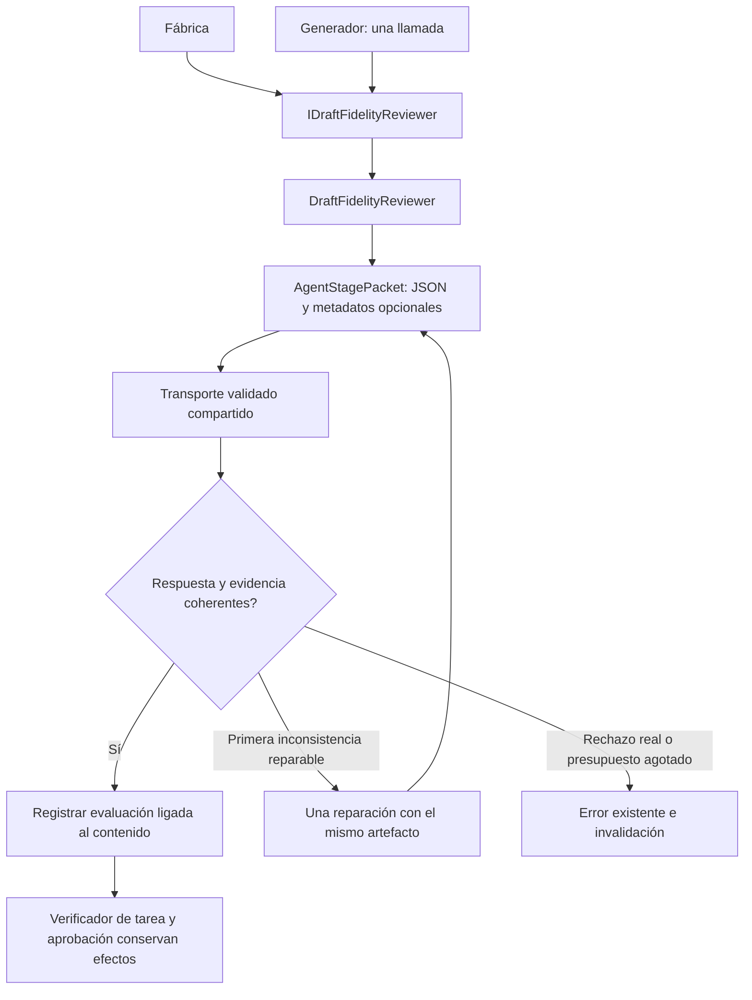

# Revisión de fidelidad con propietario sustituible

## Auditoría y decisión

DraftFidelity.cs es una parte de PreparationInference: 150 líneas de revisión,
reparación acotada, errores y vinculación de contenido dentro del mismo tipo que
interpreta y genera. Sólo necesita transporte validado, política, opciones y
diagnóstico por llamada. El generador tiene un único punto de invocación.

Mantenerlo incrustado impide sustituir la revisión sin tocar la interpretación;
un proxy que vuelva a invocar el monolito conserva ese acoplamiento. Se elige mover
la implementación completa a DraftFidelityReviewer bajo IDraftFidelityReviewer.
Es el revisor existente, con el mismo punto de llamada y presupuesto. No se agrega
otro árbitro, regla por frase ni otra generación o llamada de modelo.

## Contratos y responsabilidades

- IDraftFidelityReviewer vive en Application: recibe encargo, propuesta, candidatos,
  cancelación, título ligado opcional y diagnóstico por llamada. Devuelve Task;
  errores existentes expresan rechazo o revisión no comprobada.
- DraftFidelityReviewer posee exclusivamente esa revisión semántica y sus controles.
  Recibe IValidatedAgentModelTransport prestado para consulta e invalidación.
  Conserva política, thinking, límites, schema, reglas, errores y reparación.
- El generador conserva autoría, canonicalización, captura de propuestas rechazadas
  y su única invocación al revisor. TaskGoal conserva su estado de evaluación ligada
  al contenido; el revisor no aprueba persistencia ni ejecuta efectos.
- AgentStagePacket comparte serialización y metadatos reflejados entre intérprete
  y revisor. Tipos propietarios son fijos de código confiable, no entradas del modelo.
  Sin metadatos opcionales, el paquete es idéntico al anterior. Con ellos cambia el
  consumer/hash de la revisión al nuevo propietario, conservando responsabilidad
  y representaciones; esa identidad nueva no acredita mejora semántica.
- Diagnóstico se entrega por llamada; no se almacena estado mutable de sesión en
  el singleton. El servicio no dispone el transporte prestado.
- DraftFidelity.cs se retira con archivo exacto conservado. Se mantiene el método
  privado compatible que usan pruebas anteriores como una delegación, sin revisión
  paralela. Constructor de PreparationInference agrega último parámetro opcional;
  llamadas fuente se conservan y consumidores binarios deben recompilar.
- No cambian HTTP, SQLite, frontend, paquetes, modelos, permisos ni aprobación.
  Los fallos conocidos de fidelidad/false positives siguen abiertos: modularizar
  esta revisión no demuestra corregir el significado propuesto por Qwen.



```text
componer un revisor con transporte, política y opciones actuales
generar y canonicalizar propuesta como antes
invocar el puerto una vez con diagnóstico de la llamada
construir la misma revisión y consultar el mismo transporte
validar contrato/evidencia; conservar reparación acotada existente
si no se puede comprobar: invalidar respuesta y propagar error
si se acepta: registrar evaluación para ese contenido, sin efectos persistentes
```

## Aceptación prevista

Comparar cuerpos/instrucciones y codificador de paquetes contra originales.
Resolver/usar la fábrica con intérprete/editor prohibidos. Mantener pruebas HTTP
de reparación/autoridad y diagnóstico. Verificar metadatos desde su nuevo propietario
sin relajar reglas. Congelar fuentes, compilar y validar consumidores afectados;
no correr otras matrices ni afirmar comprensión por respuestas controladas.

## Resultado ejecutado

IMPLEMENTADO Y VALIDADO para propiedad, protocolo y composición. El cuerpo de
revisión conserva sus reglas/instrucciones; sólo cambian visibilidad y acceso al
diagnóstico por llamada. El codificador compartido conserva el algoritmo anterior
tras parametrizar propietario y normalizar saltos de línea del código fuente,
sin cambiar escapes de newline dentro de las cadenas.

Pasan 666 pruebas compiladas de 54 clases afectadas, cero fallidas/omitidas. Incluyen
cuatro nuevas de fábrica con intérprete/editor prohibidos, ambos perfiles de
metadatos, cancelación/disponibilidad, delegación y propiedad del revisor prestado.
Las pruebas HTTP de reparación y autoridad siguen vigentes. Son respuestas
controladas, no aceptación de Qwen ni solución de sus fallos de fidelidad.
API/Blazor compilan sin errores/advertencias y comparten DLL idénticas a las probadas;
Evaluation compila con tests. Veinte controles estáticos pasan; el control histórico
de dependencias nativas no es build/aceptación MAUI. OpenAPI publicado idéntico.

Las selecciones previas de 93 y 26 pasan con sus fuentes de ese momento; no se
suman a la final. Una primera comparación de fuente falló por CRLF/LF del helper,
antes de congelar. El comando posterior continuó sin filtro y MSBuild lo rechazó
sin ejecutar pruebas. Su log queda conservado; la comprobación final normaliza
sólo finales de línea y corta la ejecución si falta verificación/filtro.

[Fuentes y selección](../evidence/fidelity-review-module-20261020/test-selection.json),
[comparación](../evidence/fidelity-review-module-20261020/extraction.json),
[resultado](../evidence/fidelity-review-module-20261020/verification.json).

No se modifica frontend ni se repite campaña de modelo real por extraer este
propietario. El perfil con metadatos tiene identidad/version de revisor nuevas;
su prueba valida el paquete, no fidelidad lingüística. Autoría y sustitución
semántica principales siguen abiertas y el estado canónico no cambia. Alcance
vigente sólo web; MAUI fuera de esta meta, sin instalaciones pendientes.

Reversión: restaurar archivos de before.json, incluido el parcial retirado, y
retirar conjuntamente puerto, revisor, codificador y prueba nuevos. Conservar
evidencias; no requiere migración de datos o configuración.
