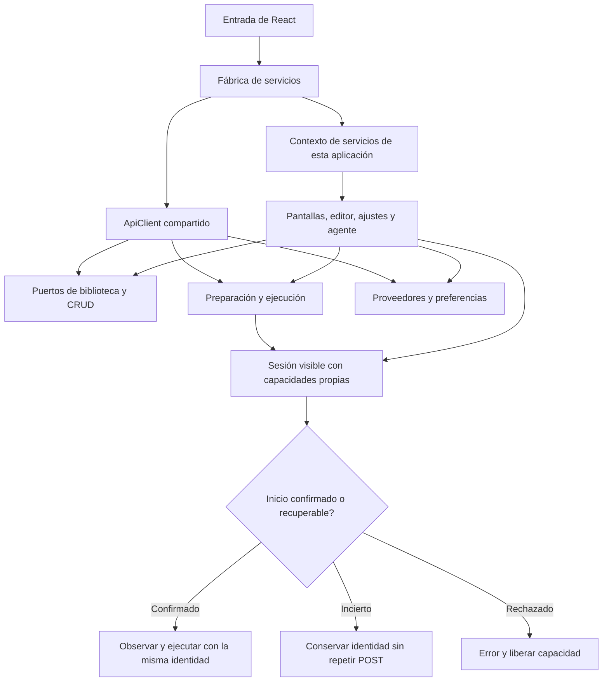

# Composición de servicios del frontend

## Auditoría y cambio

Los clientes puros tienen factories sustituibles, pero App, hooks y pantallas
consumen sus instancias globales. Sustituir el transporte en una prueba de cliente
no conecta automáticamente el editor, los diálogos o el agente. startVisible y
observeOperation también usan el live global, y las capacidades de superficie
están en un mapa de módulo. Falta la composición de aplicación y su conexión UI.

Se comparó pasar cada puerto por veinte cadenas de props, añadir un store global
de dominio y usar un contexto React sólo de servicios. Se elige la tercera opción:
ApplicationServices tipado, factory sobre ApiClient y provider UI. No introduce
estado de negocio, caché de dominio, autorización ni framework nuevo.

La entrada crea una composición estable una vez por montaje. Cada cliente recibe
el mismo ApiClient; las pantallas sólo consumen los puertos necesarios. Los usos
independientes anteriores sin provider mantienen un adaptador compatible a las
instancias existentes. Las pruebas pueden montar otra composición sin red global.
Se cualifica sustitución al montar; no hot-swap arbitrario durante tareas activas.

VisibleSessionClient posee únicamente el registro privado de capacidades y la
coordinación existente de inicio/observación. Recibe LiveClient prestado. Conserva
POST único, recuperación de recibo, error confirmado, identidad incierta y avisos
de navegador. No concede permisos ni persiste capacidades; release mantiene su
semántica. Los exports anteriores delegan a una instancia compatible de esa fábrica.

Invariantes: HTTP, schemas, cabeceras, autorización, revisión/aprobación, estados,
DOM, contenido y diseño existentes intactos. No cambiar backend o datos privados.
Cada composición usa su propio registro de capacidades; código del modelo nunca
elige servicios, selectores o propietarios. Contexto de UI no es autoridad.



```text
al montar: crear una composición con transporte y puertos existentes
conectar provider estable a App y sus descendientes
cada pantalla obtiene sus puertos y conserva su estado/algoritmo actual
iniciar visible: asignar identidad y capacidad en el registro de esta composición
consultar un recibo ante respuesta incierta, sin repetir POST
conservar o liberar capacidad según las mismas condiciones anteriores
al terminar acción/sesión: usar sus controles y liberación actuales
```

Verificación prevista: comparar algoritmo de inicio y cambio mecánico de bindings;
probar dos composiciones independientes, transporte recibido por UI y capacidades
sin cruce; ejecutar frontend completo porque cambia la composición transversal,
typecheck/build, recorridos reales de UI con API y DB sintéticos y hashes congelados.
No atribuir a estas pruebas comprensión Qwen o latencia del modelo.

Reversión: restaurar before.json y retirar factory/context/pruebas nuevos juntos;
conservar evidencia. Sin migración, dependencias ni nuevos permisos. Alcance web;
MAUI excluido. Servicios personales no se reinician.

## Resultado observado

La entrada monta ApplicationServiceProvider con createApplicationServices una vez.
Dieciocho consumidores usan puertos del contexto, incluidas pantallas diferidas,
formulario interno ActionForm y hook de biblioteca. Los cuerpos ejecutables se
compararon por AST contra los originales: iguales tras sustituir bindings y el
fallback opcional de useLibrary. startVisible/observeOperation conservan sus cuerpos
al parametrizar LiveClient; el registro de capacidades es privado de la fábrica.

Pasan 171 pruebas frontend de 29 archivos, cero fallidas/omitidas, y typecheck. Siete
casos nuevos verifican los ocho puertos sobre transporte inyectado, App/editor/
ajustes sin fetch global, árboles de categorías independientes, capacidades sin
cruce aun con ID de run igual, error confirmado e identidad incierta sin otro POST.
La tanda dirigida de 19 es subconjunto y no se suma a la final.

Edge visible: quince controles de composición con host normal/inferencia ausente/
probe y siete de workspace PASS sobre la misma web congelada y bases sintéticas.
CRUD, revisiones, cancelación, error visible sin ejecución fantasma, favoritos,
tarjetas/filas, panel persistente, ajustes y móvil; cero errores de navegador.
Inspeccionadas capturas de ajustes/escritorio y panel expandido/móvil.

El build web conserva la advertencia de chunk principal >500 kB (575.61 kB,
177.68 kB gzip); no se cambia el umbral ni se presume mejora de latencia. Evaluador
compila sin advertencias/errores. Sus DLL productivas son idénticas antes/después
de corregir el perfil QA. Veinticuatro controles estáticos PASS; el guard de fuente
nativa histórico no es aceptación MAUI. OpenAPI y matriz canónica intactos.

Fallos conservados: invocación inicial npx no resolvía el compilador del proyecto;
se usó TypeScript instalado directamente. Primera tanda: 163 PASS/1 FAIL por scope
del puerto en QuickActions; se movió a su propietario ActionForm. Typecheck de un
fixture nuevo rechazó una opción de Playwright ajena a Testing Library; matcher
anclado mantiene la expectativa exacta. El primer host QA pasó diez controles y
falló al construir el planificador: conservaba la fábrica de alcance nueva sobre
extractor deliberadamente desactivado. El perfil de significado ahora deja ausente
ese puerto opcional y prohíbe el intérprete productivo; mismas expectativas, quince
controles PASS. No se modifica el runtime productivo para resolver ese perfil.

[Validación](../evidence/frontend-composition-20261020/verification.json),
[proveniencia](../evidence/frontend-composition-20261020/compiled-provenance.json),
[comparación](../evidence/frontend-composition-20261020/algorithm-preservation.json),
[incidentes](../evidence/frontend-composition-20261020/incidents.json),
[migración del perfil QA](../evidence/frontend-composition-20261020/qa-profile-migration.json).

Estado: PASS de composición frontend y controles UI indicados. La composición se
fija al montar; hot-swap durante operaciones activas no está cualificado. Avisos de
window y almacenamiento del ID de sesión conservan su dueño previo: no se afirma
aislamiento completo de múltiples aplicaciones DOM en una misma ventana.
No hubo nueva campaña Qwen, cualificación de latencia ni reinicio de servicios
personales. Semántica y auditoría/refactorización restantes siguen abiertas;
versión NO_CERRADA, 34/54. MAUI excluido por decisión vigente.
