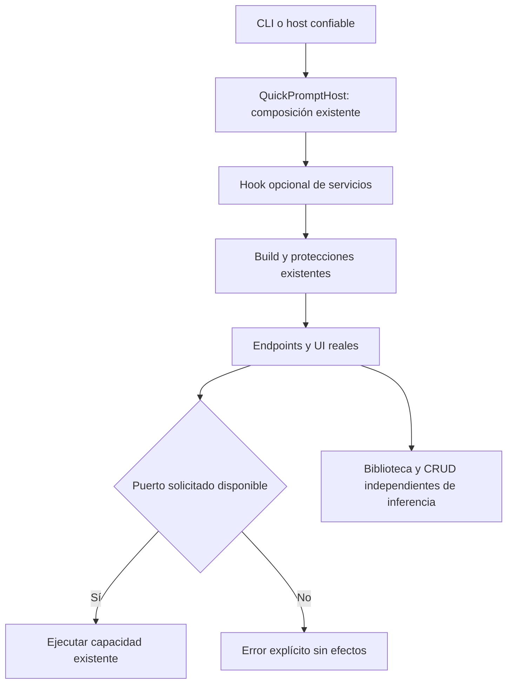
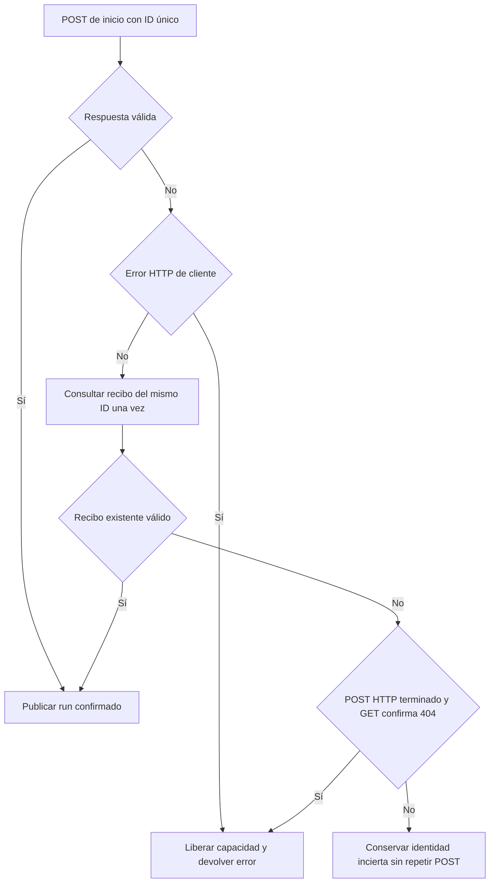

# Fábrica del host y sustitución completa de módulos

Estado: IMPLEMENTADO Y VALIDADO PARA ESTA FRONTERA; objetivo global abierto.

## Contrato de cambio

Program.cs compone módulos, seguridad, diagnóstico, endpoints y estáticos en un
arranque cerrado. La interfaz de transporte ya se puede sustituir; falta demostrar
que una composición alternativa sirve los mismos endpoints/UI sin copiar arranque
ni hacer que producción dependa del evaluador.

- **Dueño:** QuickPromptHost en Api conserva la secuencia original de arranque.
  Program sólo la invoca. No hay nuevo dueño de reglas, datos, permisos o workflow.
- **Extensión:** Action<IServiceCollection> opcional, invocado después de registrar
  módulos y antes de Build. Es código confiable del host; nunca una configuración
  aceptada desde HTTP, texto del usuario, modelo, ruta CLR o archivo de biblioteca.
- **Compatibilidad:** Program y CLI normales conservan configuración y comportamiento.
  Se añade una fábrica pública para otros hosts .NET; no cambia API HTTP, DB/modelos
  ni políticas. Diagnóstico y Run conservan el mismo alcance de recursos.
- **Invariantes:** mismos loopback/host/origen/cabeceras/limites/rate-limit/errores,
  endpoint/servicio/config y archivos estáticos. El hook no modifica configuración
  de red; sólo composición por interfaces. Sin promoción del candidato rechazado.
- **Dependencias:** Evaluation puede referenciar Api para ejecutar una composición
  QA; Api/Infrastructure/Application nunca referencian Evaluation. No nuevos paquetes.
- **Ausencia:** prueba QA reemplaza los puertos del agente por fallos explícitos;
  los constructores semánticos/modelo antiguos son trampas que deben permanecer sin
  invocar. Biblioteca/CRUD conservan sus propietarios y funcionan sin inferencia.
- **Sustitución:** segundo modo QA ofrece un intérprete sintético de aclaración,
  por los contratos existentes; sin decidir por frases ni fingir fidelidad LLM.
  Sólo se permite arrancar estos modos con una base nueva bajo .playwright propia.
- **Alternativas:** copiar Program al evaluador duplica seguridad; referenciar
  Evaluation desde Api incorpora código rechazado al producto; otro perfil del
  núcleo no demuestra sustituibilidad. Se elige extraer la raíz existente.
- **Verificación:** comparar la secuencia extraída con el original, compilar y
  comprobar HTTP/UI reales con agente ausente y sustituto, incluyendo origen ajeno,
  cabecera requerida, integridad, CRUD y error explícito sin escrituras del agente.
  Las matrices de comprensión del modelo permanecen separadas.



```text
crear builder y validar configuración como antes
componer biblioteca, agente y ejecución visible con sus fábricas existentes
aplicar callback opcional de composición confiable
construir host y registrar exactamente middleware/endpoints/estáticos originales
ejecutar y liberar diagnóstico con el mismo alcance anterior
en QA:
    exigir base sintética nueva y ruta propia
    declarar puertos ausentes, sin construir implementaciones antiguas
    opcionalmente registrar un intérprete sintético de aclaración
    arrancar la misma fábrica y probar endpoints/UI reales
    comprobar que fallar el agente no borra o altera biblioteca/CRUD
```

## Fallo real de inicio observado en la prueba de sustitución

La primera ejecución UI recibió 503 al iniciar y 404 al consultar el ID. startVisible
trataba cualquier fallo de consulta como incertidumbre: publicaba el ID inexistente,
lo retenía en sesión y activaba SSE/polling de un run ausente. El formulario manual
había funcionado, pero el error original se perdía y la UI seguía consultando 404.
Se conserva esa ejecución en `docs/evidence/module-host-ui-1792513823993/results.json`.

**Dueño y corrección:** extender startVisible, sin otro estado/coordinador en los
componentes. Si el POST terminó con error HTTP y la consulta autorizada confirma
404, liberar la capacidad local y propagar el error original sin publicar identidad.
Si se perdió la respuesta del POST, un 404 inmediato no prueba que haya terminado:
conservar incertidumbre, identidad y recuperación para impedir un POST duplicado.
Una consulta exitosa conserva la recuperación anterior del mismo run. Servicios
transitoriamente inaccesibles conservan incertidumbre; no se añaden reintentos.



```text
ante fallo del inicio:
    conservar rechazo definitivo de cliente como antes
    consultar una vez el recibo del ID ya enviado
    si existe: recuperar el mismo run
    si POST respondió error HTTP y recibo respondió 404:
        liberar capacidad; propagar el error original; no anunciar run
    en los otros fallos de transporte/consulta:
        conservar identidad incierta; nunca repetir el POST automáticamente
```

Se elige corregir el propietario del inicio frente a capturar 404 por separado en
cada componente o suprimir toda recuperación de conexiones. Cambia el tratamiento
del par de hechos HTTP-error/recibo-ausente; no interpreta mensajes ni modela frases.

## Resultado ejecutado

- **794/794 backend PASS**, cero omitidos, sobre API/evaluador actuales.
- **164/164 frontend PASS** con dos workers y los mismos límites/oráculos. Primera
  tanda: 162 PASS y dos timeouts de 5000 ms en pruebas anteriores sin cambios; se
  conservó. Los 20 controles de esos archivos y del inicio pasan dirigidos; después
  pasa la tanda completa con concurrencia acotada. No se aumentó el timeout.
- **15 checks HTTP/Edge PASS**: CLI productivo normal con CRUD y protecciones;
  módulo ausente con error 503, UI sin ID fantasma/polling y CRUD completo; módulo
  sintético consumido por el planificador real más CRUD UI. Cancelar borrado conserva
  detalle/datos; confirmar elimina sólo el fixture revisado. Cero pageerrors o red externa.
- API/evaluador compilan sin warnings/errores; tsc/Vite compilan conservando el aviso
  previo de chunk grande. Trece controles estáticos PASS. La secuencia del host coincide
  con el original tras dedentar y retirar sólo el hook. Tres DLL compartidas son
  idénticas entre builds y con las 168 pruebas compartidas previas; no se repitieron.

Evidencias: [verification.json](../evidence/host-composition-20261020/verification.json),
[prueba de secuencia](../evidence/host-composition-20261020/host-sequence.json) y
[HTTP/UI final](../evidence/module-host-ui-1792514289507/results.json).
El primer build falló por faltar el import del namespace de la nueva entrada QA;
se corrigió antes de ejecutar pruebas. El fallo real de UI anterior se conserva.

El evaluador ahora referencia Api y requiere también el runtime ASP.NET Core ya
instalado; no hay paquetes nuevos. Producción no referencia Evaluation. Los modos
QA no son funcionalidades/configuraciones disponibles desde la interfaz normal.
La comprobación de sustitución del intérprete se realiza por el endpoint semántico
y el planificador; el CRUD UI es real. No prueba una tarea completa de NOVA ni
comprensión LLM; no se promueve ningún candidato semántico fallido.

La fuente canónica API_CODE se migró de Program.cs a QuickPromptHost.cs para mantener
su referencia a las protecciones reales; todas las filas, criterios y estados de la
matriz se conservaron. Hay 34 cerrados y 54 abiertos. No se ejecutó una nueva campaña
Qwen/holdout/latencia ni MAUI: su autorización de SDK9/workload sigue pendiente.
