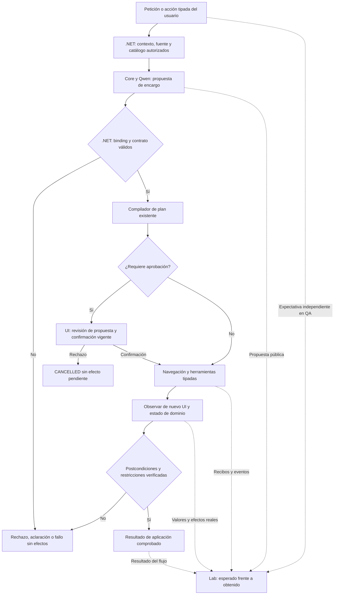

# QuickPrompt NOVA, Adaptive AI Core y AI Delivery Lab

## Informe integral de estado, propósito y continuidad

**Fecha de corte:** 22 de octubre de 2026, aproximadamente 11:52, America/La_Paz (UTC−04).  
**Destino:** una nueva conversación de trabajo con contexto suficiente para auditar y continuar el proyecto.  
**Estado del producto:** **NO CERRADO / FALLA** en fiabilidad semántica y aceptación integral.  
**Instrucción vigente al preparar este documento:** detener cambios de código y pruebas; entregar este informe. Se realizaron lecturas e inventario para redactarlo.  
**Alcance confirmado por el usuario:** versión local completa con **Qwen3:8b**; los demás proveedores deben quedar preparados. No se exige para esta versión envío automático autenticado ni lectura de respuestas externas.

Este documento distingue comportamiento deseado, implementación existente, evidencia ejecutada y trabajo pendiente. Un resultado histórico no certifica el código o servicio actual. Las propuestas de misiones de este informe todavía deben registrarse y ejecutarse en el Lab; no se presentan como una batería ya aprobada.

---

## 1. Qué estamos construyendo

QuickPrompt es una aplicación para crear, organizar y utilizar instrucciones reutilizables o prompts. NOVA es su agente: debe comprender una petición del usuario, elegir capacidades autorizadas, operar la interfaz visible, verificar sus efectos y comunicar el resultado real.

La experiencia prevista combina dos caminos que deben conservarse:

1. **Uso manual:** biblioteca, búsqueda, editor, variables, versiones, copia, ejecución local y preparación de proveedores.
2. **Uso mediante NOVA:** el usuario expresa una tarea o elige una acción tipada; el agente navega y opera los controles correspondientes con sus permisos y confirmaciones.

Adaptive AI Core proporciona inferencia genérica con el modelo local. QuickPrompt conserva las reglas de su negocio. AI Delivery Lab es el mecanismo de diagnóstico y evaluación independiente: debe hacer visible qué se pidió, qué se propuso, qué se ejecutó, qué se esperaba y dónde se produjo la primera diferencia.

La meta no consiste en que el modelo devuelva JSON o en que el sistema complete su propio plan. La meta es que **el resultado pedido por el usuario quede satisfecho, sin efectos adicionales, sobre la fuente y los valores correctos**.

### 1.1 Resultado funcional de la versión inicial

El usuario debe poder:

- Crear un prompt reutilizable como borrador, revisarlo y guardarlo cuando corresponda.
- Consultar y buscar prompts por nombre o contexto, sin seleccionar una coincidencia ambigua arbitrariamente.
- Abrir el registro correcto y navegar a la vista o editor necesarios.
- Adaptar el contenido de una instrucción existente conservando lo que no se pidió cambiar.
- Actualizar el mismo registro mediante una nueva versión, con revisión y aprobación.
- Guardar una copia con identidad nueva y conservar el original.
- Eliminar exclusivamente el registro autorizado, después de una confirmación vigente.
- Cancelar o rechazar sin guardar, borrar, copiar ni ejecutar efectos pendientes.
- Completar variables con los valores que proporcionó el usuario, en los campos del origen correcto.
- Preparar un texto para copiar sin escribir todavía el portapapeles.
- Copiar realmente cuando exista una solicitud o acción explícita que lo autorice.
- Ejecutar el prompt completado con Qwen local y mostrar una respuesta terminada.
- Preparar un destino externo correcto, mostrar el texto y permitir copiar/abrir el sitio ofrecido.
- Mantener continuidad entre turnos, distinguir borrador y fuente guardada y pedir aclaración ante información esencial ausente.

Las peticiones libres necesitan una matriz representativa con paráfrasis, tareas compuestas, negaciones, referencias, cambios de contexto y entradas adversariales. Una colección finita aprobada acredita ese alcance; no demuestra comprensión universal de cualquier petición posible.

### 1.2 Qué significa «adaptar y dejar listo para copiar»

Son resultados separados:

1. Adaptar la definición reutilizable de la instrucción.
2. Preparar la representación solicitada para copiar.

No autoriza por sí mismo guardar, sobrescribir, ejecutar el prompt ni escribir el portapapeles.

El usuario eligió **ofrecer ambas opciones claramente en la UI**:

| Representación | Resultado esperado | Datos necesarios |
|---|---|---|
| Plantilla, `TEMPLATE` | Instrucción adaptada con sus marcadores literales, por ejemplo `<puntos>` | No exige inventar los valores de una futura ejecución |
| Texto rellenado, `RENDERED` | Instrucción compilada con los valores concretos de este caso | Exige los valores requeridos por esa plantilla |

Si faltan datos para la representación rellenada, se solicitan; no se inventan ni se ejecuta la instrucción para obtenerlos. Se debe conservar la opción de preparar la plantilla cuando sea el resultado elegido.

El usuario también pidió conservar ambas capacidades de salida: portapapeles nativo de Windows conforme a su formato y archivo UTF-8 con LF exactos. No se debe modificar un oráculo histórico de igualdad para ocultar la diferencia LF/CRLF.

## 2. Alcance y límites que siguen vigentes

### 2.1 Decisiones explícitas del usuario

- Mantener únicamente **Qwen3:8b** como modelo generativo de esta solución.
- No descargar ni evaluar Qwen3.5 como sustitución. La propuesta de comparación fue rechazada.
- Conservar un diagnóstico ajeno si mantiene el bloqueo de evaluación. No detener procesos de otros trabajos.
- No tocar la instancia **5196** ni su base privada.
- Usar Core como componente genérico y .NET como propietario del negocio.
- Evitar seguir acumulando lógica nueva sobre caminos defectuosos o duplicar planificadores.
- Conservar la matriz y los umbrales originales de aceptación.
- Utilizar el Lab para objetivos, misiones, evidencia y certificación real.
- Tras pedir detener experimentos exploratorios, autorizó sólo verificación final de una corrección. Posteriormente pidió una auditoría funcional por misiones y repruebas de las correcciones. **La última instrucción detiene ahora código y pruebas para preparar este traspaso.**

### 2.2 Restricciones técnicas de la reparación

- Conservar `adaptive-inference/1` y la compatibilidad pública.
- No restaurar `intent-v2` ni el intérprete legacy como fallback.
- No añadir routing semántico por frases, palabras clave o expresiones para aprobar casos concretos.
- No introducir un segundo planificador, un juez LLM adicional ni recuperación ilimitada.
- No aumentar presupuestos de inferencia ni cambiar de modelo o proveedor silenciosamente.
- No relajar permisos, confirmaciones, revisión, límites o idempotencia para aprobar pruebas.
- No mezclar resultados de distintos candidatos, modelos, configuraciones o commits como si fueran una campaña final única.
- No enviar contenido privado a servicios externos ni incluirlo en evidencia pública.

La autorización previa para refactorizar y retirar lógica no funcional no convierte esta solicitud documental en permiso para seguir modificando código. En la nueva conversación habrá que seguir la instrucción de trabajo que el usuario dé allí.

## 3. Rutas y espacios de trabajo

### 3.1 Proyectos principales

| Elemento | Ruta absoluta | Situación |
|---|---|---|
| Directorio compartido | `C:/Projects/Repos` | Directorio de trabajo de esta conversación |
| QuickPrompt | `C:/Projects/Repos/QuickPrompt-Web` | Repositorio principal, con abundantes cambios locales previos |
| Adaptive AI Core | `C:/Projects/Repos/Adaptive-AI-Core` | Repositorio inicializado sin un HEAD resoluble en la inspección; no asumir historial consolidado |
| AI Delivery Lab | `C:/Projects/Repos/AI-Delivery-Lab` | Proyecto local; no se ha tratado como checkout Git |
| Instrucciones del proyecto | `C:/Projects/Repos/QuickPrompt-Web/AGENTS.md` | Leer antes de modificar producto |
| Arquitectura modular local | `C:/Projects/Repos/QuickPrompt-Web/.agents/skills/universal-modular-architecture/SKILL.md` | Guía específica del proyecto |

HEAD de QuickPrompt observado: `f7e928fc474ed2ef5b467993ec5d3e13b008c526`.

Ese commit **no identifica por sí solo el candidato probado**, porque el árbol tiene cientos de modificaciones, movimientos, eliminaciones y archivos nuevos. No ejecutar `git reset`, `git clean`, restauraciones masivas o cambios de rama sobre ese trabajo. No se solicitaron commits, PRs, merges ni publicación.

### 3.2 Estructura útil de QuickPrompt

```text
C:/Projects/Repos/QuickPrompt-Web/
├─ apps/
│  ├─ web/                         React actual
│  └─ mobile/                      Código móvil reorganizado; no certificado en esta versión local web
├─ backend/
│  ├─ QuickPrompt.Api/             Host ASP.NET Core y endpoints
│  ├─ QuickPrompt.Application/     Casos de uso, agente, contratos y ejecución
│  ├─ QuickPrompt.Infrastructure/  Inferencia, puente Core y almacenamiento
│  ├─ QuickPrompt.Evaluation/      Evaluadores y fixtures sintéticas
│  └─ QuickPrompt.Tests/           Regresión backend
├─ src/
│  ├─ QuickPrompt.Domain/          Dominio compartido
│  ├─ QuickPrompt.Tests/           Pruebas compartidas/históricas
│  └─ QuickPrompt.Web/             Superficie Blazor conservada
├─ agents/nova-core/              Worker stdio que integra el SDK genérico
├─ contracts/openapi/             Contrato público de NOVA
├─ Tests/nova/                    Evaluación, navegador, certificación y adaptadores Lab
├─ docs/nova/                     Arquitectura, diagnóstico y matriz
├─ docs/evidence/                 Recibos y expedientes locales
└─ .playwright/                   Binarios, frontend y fuentes congeladas de QA
```

La coexistencia de móvil, Blazor, React y pruebas históricas no significa que todos sean motores activos de NOVA. Se debe comprobar la composición efectiva del host. Conservar compatibilidad no autoriza usar un intérprete retirado como fallback.

### 3.3 Rutas del Lab y de evidencia

- Lab: `http://127.0.0.1:8803/`.
- Observador del trabajo de Codex: `http://127.0.0.1:8765/`.
- Configuración local del Lab: `C:/Projects/Repos/AI-Delivery-Lab/artifacts/closure-20261021/config-certification-20261022.json`.
- Diario configurado: `C:/Projects/Repos/AI-Delivery-Lab/artifacts/visual/events.jsonl`.
- Referencia del candidato del Lab: `C:/Projects/Repos/AI-Delivery-Lab/artifacts/closure-20261021/candidate-reference.json`.
- Objetivos persistidos: `C:/Projects/Repos/AI-Delivery-Lab/artifacts/closure-20261021/goals/`.
- Trabajos y logs: `C:/Projects/Repos/AI-Delivery-Lab/artifacts/closure-20261021/runs/`.
- Evidencia de cierre: `C:/Projects/Repos/QuickPrompt-Web/docs/evidence/closure-lab-20261021/`.
- Candidatos congelados: `C:/Projects/Repos/QuickPrompt-Web/.playwright/closure-lab-20261021/`.
- Matriz original: `C:/Projects/Repos/QuickPrompt-Web/docs/nova/VERSION_CLOSURE_MATRIX.json`.
- Splits originales: `C:/Projects/Repos/QuickPrompt-Web/Tests/nova/datasets/recovery-v1/`.

## 4. Tecnologías y recursos existentes

Versiones declaradas en los archivos locales inspeccionados; no son recomendaciones de actualización:

| Capa | Tecnología |
|---|---|
| Frontend | React y React DOM `19.3.1`, TypeScript `5.9.3`, Vite `8.3.4` |
| UI | Radix Dialog `1.3.1`, Lucide React `1.58.0`, Motion `14.3.0`, Tailwind `4.3.0`, Zod `4.6.7` |
| Tests frontend | Vitest `5.0.5`, Testing Library, jsdom `27.4.0` |
| Backend | C#, ASP.NET Core, proyectos `net8.0` |
| Datos | SQLite; `Microsoft.Data.Sqlite.Core 8.0.29`, SQLitePCLRaw |
| Serialización | System.Text.Json; referencia declarada `10.0.13` en Infrastructure |
| Abstracciones IA .NET | `Microsoft.Extensions.AI.Abstractions 10.11.0` |
| Core | Python ≥3.11; paquete local `adaptive-ai-core 0.1.1` |
| Framework de inferencia | `pydantic-ai-slim[openai] 2.59.0`, Pydantic y `jsonschema 4.26.0` |
| Lab | Python ≥3.11, paquete local `ai-delivery-lab 0.2.2`, servidor HTTP loopback y UI HTML/JS/CSS |
| Inferencia local | Ollama, Qwen3:8b; versión de Ollama observada anteriormente `0.40.6` |
| Navegador de QA | Playwright con Microsoft Edge; controles reales, API y SQLite sintética |
| Observabilidad | Recibos/eventos del agente y Core, diario Lab, exportaciones JSON, gráficos y observador Visual Agent Live |

### 4.1 Ejecutables conocidos

```text
Core Python:
C:/Projects/Repos/Adaptive-AI-Core/.venv/Scripts/python.exe

Python auxiliar instalado:
C:/Users/estju/.cache/codex-runtimes/codex-primary-runtime/dependencies/python/python.exe

Node:
C:/Users/estju/AppData/Roaming/fnm/node-versions/v22.19.0/installation/node.exe

PowerShell:
C:/Users/estju/.cache/codex-runtimes/codex-primary-runtime/dependencies/native/powershell/pwsh.exe

Playwright instalado:
C:/Users/estju/.cache/codex-runtimes/codex-primary-runtime/dependencies/node/node_modules/playwright
```

No descargar runtimes ni dependencias para seguir este documento. Revalidar la existencia de estas rutas al retomar.

### 4.2 Modelo e identidad

- Modelo autorizado: `qwen3:8b`.
- Digest observado: `500a1f067a9f782620b40bee6f7b0c89e17ae61f686b92c24933e4ca4b2b8b41`.
- Ollama: `http://127.0.0.1:11434/`.
- Existe un modelo de embeddings instalado; su presencia no demuestra que QuickPrompt lo utilice ni autoriza incorporar RAG.
- Se observaron anteriormente unos 15,6 GiB de RAM y una RTX 4070 Laptop de aproximadamente 8 GiB de VRAM. Son observaciones del entorno, no una garantía de rendimiento.
- El bloqueo compartido de evaluación es `%TEMP%/QuickPrompt.Nova.SemanticModel.lease`. Respetar su propietario; no borrar el bloqueo ni terminar un diagnóstico ajeno para ganar acceso.

## 5. Arquitectura y responsabilidades

### 5.1 Regla principal

**El modelo propone; .NET valida, autoriza, ejecuta y verifica. Core no debe conocer las reglas particulares de QuickPrompt ni acceder a su base.**

| Propietario | Debe hacer | No debe asumir |
|---|---|---|
| React | Mostrar biblioteca/editor/agente, exponer controles tipados, recoger entradas y confirmaciones, observar cambios visibles | Que un clic o un modal cerrado prueban persistencia |
| Dominio/Application .NET | Biblioteca, identidades, revisiones, variables, permisos, planes, aprobaciones, idempotencia y postcondiciones | Que el JSON del modelo equivale a autorización o a cumplimiento humano |
| Infrastructure .NET | Montar contexto y schema de la aplicación; invocar Core; vincular resultados; adaptar almacenamiento | Inventar objetivos omitidos para hacer funcionar un plan |
| Adaptive Core Python | Inferencia genérica, validación estructural y límites mediante Pydantic AI | Reglas, frases, IDs o herramientas particulares de QuickPrompt |
| Ollama/Qwen | Generar una propuesta con los datos y contrato ofrecidos | Garantizar por sí mismo corrección semántica, verdad de estado o efectos |
| AI Delivery Lab | Comparar expectativas independientes con observaciones, correlacionar evidencia, ejecutar misiones configuradas y conservar fallos | Derivar la expectativa de la propuesta que está evaluando o conceder autoridad al producto |
| Visual Agent Live | Observar las acciones públicas del asistente de ingeniería y publicar su informe | Ser el Lab del producto, un ejecutor de NOVA o una prueba de todas sus ramas internas |

### 5.2 Flujo esperado de la aplicación



Este diagrama describe el recorrido y sus propietarios. No demuestra que todos los nodos se hayan ejecutado o que el runtime comprenda perfectamente la petición.

### 5.3 Entradas, representaciones y contexto

Se deben distinguir al menos:

1. Petición actual del usuario: resultados y límites de la sesión.
2. Directiva de autoría: qué cambiar de una instrucción reutilizable.
3. Plantilla reutilizable: imperativos destinados a una futura ejecución.
4. Valores de caso: datos literales que rellenan variables.
5. Texto compilado: resultado determinista de aplicar valores a la plantilla.
6. Respuesta del modelo: resultado de ejecutar una instrucción, cuando se solicitó.

Una frase imperativa dentro del título, una variable, una plantilla o una respuesta no puede autorizar una acción actual de NOVA. La memoria conversacional no sustituye la revisión real del registro. Un borrador no guardado y un registro persistido necesitan identidades y estados distintos.

### 5.4 Archivos propietarios que conviene leer

Todas las rutas siguientes son relativas a `C:/Projects/Repos/QuickPrompt-Web/`:

| Archivo | Responsabilidad |
|---|---|
| `backend/QuickPrompt.Infrastructure/AdaptiveCoreInterpreter.cs` | Montaje del encargo, contexto, catálogo, invocación y compilación de la interpretación |
| `backend/QuickPrompt.Infrastructure/QuickPromptCoreContract.cs` | Schema de la aplicación y binding de operaciones/fuentes/evidencia literal |
| `backend/QuickPrompt.Infrastructure/AdaptiveCoreModelTransport.cs` | Traducción al protocolo genérico y validación de identidad, estado y uso del worker |
| `agents/nova-core/nova_worker.py` | Puente stdio con el SDK Core configurado |
| `backend/QuickPrompt.Application/TaskPlanning.cs` | Orquestación existente de interpretación y resolución |
| `backend/QuickPrompt.Application/TaskSourceResolver.cs` | Resolución de referencia y fuente real |
| `backend/QuickPrompt.Application/TaskConversationContext.cs` | Contexto de conversación y continuidad |
| `backend/QuickPrompt.Application/TaskIntentContract.cs` | Contrato aceptado de intención y compatibilidad del plan |
| `backend/QuickPrompt.Application/TaskGoal.cs` | Objetivos, efectos, fuentes y condiciones de finalización |
| `backend/QuickPrompt.Application/SemanticPlanCompiler.cs` | Composición de operaciones y dependencias de dominio |
| `backend/QuickPrompt.Application/SemanticIntent.cs` | Operaciones, metadatos y validaciones semánticas/deterministas |
| `backend/QuickPrompt.Application/AgentOrchestrator.Visible.cs` | Ejecución visible y control de resultados |
| `backend/QuickPrompt.Application/SameTabUiDispatcher.cs` | Despacho de controles de la misma pestaña |
| `backend/QuickPrompt.Application/UiToolCatalog.cs` | Catálogo de herramientas de UI |
| `backend/QuickPrompt.Application/Providers.cs` | Registro de destinos y preparación de transferencias |
| `apps/web/src/features/nova/AgentUiDriver.ts` | Driver de controles visibles |
| `apps/web/src/features/nova/NovaLive.tsx` | Estado del agente y revisión/aprobación de guardados |
| `apps/web/src/features/nova/QuickActions.tsx` | Acciones explícitas, incluida elección de representación para copia |
| `apps/web/src/features/nova/PreparedUse.tsx` | Uso del prompt preparado y respuesta local |
| `apps/web/src/app/App.tsx` | Composición de vistas y confirmación de eliminación |

La ruta genérica de inferencia está en `C:/Projects/Repos/Adaptive-AI-Core/adaptive_core/inference.py`. No confundirla con las copias congeladas bajo `.playwright/.../sdk/adaptive_core/`.

### 5.5 Hallazgos de arquitectura que evitan diagnósticos equivocados

- La ruta Core actual ya utiliza Pydantic AI. Añadir otro framework no acredita una mejora semántica.
- `AdaptiveCoreInterpreter` implementa los intérpretes de intención, pero **no** `ISourceReferenceResolver`. No atribuirle una segunda inferencia de resolución que no se ejecuta en esa composición.
- `TaskSourceResolver` sólo utiliza ese puerto opcional si existe un propietario que lo implementa. No restaurar el intérprete anterior para llenar ese hueco sin una causa demostrada.
- El contexto actual de workflow proyecta roles/metadatos de fuentes; sus cuerpos son leídos por propietarios de contenido después del binding. La ausencia del cuerpo en la primera etapa no demuestra por sí sola un defecto.
- `TaskIntentContract` y `TaskGoal` se construyen a partir de la interpretación aceptada. Validar que el plan cumpla ese contrato **no prueba que la interpretación conserve todos los resultados humanos**.

## 6. Protocolo Core/.NET

### 6.1 Contrato genérico conservado

`adaptive-inference/1` transporta identidad, modelo, modo, mensajes, schema y límites. No incluye acceso al host o a la base de QuickPrompt.

Ejemplo conceptual, sin datos privados:

```json
{
  "version": "adaptive-inference/1",
  "requestId": "00000000000000000000000000000001",
  "model": "qwen3:8b",
  "mode": "structured",
  "messages": [
    {"role": "system", "content": "Responsabilidad de esta etapa"},
    {"role": "user", "content": "Petición y contexto autorizado"}
  ],
  "outputSchema": {"type": "object"},
  "limits": {
    "requests": 2,
    "timeoutSeconds": 90,
    "contextTokens": 12288,
    "outputTokens": 6000,
    "temperature": 0,
    "thinking": true
  }
}
```

El ejemplo ilustra campos y límites observados de interpretación; no sustituye el schema real ni autoriza ejecutar esta llamada. Los presupuestos son por invocación de inferencia: una tarea completa puede tener varias etapas. Contabilizar las llamadas reales; no anunciar que toda tarea consume como máximo dos llamadas.

El resultado de Core tiene condición de **propuesta**, no de tarea de negocio completada. .NET comprueba versión, identidad, estado y presupuesto antes de aceptar el contenido. Core admite sólo referencias de schema locales y endpoint Ollama loopback en este adaptador.

### 6.2 Encargo de aplicación conservado

El código canónico se restauró a `quickprompt-work-order/4` después de rechazar el último ensayo. Sus efectos contienen una operación y `supportingPassage`; el host vincula la cita a texto literal ofrecido y la fuente a una opción autorizada.

Los alias del modelo `PREPARE_COPY_PREVIEW` y `WRITE_CLIPBOARD_NOW` se vinculan a operaciones de dominio distintas: `COPY_PROMPT` y `COPY_TO_CLIPBOARD`.

El último contrato experimental `/9`, con resultados por fragmento, **fue rechazado y retirado del código canónico**. Sólo permanece congelado en su expediente para explicar su fallo. No confundir su existencia en `.playwright` con una activación.

## 7. Estado real del sistema al traspaso

### 7.1 Servicios observados

| Servicio | Puerto | PID observado | Estado al corte |
|---|---:|---:|---|
| AI Delivery Lab | 8803 | 13196 | Escuchando |
| Visual Agent Live | 8765 | 26460 | Escuchando |
| Ollama | 11434 | 10616 | Escuchando |
| Revisión protegida | 5196 | — | No escuchaba; no fue modificada ni iniciada por esta fase |
| Otra revisión previa | 5200 | — | No escuchaba |
| Host de QA del navegador | 5243 | — | No escuchaba al corte |

Los PIDs son observaciones fechadas, no identificadores permanentes. Comprobar identidad antes de actuar. La presencia de un puerto abierto no certifica la aplicación.

El Lab sigue con la configuración local indicada y `--watch-sources`. Esa opción recarga **sólo fuentes de evidencia**. No recarga comandos, proveedores, metas, roots, suite de certificación ni módulos Python ya importados.

### 7.2 Candidato de producto que debe conservarse separado

**Nombre:** `dual-copy-title-authority-safe`.

- Runtime: `C:/Projects/Repos/QuickPrompt-Web/.playwright/closure-lab-20261021/dual-copy-title-authority-safe/`.
- Manifest: `C:/Projects/Repos/QuickPrompt-Web/docs/evidence/closure-lab-20261021/dual-copy-title-authority-safe/manifest.json`.
- SHA-256 del manifest observado: `73b2e481925b6ae40bba4205cbb1f0bae62443c3ec1593b305da6a213d12a24e`.
- Frontend: `C:/Projects/Repos/QuickPrompt-Web/.playwright/closure-lab-20261021/dual-copy-choice-final-web/`.
- SHA de frontend registrado: `2129D0F2014BF0C009649326A59CE7A5B5A4305A88B9D622E8B5BB54908E5949`.

Conserva las correcciones de elección plantilla/texto rellenado, recibos de copia vinculados a revisión/valores y protección de autoridad de título. **Es un candidato no certificado**, no una versión liberada.

La referencia configurada del Lab sigue apuntando a `input-authority-v9`. Esta diferencia es una deuda de configuración comprobada. Antes de ejecutar nuevas misiones se debe elegir y fijar expresamente el candidato de evaluación correcto, sin presentar ese cambio como certificación ni despliegue.

Además, los comandos configurados de `local-ui`, `local-copy` y `local-units` conservan como argumento de frontend `C:/Projects/Repos/QuickPrompt-Web/.playwright/closure-lab-20261021/local-copy-v11/web`. No es la ruta del frontend del candidato conservado indicada arriba. Cambiar sólo `candidate-reference.json` no corrige esta composición: revisar también frontend, template de inputs de certificación, inventario de tests y contratos de flujo/identidad.

### 7.3 Evidencia del candidato conservado

| Capa | Resultado registrado | Límite de la evidencia |
|---|---|---|
| Backend | 1124 PASS | Regresión determinista histórica de este candidato; no garantiza comprensión libre |
| React | 246 PASS | Pruebas de componentes; no sustituyen el recorrido real |
| Development original | 16/16 PASS | Interpretación y resolución de fuentes sintéticas |
| Validation original | 14/16 PASS, 2 FAIL | Continúan omisión de adaptación y preparación de Claude incorrecta |
| Holdout | BLOQUEADO / 0 ejecutados | No aprobado; no usar como PASS |
| Navegador real | 12/13 PASS | Falla preparación del proveedor; no es certificación integral de CRUD |
| Copia nativa/archivo | 3/3 PASS en el alcance dual acordado | Preserva separado el criterio histórico LF crudo |
| Gate final local | 7 PASS / 4 FAIL | Resultado global FAIL |

Rutas de los recibos bajo `docs/evidence/closure-lab-20261021/`:

```text
dual-copy-title-authority-safe-regressions/backend.trx
dual-copy-title-authority-safe-regressions/react.json
rel05-safe-development-20261022/development.json
rel05-safe-validation-20261022/validation.json
rel05-safe-holdout-20261022/holdout.json
safe-live-browser-development-20261022/browser.json
safe-native-copy-20261022/copy.json
safe-final-gate-20261022/gate.json
safe-final-gate-20261022/inputs.json
```

Las métricas de éxito de tarea completa, fidelidad de adaptación, exactitud de herramientas o efectos ejecutados que aparecen como `NOT_TESTED` en un informe semántico siguen sin medir en ese informe. No rellenarlas con el porcentaje de JSON válidos.

### 7.4 Matriz original y certificación del Lab

La matriz original contiene **88 requisitos**:

| Estado documental | Cantidad |
|---|---:|
| CERRADO | 33 |
| PARCIAL | 35 |
| FALLA | 13 |
| PENDIENTE | 4 |
| SIN_VERIFICAR | 3 |

Sus descripciones incluyen observaciones históricas. «CERRADO» en una fila no dispensa de la regresión exigida para el candidato final.

El perfil de certificación local configurado contiene **87 criterios**: excluye los tres criterios históricos `EXT-02`, `EXT-03` y `VAR-04` de ese perfil y añade dos comprobaciones explícitas de copia acordadas con el usuario. La matriz histórica no fue borrada ni reescrita para ocultarlos.

**Hallazgo decisivo de configuración:** el archivo de configuración actual sólo define **dos `criteriaBindings`**:

1. `windows-unicode-crlf` → comprobación de portapapeles Windows.
2. `utf8-lf-file` → comprobaciones de archivo guardado y borrador.

Por tanto, el mecanismo estricto del Lab no puede acreditar todos los 87 criterios desde esa configuración. La ausencia de un binding significa **evidencia no vinculada**, no necesariamente un error de implementación. No inventar vínculos ni aprobar filas por similitud de nombres.

La UI también ha mostrado 52 criterios locales abiertos a partir de su evaluación disponible. Esa cifra y los 55 estados no cerrados de la matriz de 88 elementos describen conjuntos/fechas distintos; no deben mezclarse como un único conteo de bugs.

Misiones configuradas al corte: `core-four-controls`, `core-development`, `lab-tests`, `core-validation`, `core-holdout`, `release-certification`, `local-units`, `local-ui`, `local-copy` y `local-release-decision`. La suite secuencia componentes, Lab, development, validation, holdout, navegador, copia y decisión. Las metas individuales persistidas pueden añadir misiones al iniciar el Lab; su existencia no las convierte automáticamente en etapas obligatorias ni en criterios certificados.

## 8. Fallos semánticos originales reconstruidos

### 8.1 Caso 11: adaptación omitida al preparar copia

**Caso:** `recovery-v1-validation-11`.  
**Run conservado:** `203e1861-acfa-44b9-989f-799404967498`.

Petición:

> Transforma la agenda en una instrucción centrada en decisiones, prepara el texto para copiar y conserva intacta la biblioteca.

Contexto sintético: origen seleccionado `Preparar reuniones`, revisión 1, ID `30000000-0000-0000-0000-000000000001`. Su texto es una agenda reutilizable con `<puntos>` y una restricción de no inventar responsables.

Contrato esperado independiente:

```json
{
  "required": ["PROPOSE_ADAPTATION", "COPY_PROMPT"],
  "forbidden": ["EXECUTE_LOCAL", "REQUEST_SAVE_VERSION"],
  "outcomes": ["DRAFT"]
}
```

Campos relevantes de la propuesta recibida; el recibo JSON conserva el objeto completo:

```json
{
  "effects": [{"operation": "PREPARE_COPY_PREVIEW", "supportingPassage": 0}],
  "source": "OPEN: Preparar reuniones",
  "providerId": "ollama",
  "continuesPendingTask": false
}
```

Recorrido observado:

1. La petición original conserva adaptación y copia.
2. La propuesta pública ya contiene únicamente preparación de copia.
3. El binding convierte el alias de copia en `COPY_PROMPT`.
4. El compilador produce sus dependencias legítimas; no recibe una operación de adaptación que pueda preservar.
5. El resultado de interpretación es de lectura/preparación, no `DRAFT` adaptado.
6. El oráculo independiente detecta `PROPOSE_ADAPTATION` ausente.

**Primera divergencia comprobada:** propuesta semántica antes del binding.  
**Lo que no se ha demostrado:** que una única propiedad del schema, el catálogo o la capacidad intrínseca de Qwen explique por sí sola todas las omisiones.

### 8.2 Caso 16: preparar Claude interpretado como adaptar

**Caso:** `recovery-v1-validation-16`.  
**Run conservado:** `b79fd2f1-3731-4a4c-9181-334a45fdbc3a`.

Petición:

> Déjala preparada para Claude, sin enviar nada.

Contrato esperado:

```json
{
  "required": ["PREPARE_PROVIDER"],
  "forbidden": ["PROPOSE_ADAPTATION", "EXECUTE_LOCAL"],
  "outcomes": ["READY_PROVIDER"]
}
```

Campos relevantes de la propuesta recibida; el recibo JSON conserva el objeto completo:

```json
{
  "effects": [{"operation": "PROPOSE_ADAPTATION", "supportingPassage": 0}],
  "source": "OPEN: Preparar reuniones",
  "providerId": "claude",
  "continuesPendingTask": false
}
```

El identificador del destino no representa la operación solicitada. La interpretación añade adaptación y omite `PREPARE_PROVIDER`; el compilador añade `VALIDATE_DRAFT` por una dependencia de la adaptación que recibió.

**Primera divergencia:** propuesta pública. No es un error de SQLite ni una pérdida demostrada de una operación correcta dentro del compilador.

Observación de QA: la fila original conservada no contiene una expectativa explícita de `providerId` en ese campo, aunque sí exige la operación y el outcome de preparación. La comprobación concreta de Claude aparece en el recorrido de navegador. Se preparó soporte para fijar también el proveedor esperado en nuevas metas del Lab; esa ampliación no modifica el oráculo original.

### 8.3 Fallo correlacionado en navegador

Petición real de QA:

> Prepara este prompt para Claude sin enviarlo ni cambiar su plantilla.  
> tema: energía geotérmica

Run: `38e26ee6-39c0-456d-b759-806eefd9ea32`.

La propuesta fue `OPEN_PROMPT` con metadato `claude`. El plan quedó en lectura y la aplicación terminó ese plan como `COMPLETED`; el oráculo de la petición falló porque no estaba preparado el proveedor.

Este es el defecto de finalización relevante: completar un plan incompleto no satisface la solicitud. No se corrige borrando el metadato del destino ni añadiendo automáticamente una acción por detectar un nombre de proveedor.

## 9. Qué se ha demostrado y qué sigue como hipótesis

| Afirmación | Clasificación | Evidencia/alcance |
|---|---|---|
| Los dos fallos originales ya están en la propuesta pública | Confirmada | JSON y recibos anteriores al binding |
| El compilador puede conservar adaptación y copia si las recibe correctamente | Confirmada en control sintético | Replay de propuesta correcta en los consumidores congelados |
| El ejecutor/UI cumplen cualquier petición libre porque ese control compila | No demostrada | El contrafactual no sustituye inferencia ni efecto real |
| El contrato estructural acepta omisiones semánticas | Confirmada | Propuesta copia-only válida; contrato derivado de sus propios roots |
| Más cuerpo de fuente resuelve la familia completa | Refutada para el candidato probado | Development 16/16, validation 14/16 y regresión de lectura |
| Acoplar proveedor y operación basta para reparar la semántica | Refutada para las variantes probadas | Recuperación agotada o efectos nuevos no solicitados |
| Qwen3:8b es incapaz de cumplir cualquier contrato adecuado | No demostrada | Los resultados actuales no prueban imposibilidad universal |
| El error viene exclusivamente de .NET o exclusivamente de Python | Simplificación incorrecta | La selección falla en inferencia; la aceptación/finalización y el montaje tienen propietarios .NET que deben auditarse |
| Instalar otro framework cerrará el producto | No demostrada | El framework de inferencia ya está integrado |

La causa demostrada debe expresarse como mecanismo observable: **la selección de resultados del encargo no conserva siempre el significado original, y el contrato/plan posterior puede ser internamente coherente con esa selección incompleta**. El mecanismo interno del modelo que produce cada elección no queda demostrado sólo por ver el JSON final.

## 10. Intervenciones probadas y rechazadas

No repetir estas variantes sin evidencia nueva que distinga una hipótesis diferente. Sus resultados son expedientes separados, no porcentajes acumulables de una sola versión.

| Variante | Resultado relevante | Disposición |
|---|---|---|
| Coherencia proveedor/operación | Control 3/4; variante 1/4 | Rechazada |
| Resultados agrupados por responsabilidad | 0/4 en el contraste | Rechazada; no demuestra que toda representación agrupada sea inviable |
| Feedback detallado de schema | 2/4; una reparación perdió adaptación y añadió preparación de destino | Rechazado; modificación de Core retirada |
| Proveedor dentro de la operación | 1/4 | Rechazado |
| Retirar metadatos de etapa | 3/4; añadió escritura al portapapeles en el control compuesto | Rechazado |
| Qwen sin thinking | 1/4 | Rechazado; modo del producto conservado |
| Cuerpo de origen, `source-context-full-v14` | Development 16/16; validation 14/16; contratos 111/114 | Rechazado; no promovido |
| Resultados por fragmento, `passage-contract-final-runtime` | Backend 1132/1132; validation estricta **6/16** | Rechazado y retirado del código canónico |

En `source-context-full-v14`, el caso 16 mejoró, pero el caso 11 continuó fallando y el 09 regresó al proponer creación en lugar de lectura. Tres contratos originales rechazaron la exposición de cuerpos de fuentes. No se cambiaron sus expectativas para aprobarlo.

### 10.1 Última verificación final y retirada

El contrato por fragmentos exigía un slot por instrucción literal, en la misma inferencia. No utilizaba palabras clave para elegir operaciones y mantenía el compilador existente. Su hipótesis era que exponer estructuralmente cada fragmento ayudaría a preservar resultados compuestos.

La verificación final la rechazó:

- Caso 11: propuso adaptación y copia, pero también aclaración, escritura de portapapeles y prohibiciones incompatibles. El dominio lo rechazó con `TERMINAL_GOAL_CONFLICT`.
- Caso 16: propuso preparar Claude y adaptar, agregando la adaptación prohibida.
- Resultado estricto completo: 6 PASS y 10 FAIL.

Se restauraron exactamente:

```text
backend/QuickPrompt.Infrastructure/AdaptiveCoreInterpreter.cs
backend/QuickPrompt.Infrastructure/QuickPromptCoreContract.cs
backend/QuickPrompt.Tests/CoreBoundaryProtocolTests.cs
```

Antes de restaurar se comprobó que esos archivos coincidieran con la copia de la intervención, para no sobreescribir cambios ajenos. Después se comprobó la igualdad con los respaldos previos. El runtime congelado y todos los fallos permanecen:

```text
docs/evidence/closure-lab-20261021/passage-contract-final/decision.json
docs/evidence/closure-lab-20261021/passage-contract-final/counterfactual-host.json
docs/evidence/closure-lab-20261021/passage-final-validation/validation.json
.playwright/closure-lab-20261021/passage-contract-final-runtime/
```

El control sintético completo conserva adaptación/copia; otro control con slots presentes pero adaptación ausente sigue siendo aceptado estructuralmente. Esto demuestra por qué **cobertura estructural no es cumplimiento semántico**.

No se ejecutaron development, holdout ni navegador para promover esta variante después de su rechazo. No se desplegó en 5196.

## 11. Por qué se produjo el ciclo de trabajo sin cierre

No hay evidencia de un único bug determinista que explique todos los resultados. Se combinaron varias dificultades:

1. **Una frontera semántica no acreditada:** el modelo selecciona operaciones equivocadas o incompletas antes del binding.
2. **Verificación posterior demasiado ligada a la interpretación:** coherencia de plan y contrato no detecta por sí misma un objetivo humano omitido.
3. **Intervenciones que mejoraban un caso y regresaban otros:** se interpretaron muestras pequeñas como señales prometedoras, pero la validación completa las rechazó.
4. **Confusión de capas de prueba:** unit tests, JSON válido, binding, navegación y tarea completa demuestran cosas distintas.
5. **Identidades y expedientes numerosos:** fuentes históricas, revisiones de frontend, candidatos congelados y servicios podían aparecer juntos en la UI.
6. **Certificación incompletamente conectada:** el catálogo, referencia de candidato, frontend de misiones y bindings no estaban alineados con el objetivo funcional actual.
7. **Criterios de producto más amplios que las misiones dirigidas:** pasar adaptación/copia no cierra guardado, borrado, conflictos, privacidad, reinicio, accesibilidad y operación.
8. **Estocasticidad observada:** incluso con configuración aparentemente equivalente hay respuestas diferentes; no conservar sólo el intento favorable.

La salida del ciclo exige una batería de aceptación fija y vinculada, una identidad única por campaña, causalidad antes de intervenir y una corrección acotada que conserve controles. No se debe iniciar otra serie de variantes de prompt/schema sólo por cambiar la conversación.

## 12. Cómo debe usarse AI Delivery Lab

### 12.1 Propósito y capacidades existentes

El Lab debe servir a la persona y al agente de ingeniería para localizar qué pasó, cuándo, con qué entrada, en qué etapa y respecto a qué expectativa.

Ya dispone de superficies para corridas, casos, eventos, matriz, misiones, certificación, flujos, código y evolución; exportaciones JSON, snapshots e informes/gráficos guardados. Reutilizarlas antes de añadir otro dashboard.

Archivos importantes:

| Ruta en `C:/Projects/Repos/AI-Delivery-Lab/` | Propósito |
|---|---|
| `ai_delivery_lab/dashboard.py` | API local, metas, misiones y procesos configurados |
| `ai_delivery_lab/visual_store.py` | Lectura/correlación de evidencia y comparación por caso |
| `ai_delivery_lab/certification.py` | Etapas, dependencias, binding de criterios y decisión |
| `ai_delivery_lab/flow_health.py` | Estado de flujos según señales observadas |
| `ai_delivery_lab/visual_charts.py` | Comparaciones, gráficos y snapshots |
| `ai_delivery_lab/telemetry.py` | Diario seguro de eventos |
| `ai_delivery_lab/web/` | Interfaz del Lab |
| `docs/VISUAL_LAB.md` | Uso de diagnóstico visual |
| `docs/ARCHITECTURE.md` | Límites y arquitectura del Lab |
| `docs/PROTOCOL.md` | Contratos de evidencia |
| `SKILL.md` | Método local de auditoría y evaluación |

### 12.2 Expectativas independientes

Antes de ejecutar una misión, fijar:

- Petición y fixture sintética.
- Origen esperado, identidad/revisión y contexto.
- Operaciones y resultados obligatorios.
- Efectos prohibidos y techo de efectos adicionales.
- Valores exactos de caso y representación esperada.
- Proveedor, si lo requiere el objetivo.
- Postcondiciones de UI, persistencia, copia o respuesta.
- Condiciones de aclaración, aprobación y cancelación.

El modelo recibe petición y contexto necesarios, **no** `required`, `forbidden`, respuestas del holdout ni adjudicaciones del evaluador. Verificar el código y el paquete efectivo: un archivo llamado `assisted-development.json` puede contener hoy un reporte no asistido por compatibilidad del nombre. El nombre no determina su naturaleza.

### 12.3 Trazabilidad mínima por ejecución

```text
campaignId → caseId → runId → requestId → etapa/intento
                         ↘ fuente/revisión/valores
                         ↘ propuesta → binding → plan → herramienta
                         ↘ observación → efecto → comparación independiente
```

Conservar hora real, propietario, archivo/símbolo/línea cuando exista señal, entrada segura, salida y comparación. Distinguir ubicación estática de un test, punto instrumentado del programa y línea exacta de excepción.

El Lab **no es automáticamente un debugger de todas las líneas**: no obtiene cada variable o rama interna por mostrar un archivo. Si no se instrumentó un punto, debe decir `NOT_OBSERVED` o equivalente. No inventar valores locales ni exponer frame locals, credenciales o razonamiento interno del modelo.

### 12.4 Pasos de auditoría usando el Lab

1. Confirmar workspace, config, manifest, DLLs, frontend y digest efectivos.
2. Elegir una misión con contrato previo y fixture propia.
3. Ver la petición y el contexto en la entrada del flujo.
4. Abrir cada propuesta pública, incluidas las rechazadas durante reparación.
5. Comparar requerido/recibido antes de buscar errores downstream.
6. Inspeccionar binding de fuente, proveedor, valores y evidencia literal.
7. Ver el plan y separar objetivo solicitado de dependencia técnica.
8. Comprobar herramientas y navegación con estado UI fresco.
9. Contrastar postcondiciones con API/SQLite/portapapeles/respuesta real.
10. Exportar JSON y guardar gráficos ligados a esa misma identidad.
11. Atribuir primera divergencia y causa confirmada frente a hipótesis.
12. Corregir el propietario demostrado y reejecutar la familia afectada y sus controles.

Un mapa con animación o una etiqueta `COMPLETED` no reemplazan estos pasos.

### 12.5 Asociación de fuentes y eventos

En el almacén visual, el `id` de la fuente debe coincidir con el `campaignId` de sus eventos para que aparezcan juntos. Se corrigió una discrepancia de nombre en la publicación de la última campaña; conservar este aprendizaje al registrar otra.

Los eventos externos reenviados deben mantener IDs y horas originales. No emitir eventos nuevos para aparentar que una prueba histórica está corriendo. Si el diario llega a su límite, utilizar el mecanismo existente de feed aislado y relay, sin eliminar los expedientes previos.

### 12.6 Certificación: qué debe comprobar

La certificación existente puede secuenciar misiones configuradas y congelar identidad y archivos de ejecución. Una etapa sólo pasa con reporte completo, filas únicas, cero omitidas, expectativas satisfechas y salida válida del proceso. Los criterios se vinculan por IDs exactos o grupos de ejecución con cantidades fijadas.

Cada requisito obligatorio necesita un binding explícito. Si falta, debe quedar `NOT_MAPPED`; si faltan señales, `NOT_TESTED`/`UNCONFIRMED`; si falla la etapa, `FAIL`; si falta un prerrequisito o autorización, `BLOCKED`.

No convertir automáticamente «la suite pasó» en «todos los requisitos pasan» ni vincular por texto parecido. Mantener la decisión del Lab separada de una autorización para activar servicios.

## 13. Metas y misiones que debe registrar la siguiente sección

**Estas metas son una especificación de trabajo, no una campaña ejecutada.** Deben convertirse en contratos persistidos en el Lab y enlazarse a los criterios originales correspondientes.

### 13.1 Meta general

> Certificar la versión local inicial de QuickPrompt NOVA: biblioteca y agente funcionales, navegación y valores correctos, CRUD autorizado, copia fiel, generación/adaptación útil, respuesta real de Qwen y preparación honesta de proveedores externos, sin efectos indebidos y con evidencia reproducible del mismo candidato.

### 13.2 Metas de capacidad y aceptación

| ID propuesto | Misión | Resultado y evidencia requeridos | Control negativo |
|---|---|---|---|
| M-01 | Crear borrador libre | UI muestra una instrucción reutilizable que cumple la petición; no persiste por sí sola | No ejecutar el contenido futuro ni añadir copia |
| M-02 | Guardar copia nueva | Revisión visible, aprobación, nuevo ID, revisión inicial y reapertura después de reiniciar | Antes de aprobar no cambia la biblioteca |
| M-03 | Consultar/abrir | Registro correcto y texto real; consulta no modifica valores ni usos | Fuente inexistente o ambigua no selecciona un vecino |
| M-04 | Buscar desde biblioteca | Búsqueda, apertura del resultado correcto y navegación visible | Mantener búsqueda manual independiente del input NOVA |
| M-05 | Completar variables | Valores literales en controles del origen correcto; compilado exacto | Instrucciones dentro del valor no conceden autoridad |
| M-06 | Adaptar | Cambia sólo lo pedido, conserva restricciones y fuente guardada si procede | No rellenar datos futuros ni inventar hechos |
| M-07 | Adaptar y preparar copia | Ambos objetivos; selección plantilla/rellenado; preview del resultado adaptado | Sin escritura de clipboard, guardado o ejecución implícita |
| M-08 | Copiar realmente | Clipboard, fuente/revisión/valores y recibo correctos; un uso exactamente una vez | Error, cancelación o replay no cuentan como copia nueva |
| M-09 | Actualizar versión | Aprobación ligada al mismo ID/revisión; contenido exacto; versión incrementada; historial preservado | Conflicto obsoleto no sobrescribe |
| M-10 | Rechazar actualización | Estado cancelado y registro íntegro | No reutilizar aprobación rechazada |
| M-11 | Eliminar | Revisión y confirmación explícita; desaparece sólo el registro esperado | Cancelar/Escape/cerrar preservan datos y contexto |
| M-12 | Ejecutar Qwen con valores | Compilado correcto, respuesta completa visible y sin guardado/copia indebidos | No afirmar éxito con respuesta parcial o ejecución cancelada |
| M-13 | Preparar proveedor externo | Destino pedido, texto correcto, preview y capacidad real `COPY_AND_OPEN` | No auto-submit ni contenido sensible en URL |
| M-14 | Continuar por contexto | Usa el borrador/fuente correctos después de aclaración y cambios de vista | Memoria antigua no autoriza efectos nuevos |
| M-15 | Ambigüedad/datos ausentes | Pregunta concreta y tarea suspendida; conserva resultados válidos | No adivinar fuente ni inventar valores |
| M-16 | Pausa/cancelación/recuperación | Detención observable, sin escritura tardía y reanudación consistente | No duplicar efectos al recuperar |
| M-17 | Persistencia/reinicio | Biblioteca, revisiones, privacidad y resultados autorizados se conservan | Aprobaciones viejas no resucitan |
| M-18 | Base sin modelo | CRUD manual, búsqueda, editor y datos siguen funcionando | Ollama ausente muestra error honesto en IA |

Cada meta necesita varios casos cuando haya alternativas relevantes. En particular, M-07 debe incluir los dos casos originales, campos presentes/ausentes, plantilla y texto rellenado; M-11 necesita confirmar, cancelar, negación, pregunta hipotética, fuente ausente y revisión obsoleta.

### 13.3 Tres capas que no deben mezclarse

| Capa | Qué mide | Qué no acredita sola |
|---|---|---|
| Contrato semántico | Selección de resultados, fuente, valores y destino | Generación útil, clics, persistencia o respuesta final |
| UI y herramientas | Navegación, controles, approvals, recibos y estados visibles | Que el prompt libre se comprendió siempre |
| Efecto final | Texto, SQLite, clipboard, archivo y respuesta real | Fiabilidad de cualquier otra formulación no probada |

Las acciones rápidas tipadas acreditan un camino distinto de la inferencia libre. Deben probarse ambas donde se ofrecen, conservando el camino manual sin IA.

### 13.4 Orden de preparación recomendado

1. Fijar candidato y frontend correctos; revisar las diferencias con el checkout.
2. Completar el catálogo de metas del Lab con las capacidades de CRUD que el dominio ya publica.
3. Registrar contratos inmutables y sus fixtures mediante el propietario existente de metas.
4. Asociar cada misión a la meta y a criterios concretos de la matriz.
5. Reutilizar los runners existentes; ampliar sólo una carencia real de cobertura.
6. Hacer visible el estado completo y lo no alcanzado antes de iniciar la batería.
7. Ejecutar una campaña identificada; conservar todos sus fallos.
8. Reparar por familia causal, sin cambiar las expectativas para aceptar el candidato.
9. Congelar el candidato corregido y ejecutar verificación final, regresión, navegador y gates originales.

No se completó este registro/configuración antes de la instrucción de parar código. La siguiente sección debe comprobarlo y no anunciar metas creadas basándose sólo en este documento.

## 14. Cambios preparados que quedaron pendientes al detener el código

Son modificaciones de QA/Lab del árbol de trabajo, **no una reparación semántica activa de NOVA**:

| Archivo absoluto o grupo | Cambio preparado | Verificación/activación al corte |
|---|---|---|
| `C:/Projects/Repos/AI-Delivery-Lab/ai_delivery_lab/dashboard.py` | `providerId` opcional en metas, validado contra catálogo configurado, incluido en expectativas | Prueba específica y suite Lab pasaron; módulo del servidor 8803 no fue reiniciado para cargarlo |
| `C:/Projects/Repos/AI-Delivery-Lab/ai_delivery_lab/web/index.html` | Campo de proveedor esperado y outcomes de revisión/pausa/reanudación/consejo | Archivo modificado; no se hizo nueva aceptación de navegador |
| `C:/Projects/Repos/AI-Delivery-Lab/ai_delivery_lab/web/app.js` | Enviar proveedor esperado sólo cuando se proporciona | Comprobación sintáctica; sin aceptación UI nueva |
| `C:/Projects/Repos/AI-Delivery-Lab/tests/test_visual_lab.py` | Test de proveedor independiente, inmutable y limitado al catálogo | 26 métodos de ese módulo pasaron |
| `C:/Projects/Repos/QuickPrompt-Web/Tests/nova/run-lab-goal.ps1` | Propagar proveedor esperado al dataset; parámetro opcional `FrozenCandidate` para evitar referencia hardcodeada | El proveedor pasó preflight; el parámetro se añadió después y quedó sin nueva ejecución |
| `C:/Projects/Repos/QuickPrompt-Web/Tests/nova/run-lab-goal.test.cjs` | Control de que el proveedor esperado permanece en el oráculo, fuera del mensaje | 6/6 preflights pasaron antes de la última ampliación del parámetro |
| `C:/Projects/Repos/QuickPrompt-Web/Tests/nova/certification-stage.py` | Escenarios de navegador seleccionables por configuración confiable `NOVA_CERTIFICATION_SCENARIOS` | Ampliación no ejecutada |
| `C:/Projects/Repos/QuickPrompt-Web/Tests/nova/clipboard-agent.cjs` | Casos adicionales `execute_values`, `search_library`, `update_version`, `reject_update`, `delete_confirm` | Sólo sintaxis verificada; **no ejecutados** |

La suite completa del Lab ejecutada antes de la solicitud documental pasó **97 métodos, 142 observaciones y cero omitidas**, con recibo:

`C:/Projects/Repos/AI-Delivery-Lab/artifacts/closure-20261021/functional-missions-lab-tests.json`.

Esa suite valida el Lab, no NOVA. No convertirla en certificación de CRUD ni en prueba de los nuevos escenarios de navegador.

**Riesgo de versión parcial que debe resolver la siguiente sección:** el servidor Python de 8803 conserva los módulos cargados anteriormente, mientras sus assets se sirven desde disco. No asumir que el campo nuevo de proveedor ya está aceptado por el proceso antiguo. Revisar y validar el conjunto antes de una activación autorizada; no activar ni reiniciar servicios como parte de la lectura de este informe.

La configuración inspeccionada tampoco incorpora todavía una lista `goalAdapter.providers` para el nuevo validador, ni todas las operaciones de guardar/actualizar/borrar y outcomes de control que faltaban en el catálogo de metas. Reiniciar sin preparar esa configuración no completaría el soporte de proveedores/CRUD. El parámetro `FrozenCandidate` del runner también debe conectarse al comando del adaptador; su valor opcional no sustituye por sí solo la referencia anterior.

## 15. Skills que deben usarse y cómo coordinarlos

### 15.1 Entrada principal

**`ai-engineering`**  
`C:/Users/estju/.codex/skills/ai-engineering/SKILL.md`

Se leyó la skill solicitada. Coordina las guías instaladas mediante un único método, conservando stack y proveedor. No instala un runtime ni garantiza que otra conversación cargue automáticamente las dependencias.

Usarla como entrada para decidir qué guía aplicar a la evidencia concreta. No repetir cinco auditorías independientes ni crear otro sistema de orquestación para seguirlas.

### 15.2 Guías principales y responsabilidad

| Skill y ruta | Aplicación en este proyecto |
|---|---|
| `algorithmic-engineering` — `C:/Users/estju/.agents/skills/algorithmic-engineering/SKILL.md` | AUDIT → WORKFLOW → PSEUDOCODE → CONTRACTS → IMPLEMENTATION → TESTS → ACCEPTANCE; diagramas e invariantes proporcionados al cambio |
| `adaptive-ai-systems` — `C:/Users/estju/.agents/skills/adaptive-ai-systems/SKILL.md` | Separar objetivo, estado, contexto, operaciones, autoridad, observaciones y éxito real con LLM probabilístico |
| `universal-modular-architecture` — `C:/Projects/Repos/QuickPrompt-Web/.agents/skills/universal-modular-architecture/SKILL.md` | Propietarios existentes, contratos, responsabilidades Core/.NET/UI y cambios cohesivos |
| `ai-software-delivery` — `C:/Users/estju/.codex/skills/ai-software-delivery/SKILL.md` | Proveedor/modelo explícitos; resultado completo, baseline sin IA y evidencia de integración |
| `ai-system-debugging` — `C:/Users/estju/.codex/skills/ai-system-debugging/SKILL.md` | Primera divergencia, propósito de la lógica, contrafactual, reparación de la causa y conservación de regresiones |
| `ai-delivery-lab` — `C:/Projects/Repos/AI-Delivery-Lab/SKILL.md` | Oráculos independientes, expediente, identidad, comparación y cierre con evidencia |
| `causal-workflow-live` — `C:/Users/estju/.codex/skills/causal-workflow-live/SKILL.md` | Mapa del flujo con propietarios, contratos y señales; diferenciar hipótesis de ejecución observada |
| `visual-agent-live` — `C:/Users/estju/.codex/skills/visual-agent-live/SKILL.md` | Dashboard del trabajo de ingeniería e informe estructurado de la consulta actual |

También existe la skill global modular en `C:/Users/estju/.codex/skills/universal-modular-architecture/SKILL.md`. Una referencia auxiliar global no estaba disponible en una lectura anterior; se utilizó la copia local del proyecto y su referencia de autoridad. No asumir que todos los enlaces de otra instalación existen.

### 15.3 Auditorías dirigidas al cerrar

En `C:/Users/estju/.agents/skills/`:

- `bug-root-cause/SKILL.md`: reproducir y trazar un defecto concreto.
- `test-strategy-audit/SKILL.md`: comprobar que las pruebas midan resultados reales y no reproduzcan la implementación.
- `release-readiness-audit/SKILL.md`: builds, configuración, datos, operación, observabilidad y rollback.
- `security-audit/SKILL.md`: permisos, orígenes, datos no confiables y persistencia privada.
- `documentation-audit/SKILL.md`: instrucciones y límites coherentes con la versión final.
- `ui-ux-audit/SKILL.md`: acceso a controles, foco, responsive y recuperación de errores.

Leer una skill no significa haber ejecutado toda su auditoría. Cargar las referencias pertinentes según el fallo; no introducir dependencias sólo porque una guía las menciona.

### 15.4 Frameworks y guía Vercel

La skill solicitada `vercel:build-agents` se encuentra en:

`C:/Users/estju/.codex/plugins/cache/openai-curated-remote/vercel/0.54.1/skills/build-agents/SKILL.md`.

El proyecto ya tiene stack local y Pydantic AI. No se eligió migrarlo a eve/Vercel ni instalar AI Gateway, otro agente o servicios externos. En otra conversación, resolver la versión instalada desde el catálogo y respetar esta decisión de arquitectura.

`agent-browser` no se encontró en el catálogo y raíces inspeccionadas. Se usaron CUA/Playwright disponibles. No inventar su ejecución ni instalarlo como prerrequisito para continuar.

## 16. Método de trabajo para la siguiente sección

### 16.1 Primer paso: auditoría de identidad sin modificar producto

1. Leer este documento, `AGENTS.md`, las skills pertinentes y la matriz original.
2. Inspeccionar el worktree y conservar cambios ajenos.
3. Confirmar servicios/puertos y sus comandos reales; no asumir los PIDs históricos.
4. Comparar el candidato del Lab, sus manifests y el runtime que se piensa probar.
5. Revisar las modificaciones de QA pendientes del apartado 14 antes de ejecutarlas.
6. Confirmar el alcance local ya acordado, sin volver a preguntar por otro modelo.

### 16.2 Una sola especificación por misión

```text
entrada: petición, fixture, contexto, revisión, valores, permisos
oracle: resultados obligatorios, efectos prohibidos, destino y postcondiciones
identidad: fuentes, DLLs, frontend, SDK, worker, modelo/digest y configuración

ejecutar el recorrido real con límites existentes
registrar propuestas públicas e intentos sin razonamiento interno
comparar la primera frontera donde difieren esperado y observado
si hay error de arnés o identidad: corregir el propietario de QA
si hay defecto de producto demostrado: corregir sólo ese propietario
conservar todos los fallos y ejecutar los controles afectados
si cambia el código después: la evidencia anterior no certifica el nuevo artefacto
cerrar sólo cuando las condiciones originales y los efectos estén acreditados
```

### 16.3 Evitar nuevos ciclos sin evidencia

- No volver a probar una variante rechazada sólo con otra redacción de la hipótesis.
- No tratar un 4/4 dirigido como sustituto de validation y holdout.
- No usar el holdout para ajustar prompts, schema o decisiones de aceptación.
- No seleccionar sólo los intentos buenos de Qwen.
- No reparar una omisión añadiendo efectos por nombre de proveedor o frase.
- No cambiar la matriz para aceptar una capacidad aún ausente.
- No atribuir un fallo al compilador si nunca recibió la operación correcta.
- No culpar exclusivamente a la capacidad del modelo sin aislar el montaje y los contratos.
- No anunciar cierre si se creó la misión pero no se ejecutó, si faltó aprobación o si el efecto no se observó.

## 17. Verificación y cierre formal

### 17.1 Umbrales originales

Archivo: `C:/Projects/Repos/QuickPrompt-Web/Tests/nova/datasets/recovery-v1/thresholds.json`.

SHA-256 conservado: `EED1DACFA7AB510EF37EAEAA8192B6FF40F75EB34E015EC8B10D9E5760A5BE1C`.

| Métrica | Umbral |
|---|---:|
| Intención | ≥90% |
| Plan válido | ≥95% |
| Resolución correcta de destino/fuente | ≥95% |
| Finalización correcta | ≥95% |
| Herramientas correctas | ≥95% |
| Fidelidad de adaptación | ≥90% |
| Éxito de tarea | ≥90% |
| Equivalencia metamórfica | ≥90% |
| Efectos no autorizados | 0 |
| IDs inventados aceptados | 0 |
| Cierre prematuro incorrecto | 0 |
| Contaminación de salida | 0 |

Development, validation y holdout tienen 16 casos cada uno. El usuario además pide **cero misiones obligatorias fallidas** para cerrar la versión inicial. No rebajar esa condición al mínimo porcentual del archivo ni modificar los umbrales originales.

Una dimensión sin medir queda `NOT_TESTED`. La política de latencia pide tres observaciones baseline comparables antes de fijar metas; no deducirlas de muestras exitosas aisladas.

### 17.2 Condiciones conjuntas para CERRADA

- Candidato, frontend, SDK, worker, modelo y configuración identificados y congelados.
- Capacidades manuales y de NOVA requeridas comprobadas.
- Metas/misiones de la versión registradas con contratos previos y evidencia independiente.
- Todos los criterios obligatorios vinculados a ejecuciones concretas, sin filas sin mapear.
- Regresiones backend, frontend y compartidas pertinentes aprobadas.
- Development, validation, holdout y matriz REL-05 acreditados conforme a política original.
- Navegador real y efectos de dominio completos; cero fallos obligatorios.
- Confirmaciones, cancelación, idempotencia, revisiones y conflictos preservados.
- Qwen local entrega y muestra la respuesta cuando se solicita ejecutar.
- Preparación de proveedores correcta y límites de transferencia explícitos.
- Persistencia, privacidad, arranque y rollback comprobados en el alcance requerido.
- Documentación del paquete final coherente y revisión humana pendiente completada donde la matriz la exige.
- Activación autorizada y versión visible verificadas si forman parte de la entrega; no sustituirlas por pruebas en fixtures.

Un candidato puede tener una corrección útil y seguir sin cumplir estas condiciones. Los estados finales permitidos son CERRADA sólo con evidencia suficiente; en otro caso FALLA, BLOQUEADO o SIN VERIFICAR según el impedimento real.

## 18. Política, datos privados y operación

Anteriormente la revisión automática rechazó ciertas sustituciones/inicios locales con el único motivo recibido **`blocked by policy`**. No se obtuvo una explicación causal adicional. El usuario autorizó después iniciar exclusivamente el Lab en 8803 y ese servicio se recuperó.

No convertir esa autorización en permiso para iniciar o sustituir QuickPrompt 5196, modificar su base o eludir otra denegación. Si una activación necesaria vuelve a rechazarse, registrar acción, identidad, motivo recibido y estado BLOQUEADO; no usar un puerto alternativo como evasión de la misma acción bloqueada.

La copia/importación de la biblioteca privada se autorizó previamente de manera específica y local. La evidencia histórica registra 22 plantillas y un historial importados en una base nueva, con el original intacto; una diferencia de metadato de historial quedó sólo en respaldo. Eso no autoriza nuevas lecturas privadas para estas misiones ni acredita paridad integral. Para QA usar bases y valores sintéticos.

No exportar tokens de sesión/capacidad del Lab, credenciales, base privada, contenido no autorizado o razonamiento interno. Al consumir `/api/session`, utilizar el token sólo en memoria para la acción local y no imprimirlo en reportes.

## 19. Runners existentes y uso futuro

No se deben ejecutar estos comandos como parte de la lectura del traspaso. Son puntos de entrada para una futura fase de trabajo autorizada; revisar parámetros y estado antes de utilizarlos.

| Herramienta en QuickPrompt | Uso |
|---|---|
| `Tests/nova/verify-core-recovery.ps1` | Congelar candidato o evaluar un split con runtime congelado y hashes verificados |
| `Tests/nova/run-lab-goal.ps1` | Convertir meta inmutable en dataset diagnóstico; conservar oráculo fuera del modelo |
| `Tests/nova/certification-stage.py` | Componentes, navegador o copia sobre un candidato congelado |
| `Tests/nova/certify-lab.cjs` | Decisión contra matriz y recibos explícitos de campaña |
| `Tests/nova/configure-certification.py` | Configurar suite; revisar su dependencia de candidato/inventario antes de reutilizar |
| `Tests/nova/clipboard-agent.cjs` | Flujo de navegador con solicitudes libres, copia y casos nuevos pendientes |
| `Tests/nova/agent-deletion.cjs` | Calificación dirigida de borrado y controles; revisar opciones de composición antes de reutilizar |
| `Tests/nova/native-clipboard-probe.cjs` | Formatos Windows y archivos exactos |
| `Tests/nova/semantic-boundary-probe/` | Contrafactual offline contra DLLs congeladas; no ejecuta negocio ni llama al modelo |
| `Tests/nova/trx-results.py` | Importar ejecuciones TRX con identidad y cantidades reales |

Ejemplo de preparación futura, desde `C:/Projects/Repos/QuickPrompt-Web`:

```powershell
# Documentación: no ejecutar sin una fase de implementación/evaluación autorizada.
& 'C:/Users/estju/.cache/codex-runtimes/codex-primary-runtime/dependencies/native/powershell/pwsh.exe' `
  -NoProfile -File Tests/nova/verify-core-recovery.ps1 `
  -Python C:/Projects/Repos/Adaptive-AI-Core/.venv/Scripts/python.exe `
  -SdkRoot C:/Projects/Repos/Adaptive-AI-Core `
  -Candidate NOMBRE-NUEVO-EN-MINUSCULAS -PrepareOnly
```

El runner rechaza rutas existentes para conservar evidencia. Un nombre de candidato debe ser nuevo y ajustarse al patrón permitido. No reutilizar un directorio histórico para sobreescribir una campaña.

Las APIs existentes del Lab incluyen `GET /api/state`, `GET /api/source`, `POST /api/goals`, `POST /api/missions/{id}/run`, `POST /api/certification/run` y `POST /api/save`. Exigen límites y sesión/origen adecuados para mutaciones; no aceptan comandos arbitrarios desde la UI.

## 20. Lecturas de referencia para continuar

1. `C:/Projects/Repos/QuickPrompt-Web/AGENTS.md`.
2. `C:/Projects/Repos/QuickPrompt-Web/docs/nova/VERSION_CLOSURE_MATRIX.json`.
3. `C:/Projects/Repos/QuickPrompt-Web/docs/nova/LAB_CLOSURE_DIAGNOSIS_20261021.md`.
4. `C:/Projects/Repos/QuickPrompt-Web/docs/nova/CORE_HOST_BOUNDARY_20261021.md`.
5. `C:/Projects/Repos/QuickPrompt-Web/docs/nova/PRODUCTION_AGENT_ARCHITECTURE.md`.
6. `C:/Projects/Repos/QuickPrompt-Web/docs/nova/AGENT_CORE_ARCHITECTURE_REVIEW.md`.
7. `C:/Projects/Repos/QuickPrompt-Web/docs/nova/SOW.md`.
8. `C:/Projects/Repos/AI-Delivery-Lab/docs/ARCHITECTURE.md`.
9. `C:/Projects/Repos/AI-Delivery-Lab/docs/VISUAL_LAB.md`.
10. Los manifests y recibos específicos del apartado 7.

Las referencias históricas deben interpretarse con su fecha y candidato. Este informe actualiza el estado conocido, pero no concede a una afirmación histórica prioridad sobre los archivos y runtime que se observen al retomar.

## 21. Instrucción de traspaso lista para usar

> Lee `C:/Projects/Repos/QuickPrompt-Web/docs/nova/INFORME_INTEGRAL_TRASPASO_NOVA_20261022.md` y `C:/Projects/Repos/QuickPrompt-Web/AGENTS.md`. Primero verifica el estado actual sin modificar producto: worktree, servicios, candidato y configuración del Lab, metas existentes y cambios de QA pendientes. Aplica `ai-engineering` coordinando las skills pertinentes, sin reinstalar frameworks ni cambiar Qwen3:8b. El alcance es la versión local con respuesta de Qwen y preparación de proveedores externos. No toques 5196 ni su base privada. Conserva los oráculos, umbrales, fallos y candidatos rechazados. Presenta el inventario de metas/misiones y las vinculaciones que faltan para la certificación. Espera la instrucción de implementación de esta nueva conversación antes de activar los cambios pendientes. Cuando se autorice continuar, audita CRUD, búsqueda, generación, adaptación, valores, copia, ejecución local, aprobaciones y navegación con el Lab y los runners existentes. No declares CERRADA una versión que conserve fallos, evidencia ausente o criterios sin vincular.

## 22. Estado de entrega de este informe

Se entrega un documento de análisis y continuidad. No se crearon nuevas metas de la auditoría funcional ni se ejecutaron sus casos después de la instrucción de detener código. Los cambios semánticos rechazados se retiraron; las ampliaciones de QA pendientes quedan identificadas para revisión. Lab y Ollama estaban activos al corte, y QuickPrompt no estaba escuchando en los puertos revisados.

**La versión del producto sigue NO CERRADA. La siguiente sección dispone de las rutas, propietarios, contratos, evidencia, restricciones y objetivos necesarios para retomar sin repetir el diagnóstico desde cero.**

---

## Anexo A. Inventario original de requisitos

La tabla siguiente se incorpora desde la matriz local leída para este informe. Sus estados son documentales; las condiciones completas, evidencia y `closeWhen` se conservan en el JSON original. No se modificó esa matriz al crear este documento.

| ID | Área | Requisito | Estado documental |
|---|---|---|---|
| LIB-01 | Biblioteca manual | Crear, leer y editar prompts con/sin variables | CERRADO |
| LIB-02 | Biblioteca manual | Buscar sin Ollama, filtrar y paginar | CERRADO |
| LIB-03 | Biblioteca manual | Favoritos, recientes, tarjetas y filas | CERRADO |
| LIB-04 | Biblioteca manual | Duplicar, archivar y recuperar | CERRADO |
| LIB-05 | Biblioteca manual | Eliminar sólo tras confirmar; cancelar no navega | CERRADO |
| LIB-06 | Biblioteca manual | Colecciones: crear, asignar, filtrar, renombrar y borrar | CERRADO |
| LIB-07 | Biblioteca manual | Uso y contadores exactamente una vez | PARCIAL |
| LIB-08 | Biblioteca manual | Conflictos entre revisiones y edición sin pérdida | PARCIAL |
| VAR-01 | Variables y texto | Crear/deshacer variable con el mismo botón | CERRADO |
| VAR-02 | Variables y texto | Vista previa siempre disponible y vinculada a valores actuales | CERRADO |
| VAR-03 | Variables y texto | Parser de marcadores, escapes y valores límites | CERRADO |
| VAR-04 | Variables y texto | Copia exacta en portapapeles nativo Windows | FALLA |
| VAR-05 | Variables y texto | Descarga UTF-8 exacta y errores de copia | CERRADO |
| PAR-01 | Paridad React | Seleccionar y editar categoría | CERRADO |
| PAR-02 | Paridad React | Editar defaults y definir optionalidad sin cambiar sintaxis en silencio | PARCIAL |
| PAR-03 | Paridad React | Consultar y restaurar versiones anteriores | CERRADO |
| PAR-04 | Paridad React | Perfiles e instrucciones generales/combinaciones | PENDIENTE |
| PAR-05 | Paridad React | Historial de compilados y resultados | CERRADO |
| PAR-06 | Paridad React | Controles de privacidad completos | PARCIAL |
| PAR-07 | Paridad React | Editor contextual y deshacer/rehacer del legado | CERRADO |
| PAR-08 | Paridad React | Compartir plantilla JSON sin valores ni historial | CERRADO |
| AI-01 | Intención y navegación | Interpretación libre en español/inglés y paráfrasis | FALLA |
| AI-02 | Intención y navegación | Buscar/abrir desde Home y desde otro detalle | FALLA |
| AI-03 | Intención y navegación | Ambigüedad, inexistentes y ausencia de antecedente | PARCIAL |
| AI-04 | Intención y navegación | Negaciones, preguntas sobre acciones y lectura sin efectos | PARCIAL |
| AI-05 | Intención y navegación | Preparar, ejecutar, enviar y guardar son efectos distintos | PARCIAL |
| AI-06 | Intención y navegación | Acción rápida conserva operación, origen y revisión | PARCIAL |
| AI-07 | Intención y navegación | No declarar COMPLETED con efectos faltantes o sobrantes | FALLA |
| AUT-01 | Autoría y fidelidad | Crear desde cero sin órdenes de sesión en el cuerpo | FALLA |
| AUT-02 | Autoría y fidelidad | Título, idioma, entradas, cantidades y formatos fieles | FALLA |
| AUT-03 | Autoría y fidelidad | Restricciones futuras y aprobación futura preservadas | FALLA |
| AUT-04 | Autoría y fidelidad | Adaptar/mejorar sin alterar invariantes del origen | FALLA |
| AUT-05 | Autoría y fidelidad | Crear desde origen o borrador sin heredar datos indebidos | PARCIAL |
| AUT-06 | Autoría y fidelidad | Mismo texto revisado, escrito, mostrado y guardado | PARCIAL |
| AUT-07 | Autoría y fidelidad | Revisor detecta fallos sin rechazar prompts válidos | FALLA |
| AUT-08 | Autoría y fidelidad | Corrección acotada sin deriva de objetivo | PARCIAL |
| CTX-01 | Campos y continuidad | Aplicación parcial por botón sin inferir campos ajenos | CERRADO |
| CTX-02 | Campos y continuidad | Petición libre completa el dato indicado | FALLA |
| CTX-03 | Campos y continuidad | Datos faltantes preguntan y no ejecutan | CERRADO |
| CTX-04 | Campos y continuidad | Respuesta de datos conserva ejecución pendiente | CERRADO |
| CTX-05 | Campos y continuidad | Correcciones naturales y conversación multivuelta general | FALLA |
| CTX-06 | Campos y continuidad | Proveniencia de valores y rechazo de sugerencias inventadas | CERRADO |
| CTX-07 | Campos y continuidad | Borrador, selección, modelo y revisión no quedan obsoletos | PARCIAL |
| EXE-01 | Efectos y control | Navegación y escritura reales en la misma pestaña | CERRADO |
| EXE-02 | Efectos y control | Ejecutar local el compilado correcto una sola vez | PARCIAL |
| EXE-03 | Efectos y control | Fidelidad de respuesta local | FALLA |
| EXE-04 | Efectos y control | Streaming, cancelación y respuesta parcial | PARCIAL |
| EXE-05 | Efectos y control | Tocar/scroll no pausa; pausa sólo por control explícito | CERRADO |
| EXE-06 | Efectos y control | Pestaña oculta, desconexión, recarga y reanudación | PARCIAL |
| EXE-07 | Efectos y control | Ollama ausente, timeout, error transitorio y persistente | CERRADO |
| SAV-01 | Aprobación y CRUD del agente | Crear y guardar autónomamente después de aprobar | PARCIAL |
| SAV-02 | Aprobación y CRUD del agente | Actualizar y guardar versión o copia según instrucción | PARCIAL |
| SAV-03 | Aprobación y CRUD del agente | Rechazar/cancelar aprobación y propuesta obsoleta | PARCIAL |
| SAV-04 | Aprobación y CRUD del agente | Eliminar mediante instrucción libre con confirmación | CERRADO |
| UX-01 | Experiencia y aprendizaje | Orb circular persistente, acciones e input accesibles | CERRADO |
| UX-02 | Experiencia y aprendizaje | Input del agente independiente de búsqueda | CERRADO |
| UX-03 | Experiencia y aprendizaje | Registro en vivo con valores observados y sin retrasar acciones | PARCIAL |
| UX-04 | Experiencia y aprendizaje | Panel, modal de resultado y mensajes no tapan acciones | PARCIAL |
| UX-05 | Experiencia y aprendizaje | Header, configuración, temas y preferencias | CERRADO |
| UX-06 | Experiencia y aprendizaje | Logo oficial, iconos, espaciado y estados visuales | PARCIAL |
| UX-07 | Experiencia y aprendizaje | Responsive, teclado, zoom y accesibilidad | PARCIAL |
| UX-08 | Experiencia y aprendizaje | Prompts reales, guía y cuatro videos cortos | PARCIAL |
| DAT-01 | Datos y operación | Import/export y backup/restore con integridad | PARCIAL |
| DAT-02 | Datos y operación | Reinicio y recuperación sin pérdida | PARCIAL |
| DAT-03 | Datos y operación | Migración de biblioteca privada y paridad definitiva | PARCIAL |
| DAT-04 | Datos y operación | Arranque local y guía reproducible sin descargas implícitas | PARCIAL |
| DAT-05 | Datos y operación | Un modelo generativo para el agente | CERRADO |
| DAT-06 | Datos y operación | Rollback practicado del candidato y de datos | CERRADO |
| EXT-01 | Proveedores y límites | Preparar destino y copiar/abrir sin envío implícito | PARCIAL |
| EXT-02 | Proveedores y límites | Sitios reales, autenticación y estado honesto | SIN_VERIFICAR |
| EXT-03 | Proveedores y límites | Extensión MV3 y alcance del SOW externo | PENDIENTE |
| SEC-01 | Seguridad y privacidad | Loopback, origen, límites y cabeceras | PARCIAL |
| SEC-02 | Seguridad y privacidad | Autoridad, prompt injection y datos no confiables | PARCIAL |
| SEC-03 | Seguridad y privacidad | Persistencia opt-in, logs y artefactos sin secretos | PARCIAL |
| SEC-04 | Seguridad y privacidad | Dependencias, licencias y riesgo del paquete final | PARCIAL |
| PER-01 | Rendimiento | Presupuesto de latencia congelado con baseline comparable | PENDIENTE |
| PER-02 | Rendimiento | Medir y cumplir rapidez con calidad preservada | SIN_VERIFICAR |
| PER-03 | Rendimiento | Memoria, recursos y estabilidad de ejecución | PARCIAL |
| REL-01 | Validación y entrega | Suite backend actual | CERRADO |
| REL-02 | Validación y entrega | Suite React actual | CERRADO |
| REL-03 | Validación y entrega | Builds API/evaluador/web y regresiones compartidas | CERRADO |
| REL-04 | Validación y entrega | Campaña UI integral del mismo candidato | PARCIAL |
| REL-05 | Validación y entrega | Development, validation y holdout con umbrales originales | FALLA |
| REL-06 | Validación y entrega | Candidato identificable y configuración efectiva congelada | CERRADO |
| REL-07 | Validación y entrega | CI verifica NOVA y conserva fallos | CERRADO |
| REL-08 | Validación y entrega | Documentación y evidencia portable coherentes | PARCIAL |
| REL-09 | Validación y entrega | Piloto humano de tareas reales y revisión de calidad | SIN_VERIFICAR |
| REL-10 | Validación y entrega | Cierre formal sin pendientes obligatorios | PENDIENTE |

## Anexo B. Identidad de las principales fuentes leídas

Los hashes permiten comprobar si la evidencia cambió después del corte. No equivalen a una calificación PASS.

| Fuente | SHA-256 |
|---|---|
| `C:/Projects/Repos/QuickPrompt-Web/docs/nova/VERSION_CLOSURE_MATRIX.json` | `746888FE36E3977D3064693A3C7F29D121723E86B52814AACEEDC9EDD7FEAB6C` |
| `C:/Projects/Repos/QuickPrompt-Web/Tests/nova/datasets/recovery-v1/thresholds.json` | `EED1DACFA7AB510EF37EAEAA8192B6FF40F75EB34E015EC8B10D9E5760A5BE1C` |
| `C:/Projects/Repos/QuickPrompt-Web/docs/evidence/closure-lab-20261021/dual-copy-title-authority-safe/manifest.json` | `73B2E481925B6AE40BBA4205CBB1F0BAE62443C3EC1593B305DA6A213D12A24E` |
| `C:/Projects/Repos/QuickPrompt-Web/docs/evidence/closure-lab-20261021/rel05-safe-validation-20261022/validation.json` | `C07C8C2662C175B1938CA07B5903F138DC6B3AC694B6868B66487424AA2028F5` |
| `C:/Projects/Repos/QuickPrompt-Web/docs/evidence/closure-lab-20261021/safe-live-browser-development-20261022/browser.json` | `E98691CCD209DB576209C4CEA7D785DB07E85B0EC4DDDF066D041EC7FF44B913` |
| `C:/Projects/Repos/QuickPrompt-Web/docs/evidence/closure-lab-20261021/safe-final-gate-20261022/gate.json` | `F2CE451DC673350731F5F96FCF4677B27C33ADCFF71544878600C1F6024F5938` |
| `C:/Projects/Repos/QuickPrompt-Web/docs/evidence/closure-lab-20261021/passage-contract-final/decision.json` | `39D1CA4701C84DCD36C0B41A68362F54DB586D22799B24C090D312D534EEBBB0` |
| `C:/Projects/Repos/AI-Delivery-Lab/artifacts/closure-20261021/config-certification-20261022.json` | `168068710CBC68F155FA21271E704E91042DBA498A47F071E456907B3545D674` |
| `C:/Projects/Repos/AI-Delivery-Lab/artifacts/closure-20261021/functional-missions-lab-tests.json` | `360609BEA8E518DFCBF958DC5E2C3928D4604DB0DDDDDC8752B75FE6EF368DE4` |
