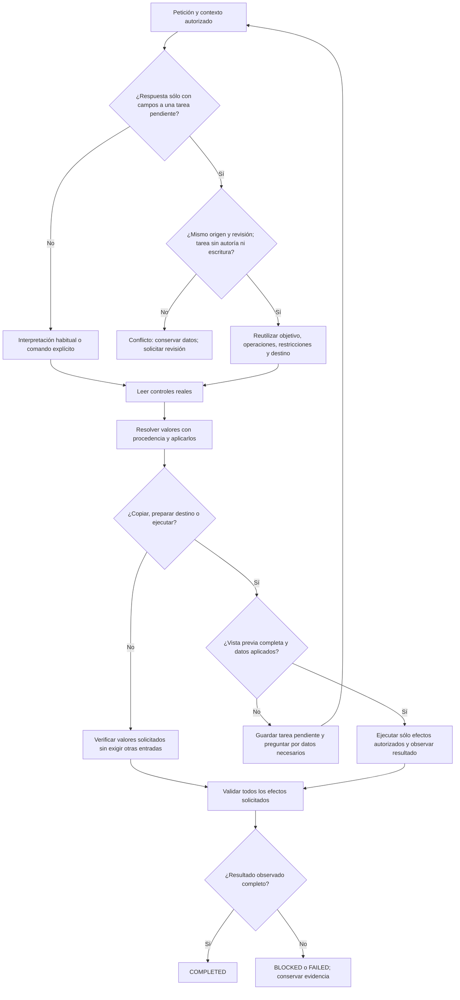

# NOVA — campos, continuidad y controles visibles

Fecha local: 2026-10-18. Modo IMPLEMENT. Seguimiento de [la revisión de cierre](INITIAL_VERSION_CLOSURE_REVIEW.md).

Actualización posterior: [recuperación de aplicación de campos](SEMANTIC_INPUT_RECOVERY.md). Conservamos los fallos históricos de este documento; la petición libre tiene evidencia posterior de corrección y la creación sigue sin aceptación.

**Estado: mejora implementada; versión inicial todavía NO ACEPTADA.** Las pruebas de contratos pasan. La aceptación visual con modelo real distingue los recorridos válidos de la petición libre que sigue fallando. No se cambió el modelo, su configuración global, los perfiles experimentales, las aprobaciones ni el esquema SQLite.

## Auditoría y causas

| Problema | Causa comprobada | Cambio |
| --- | --- | --- |
| Completar un campo exige otros datos no pedidos | `TaskGoal` y dos puertas de `RunVisible` trataban FILL como consumo de un prompt completo | Una propiedad de dominio, `RequiresCompiledOutput`, separa aplicación de valores y consumo del prompt |
| Responder una pregunta pierde el trabajo solicitado | El atajo de continuidad sólo aceptaba `PendingCommand`; reconstruía un plan desde el botón | Reutiliza el `PendingPlan` completo, su objetivo y destino para respuestas compuestas sólo de asignaciones de campos |
| Continuar sobre una revisión diferente | El atajo anterior comprobaba identidad, pero no comparaba el checkpoint de origen con la revisión actual | Una revisión distinta produce conflicto antes de continuar; no se reclasifican esos datos como permiso nuevo |
| Extracción pide campos desconocidos | El modelo podía preguntar por entradas ausentes aunque el dominio ya conoce qué operación debe completarse | La extracción sólo pregunta por material ambiguo/contradictorio; el dominio pregunta por entradas realmente necesarias |
| Panel tapa controles o diálogos | Panel fijo sin reserva lateral; su capa estaba por encima del diálogo nativo | Reserva lateral en escritorio, panel se recoge si tapa el campo enfocado y capa situada debajo de los diálogos |
| Avisos antiguos y «trabajando» después de terminar | Preguntas terminales se renderizaban fuera del historial; aviso de inicio sólo dependía del temporizador | Preguntas recuperables desde la actividad y aviso de inicio condicionado también al estado terminal |

La continuidad automática **no** aplica a autoría ni guardado: repetir esos efectos necesita checkpoints y aprobaciones propios. Tampoco interpreta un «sí» o una instrucción nueva como datos. El análisis de `nombre: valor` conserva el contrato existente de asignación literal; no se añadieron palabras clave ni expresiones regulares para clasificar intención.

## Workflow implementado



```text
entrada: petición, sesión, identidad/revisión seleccionadas, observación de UI
si existe comando explícito:
    compilar sus operaciones tipadas mediante las reglas existentes
si no, y la respuesta sólo asigna campos de una tarea pendiente elegible:
    exigir mismo origen y revisión; ante diferencia -> conflicto sin efectos
    conservar plan completo y GoalId; marcar continuación
en cualquier otro caso:
    mantener la interpretación semántica existente

en cada paso limitado del ejecutor:
    observar controles actuales y validar identidad/revisión
    resolver valores literales/autorizados; preguntar sólo ante ambigüedad real
    aplicar cada valor pendiente mediante el control correspondiente
    si la operación consume el prompt:
        exigir compilación completa; de lo contrario conservar tarea y preguntar
    si la operación sólo completa valores:
        exigir al menos un valor autorizado, campo existente y valor visible exacto
        no exigir que otros campos estén rellenos
    ejecutar efectos autorizados y verificar los recibos existentes
    finalizar sólo si se cumplen todas las postcondiciones
cancelación, límites de pasos, revisiones y aprobación: controles existentes
```

## Contratos y regresiones

- FILL parcial puede finalizar con campos ajenos vacíos; FILL + COPY no puede hacerlo sin compilación completa.
- No se considera éxito un conjunto de valores vacío, nombres inexistentes, valor incorrecto o un mensaje de éxito sin estado visible.
- Una respuesta de campos conserva todas las operaciones pendientes. No añade ejecución ni elimina una ejecución previamente solicitada.
- Cambiar la revisión invalida la continuación. Una directiva nueva vuelve al intérprete; no es absorbida como respuesta de datos.
- La UI conserva el foco del campo al recoger el panel. Tocar otros controles no dispara pausa. Los eventos de foco, scroll y resize se agrupan por frame; no hay polling ni llamadas al modelo para estas comprobaciones.
- Los diálogos nativos conservan su prioridad visual y su foco. La pregunta terminal sigue disponible en «Ver última actividad de NOVA».

## Validación ejecutada

| Comprobación | Resultado |
| --- | --- |
| Backend completo, compilado desde estas fuentes | **456 PASS**, cero omitidas; TRX `initial-closure-final.trx` |
| React completo | **95 PASS**, 14 archivos |
| API build | **PASS**, cero warnings y errores |
| TypeScript y Vite producción | **PASS**; permanece el aviso de bundle mayor de 500 kB |
| UI real: completar un campo y conservar otro vacío | **PASS**, controles y estado observados; cero llamadas LLM |
| UI real: ejecutar con dato faltante | **PASS**, pregunta por `publico`, no ejecuta ni persiste; cero llamadas LLM |
| UI real: responder datos y conservar ejecución | **PASS**, valores exactos, Qwen responde `LISTO`, una llamada LLM |
| UI real: desktop y móvil | **PASS** en el recorrido dirigido: sin overflow, panel fuera de controles de escritorio, campo móvil enfocado descubierto |
| Petición libre: completar sólo el dato indicado | **FAIL**: el intérprete omitió FILL; terminó preguntando por otro campo |
| Creación general sin contaminar contenido con órdenes de sesión | **NO ACEPTADA**; los experimentos de generación/extracción siguen fallando |

El candidato final y los hashes de sus artefactos se conservan en [esta evidencia](../evidence/field-continuity-20261018/1792375509996/results.json). Tiempos observados allí: completar 398 ms, preguntar 238 ms, continuar y obtener respuesta local 2.307 ms. **Son tres pasos sintéticos con modelo residente, no un benchmark ni p95 ni una mejora general de inferencia.** En la comprobación de recursos posterior había aproximadamente 0,3 GiB libres; no se cerraron aplicaciones del usuario.

La misma campaña final registra para la petición libre `BLOCKED`, seis llamadas y 26.074 ms. Conserva los tres recorridos anteriores y el fallo; no se cambió su expectativa para obtener PASS. Una campaña anterior ya había reproducido el mismo fallo ([evidencia histórica](../evidence/field-continuity-20261018/1792375069195/results.json)).

La instancia local `http://127.0.0.1:5190/` sirve ahora este build (`.playwright/initial-closure-20261018/api-final/QuickPrompt.Api.dll`). Se verificó el proceso propio antes de reemplazarlo, se conservó su SQLite de auditoría con tres registros sintéticos y se comprobó `/health`: `ok`, esquema 2. Recarga real de React sin alertas. No se hizo commit, push ni despliegue remoto.

Se añadieron pruebas de regresión en `TaskGoalTests`, `LiveCommandTests`, `LiveExecutionTests` y `live.test.tsx`. El harness [field-continuity.cjs](../../Tests/nova/field-continuity.cjs) usa Edge existente, React de producción, controlador de la misma pestaña, SQLite sintética y Ollama instalado. Su estado global falla si la petición libre falla. Los informes posteriores incluyen hashes de los DLL y del índice web, modelo y digest. No instala dependencias ni captura razonamiento privado.

```powershell
dotnet test backend/QuickPrompt.Tests/QuickPrompt.Tests.csproj --no-restore --verbosity quiet
Set-Location apps/web
npm test -- --maxWorkers=1
npm run build
Set-Location ../..
dotnet build backend/QuickPrompt.Api/QuickPrompt.Api.csproj --no-restore -o .playwright/initial-closure-20261018/api-final --verbosity quiet
$env:NOVA_TEST_BUILD='.playwright/initial-closure-20261018/api-final/QuickPrompt.Api.dll'
node Tests/nova/field-continuity.cjs
```

## Experimentos rechazados y cierre pendiente

No se integraron los contratos alternativos de generación ni un perfil de razonamiento distinto. El verificador muestreado acertó seis componentes contrastados con propósito dado por QA, pero eso no demuestra generación correcta ni comprensión de un propósito obtenido del usuario. La generación reducida y la extracción separada siguieron contaminando el artefacto; otra comparación de clasificación añadió latencia y mantuvo errores. Informes sintéticos conservados en [initial-closure-20261018](../evidence/initial-closure-20261018/reduced-authoring.json).

Para cerrar la versión faltan: fidelidad de creación, reconocimiento de todos los efectos en lenguaje libre, eliminación semántica con confirmación y campaña integral multi-turno del mismo candidato. Las mejoras aquí implementadas no sustituyen esos criterios ni justifican habilitar `TaskGoals`/`TaskResultContract` o cambiar de modelo silenciosamente.
