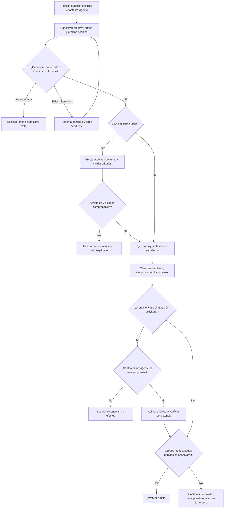

# NOVA web local — qué falta para cerrar la versión inicial

Actualización 2026-10-19: consultar la [matriz obligatoria de cierre](VERSION_CLOSURE_MATRIX.md), que reúne también paridad, operación y criterios por requisito. Este informe mantiene su alcance y resultados históricos.

Fecha: 2026-10-18. Modalidad: análisis, sin modificaciones de producto, cambio de modelo ni nuevas inferencias. **Estado: NO LISTO PARA CIERRE.**

Seguimiento posterior con implementación, contratos, pruebas y fallos preservados: [INITIAL_CLOSURE_IMPLEMENTATION.md](INITIAL_CLOSURE_IMPLEMENTATION.md). Esta revisión conserva su evidencia histórica.

## 1. Estado comprobado

En esta revisión:

- `dotnet test backend/QuickPrompt.Tests/QuickPrompt.Tests.csproj --no-build --no-restore --verbosity quiet`: **449/449 PASS**, cero omitidas, 16 s. Se ejecutó el ensamblado existente; no es una compilación nueva.
- En `apps/web`, `npm test -- --maxWorkers=1`: **92/92 PASS**, 14 archivos, 70,30 s. No se modificaron pruebas ni expectativas.
- `http://127.0.0.1:5190/api/v1/prompts` respondió y conservaba tres prompts de la instancia sintética de auditoría.
- Ollama respondió y tenía instalados Qwen3:8b y Qwen2.5:7b-instruct. La consulta de modelos residentes no mostró un modelo cargado. No se ejecutó un benchmark ni se atribuye la duración de estas pruebas a inferencia.
- No se repitieron en esta revisión los 150 tests heredados ni todos los recorridos visuales. Sus PASS anteriores pertenecen a sus respectivas evidencias.

La biblioteca manual tiene CRUD y navegación probados en la auditoría anterior. Hubo después éxitos reales dirigidos de actualización, aprobación, persistencia, ejecución local y continuación de campos. **Eso no equivale a una campaña completa del candidato actual.** Los 3/11 históricos tampoco son una tasa actual del agente.

La última creación real del build de protección terminó `BLOCKED`, sin propuesta ni persistencia: run `53c9d71e-0c50-4581-bfa0-47b1a7031981`. La SQLite sintética contenía cero prompts. Se protegieron los datos, pero no se entregó el prompt solicitado. Evidencia: [aceptación actual](../evidence/authoring-scope-20261018/acceptance.json).

## 2. Arquitectura actual y fronteras

| Componente | Estado observado | Límite |
| --- | --- | --- |
| React, orb y controlador de la misma pestaña | PRESENTE | Puede navegar y llenar controles reales; no demuestra que el contenido pedido sea correcto |
| `LiveCommand` | PRESENTE | Conserva elecciones explícitas del botón como operaciones tipadas; no debe reclasificarlas |
| Planificación semántica / `TaskGoal` | PRESENTE, aceptación parcial | Mantiene objetivos y restricciones, pero un objetivo inicialmente mal interpretado puede seguir siendo incorrecto |
| Generación / `DraftFidelity` / Ollama | PRESENTE, FAIL de fidelidad general | Las citas e índices válidos no prueban el rol semántico de su contenido |
| Sesión, borrador y tarea pendiente | PRESENTE, cobertura parcial | Hay continuación determinista por campos; falta una campaña general multi-turno del candidato final |
| Dominio, revisiones y aprobación | PRESENTE | Escrituras ligadas a identidad, versión y hash; aprobación no demuestra calidad del contenido |
| Telemetría por RunId | PRESENTE | Distingue tiempo/coste y resultados; no convertir estado terminal en oráculo semántico |
| RAG externo, nuevo framework o multiagente | INNECESARIO para los fallos observados | No resolverían por sí mismos el alcance de una orden de autoría |

`Program.cs` mantiene `TaskGoals=false` y `TaskResultContract=false` como valores predeterminados de los perfiles experimentales. Las acciones explícitas sí construyen su `TaskGoal` mediante `LiveCommand`. No deben mezclarse resultados de esos caminos ni habilitarse un perfil rechazado por haber pasado sus pruebas de contratos.

## 3. Bloqueos y trabajo mínimo

### B1 — Fidelidad de creación e interpretación: BLOQUEANTE

**Observado:** el cuerpo todavía puede trasladar «no hagas la tarea ahora» desde la sesión de autoría al prompt futuro. Los ensayos también omitieron una prohibición futura de SQL, trasladaron idioma al objeto equivocado y añadieron condiciones no pedidas. Un verificador alternativo sólo acertó seis de doce etiquetas en cuerpos controlados; no se incorporó.

**Fuente:** `TaskGoal.ContentRequest` concatena citas clasificadas como contenido, no una especificación futura semánticamente comprobada. `GenerateCore` solicita en una misma salida el artefacto y sus rangos de autoría. `BindAuthoringReferences` prueba cobertura, literalidad y separación estructural. El revisor también puede compartir el error de interpretación. `GoalCompletionValidator` comprueba coherencia con el objetivo y recibos; no puede demostrar por sí solo que ese objetivo inicial entendió al usuario.

**Trabajo:** separar conceptualmente operación actual, tarea futura, metadatos y datos del caso en el contrato compartido existente. Antes de integrar más etapas, evaluar una formulación mínima contra ejemplos contrastados por destinatario: controles actuales, restricciones futuras, aprobación futura, títulos/idiomas distintos y datos reales frente a declaraciones. Una representación nueva o más llamadas no se aceptan sin evidencia de mejora. Si el modelo no alcanza el umbral con un contrato manejable, evaluar su capacidad como componente; no dar por probado que cambiarlo arreglará todo.

**Cierre:** crear instrucciones útiles con entradas y restricciones correctas, sin contaminación ni condiciones inventadas; validar también las objeciones falsas del revisor. El bloqueo seguro actual debe conservarse, pero no contarse como creación exitosa.

### B2 — Cobertura completa y continuidad: BLOQUEANTE

**Observado:** el historial contiene ejecución omitida, destino anterior retenido y pérdida de tarea tras responder una aclaración. Las acciones rápidas y una continuación con campos ya tienen correcciones y éxitos dirigidos. Falta repetir las familias completas en el mismo candidato final.

**Trabajo:** conservar el mismo objetivo solicitado, origen y revisión, borrador vigente, valores con procedencia, destino y efectos pendientes durante una pregunta o reparación. La respuesta debe completar la información ausente; no reiniciar ni reducir el trabajo. Reutilizar `PendingCommand`, `PendingPlan`, referencias de borrador y validador de finalización existentes. Ante incertidumbre real, formular una pregunta concreta y conservar la tarea, sin pedir de nuevo datos suficientes ni mostrar instrucciones internas de reparación.

**Cierre:** crear → cambiar → completar → ejecutar → revisar/guardar mantiene el mismo contexto correcto; cambiar explícitamente de prompt cambia sólo el objetivo indicado. `COMPLETED` exige todos los efectos solicitados, y un fallo parcial se comunica como tal.

### B3 — CRUD del agente: BLOQUEANTE si se cierra con CRUD completo

**Observado:** `SemanticOperation` y `LiveCommand.Validate` no admiten eliminación. `QuickActions` usa `onRemove` y la confirmación nativa para esa acción. Existe eliminación manual/por botón, no eliminación semántica completa.

**Trabajo:** para cumplir el CRUD pedido, exponer la eliminación como capacidad de dominio tipada: identidad/revisión, propuesta, confirmación humana vigente, efecto único y observación de ausencia. Reutilizar la confirmación y operación existentes. Una petición no soportada no puede convertirse en abrir el registro y declarar éxito.

**Cierre:** eliminar el registro correcto después de confirmar; cancelar conserva registro, revisión y navegación. Si se decide excluir lenguaje natural de esta operación, debe declararse y acordarse ese alcance; no presentarlo como CRUD autónomo completo.

### B4 — Evidencia integral de un candidato: BLOQUEANTE

**Observado:** hay PASS de distintos builds, pruebas simuladas de contratos, replays nativos y ejecuciones de modelo real. La modificación/aprobación funcionó en el candidato anterior; la creación final falló antes de alcanzar ese tramo. No existe una aceptación integral actual que reúna todas las familias.

**Trabajo:** congelar código, configuración, modelo/digest, fixture y criterios. Ejecutar desarrollo, validación y holdout en ese orden; no ajustar instrucciones con los resultados del holdout. Registrar todos los intentos y clasificar por separado contenido, herramienta, persistencia, recuperación y tiempo. Usar criterios independientes del propio plan generado y revisión humana para significado que el oráculo determinista no pueda comprobar.

**Cierre:** cumplir los umbrales existentes y todos los recorridos críticos de la matriz inferior. Un PASS de componente no sustituye un PASS de UI con modelo real.

### B5 — Latencia: ALTA

**Observado:** hay éxitos dirigidos de dos llamadas y unos 31 s hasta revisión, una petición libre de 17 llamadas y 91,8 s, y una recuperación de cuatro llamadas y 127,3 s. Son tareas/candidatos distintos; no son un p95 comparable. Los informes atribuyen gran parte del coste al LLM. La memoria disponible varió incluso en esta revisión; no hay benchmark estable nuevo.

**Trabajo:** usar código para elecciones ya determinadas por botón, identidad, campos autorizados o estado observado. Reservar inferencia para significado o contenido desconocidos; no volver a interpretar toda la tarea al reparar un solo contrato. Mantener cancelación, recibos y controles de versión. Medir después de estabilizar calidad, con el mismo fixture, modelo y condiciones, separando frío/caliente y espera humana.

**Cierre:** presupuesto global y por etapa verificable, progreso inmediato y significativo, recuperación acotada y objetivos de latencia congelados antes de comparar. No reducir calidad, contexto necesario ni verificación para obtener tiempos menores. No se promete aquí un SLA nuevo.

### B6 — Usabilidad y cierre reproducible: ALTA

**Observado:** la auditoría real encontró el panel expandido tapando acciones. El código actual sigue reservando la altura del contenedor del orb mientras el panel tiene posición absoluta. `NovaLive` también permite mostrar la pregunta de un run terminal fuera de su panel cerrado. No se volvió a ejecutar aquí esa interacción; son riesgos respaldados por el hallazgo y el código actual, no un nuevo FAIL visual.

**Trabajo:** comprobar que se puede revisar, copiar, aprobar y corregir sin controles tapados; retirar o contextualizar mensajes terminales. Reunir un informe canónico de versión con evidencias por candidato. El árbol tiene numerosos cambios sin consolidar; conservar trabajo ajeno y congelar una entrega revisable cuando corresponda, sin limpiar indiscriminadamente.

**Cierre:** build web/API, arranque local, configuración efectiva, biblioteca conservada, procedimiento de respaldo/retorno y documentación del alcance corresponden a una versión identificable. MAUI/Android y automatización de páginas externas no quedan aceptados por esta revisión del producto web local.

## 4. Flujo objetivo propuesto, no implementado en esta revisión



```text
atender(petición, sesión):
    restaurar objetivo pendiente y referencias vigentes
    conservar elecciones explícitas sin reclasificarlas
    interpretar sólo significado todavía desconocido
    si falta capacidad: comunicar límite y no completar otra tarea como sustituto
    si falta información esencial:
        guardar objetivo, origen, valores y efectos pendientes
        preguntar sólo por lo que falta; finalizar esta espera
    si requiere contenido:
        preparar contra tarea futura, metadatos y datos separados
        validar criterios y restricciones; corregir como máximo una vez por etapa
        si falla: preservar originales y explicar el fallo
    mientras haya acción lista, autorización y presupuesto:
        comprobar cancelación, identidad y revisión
        ejecutar una acción y recoger observación real
        si es escritura/eliminación: exigir confirmación vigente y evitar duplicados
        actualizar efectos pendientes con recibos, no con afirmaciones del modelo
    completar sólo si se observaron todos los resultados originales requeridos
```

## 5. Contratos mínimos a mantener

| Contrato | Entrada / salida | Invariante |
| --- | --- | --- |
| Objetivo | Petición, operación explícita o propuesta semántica, efectos requeridos/prohibidos | Una reparación o aclaración no amplía ni reduce autorización |
| Contexto | ID/revisión o identidad temporal, valores y procedencia, tarea pendiente | Un catálogo recordado no inventa un antecedente conversacional ni una identidad autorizada |
| Artefacto | Tarea futura, metadatos, entradas, restricciones y cuerpo | Órdenes de la sesión y datos de un caso no se convierten en instrucciones futuras por ser citas literales |
| Herramienta | Capacidad permitida y argumentos tipados | La UI actúa sobre la identidad vigente; no hay selectores/scripts libres ni efectos extras |
| Resultado | Observación, recibos y versión persistida cuando corresponda | Lo generado, mostrado, aprobado y guardado coincide; no basta el plan ni un clic |

Estos son límites del sistema existente a consolidar y evaluar, no una propuesta para añadir un framework o un clasificador por cada frase.

## 6. Matriz mínima para cerrar

Ejecutar las familias con botón y texto libre cuando ambos estén soportados, con el modelo local real y datos sintéticos. Incluir paráfrasis nuevas, negación, ambigüedad y varios turnos; no sólo cambiar nombres en las frases conocidas.

| Familia | Resultado exigido |
| --- | --- |
| Buscar/abrir desde Home y otro detalle | Identidad correcta; ambigüedad pregunta; no edición o ejecución implícita |
| Crear sin origen y desde origen/borrador | Cuerpo útil, título/idioma/variables correctos, restricciones preservadas y cero controles actuales trasladados |
| Actualizar | Cambio solicitado y resto preservado; no modificación persistente previa a aprobar |
| Completar y corregir campos | Valores reales en campos correctos; ninguna orden/proveedor/marcador como dato; preview actual |
| Datos faltantes y continuación | Pregunta pertinente; respuesta reanuda el mismo objetivo sin perder origen, destino ni efectos |
| Ejecutar local | Prompt compilado correcto, una ejecución autorizada y respuesta real; revisar fidelidad de la respuesta por separado |
| Preparar destino | Destino correcto y texto listo, sin ejecución o envío no pedidos |
| Aprobar/rechazar/cancelar guardado | Igualdad de contenido y revisión; rechazo/cancelación sin escritura; aprobación obsoleta rechazada |
| Eliminar y cancelar | Registro correcto y confirmación; cancelación no borra ni navega |
| Pausa, continuar, detener y error local | Sólo control explícito y conflictos reales detienen el trabajo; ninguna escritura después de cancelar; fallo preserva el original |

Umbrales ya congelados: [recovery-v1/thresholds.json](../../Tests/nova/datasets/recovery-v1/thresholds.json). Intención ≥90%; planes válidos, destino, finalización y herramientas ≥95%; fidelidad de adaptación, éxito de tarea y equivalencia metamórfica ≥90%. **Cero efectos no autorizados, IDs inventados aceptados, finalización prematura y contaminación del cuerpo.** En un split de 16, un umbral de 95% exige 16/16. No se rebajan estos umbrales para cerrar. La matriz CRUD añade cobertura de producto; no reemplaza ni reetiqueta el holdout congelado.

## 7. Orden de cierre recomendado

1. Mantener alcance web local y congelar nuevas funcionalidades mientras se recupera fiabilidad.
2. Resolver B1 con evaluación mínima de interpretación/autoría; integrar sólo un candidato que mejore de forma reproducible. No repetir cadenas que ya fallaron.
3. Consolidar B2 y completar B3 para el CRUD solicitado, preservando dominio y confirmación actuales.
4. Congelar el candidato y superar B4 sobre todas las familias. Los éxitos aislados no cierran una familia fallida.
5. Medir B5 con calidad preservada y resolver las interferencias funcionales de B6.
6. Emitir aceptación única del binario/configuración evaluados. Preparar commit/publicación sólo cuando se soliciten y se cumplan los criterios.

**Conclusión:** la base manual y las protecciones permiten continuar sobre la arquitectura actual. Falta demostrar que el agente entiende y completa la tarea de forma fiable. Cambiar el modelo, añadir prompts o acumular tests simulados no constituye por sí mismo ese cierre.

Fuentes principales: [auditoría UI histórica](UI_FUNCTIONAL_AUDIT_2026-10-18.md), [recuperación dirigida posterior](AGENT_RECOVERY_IMPLEMENTATION.md), [última creación y experimentos rechazados](AUTHORING_SCOPE_RECOVERY.md), [aceptación de rendimiento y sus límites](PERFORMANCE_ACCEPTANCE.md). Cada documento conserva su propio candidato y alcance; los resultados antiguos no se presentan como nuevas ejecuciones.
