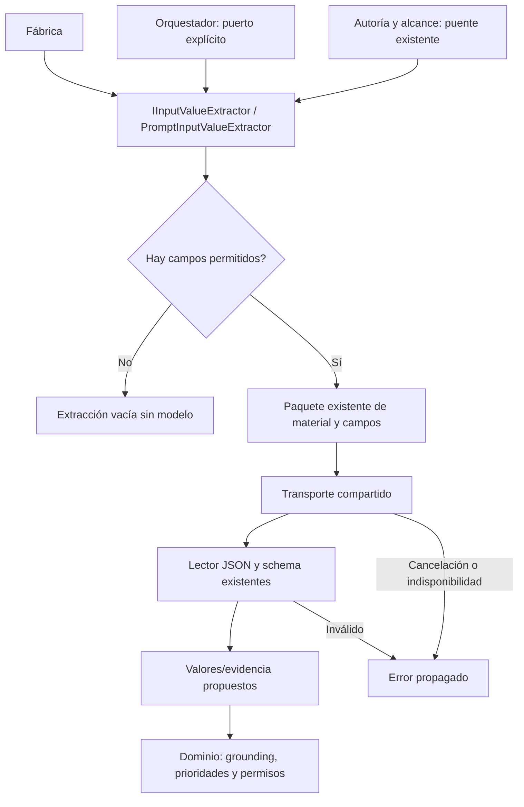

# Extracción de campos como capacidad independiente

## Auditoría y decisión

PreparationInference también implementa IInputValueExtractor. El método utiliza
transporte, observación opcional, plantilla/campos/contexto y lector JSON. No necesita
interpretación de intención, edición, persistencia o control de pantalla. El
orquestador obtiene esa capacidad mediante cast de IPromptGenerator en dos caminos;
por ello cambiar el generador puede omitir extracción aunque exista otro proveedor.

Se comparan mantener el cast, añadir un proxy al intérprete y extraer la capacidad
con inyección explícita. El cast mantiene dependencia oculta; el proxy no permite
retirar el intérprete. Se elige PromptInputValueExtractor sobre transporte compartido
y el lector de respuesta existente. No se reescriben instrucciones ni interpretación.

## Contratos y propietarios

- PromptInputValueExtractor implementa IInputValueExtractor; recibe transporte
  prestado y observador opcional. No dispone dependencias ni ejecuta efectos.
- Entradas: PrepareInput, plantilla y nombres reales permitidos, cancelación.
  Salida: InputValueExtraction tipado con valores/evidencia y pregunta existente.
- Mismos límites, schema, redacción, modelo, contexto y propósito ExtractInputs.
  Cero campos devuelve extracción vacía sin modelo como antes. Con campos, la
  cancelación se comprueba antes de enviar; errores de transporte se conservan.
- AgentResponseContent valida JSON; el dominio conserva comprobación literal,
  prioridades de valores, datos autorizados y aprobación. La propuesta no concede
  autoridad por ser JSON válido.
- La fábrica registra el puerto; orquestador lo recibe explícitamente. El método
  antiguo delega a esa instancia. Autoría/alcance existentes consumen el mismo dueño.
- Compatibilidad: último parámetro opcional en constructores de PreparationInference
  y AgentOrchestrator. Código fuente existente conserva llamadas; consumidores
  binarios deben recompilarse. Si el consumidor antiguo publica extracción en su
  generador se conserva el adaptador de capacidad, sin algoritmo duplicado. El camino
  productivo usa el puerto registrado, nunca exige que el generador lo implemente.
- Sin cambios HTTP, SQLite, paquetes, modelos ni permisos. El intérprete de alcance
  sigue teniendo su propietario actual; no se declara sustituida la cadena semántica.



```text
componer extractor con transporte y observación existentes
inyectar el puerto en orquestador e intérprete compatible
al extraer:
    si no hay campos devolver extracción vacía
    conservar exclusión de valores ya ligados y contexto autorizado
    construir exactamente el mismo schema y paquete
    comprobar presupuesto, observar etapa y consultar transporte
    validar respuesta con lector compartido y devolver propuesta
el dominio comprueba evidencia literal y aplica sus reglas antes de usar valores
```

## Aceptación prevista

Probar resolución real de fábrica con intérprete/editor prohibidos, y selección
explícita del puerto por el orquestador con generador que no lo implementa. Conservar
casos HTTP de campos, grounding, control visible y autoría/alcance afectados. Comparar
el método/prompt extraído con original, congelar fuentes y compilar antes de pruebas.
No convertir respuestas controladas en fiabilidad semántica del modelo.

## Resultado ejecutado

IMPLEMENTADO Y VALIDADO para composición, compatibilidad y límites de datos.
El método, instrucciones, schema y observación extraídos se conservan byte a byte.
La fábrica real permite resolver/usar extracción con intérprete/editor prohibidos.
Un generador que no implementa extracción completa y compila campos por el puerto
inyectado; un valor inventado sigue siendo rechazado por el dominio, sin mutación
de plantilla/versiones. El puente anterior devuelve el mismo resultado prestado
y no dispone ese proveedor al cerrar el intérprete.

Pasan 582 pruebas dirigidas compiladas de 44 clases afectadas, cero fallidas/omitidas.
Incluyen cinco pruebas nuevas, HTTP controlado de alcance, caché, grounding, contexto,
autoría y ejecución visible existentes. No son 582 peticiones al modelo real.
API/Blazor compilan con cero errores/advertencias y tres DLL compartidas idénticas
a las probadas; Evaluation compila con tests. Dieciocho controles estáticos pasan.
OpenAPI publicado idéntico. No se ejecuta otra matriz frontend/UI/Qwen por esta
extracción de composición; no cambia la hipótesis semántica rechazada.

La selección inicial de 23 pasó con una advertencia CS0184 en una comprobación del
fixture nuevo. Se sustituyó por reflexión sobre su interfaz, conservando el control;
el log inicial queda archivado y la compilación final no tiene advertencias.

[Fuentes y selección](../evidence/input-extraction-module-20261020/test-selection.json),
[procedencia compilada](../evidence/input-extraction-module-20261020/compiled-provenance.json),
[resultado](../evidence/input-extraction-module-20261020/verification.json).

La sustitución de la interpretación semántica principal y la auditoría global siguen
abiertas; MAUI pendiente de herramientas/validación. Las 88 filas canónicas y criterios
permanecen intactos, 34 cerradas y 54 abiertas. No se declara cierre de versión.

Reversión del incremento: restaurar los seis archivos productivos/de control
registrados en before.json y retirar conjuntamente el proveedor y su prueba nueva.
Las evidencias y documentos permanecen archivados; no requiere migración de datos.
