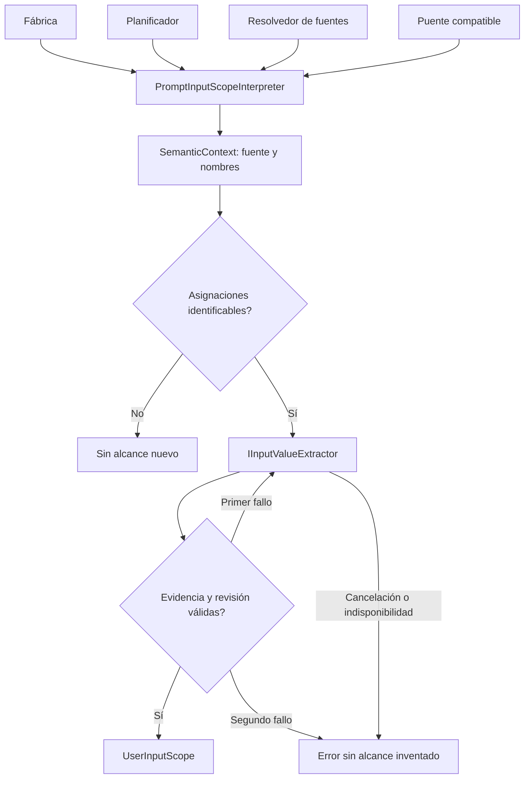

# Alcance de entradas como capacidad conectada al planificador

## Auditoría y alternativas

InputScopeInference es una parte de PreparationInference. Usa sólo extracción de
campos, política local, observación opcional y dos proyecciones puras del contexto.
Planificador y resolvedor de fuentes obtienen IInputScopeInterpreter haciendo cast
del intérprete semántico. Cambiar ese intérprete puede omitir alcance pese a existir
un proveedor independiente. CurrentSubject/CurrentInputNames son reglas compartidas
de datos/contexto, no interpretación de lenguaje.

Mantener el cast conserva dependencia oculta; copiar las proyecciones crea otra
autoridad de contexto; un proxy al intérprete no permite retirarlo. Se elige extraer
PromptInputScopeInterpreter, publicar métodos puros en SemanticContext y conectar
el puerto explícito en ambos consumidores. Los métodos no agregan propiedades JSON.

## Contratos y límites

- SemanticContext posee CurrentSubject/CurrentInputNames, con exactamente las mismas
  prioridades, ambigüedad y trato de fuente vigente/borrador. No concede permisos.
- PromptInputScopeInterpreter implementa IInputScopeInterpreter sobre extracción
  prestada; valida política/modelo, delimitación/evidencia y como máximo dos intentos.
  Conserva instrucciones de corrección y errores; no interpreta intención, persiste,
  recupera candidatos o controla la pantalla.
- La fábrica comparte el puerto con NovaTaskPlanner/TaskSourceResolver y el puente
  compatible. Los consumidores antiguos conservan la capacidad publicada por su
  intérprete cuando no inyectan una explícita; no hay algoritmo duplicado.
- TaskSourceResolver conserva identidad, lectura/relectura y revisión. La nueva
  capacidad sólo liga material a nombres/cuerpo/revisión que ya recibió.
- Cancelación pasa a extracción; política inválida rechazada antes de consultar;
  sin asignaciones o con etiquetas ambiguas devuelve null como antes. No se amplía
  presupuesto ni se convierte un fallo en una delimitación inventada.
- Se retira el archivo parcial InputScopeInference.cs del código activo; su método
  público queda como una delegación compatible en PreparationInference.
- Nuevos parámetros finales opcionales de alcance en constructores de intérprete
  y planificador conservan llamadas fuente. Consumidores binarios deben recompilar.
  No cambian HTTP, JSON, SQLite, paquetes, modelos ni permisos.



```text
componer alcance con el extractor registrado y política actual
inyectar el mismo puerto en planificador y resolvedor de fuentes
obtener fuente/campos por métodos puros del contexto
si no hay asignaciones o las etiquetas son ambiguas devolver null
hasta dos intentos:
    extraer campos sin reinterpretar fuente, intención o permisos
    validar material contra petición, fuente, revisión y nombres
    devolver alcance si es válido
    corregir sólo extracción una vez; después propagar error
mantener revisión y autoridad de identidad en el resolvedor existente
```

## Aceptación prevista

Comparar proyecciones y algoritmo con sus fuentes originales; comprobar ausencia
de nuevas propiedades JSON. Resolver fábrica sin intérprete/editor. Usar planificador
con intérprete que no publique alcance y puerto explícito; mantener pruebas de ID/
revisión y de HTTP con reparaciones acotadas. Congelar fuentes, compilar y ejecutar
consumidores afectados. No atribuir comprensión del modelo a respuestas controladas.

## Resultado ejecutado

IMPLEMENTADO Y VALIDADO para composición y reglas de contexto/alcance. Se retira
InputScopeInference.cs del código activo, con fuente exacta archivada. El algoritmo
de alcance conserva cuerpo/instrucciones salvo acceso a dependencias; las dos
proyecciones conservan sus expresiones y prioridades. SemanticContext sólo agrega
métodos: declaraciones y propiedades JSON previas quedan intactas por comparación.

Pasan 662 pruebas compiladas de 53 clases afectadas, cero fallidas/omitidas. Incluyen
15 nuevas de proveedor/contexto/revisión, variante de planificador con intérprete
sin alcance y cuatro variantes HTTP de reparación directa/compatible. Se comprueba
la fuente nombrada con revisión fresca y conflicto si cambia durante extracción.
API/Blazor compilan sin errores/advertencias y comparten DLL idénticas a las probadas;
Evaluation compila con tests. Diecinueve controles estáticos pasan, sin confundir
el control histórico de dependencias nativas con compilación/aceptación MAUI.

La tanda inicial de 58 y la selección de rebinding de 21 pasan con sus fuentes de
ese momento; no se suman ni sustituyen la selección final congelada.

La tanda final duró 3 h 3 m: una prueba controlada de timeout registró 3:02:27.57
aunque acabó con el código esperado. Una repetición aislada del mismo binario
registra 1.2705289 segundos. Causa del retraso NO CONFIRMADA; ambos resultados se
conservan. El PASS funcional no acredita cumplimiento de latencia ni explica el
incidente. No se modifica el producto para ocultar esa observación.

[Fuentes y selección](../evidence/input-scope-module-20261020/test-selection.json),
[comparación](../evidence/input-scope-module-20261020/extraction.json),
[resultado y límites](../evidence/input-scope-module-20261020/verification.json).

No hay nueva campaña Qwen/UI/frontend por este cambio de composición. La sustitución
semántica y la auditoría global web siguen abiertas. Por decisión posterior del
usuario, MAUI queda fuera del alcance actual y la propuesta de SDK deja de estar
pendiente: [alcance vigente](WEB_SCOPE_DECISION_20261020.md). No se altera ninguna
fila canónica ni se declara cierre de versión.

Reversión: restaurar los archivos registrados en before.json, incluido el parcial
retirado, y retirar conjuntamente proveedor y prueba nuevos. Conservar evidencias;
no requiere migración de datos ni cambios de entorno.
