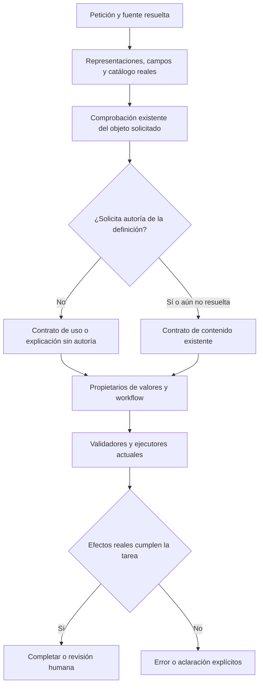

# Autoría frente a uso de una plantilla

2026-10-20. Corrección del propietario `InterpretInstructionUse` / `ReviewAuthoringScope`.

## Diagnóstico y contrato

En la petición libre retenida, el primer error fue `REVISION_REQUEST`, seguido de una definición con `[Preparado para copiar]`. La UI recibió por ello únicamente edición/aclaración. La comprobación de objeto anterior ofrecía sólo capacidades de creación/adaptación y omitía los campos de la fuente y las alternativas de uso existentes. La clasificación posterior volvía a abrir todas las alternativas de autoría aunque la comprobación anterior las descartase. Esto es un problema del contexto y de consistencia entre etapas, no de localizar el control de escritura.

**Propietarios:** la misma comprobación de autoría recibe las representaciones reflejadas existentes, identidad, nombres de campos y presencia de datos; el catálogo semántico actual describe todas las operaciones disponibles como documentación, nunca como permiso. El extractor sigue siendo propietario de valores, el compilador de dependencias y el workflow de navegación/copia/ejecución/aprobación. No se incorpora otro árbitro ni registro.

**Cambio mínimo:** extender el contexto del propietario y conservar su decisión mediante el esquema siguiente. Alternativas descartadas: añadir reglas por frase; otro clasificador; promover globalmente el prototipo de autoría no cualificado. No se cambia configuración, contratos HTTP, base de datos, modelos o paquetes.

**Invariantes:** datos de caso no alteran la definición; copiar no requiere reescribir; una modificación independiente debe conservarse aunque también se pidan valores/copia; la definición futura no es una acción actual; una clasificación no autoriza persistencia. Esquemas, evidencia literal, cancelación y presupuestos existentes se mantienen. Una salida incompatible se rechaza, no se convierte silenciosamente en permiso de edición.



```text
resolver fuente usando su propietario actual
aportar a la comprobación de autoría:
    petición literal fuera de datos, identidad, campos/presencia de datos,
    definiciones reflejadas y catálogo semántico actual
cuando el propietario descarta cambio a la definición:
    excluir crear/revisar del contrato de contenido posterior
mantener valores, restricciones y workflow en sus propietarios actuales
validar la respuesta y conservar el presupuesto compartido de reparación
ejecutar sólo el plan autorizado y verificar valor, fuente, revisión y compilación
```

**Aceptación:** contratos de contexto y consistencia, regresiones de edición auténtica y combinación edición/datos/copia; repetir la petición libre original en UI con Qwen y verificar que no abre editor, que escribe el valor literal y permite copiar con la definición intacta. Paráfrasis y petición con una modificación real deben discriminarse usando el modelo local. No se declara aceptación antes de ejecutar estas comprobaciones.

## Implementación final: JSON tipado y efectos reflejados

La ampliación de descripciones sola no corrigió el fallo: se conservan [los ensayos rechazados](../evidence/closure-20261020/instruction-use-resource-only-rejected/review.md). Se sustituyó la decisión privada por tipo de objeto por una selección JSON de capacidades del catálogo actual. `AgentOperationAttribute.Writes` declara la representación afectada; `Requires` declara recursos necesarios. El código deriva el efecto, sin clasificar frases. La selección no reemplaza los propietarios de valores/workflow ni ejecuta herramientas.

Una alternativa sin recursos disponibles devuelve incertidumbre (`null`), no una negación de autoría. La evaluación de contenido existente conserva entonces una edición legítima. Cuando hay una alternativa sustentada que conserva la definición, el esquema posterior no permite inventar una revisión. Los tipos de entrada, guía y respuesta tienen esquemas generados y validación estricta/coherencia antes de inferir. Detalles y contratos exportados: [TYPED_AGENT_CONTEXT.md](TYPED_AGENT_CONTEXT.md).

## Evidencia final ejecutada

- **194 controles dirigidos PASS**: [TRX final](../evidence/closure-20261020/tests/typed-json-v3-qualified-boundaries.trx). Incluyen JSON incompleto, null, duplicados, propiedades desconocidas, enum inventado/numerado, catálogo, datos separados, incertidumbre por recursos ausentes y consumidores UI/vectoriales. No se repitieron matrices completas frontend/backend.
- **Build API/evaluador PASS**, sin warnings/errores. Fuentes congeladas y tres ensamblados coincidentes entre API, evaluador y snapshot UI: [freeze](../evidence/closure-20261020/typed-json-v3-freeze.json).
- **Qwen/planificación real PASS en los tres casos acotados**: edición de redacción, completar sin cambiar plantilla y adaptar más copiar. [Diagnóstico v3](../evidence/closure-20261020/typed-json-v3-semantic-regression.json). Oráculos/dataset originales sin cambios; SQLite sintética intacta. No es generación/fidelidad/UI de edición ni holdout.
- **UI real/Qwen PASS en ambas peticiones libres originales**: `boundVariables` 35.347 ms / 14 llamadas; `variables` 33.509 ms / 15 llamadas. [Mediciones](../evidence/latency-1792486471301/measurements.json), [aceptación](../evidence/latency-1792486471301/validation.json). Fuente, revisión, definición, valor literal, preview y copia exactos. Sin editor, destino, ejecución o guardado añadidos. Sólo la copia manual incrementa usos; portapapeles capturado dentro del navegador, no integración OS. Ambas capturas visuales inspeccionadas.
- Versión intermedia v2 conservada: las dos peticiones UI pasaban, pero la edición de redacción fue descartada por una alternativa de completar sin datos. La precondición reflejada y la incertidumbre v3 recuperan ese caso. [Diagnóstico anterior](../evidence/closure-20261020/typed-json-semantic-regression.json) también conserva un fallo en resolución de referencia inglesa anterior a esta etapa; no se corrigió ni se reejecutó esa capacidad ajena en la tanda v3.

**Alcance:** corrección acreditada de estos dos recorridos libres y de la frontera JSON/selección inicial. No certifica cualquier petición, toda la autoría, la búsqueda vectorial real, guardado/aprobación, portapapeles OS, p50/p95 ni el cierre de versión. Los tiempos no constituyen una campaña de rendimiento comparable. La configuración de producción y el modelo activo no cambiaron; QA fuerza decisiones de navegación del modelo para observarlas.

## Ampliación de aceptación del candidato final

La [campaña integral posterior](RELEASE_VALIDATION_20261020.md) conserva el PASS de las dos peticiones libres de completar/copiar, pero detecta una pregunta explicativa rechazada por vínculo inválido de capacidades y otros fallos fuera de esta frontera. La evidencia general queda PARTIAL; los controles JSON estrictos siguen siendo una garantía estructural, no de comprensión universal. El contenido contaminado de una adaptación real se rechaza mediante revisión independiente aunque el modelo y la igualdad de campos lo acepten. La versión sigue NO CERRADA.
