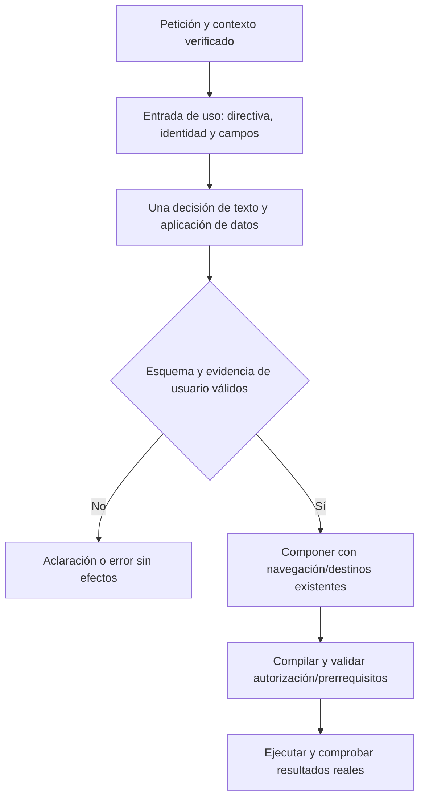
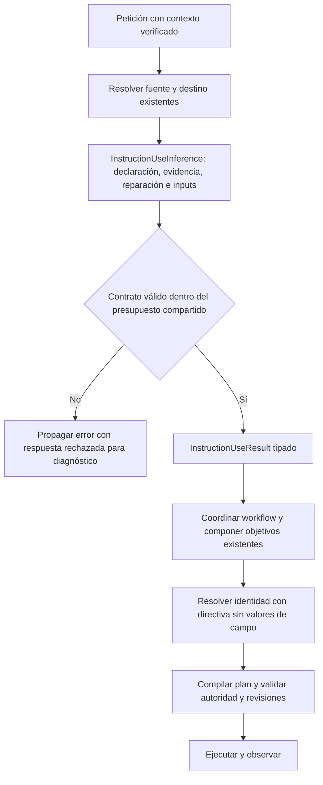

# Refactor de interpretación del uso de instrucciones

Estado: refactor estructural conservado; protocolo conjunto y reducción de contexto RECHAZADOS. No aceptación semántica de NOVA ni de versión.

Capacidad y propietario: `PreparationInference` interpreta cómo quiere usar el usuario una instrucción. `SemanticStageComposition` compone resultados tipados y `SemanticPlanCompiler` conserva prerrequisitos/autoridad. No se crea otro planificador, almacén o router. Fuente, destino, aprobación y ejecución conservan sus propietarios existentes.

Observado: autoría tiene clasificación de objeto/postura (`ReviewAuthoringScope`), clasificación de texto (`ContentRequest`) y decisión posterior de identidad (`AdditionalArtifactRequested`). Los campos pueden decidirse en el contrato de texto o mediante `InterpretInputUse`. `GoalOnlyData` entrega el cuerpo imperativo del prompt a la decisión de autoría. Los dos fallos de completar/copiar del checkpoint anterior clasifican revisión, reproducen su tarea futura e incorporan workflow al contenido; luego pagan generación/revisión innecesarias. El rechazo posterior no corrige el objetivo inicial.

Propuesta contrastada, no conservada: entrada acotada de uso con directiva literal, referencias de sesión/origen y campos, sin cuerpo de la instrucción ni valores. Una respuesta conjunta posee autoría, aplicación de campos y explicación. Evidencia por índice de pasajes, sin inventar citas/resúmenes que concedan efectos. Conservar texto no niega llenar; editar no concede llenar. La creación representa identidad nueva, no sólo redacción nueva. El contraste mostró errores que impiden adoptar este protocolo completo.

Alternativas: ampliar el módulo actual manteniendo etapas dispersas conserva duplicación; otro revisor/cadena añade latencia y otra autoridad; un planificador general nuevo repite experimentos rechazados. Se elige un módulo cohesivo de interpretación de uso dentro del adaptador existente, con contrato explícito, sin framework ni dependencia nueva. No se pretende eliminar validaciones de dominio ni decidir por similitud/keywords/regex.

Flujo del protocolo candidato rechazado:



```text
proyectar la petición fuera de datos/títulos con el propietario de UserInputScope
presentar referencias y campos; no presentar cuerpos futuros como directivas
interpretar una vez cambio de texto, aplicación de valores y explicación
validar enums, evidencia literal/índices y continuidad autorizada
traducir a objetivos existentes sin otra reclasificación de autoría o campos
componer; verificar permisos, revisiones, cancelación y postcondiciones
ante un contrato inválido no autorizar efectos ni declarar tarea completada
```

Precondiciones: contexto acotado y sesión ligada a petición; valores y títulos no son instrucciones. Invariantes: separación de actores, fuente real/revisión actual, decisiones independientes, cero escritura/ejecución implícita, presupuestos acotados y ninguna clasificación textual en código. Cancelación y timeout del llamador se propagan. Compatibilidad: contratos públicos de UI/API y SQLite se mantienen; cambia el contrato privado del modelo, que debe migrar fixtures conservando todos los oráculos. No se promociona por pasar un componente; el gate completo de aplicación/UI conserva sus umbrales.

Antes de modificar el recorrido activo se contrasta la representación con los mismos diecisiete paquetes conservados de scope más los tres recorridos reales del checkpoint de conversación. Sólo se gradúa la autoría que ya tiene oráculo; el caso sin antecedente mantiene la anotación de scope no adjudicada y su oráculo final de aclaración intacto. El contraste no elige fuente, no genera contenido y no ejecuta acciones. Un fallo impide promoverlo; no se retoca por fila. No se toca validation/holdout ni se instala otro modelo.

## Decisión tras los contrastes

`instruction-use-contract-v1.json`: cinco decisiones de autoría adjudicadas correctas, una incorrecta, trece inconclusas y un caso de recuperación sin adjudicar. El modelo devuelve índices incompatibles con NONE/KEEP; las respuestas inválidas no son aciertos.

`instruction-use-contract-v2.json`: variantes discriminadas imponen la relación entre tipo y evidencia. Se recibe el catálogo original reflejado de capacidades como datos, sin ejemplos ni oráculos. Autoría **19/19 adjudicados**, cero contratos inválidos; caso de antecedente sin adjudicar conservado. **No es PASS conjunto:** solicita FILL_FIELDS extra en los casos 01, 05, 08 y 14, que no lo permiten en sus techos originales. No se integra ese nuevo protocolo ni se presenta como recuperación completa.

El incremento incorporado es más pequeño: extraer la capacidad existente a `InstructionUseInference.cs`, con entrada/salida privada tipada y presupuesto local compartido entre los reintentos permitidos. `SemanticInference.Interpret` coordina fuente, destino, workflow y composición, consumiendo `InstructionUseResult`; la capacidad encapsula declaración, validación y reparación. Se conservan los validadores y contratos privados anteriores en este incremento. No se afirma haber eliminado todas las consultas de scope/identidad ni sustituido el protocolo por el candidato rechazado.

La variante de frontera utilizó `InstructionUsePacket` con identidad, campos, destino y operaciones del catálogo reflejado, omitiendo `workingInstructionData`. Se ejecutó en el coordinador/UI real. **Fue rechazada:** no basta retirar el cuerpo para impedir autoría extra. Se restauró exactamente `GoalOnlyData` del candidato anterior dentro del módulo nuevo; la fuente vuelve a ser conocimiento en `authorizedContext.workingInstructionData`, separada de la directiva. No se presenta esa restauración como solución del juicio semántico. Los registros de proyección retirados y sus pruebas específicas están archivados junto a la decisión de rechazo.

Sí se conserva la corrección independiente de identidad: `AdditionalArtifactRequested` utiliza `GroundedVariableResolver.InstructionDirective` y el ámbito de entrada ligado a la petición, en lugar de recibir valores de campo como directivas. Sólo recibe metadatos si necesita la identidad actual, sin su cuerpo futuro. La prueba reforzada falló antes al encontrar `PRIVATE_CASE_VALUE` en esa consulta y pasa después. No se modificaron las expectativas originales de la versión; las nuevas pruebas de la variante rechazada se archivaron y se ajustaron a la frontera conservada: cuerpo como datos, valores fuera de autoridad y presupuesto/diagnóstico preservados.

Compatibilidad: no cambia API pública, SQLite, modelos, instalación ni UI. La clase pública y los contratos existentes conservan sus nombres. La reparación mantiene su presupuesto por petición y comparte estado sólo dentro de esa invocación; cancelación se propaga. La evidencia de una respuesta rechazada se conserva incluso si falla el parseo antes de devolver el resultado de la etapa.

Comprobaciones iniciales: **156/156** controles de transporte pasan tras extracción y tras proyección. El backend conservado pasa **639/639**, cero omitidas (`tests/instruction-use-backend-retained.trx`). Las pruebas de frontera verifican la directiva separada del cuerpo de conocimiento, ausencia de material de caso en autoría/identidad y dos rechazos de esquema con diagnóstico literal y presupuesto original. Es evidencia determinista con modelo controlado, no precisión del modelo.

## UI real y rechazo de la reducción de contexto

[Tanda Qwen/Edge del candidato de contexto reducido](../evidence/latency-1792468519192/measurements.json): **0/3 correctos**. Los dos mensajes de completar/copiar terminaron COMPLETED, pero añadieron adaptación del texto no solicitada (99512 ms/16 llamadas y 81349 ms/13 llamadas). El tercero se bloqueó en creación antes de alcanzar adaptación (98576 ms/9 llamadas). Se conservan capturas, vídeos, texto propuesto y observaciones; la biblioteca permanece intacta, pero sí hubo cambios no pedidos en el formulario. COMPLETED no acredita el resultado del usuario.

No se integra esa proyección ni se continúa ajustándola por frase. La hipótesis de que retirar el cuerpo resolvería la clasificación queda refutada como solución suficiente. El nuevo protocolo conjunto tampoco se integra por su 19/19 de autoría aislada: falla otras dimensiones. La versión sigue abierta y no se ejecutan validation/holdout ni aceptación de latencia sobre candidatos fallidos.

Se conserva el refactor cohesivo y la reparación de frontera de identidad, sin ampliar presupuestos ni cambiar modelos, permisos, persistencia o controles del editor. La siguiente sustitución del intérprete debe respetar propietarios independientes de autoría, datos y workflow, y superar el recorrido completo; no otro árbitro que compense decisiones contradictorias. No se afirma que la arquitectura modular, por sí sola, haga correcto un juicio probabilístico.

## Flujo conservado y verificación final



```text
crear presupuesto de reparación por petición, compartido por sus intentos acotados
delegar declaración y validación de uso al módulo existente extraído
registrar respuesta para diagnóstico antes de parsearla
retornar resultado tipado; no reclasificar su evidencia en el coordinador
resolver identidad con InstructionDirective y ámbito validado, sin material de campo
mantener compilador, permisos, revisión, cancelación y postcondiciones existentes
```

[Candidato conservado](../evidence/closure-20261020/candidate-instruction-use-retained/verification.json): backend final **639/639**, cero omitidas; API/evaluador recompilados, ensamblados compartidos idénticos y fuentes estables. Frontend **136/136** y legacy **151/151** proceden de la verificación completa anterior con sus fuentes intactas, no de otra campaña inferencial. Web conservada sin cambios. La puerta de cierre sigue devolviendo 2. No se confunde la UI del candidato rechazado con evidencia semántica del código conservado.
