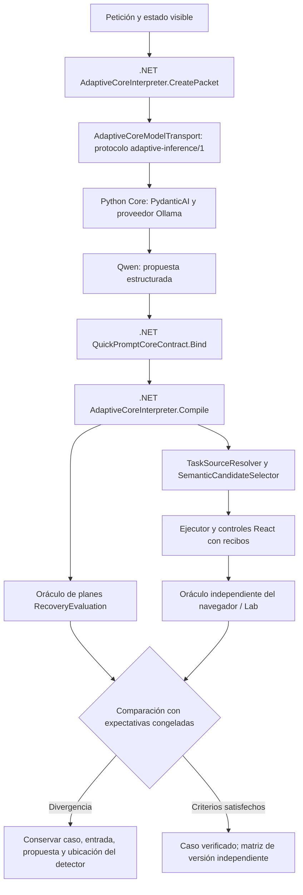

# Diagnóstico de cierre mediante el Lab — 21 de octubre de 2026

Estado de versión: **NO_CERRADA**. Esta investigación conserva los fallos originales, las pruebas dirigidas y los resultados reales del navegador. No convierte un plan válido ni una respuesta del modelo en aceptación de la petición completa.

Actualización de cierre del 22 de octubre, 06:52 UTC−04: campaña del Lab
`certification-8ed4d1fc75a0` **NOT_CERTIFIED**; desarrollo 16/16, validación 14/16,
holdout bloqueado, UI 12/13 y copia 3/3. Posteriormente se corrigió el importador
de identidades xUnit y su misión real pasó 1465/1465 resultados, sin reescribir
el fallo previo. El experimento aislado `native-output-tools-v11` pasó componentes
pero falló 0/4 controles semánticos; descartado y sin despliegue. El servicio del
Lab disponible es 8803; el arranque adicional 8804 fue rechazado por revisión
automática. Los nuevos vínculos de criterios están probados en código pero no
cargados en ese proceso. Ver operación, contratos, cobertura y límites actuales
en [LAB_CERTIFICATION_OPERATION_20261022.md](LAB_CERTIFICATION_OPERATION_20261022.md).

## Origen semántico, contrato real y certificación — 22 de octubre, continuación

Misión creada por la API del Lab y ejecutada desde su UI: **Origen semántico · contrato JSON y efectos**, `goal-c8586c8462894775`, hash `26dc8522fe2a92b6a45832ea61c06bee59b4f08c02f31b2a97ef8a49d0f43029`. Conserva literalmente el encargo de agenda del caso validation-11, contexto seleccionado y fixture de validación; el oráculo no llega a Qwen. Ejecución `lab-live-b718f8782152`: 1/1 dirigido PASS, interpretación y resolución, sin ejecución UI.

### Qué ejecuta y comprueba ahora el Lab

`Tests/nova/semantic-boundary-probe/` consume las DLL **congeladas /9**, sin recompilar el producto, intercepta su puerto de modelo con respuestas públicas conservadas y ejecuta `QuickPromptCoreContract.Bind` → `AdaptiveCoreInterpreter.Compile`. Produce el esquema real del binario, el paquete y `AdaptiveCoreModelTransport.CreateRequest`. No ejecuta herramientas ni efectos. `audit-semantic-boundary.py` verifica hashes, mensajes realmente capturados, opciones y correlaciones; reproduce también la serialización del framework usando el SDK congelado con el proveedor sustituido sólo durante el replay. Rechaza contextos, versiones, perfiles asistidos y evidencia que no pueda correlacionar.

Se capturó además una inferencia **real nueva**, bajo el bloqueo exclusivo existente, sin detener diagnósticos ajenos. El auditor conserva los bytes UTF-8 de `urllib.request.Request.data` justo antes de entregar la petición HTTP al puerto original. Sólo se guarda la respuesta final pública; nunca `message.thinking`. Archivos en `docs/evidence/closure-lab-20261021/semantic-boundary-live-20261022/`: `actual-http-request-1.json`, `actual-core-request.json`, `actual-core-result.json`, `actual-core-events.json`. SHA256 del cuerpo saliente: `9a94d6ef89e56e67ee9c1036fe41016338ed51bef660c0eabe2104e1a5661602`. Qwen/digest conservados; una llamada, 1.823 tokens de entrada, 743 de salida, objetivos correctos en esta observación. Este intento no evidencia truncamiento.

La vista enriquecida e inmutable `semantic-boundary-live-view-20261022/audit.json` reutiliza esa captura con su hash y **sin otra inferencia**. Incluye cinco respuestas: tres históricas y las dos nuevas de este trabajo. Resultado: **JSON 5/5, objetivos 3/5**. No es una estimación de fiabilidad ni cinco tareas UI. Los HTTP históricos siguen SIN_CAPTURAR; la igualdad comprobada corresponde a mensajes/opciones capturados y ejecutables. Los contratos históricos completos se identifican como reconstrucciones verificadas, no como HTTP históricos.

| Campo/frontera | Esperado | Observado y significado |
|---|---|---|
| `effects` | `PROPOSE_ADAPTATION` + `PREPARE_COPY_PREVIEW` | Un intento histórico omite adaptación; otro añade `WRITE_CLIPBOARD_NOW`; ambos pasan esquema y Bind/Compile. La copia adicional no se ejecutó en este evaluador. |
| `source` | `OPEN: Preparar reuniones`, revisión 1 | Correcta en las cinco observaciones; resolución real ligada al ID sintético. |
| `values` | `{}`; no inventar `puntos` para editar una definición | No se suministraron datos de caso. La evaluación dirigida no ejecuta compilación/UI que necesite esos datos. |
| `supportingPassage` | `0` | Citar la frase completa verifica procedencia literal, no que esa frase autorice toda operación propuesta. |
| `providerId` | `null`, ningún destino pedido | `ollama` en las cinco propuestas base; .NET lo descarta porque no hay PREPARE_PROVIDER. Discordancia de campo; no es la causa demostrada de omisión de adaptación. |
| Transporte Core | Mensajes, opciones y esquema conservados | Replay conserva mensajes/opciones/think; el framework añade únicamente el título del esquema. La captura real permite inspeccionar el cuerpo saliente de esa inferencia. |

Primera divergencia observada: **la propuesta estructurada**, antes de Bind/Compile. `TaskIntentContract.Accept` deriva sus objetivos de esa propuesta y el plan se comprueba contra ellos. Esto protege consistencia posterior, pero no demuestra que el modelo haya recogido toda la petición. `SemanticPlanValidator.DirectEvidence` comprueba inclusión literal, no implicación semántica. No se atribuye una línea interna de Qwen a un checkpoint C#.

### Experimento discriminante conservado y retirado

La captura mostró las descripciones de campos en `format`, ausentes de los mensajes. [Ollama recomienda incluir también el esquema en el prompt](https://docs.ollama.com/capabilities/structured-outputs); Pydantic AI NativeOutput transmite el esquema por el formato nativo. Se probó **un solo factor** genérico: incluir el mismo esquema en las instrucciones de Core, manteniendo JSON nativo, modelo, límites, autorización y .NET. Sin otro planner/juez/retry y sin oráculo QA.

Candidato congelado `schema-grounding-v10`, informe `lab-semantic-grounding-contrast01/validation.json`: **3/4**, lectura PASS, adaptación por paráfrasis FAIL, adaptación+copia PASS, Claude PASS. Mejoran los metadatos de proveedor (`null` sin destino, `claude` para Claude), pero el control validation-05 devuelve SEARCH_PROMPT + OPEN_PROMPT y omite PROPOSE_ADAPTATION. **No se acepta como reparación semántica.** No se ejecuta el segundo bloque condicionado a cuatro controles correctos. El código, las 54 pruebas del candidato, los intentos y `decision.json` quedan preservados. Se restauró la fuente Core al SHA /9 `3E524483BAECF7D5B5C3916C82F58E31D160ACAB367EC3403D8B91A73BFCEA75`; sus 52 pruebas pasan. No cambió la instancia de revisión ni el candidato global del Lab.

### Dos correcciones aceptadas de diagnóstico/certificación

1. **Lab:** `null` ya se representa como JSON `null`, distinto de un valor ausente. La inspección semántica separa seis etapas: petición, contrato reconstruido o HTTP capturado, propuesta, validez JSON, aceptación del host y objetivos independientes. Expone alcance y primera divergencia, y conserva el flujo anterior de cuatro etapas. El origen/fecha/línea observados siguen enlazados al código; replay y ejecución real se distinguen.
2. **Certificador:** antes comparaba modelo y DLL, pero no exigía identidad del SDK Python y worker en cada informe. La reproducción con el certificador histórico acepta evidencia con otro `inference.py` y DLL idénticas. Ahora deriva identidad Core del candidato íntegro; exige SDK/worker iguales en semántica y en el navegador antes/después. El arnés UI registra esas huellas desde sus rutas CLI explícitas. Evidencia antigua sin medición suficiente se rechaza para certificación, sin modificarla ni inferir un PASS.

Pruebas ejecutadas: **18/18** del certificador (incluye rechazo real de SDK alternativo con las mismas DLL y reproducción del defecto anterior); **8/8** del auditor; **3/3** navegador explícito sin inferencia y con identidad Core antes/después igual; **7/7** comprobaciones reales de UI del Lab; suite Lab **76 ejecutadas, 67 PASS y 9 omitidas**; Core restaurado **52/52**. El ensayo de grounding pasó 54 pruebas de componente y falló el contraste semántico; no se confunden ambos resultados.

Certificación local actual ejecutada, no inferida: `semantic-certification-current-20261022/certification.json`: **7 PASS, 3 FAIL, 1 NOT_TESTED**. Falla cierre de requisitos, validación semántica y navegador completo; holdout no ejecutado. El alcance sigue siendo local-v1, **87 criterios y 52 abiertos**, no 52 defectos nuevos. No se cambió ningún estado de la matriz para conseguir verde. Las correcciones aceptadas son del Lab y sus herramientas de aceptación; **el fallo semántico de producto sigue sin una reparación aceptada y la versión no está certificada al 100 %.**

Reejecución del auditor: `Tests/nova/run-semantic-boundary-audit.ps1` conserva salidas, deriva el runtime fijado y mantiene el bloqueo exclusivo cuando se solicita `-CaptureLive`. La opción Python `--reuse-live-capture` verifica la captura preservada y no vuelve a llamar al modelo. Una diagnosis completa puede devolver un informe FAIL; no equivale a que la herramienta haya fallado ni a que el producto esté reparado.

## Misión aislada de adaptación y preparación de copia — 22 de octubre

Creada mediante la API propia del Lab y ejecutada desde su tarjeta **Misiones → Adaptación + copia · diagnóstico aislado**. Contrato `goal-566351278c5340ea`: adaptar el informe para decisiones y riesgos, aplicar `equipo: Equipo de QA`, dejar compilado listo para copiar después; no copiar ahora, ejecutar ni guardar. Fuente fija de desarrollo: `Informe semanal`. No se cambió el intérprete ni el modelo de producción.

Corrección de la herramienta diagnóstica: `Tests/nova/run-lab-goal.ps1` usaba el transporte QA que entregaba objetivos esperados al modelo. Ahora llama al evaluador de producción sobre el candidato congelado, conserva el oráculo exclusivamente en el evaluador y selecciona fixtures por una receta explícita ligada al hash del contrato. Las misiones ordinarias no pueden seleccionar holdout. Una receta de navegador opcional, también ligada al contrato, ejecuta el mismo texto y fuente en la aplicación real. El nombre histórico `assisted-development.json` se conserva sólo por compatibilidad con el Lab activo; el perfil real del contenido es ADAPTIVE_CORE, sin transporte asistido. No se sobrescribieron resultados antiguos.

La receta de navegador contiene expectativas sólo para el arnés. Únicamente el texto de la petición y la fuente guardada entran en la aplicación; no se envían al agente los objetivos ni las palabras esperadas del evaluador. La UI de creación de metas sigue disponible sin cambiar su API. Los metadatos iniciales son un plan; `execution-result.json` registra la ejecución final cuando se usa UI.

Resultados de la misión:

- `lab-live-1aa8b41ceb02`: interpretación sin asistencia, 1/1 PASS; todavía sin recorrido UI.
- `lab-live-626330ab7a5d`: interpretación y UI PASS; cinco controles de navegador, incluidos dos controles previos de copia manual. El portapapeles se conserva durante la petición natural de adaptación, no durante esos controles previos.
- `lab-live-cff9bc256fbc`: **DIAGNOSTIC_TASK_PASS**, interpretación 1/1 y **UI 3/3**, ejecutando únicamente la petición natural de esta misión y los controles de preservación. Prueba real `docs/evidence/closure-lab-20261021/lab-live-cff9bc256fbc/ui/1792659147854/results.json`. Verifica borrador modificado, texto con decisiones/riesgos, restricción de no inventar cifras, valor Equipo de QA, compilado visible, fuente original intacta y portapapeles sintético sin cambio. Es una aceptación de esta ejecución, no fiabilidad universal.
- Cinco controles del adaptador PASS (`adapt-copy-adapter-tests-final-20261022.txt`): selección de fuente, rechazo de otra identidad, bloqueo de holdout, rechazo de otra petición y preparación de UI ligada a la meta. Estos controles no llaman al modelo.

Para reproducir el fallo histórico exacto se creó además en el Lab **Adaptación + copia · reproducción original de agenda**, contrato `goal-a0022c55d4c2498f`, con fixtures de validación y la petición sin modificar: «Transforma la agenda en una instrucción centrada en decisiones, prepara el texto para copiar y conserva intacta la biblioteca.» Esta variante mide sólo interpretación; no se configuró recorrido UI ni se aportaron valores del caso.

| Ejecución del caso exacto de agenda | Propuesta de Qwen | Resultado del contrato |
| --- | --- | --- |
| Histórica `lab-live-ec6e6de27a09`, validation-11 | PREPARE_COPY_PREVIEW | FAIL: falta PROPOSE_ADAPTATION |
| Nueva `lab-live-a0070dab18c9` | PROPOSE_ADAPTATION + PREPARE_COPY_PREVIEW | PASS |
| Nueva `lab-live-2575fd021231` | PROPOSE_ADAPTATION + PREPARE_COPY_PREVIEW + WRITE_CLIPBOARD_NOW | FAIL: copia inmediata no solicitada |

**Primera divergencia confirmada:** la propuesta estructurada observada a la salida de Qwen, antes de `QuickPromptCoreContract.Bind` / `AdaptiveCoreInterpreter.Compile`. En los tres casos coinciden los mensajes capturados (SHA256 canónico `359c748b350e71f840f7b85f6dc57910ff0b68829786dd04b7d6a87af73cb589`), ajustes (temperature 0, contexto 12288, salida 6000, thinking true), perfil, digest de qwen3:8b y hashes de las cuatro DLL del candidato /9. El compilador conserva los efectos recibidos. No se atribuye la omisión al driver UI, que no ejecutó esos planes del evaluador. La propuesta adicional de escribir el portapapeles tampoco se ejecutó.

**Límites causales:** no se capturó el cuerpo HTTP completo ni se aisló la causa interna de variación del proveedor/GPU/semilla. La igualdad de mensajes, configuración y runtime está comprobada; no demuestra por sí sola una causa interna específica. Una temperatura cero no se usa como garantía de determinismo. El runtime genérico valida estructura; la finalización del plan derivado no demuestra que se hayan interpretado todos los objetivos originales. No se ha corregido este fallo semántico ni se añadió un parche por frase, otro juez o más retries.

En el Lab se registraron **Adaptar + preparar copia · sólo esta misión · UI 3/3** y **Adaptación + copia · misma entrada: FAIL / PASS / FAIL**. Esta última conserva las tres propuestas, pasos, efectos faltantes/adicionales y trazas originales con sus IDs de correlación. Evidencia canónica: `AI-Delivery-Lab/artifacts/closure-20261021/adapt-copy-original-comparison.json`. Los nombres y líneas C# del visor son puntos donde se observó la respuesta, no una supuesta línea interna del modelo.

Verificación real de la herramienta: `AI-Delivery-Lab/tools/verify_adapt_copy_mission.cjs` pasó tres controles de navegador: misión creada y ejecutable con ambos objetivos, evidencia UI ligada a la meta y los tres resultados originales preservados. Fuente, hash del arnés y capturas: `AI-Delivery-Lab/artifacts/closure-20261021/browser/adapt-copy-1792659687580/`. [Informe visual y gráficos de la comparación](http://127.0.0.1:8800/api/artifacts/632e5b417f1ef4807e7f580b/report.html). Se dejó esta comparación visible en la pestaña del Lab. No hay misión ni inferencia propia pendiente de finalizar.

## Actualización: alcance local y dos contratos de texto — 22 de octubre

El usuario autorizó certificar sólo la versión local completa y preservar ambas capacidades de texto. Véase [decisión de alcance](LOCAL_RELEASE_SCOPE_20261022.md). Se conservan los 88 registros originales; el perfil `local-v1` excluye únicamente EXT-02 y EXT-03 y sustituye VAR-04 por dos contratos ejecutables. EXT-01 sigue incluido: preparar Claude sin envío es trabajo local.

Código aceptado: `textExport.ts` concentra la descarga UTF-8 sin BOM con líneas LF. PromptFocus reutiliza esta salida; PreparationCanvas, PreparedUse y EditorPreparation la ofrecen para borradores sin guardar. La descarga no llama al modelo, no registra usos, no guarda ni copia. El editor exige una compilación vigente de su texto/valores/defaults; el botón es de tipo button para no enviar el formulario de guardado.

Evidencia actual:

- Frontend congelado: `.playwright/closure-lab-20261021/local-copy-v11/web`; backend sin cambios, `input-authority-v9`.
- React: 241/241 pruebas finales PASS (`docs/evidence/closure-lab-20261021/local-copy-v11-react-final.json`); build TypeScript/Vite PASS, aviso existente de tamaño de bundle >500 kB.
- Navegador/Windows: `native-clipboard-1792656422728/results.json`, cuatro comprobaciones PASS (descarga guardada, copia manual/uso único, Unicode CRLF, descarga de borrador) y un FAIL histórico de LF crudo. Los archivos descargados se comparan por bytes, incluyendo Unicode y líneas vacías finales. No se normaliza la lectura del portapapeles para ocultar el FAIL.
- Certificador: 14/14 controles PASS (`local-scope-tests-final-20261022.txt`). Rechaza otros perfiles, evidencia de otro backend/frontend, duplicados y descarga de borrador ausente. Cada certificado local incluye identidad del frontend congelado y las dos pruebas de texto.
- Misión real `lab-live-ec6e6de27a09`: validación independiente **14/16 FAIL_SEMANTIC_CONTRACTS**. Caso 11 omite PROPOSE_ADAPTATION y sólo propone preparar copia; caso 16 propone adaptación en vez de preparar Claude. No es un fallo de timeout. Holdout permanece sin ejecutar porque falla el prerrequisito.
- Revisión visible [QuickPrompt](http://127.0.0.1:5200/), PID 22028, base sintética nueva. [Lab](http://127.0.0.1:8800/) conserva pruebas y fallos. No se detuvieron instancias anteriores ni el diagnóstico ajeno.

Causa observada de Claude en el navegador /9: run `d8147e5a-be3e-4003-abb7-46a80b07810b`, request Core `107a77c3410d4f198eea64c05f5292da`. El paquete contenía la petición completa, la operación PREPARE_PROVIDER y el catálogo Claude habilitado. La salida cruda reconoció providerId=claude pero declaró sólo OPEN_PROMPT. `ProviderRegistry.DestinationFor` devuelve null cuando no está el objetivo de preparación; el ejecutor valida y completa el plan reducido. La primera divergencia demostrada está en la selección semántica de efectos; la finalización no detecta por sí sola lo omitido de la petición original. No se ha confirmado que cambiar frameworks, añadir instrucciones, otro juez o un retry arregle esta causa. No se añadió un parche por frase.

Fallos del arnés durante este bloque, conservados: el primer test de exportación esperaba un método GET explícito aunque el cliente usa el GET por defecto y sus mocks carecían de tipos; se corrigió la prueba. Un test de alcance quitó EXT-01 cuando quería retirar una referencia obligatoria EXT-02; se corrigió la fixture, sin excluir EXT-01 del perfil real. El probe Windows sigue retornando código 1 por su comparación histórica; las pruebas nuevas independientes no lo convierten en PASS global.

Campaña final UI del frontend nuevo: `ui-local-copy-v11/1792656733236/results.json`, **12/13**, con los ocho escenarios ejecutados. Claude volvió a omitirse con estado COMPLETED. Core se ejecutó además con un segundo consumidor de otro dominio; su éxito aislado demuestra esa integración, no corrige el fallo de QuickPrompt.

Certificación local ejecutada desde el Lab: `lab-live-b83825e19df5`, **FAIL**, 6 PASS /3 FAIL /1 NOT_TESTED. Pasan integridad de matriz/backend/frontend, development y ambos contratos de texto. Fallan 52 requisitos locales abiertos de la matriz, validation y navegador; holdout no ejecutado. El perfil tiene 87 criterios: 88 originales menos dos exclusiones autorizadas y el reemplazo de VAR-04 por dos contratos. Es un inventario de requisitos y evidencia pendiente, no 52 errores nuevos detectados. La matriz histórica continúa válida con 55/88 abiertos.

[Informe visual y gráficos guardados del dictamen local](http://127.0.0.1:8800/api/artifacts/9af80f5903d49d47c9f1d4bb/report.html). La captura `AI-Delivery-Lab/artifacts/closure-20261021/browser/final-certification-1792657066882/certification.png` muestra las diez comprobaciones reales. Dos verificaciones de navegador del propio Lab pasaron: presentación del dictamen y persistencia del informe/gráficos. En la pestaña embebida fue necesario recargar la vista antes de fijar la certificación; no se atribuye una causa de código sin reproducción aislada.

**La versión local sigue NO_CERRADA.** Los dos contratos de texto han pasado, pero no corrigen los dos fallos semánticos ni cierran los restantes requisitos locales. La campaña de navegador del nuevo frontend se registra aparte; no se reutiliza el resultado UI anterior como prueba del bundle nuevo.

## Estado histórico del bloque /9 anterior a la decisión de alcance

**NO_CERRADA.** Corrección aceptada en .NET: los planes de lectura/explicación/autoría no adquieren obligaciones de llenar campos a partir de datos incidentales. Esto no corrige la omisión de PREPARE_PROVIDER en la propuesta de Qwen.

| Capa / candidato input-authority-v9 | Resultado ejecutado | Alcance |
| --- | --- | --- |
| Backend | 1117/1117 PASS | Incluye reproducción del fallo y flujo visible con/sin TaskGoal |
| Core/Qwen, desarrollo | 16/16 PASS | Interpretación y resolución; no éxito completo de UI |
| Navegador React/API/Core/Qwen | 12/13, FAIL | 7/8 peticiones libres; Claude omitido aunque termina COMPLETED |
| Biblioteca / runtime / historial sin proveedor | 6 + 4 + 5 PASS | Misma API congelada; camino manual preservado |
| Lab | 76/76 PASS y 6 verificaciones reales de UI PASS | Mapas, valores, fuentes, gates, informes y gráficos |
| Certificador | 12/12 pruebas PASS | Rechaza evidencia incompleta, IDs ajenos e identidades ausentes |
| Portapapeles Windows | Formato Unicode/CRLF PASS; LF crudo FAIL | El criterio original se mantiene; aclaración pendiente |
| Validación y holdout /9 | NOT_TESTED | Hay un flujo de usuario fallido; no se abre holdout |
| Certificación final | **FAIL** | 33 criterios cerrados /55 abiertos /88 |

**Revisiones activas:** [QuickPrompt sintético /9](http://127.0.0.1:5199/) y [Lab](http://127.0.0.1:8800/). **Informe visual guardado:** [dictamen con gráficos](http://127.0.0.1:8800/api/artifacts/903d50ebab212ade80f9b2b0/report.html).

Certificación actual: `lab-live-c338928662cb`; conserva los siete checks y su fuente congelada. El snapshot `AI-Delivery-Lab/artifacts/closure-20261021/closure-matrix-final-20261022.json` coincide por SHA256 con la matriz evaluada. Los casos /5–/8 se retiraron y quedan como evidencia histórica. Ningún PASS de un ensayo se usa para ocultar sus regresiones. Lo que sigue documenta la investigación completa en orden, con resultados históricos que no sustituyen este estado.

## Responsabilidades y lógica ejecutada

Core proporciona transporte, historial, esquema y política de reparación acotada. No conoce operaciones, permisos, entidades ni datos de QuickPrompt. Qwen interpreta significado; una salida conforme al esquema sigue siendo una propuesta.

.NET publica las capacidades de negocio, liga referencias reales, valida revisiones, ámbitos de datos y autorizaciones, añade dependencias técnicas, genera artefactos y ejecuta controles visibles. React devuelve recibos verificables. El Lab observa y compara con un oráculo ajeno a la misma propuesta. La cita literal de una frase y el contrato congelado derivado de esa propuesta no prueban por sí solos su corrección semántica.

## Hallazgos y correcciones comprobables

| Frontera | Hecho observado | Corrección / límite |
|---|---|---|
| Core → proveedor | El adaptador serializaba los mensajes no system dentro de un nuevo mensaje user. Desaparecían los roles reales y aparecía doble codificación. | Se usan `ModelRequest`, `ModelResponse` y `message_history` de PydanticAI. Dos pruebas HTTP fallaron antes; la suite Core pasa 52 pruebas después. |
| .NET → contexto semántico | `sourceChoices` exponía nombres de campos de futuras invocaciones aunque no existieran asignaciones actuales. Qwen añadía llenado de campos a edición de definiciones. | El paquete de flujo publica roles y observaciones; los campos quedan con el binding del origen. Se mantienen únicamente nombres de asignaciones literales presentes. |
| Conversación → modelo | El dueño del estado ya tenía `CurrentSubject()`, pero su foco no se publicaba. Una selección incidental competía con la propuesta anterior. | Se publica el foco existente, sin forzar la referencia ni sustituir una elección explícita. El caso dirigido 08 pasó; también pasó en la matriz de desarrollo de 16. La repetición inicial sin cambio también había pasado: no se atribuye determinismo a un solo reintento. |
| Capacidades → modelo | Qwen proponía escritura inmediata al pedir dejar listo para copiar. La propuesta ya era incorrecta antes del binding. | El contrato privado `/3` ofrece `PREPARE_COPY_PREVIEW` y `WRITE_CLIPBOARD_NOW`, vinculados uno a uno a las operaciones existentes `COPY_PROMPT` y `COPY_TO_CLIPBOARD`. No se añade un motor, reconocedor por palabras ni permiso. |
| Configuración → Core → Ollama | La opción de muestreo podía aparecer activada en el reporte sin llegar a Core; además se perdía `seed`. | Se propagan las opciones y la semilla explícita. Las pruebas HTTP comprueban la carga enviada al proveedor. El ensayo real con muestreo recomendado falló el caso de copia: no se habilita ni se presenta como solución semántica. |
| Propuesta → ámbitos de datos | En navegador, Qwen eligió correctamente la operación, pero omitió el objeto opcional `values`. Había una asignación literal inequívoca; .NET rechazó `UserInputScope.Bind` por el recuento vacío del modelo. | El binding completa las asignaciones existentes usando el dueño literal del dominio. Un valor propuesto que contradice el original sigue rechazándose; una lectura no recibe ámbito de escritura. Dos pruebas rojas reproducen las dos operaciones de copia. No se interpreta como comando el contenido de un campo. |
| Lab → comparación | El visor llamaba «prohibido» a cualquier efecto adicional, aunque no estuviera en las prohibiciones expresas. | Se separan objetivos requeridos, tipo de resultado, prohibiciones violadas y efectos adicionales. Una señal ausente queda sin confirmar. Los veredictos originales no se reescriben. |
| Evidencia → código | Las primeras campañas apuntaban al checkout mutable; el visor advertía que leía el código actual. | Los nuevos candidatos congelan fuentes, verifican que no cambiaron durante la publicación y usan `PathMap` para que `CallerFilePath` apunte a esa revisión. La línea del verificador identifica detección, no causa automática. |
| Evaluación → observación | La primera campaña sólo capturaba el work order. La selección semántica posterior usaba otro adaptador y quedaba fuera de esa traza. | El evaluador reutiliza el transporte observado para la selección y registra todas las inferencias. Este cambio de observación no altera el modelo ni el oráculo. |
| Consulta → recuperación .NET | La expresión de tokens incluía el punto final en `reuniones.` y `seguimiento.`. La traza de selección contenía Manualidades y Seguimiento de proyectos, pero había omitido Seguimiento comercial. La ambigüedad había desaparecido antes de llegar al modelo. | El recuperador elimina terminadores y conserva puntos internos/prefijos técnicos. Ocho pruebas reprodujeron seis fallos y dos controles correctos antes; las ocho pasan después. No cambia la búsqueda manual, el filtro, la autorización ni la selección semántica. |
| Origen no identificado → compilador | Un lookup ofrecido con consulta vacía producía una excepción antes de poder pedir el antecedente que faltaba. | Se representa como referencia no identificada y el compilador existente suspende con ASK_CLARIFICATION y DeferredGoals. Una consulta inventada sigue rechazándose. La prueba conserva el contrato original y verifica que la suspensión no concede efectos. |
| Candidatos → clasificación | Después de corregir la recuperación, Qwen recibió ambos registros de seguimiento, pero en la clasificación conjunta marcó únicamente el primero. | El mismo selector clasifica cada candidato por separado y reúne las identidades reales. Máximo seis, secuencial, límite de contexto previo a llamar y cancelación sin devolver una selección parcial. La prueba HTTP sigue rechazando claves ajenas, duplicadas, omitidas y tipos inválidos. El caso real 12 pasó; aumentó de unos 25 s en la tanda conjunta incorrecta a 48 s en esta reproducción independiente. No se oculta ese coste. |
| Preparación → destino concreto | Con muestreo, el caso 16 pasó el oráculo de operaciones pero tenía `providerId: null`, aunque la petición decía Claude. | El catálogo real de proveedores pasa a ser recurso explícito del paquete privado `/4`; `providerId` se requiere como campo nullable. Un nuevo criterio `ExpectedProviderId` permite comprobar el ID concreto sin modificar el dataset original. `provider-identity-baseline` es reanálisis de evidencia, no una nueva inferencia. |

## Evidencia conservada

Carpeta de reportes: `docs/evidence/closure-lab-20261021/`. Artefactos y pruebas dirigidas: `.playwright/closure-lab-20261021/`. Configuración actual del Lab: `../AI-Delivery-Lab/artifacts/closure-20261021/config-candidate.json`, puerto 8798. Revisión sintética de QuickPrompt: puerto 5198.

| Campaña | Resultado observado | Alcance |
|---|---|---|
| `focus-projection-dev03` | 13/16 | Experimento de foco sin la separación de campos; no aceptado como solución completa. |
| `core-native-history-dev01` | 13/16 | Historial nativo; todavía aparecen divergencias semánticas. |
| `lab-live-b130d452f3ac` | 14/16 | Campos futuros separados; siguen fallando origen previo y preparación de copia. |
| `lab-live-fc561d310262` | 1/1 | Diagnóstico dirigido del origen anterior. |
| `lab-live-1e9743134f8c` | 0/1 | Copia: propuesta inmediata equivocada. |
| `lab-live-31cc231b30c4` | 0/1 | Mismo caso con muestreo de Qwen habilitado y opciones registradas. |
| `lab-live-9082f7c6ea5a` | 1/1 | Nombres de resultados de copia separados. |
| `lab-live-2d9e7683dfdf` | 16/16, gate semántico PASS | Desarrollo, Core de producción sin alcance QA suministrado al modelo. Todavía anterior al arreglo de valores omitidos. |
| `ui-copy/1792636044792` | 7/10 aserciones; 3 fallos | React → API → Core/Qwen → controles/portapapeles reales. El caso prepare añadió CREATE_DRAFT; actual y field_data fallaron por valores omitidos. |
| `ui-input-binding/1792636468224` | 10/10 aserciones | Cinco peticiones reales y controles adicionales. Orden de escenarios distinto al anterior: no es una comparación causal controlada de toda la campaña. Incluye segundo consumidor genérico real sin efectos de negocio. |

Las 1.098 pruebas backend pasaron tras el binding literal y la observación optativa de entradas sintéticas. React conserva su resultado observado de 239 pruebas; Core tiene 52. Los conteos describen esas ejecuciones, no capacidades universales.

## Fallos abiertos y aceptación

La aparición anterior de `CREATE_DRAFT` en una preparación de texto existente sigue siendo una divergencia semántica intermitente. Su causa no queda resuelta porque una campaña posterior pase. La nueva observación conserva los mensajes exactos sólo con la opción explícita de contenido sintético en Development; por defecto excluye entradas y valores privados.

La validación independiente del candidato congelado se registra en `lab-live-8c274eeb714c/validation.json`: **12/16, gate FAIL**. Los fallos 01, 12, 13 y 16 permanecen conservados. La reproducción ampliada `source-trace-validation` quedó en 1/4: 01 pasó sin cambio, 12 recibió candidatos incompletos, 13 volvió a rechazar el lookup vacío y 16 volvió a proponer ocho operaciones para un único destino.

El contraste de 01 identificó una diferencia de entrada concreta: la proyección de búsqueda original terminaba en punto; el reintento no. La traza de 12 mostró la omisión del segundo registro de seguimiento. Las pruebas de recuperación reprodujeron ambas pérdidas sin usar el modelo. `source-recall-fixed` mide la corrección de recuperación y de estado pendiente sobre los cuatro casos observados. No constituye una validación independiente nueva, pues esos casos ya se han inspeccionado.

La regresión backend tras estas correcciones pasó **1.107/1.107**. El Lab pasó **70 pruebas** y siete comprobaciones reales de navegador: fallos conservados, línea del verificador en fuente congelada, puntos de plan enlazados al mapa, aserciones de navegador correlacionadas con petición al modelo y recibos UI, guardado del informe/gráficos y tamaños 390/768/1536.

La selección independiente pasó **29 pruebas dirigidas** y una regresión posterior de **1.109 backend**. `source-recall-fixed` pasó 01 y 13, pero conservó los fallos 12 y 16. `independent-membership` pasó 12 y mantuvo 16 como control fallido. La sustitución exclusiva de configuración `independent-membership-sampled`, con el mismo ejecutable y Qwen, pasó ambos oráculos de operaciones; la inspección del destino concreto detectó el ID ausente y evitó tratar ese PASS como petición terminada. El Lab pasó después **71 pruebas**, incluida la comparación independiente de identidad del proveedor.

No se ha usado holdout para ajustar el candidato. La matriz oficial conserva 55 requisitos abiertos de 88, incluidos requisitos que esta investigación no prueba. El estado de la aplicación COMPLETED, un plan válido o una suite de componentes no cierran esa matriz.

Algoritmo de aceptación: congelar candidato y oráculo → ejecutar todos los pasos reales → comparar cada frontera observable → conservar primera divergencia y huecos → corregir al dueño del invariante → repetir regresión pertinente → validar sobre otro conjunto → revisar requisitos originales de cierre. Ante un fallo, no convertir el detector en causa ni modificar la expectativa para obtener PASS.

## Candidato congelado del contrato /4

`provider-contract` pasó el caso real estricto `provider-claude-contract`: PREPARE_PROVIDER y `providerId=claude`, con el muestreo especial desactivado. La regresión backend posterior pasó **1.110/1.110**. No se modifica el dataset original para añadir esa expectativa; el diagnóstico estricto tiene fixture sintético propio.

La campaña `lab-live-ac30b6667d0b` ejecutó **16/16 desarrollo PASS**, gate semántico PASS, sobre los mismos ejecutables, SDK y fuentes de `provider-contract`, sin recompilar. p50: 23.554 ms; p95: 51.599 ms. La validación general de ese candidato sigue registrada por separado. Las dimensiones de ejecución completa, generación y herramientas que el evaluador no mide permanecen NOT_TESTED.

El primer intento congelado `lab-live-7c4417957fab` falló al analizar el script PowerShell antes de inferir. Su registro permanece PROCESS_FAILED; el intento siguiente no lo sustituye. El arnés comprueba los hashes originales antes de cada nueva campaña.

El Lab pasó **72 pruebas** y comprobaciones de navegador sobre actividad de una campaña realmente ejecutándose, identidad Claude esperada/obtenida y conservación del null incorrecto anterior. Los subcasos se muestran como observaciones y no aumentan el número de tests ejecutados.

### Defecto del propio visor detectado durante su uso

Al seguir automáticamente una campaña nueva sin resultados, el mapa cambiaba de campaña pero el inspector lateral mantenía el PASS de la campaña anterior. Una prueba real de navegador con estados de UI controlados reprodujo el fallo. Este experimento es SIMULATED_LAB_UI_STATE: no representa nuevas inferencias ni aceptación de QuickPrompt.

El render ahora compara el ID de la campaña y limpia selección, detalle y modales de la campaña previa antes de mostrar datos nuevos. Las dos comprobaciones posteriores pasan: transición automática y cambio manual a campaña vacía. No se alteran los resultados almacenados. La corrección evita usar evidencia de otra campaña para diagnosticar la actual.

## Resultado final de esta investigación: no acredita cierre

La validación completa del mismo candidato es `lab-live-00471f23bbeb`: **14/16**, `FAIL_SEMANTIC_CONTRACTS`, gate **FAIL**. Intención: 87,5 %; planes válidos: 100 %; destino: 100 %; equivalencia metamórfica: 100 %. p50: 25.370 ms; p95: 55.172 ms. Los resultados de planes no acreditan ejecución completa. **Holdout no se ejecutó** ante estas divergencias.

| Caso | Esperado | Primera divergencia observada | Después en .NET |
|---|---|---|---|
| validation-11, transformar agenda y preparar copia | PROPOSE_ADAPTATION + COPY_PROMPT; DRAFT | A las 23:37:47 locales Qwen devuelve sólo PREPARE_COPY_PREVIEW, con la petición completa registrada a las 23:37:18 | Compile conserva sólo copia y produce READ. No existe una excepción técnica; falta el objetivo de transformación. |
| validation-16, preparar para Claude sin enviar | PREPARE_PROVIDER; READY_PROVIDER | Qwen identifica providerId=claude pero propone PROPOSE_ADAPTATION | El plan es DRAFT; el destino no corresponde a un PREPARE_PROVIDER ejecutable. |

`AdaptiveCoreInterpreter.cs:250` construye las operaciones denegadas excluyendo los objetivos propuestos. En las líneas 267–268 se acepta el contrato derivado de `meaning` y se compila ese significado. Estos controles protegen lo que el modelo propuso, pero no prueban que haya recogido toda la petición original. La primera divergencia del caso 11 está antes del compilador; atribuirla al transporte Python o a la UI no está sustentado. El mecanismo interno de la omisión del modelo queda sin confirmar. La tarea pendiente es verificar integridad contra la petición original sin añadir palabras clave, efectos adivinados ni otro motor paralelo.

El reanálisis `provider-identical-inputs.json` del Lab compara el caso estricto Claude que pasó con validation-16 que falló: mismos mensajes (SHA256 `77a4d0da7d6127fa29bac2b725827a477a1f1e908d79541636f75421f5b44a91`), hashes de ejecutables y opciones observadas de CoreWorkOrder, respuestas diferentes. No son inferencias nuevas. Temperatura cero no constituye evidencia de determinismo; no se atribuye la variación a una causa interna que no se midió.

La ejecución real React → API → Core/Qwen → UI del mismo candidato terminó **10/10 PASS**, sin errores de página: `ui-final-v4/1792640470879/results.json`. Orden original: prepare, actual, read, field_data, paraphrase. Incluye copias con recibo nuevo y uso exacto, protección del otro registro, una sola pestaña, actividad antes de completar y segundo consumidor genérico real de Core. El archivo `ui-final-v4-archive.json` conserva las trazas correlacionadas aun cuando cierre el servicio. Este conjunto no incluye transformación más copia ni preparación para Claude y no resuelve los dos fallos de validación. Tampoco prueba el contrato multilínea del portapapeles nativo VAR-04.

Tres verificaciones de inspección del Lab muestran la omisión ya presente en la propuesta, su comparación esperada/obtenida y el evento real de respuesta del modelo. Su PASS califica la inspección, mientras el caso del producto conserva FAIL. El informe, las trazas, los fallos y los gráficos permanecen disponibles en Lab8798; app5198 mantiene la revisión sintética del candidato. La matriz oficial continúa **33 cerrados / 55 abiertos / 88**.

## Continuación: misiones y candidato revisado /6

La petición posterior exige corregir y certificar contra todos los criterios, usando misiones del Lab. El alcance de certificación permanece ligado a los 88 requisitos originales; no representa toda posible petición de lenguaje natural.

### Intentos conservados y descartados

* `closure-sampling-diagnostic-v4` ejecutó sólo el primer caso de cuatro por un defecto del arnés: Evaluation acepta un único argumento CSV y el script pasaba cuatro argumentos separados. El informe conserva count=1 y no acredita el contraste solicitado.
* `verify-core-recovery.ps1` ahora une los IDs, rechaza desconocidos/duplicados antes de inferir y comprueba el número de casos del informe. `closure-sampling-four-v4` ejecutó los cuatro casos reales: **3/4**, falla validation-11. El muestreo recomendado no queda aceptado como corrección.
* `coverage-v5` ensayó clasificación explícita de todas las capacidades. Pasó **62 pruebas de contrato y 1.117 backend**, pero en Qwen real pasó **3/4**: validation-16 propuso creación, adaptación y llenado no pedidos. El candidato fue descartado. Su código está congelado en `.playwright/closure-lab-20261021/coverage-v5/source/`; la clasificación experimental y sus tests se retiraron de la ruta actual, verificando antes que no existían cambios ajenos.

### Intervención actual y límites

`AdaptiveCoreInterpreter.Interpret` del contrato privado `/6` usa el mismo transporte Core para una propuesta y una revisión de encargo, exactamente una vez cada una, antes de Compile o efectos. La revisión recibe la petición original, recursos autorizados y propuesta marcada como datos no confiables. El resultado pasa por los mismos Bind/Compile, ámbitos, revisiones y permisos de dominio. Si falla la revisión no se retorna la propuesta inicial como fallback. No hay otro motor ni bucle semántico ilimitado. El protocolo genérico adaptive-inference/1 no cambia.

Tres pruebas verifican petición original intacta, conservación de objetivos independientes, rechazo de autoridad inválida y ausencia de fallback ante cancelación. Regresión actual: **1.113/1.113 backend**. El contador es menor que el experimento /5 porque se retiraron sus siete tests y se añadieron tres del flujo aceptado como candidato. No se acumulan suites de variantes descartadas para inflar el conteo.

`reviewed-v6` congeló fuentes, ejecutables y SDK y pasó **4/4 diagnósticos reales**: lectura, adaptación, transformación más copia y preparación de Claude. El destino obtenido fue `claude`. En esos cuatro casos las propuestas iniciales ya eran correctas: el PASS dirigido no demuestra por sí solo que la revisión sea la causa de mejora frente a la variabilidad previa. La aceptación depende de la campaña completa y el navegador.

El adaptador de observación captura ambas etapas, con propósito y recuento acumulado real de llamadas. Se conserva el fallo semántico original. El coste adicional no se oculta: las primeras tareas de desarrollo /6 registraron aproximadamente 49–67 s.

### Herramientas de certificación del Lab

La revisión nueva es **Lab8799**, configuración `../AI-Delivery-Lab/artifacts/closure-20261021/config-review-v6.json`. La revisión automática rechazó sustituir Lab8798 con `blocked by policy`; se preservó la instancia y se abrió otra sin detener procesos existentes.

El Lab agrega prerrequisitos configurados por evidencia: antes de iniciar el proceso de una misión verifica la última misión requerida, estado terminal correcto, cantidad, filas completas/únicas y hashes del runtime esperado. Validación exige desarrollo; holdout exige desarrollo y validación. Las pruebas rechazan evidencia ausente, incompleta, duplicada, fallida o de otro runtime y verifican que no se crea el proceso. **Lab74/74 PASS**, cero omitidas, misión `lab-live-d7b739c57efd`.

`Tests/nova/certify-lab.cjs` reutiliza Check-VersionClosure y comprueba integridad del candidato, development/validation/holdout completos y aserciones UI reales del mismo binario. Incluye **9 pruebas** contra evidencia vacía, parcial, duplicada, incorrecta o de otro modelo/runtime. No cambia estados de la matriz. La primera misión `lab-live-3f09eb25d304` rechazó correctamente la certificación: 55 requisitos abiertos y campañas finales todavía NOT_TESTED; integridad y estructura de la matriz PASS.

La misión de desarrollo completo del mismo candidato es `lab-live-cbfc5c11af6a`. Su resultado final, las campañas posteriores y la UI se acreditan por separado. El navegador incorpora casos independientes `adapt_copy` y `provider_prepare` que comparan contenido, plantilla original, persistencia, portapapeles y destino visible; no se consideran probados antes de ejecutarlos.

Desde la UI se guardó `goal-4f72e932545e43fb`, contrato diagnóstico de transformación más preparación de copia. Es una especificación sintética del adaptador, no una ejecución ni una nueva validación independiente. La validación de formulario rechazó prohibiciones que su adaptador no publica; el contrato guardado usa únicamente capacidades admitidas.

### Contrastes posteriores: /6 descartado, /7 insuficiente, /8 en evaluación

El desarrollo completo de `reviewed-v6` (`lab-live-cbfc5c11af6a`) terminó **16/16 PASS**, pero su validación independiente `lab-live-14e2aa1df655` terminó **14/16, FAIL**. En validation-05 la propuesta inicial era PROPOSE_ADAPTATION; el revisor la reemplazó por OPEN_PROMPT + FILL_VARIABLES. Esta es una regresión confirmada introducida por la revisión. Validation-12 agotó el plazo (~90 s); no se atribuye una causa interna no observada. Se retiraron el revisor y sus pruebas exclusivas, conservando todo el código congelado y los recibos. No se ejecutó holdout.

`implementation-tools-v7` publicó los nombres reales de las herramientas de cada capacidad, sin revisor. Pasaron **35 pruebas de contrato** y **1111 backend**. La misión `lab-live-3cd01b68dcdf` pasó **3/4**: validation-16 propuso búsqueda, apertura, creación, valores y copia, con providerId=claude pero sin PREPARE_PROVIDER. La metadata omitida era un hecho del código, no una causa semántica demostrada; el ensayo no se acepta como solución. Su proyección y prueba exclusiva se retiraron para el siguiente contraste.

`grouped-outcomes-v8` es un ensayo acotado: un solo CoreWorkOrder; resultados tipados por Instruction, Inputs, Delivery, Reading, Explanation, Persistence, Control y Clarification. Cada grupo debe estar presente y sólo admite las capacidades declaradas por su propietario. Arrays vacíos significan ausencia; los prerrequisitos siguen en el compilador existente. Se mantienen las fuentes, citas, modelo, permisos y límite global de ocho resultados. No hay router por palabras ni un juez adicional. La prueba nueva falló sobre el contrato anterior; después pasaron **56 pruebas de contrato y 1111 backend**. PrepareOnly congeló las fuentes y ejecutables sin hacer inferencia. La misión real de cuatro controles es `lab-live-c10ffc098b43`; su aceptación sigue pendiente hasta su resultado completo y las campañas posteriores.

### Lab reproducible y límites del portapapeles nativo

Lab **8800** usa `candidate-reference.json` con identidad y cuatro hashes de runtime. Cambiar el candidato requiere congelarlo y actualizar explícitamente esa referencia; no cambia comandos ni permisos. Los prerrequisitos rechazan evidencia de otro candidato incluso si está en verde. Los intentos /4, /6 y /7 siguen visibles. Después de la proyección genérica optativa para resultados agrupados y la referencia de candidato, **78/78 pruebas Lab PASS** (`lab-live-9076e2dd4f47`, 112 resultados incluyendo subcasos). El primer intento de esa prueba falló por leer mal el recibo; está conservado en `lab-live-4f83d34b0b39`. El fixture final ejecuta el callback de terminación de forma controlada y comprueba el recibo persistido.

La prueba nativa nueva `Tests/nova/native-clipboard-probe.cjs` usa Edge visible, un texto sintético conocido y lectura ordinal de CF_UNICODETEXT. El primer intento headless quedó UNCONFIRMED; el intento visible `native-clipboard-1792644348339` confirmó **LF_CHANGED_TO_CRLF**. El compilado, el clic manual y un único incremento de uso pasaron. La igualdad cruda Windows falló: no se normaliza ni se cambia el criterio VAR-04. El Lab muestra los dos valores, ligados al hash de la API y al reporte original; no se inventa una línea o momento que la captura no registró. El contenido ajeno del portapapeles permanece redactado.

Las pruebas de biblioteca sin proveedor (6), runtime sin proveedor (4) e historial de compilaciones (5) pasaron sobre el candidato /6. Esas pruebas de base no certifican la semántica de /8. Las **10 pruebas** del nuevo certificador rechazan evidencia ausente, incorrecta, incompleta, asistida o de otro modelo/runtime. La matriz original conserva **33 cerrados, 55 abiertos, 88 totales**. Hay criterios funcionales e integraciones pendientes, además de aceptación humana. No hay certificado ni promesa de fiabilidad universal.

### Resultado del ensayo /8 y corrección confirmada /9

`lab-live-c10ffc098b43` terminó **2/4**. En validation-11 Qwen devolvió OPEN_PROMPT + CREATE_DRAFT + PREPARE_COPY_PREVIEW; faltó PROPOSE_ADAPTATION y sobró creación. En validation-16 la aplicación rechazó FORBIDDEN_OPERATION sin efectos. Se retiraron los siete archivos del ensayo comparándolos byte por byte contra su snapshot antes de restaurar la base. También se retiró la proyección agrupada exclusiva del puente QA. El código congelado /8 y sus fallos permanecen disponibles. No se promueve /5, /6, /7 ni /8.

El navegador real del contrato /4 (`ui-complete-contract-v4/1792645370127/results.json`) pasó **11/12 comprobaciones**, seis de siete peticiones libres. Claude terminó BLOCKED pidiendo tema, aunque el usuario ya lo había dado. La traza separó dos divergencias:

1. **Core/Qwen:** propuso OPEN_PROMPT y omitió PREPARE_PROVIDER. Esto ocurre antes de la compilación y la UI.
2. **.NET:** `RunVisible` volvió a llamar `UiToolCatalog.GroundedValues` sin el plan. Con InputScope nulo, el resolver extrajo el valor literal incluso para lectura. La condición global de valores aplicados retiró finish; `BoundGoal` pidió llenar campos futuros. Esta segunda divergencia no era responsabilidad de Core.

La corrección /9 proyecta datos sólo cuando las metas requieren input binding, tanto en ejecución como en validación de herramientas. `BoundGoal` sólo pregunta por campos faltantes cuando el resultado los necesita. Los caminos de copia/proveedor conservan datos literales, controles de origen/revisión y autorización. No cambia el protocolo genérico ni se agrega otro intérprete: el contrato de aplicación sigue /4 y Core sigue adaptive-inference/1.

La reproducción unitaria falló **3 de 5** antes de la corrección. Pasaron los **92 controles dirigidos** y luego **1117/1117 backend**. Las dos pruebas nuevas del flujo visible pasan con y sin TaskGoal. El primer intento de esas pruebas falló por comparar por referencia los arrays de un record recuperado de SQLite; el fixture se corrigió para comparar el snapshot persistido completo, sin cambiar producto para satisfacerlo. Todos los logs fallidos y posteriores están conservados.

`input-authority-v9` congela fuentes/SDK/binarios. Su matriz real `lab-live-556c69e6e89d` terminó **16/16, PASS_SEMANTIC_CONTRACTS**. La batería completa React/API/Core/Qwen `ui-input-authority-v9/1792646036611/results.json` terminó **12/13, FAIL**: siete de ocho peticiones libres pasan, incluida lectura con dato incidental y adaptación más copia. Claude ahora termina COMPLETED con sólo RESOLVE_PROMPT + OPEN_PROMPT, sin pregunta indebida, pero sigue sin preparar el proveedor. El oráculo independiente rechaza ese COMPLETED. La corrección de datos está comprobada; la interpretación completa de Claude no está resuelta. El arnés exacto ejecutado está archivado y su hash coincide con el reporte.

Sobre este mismo candidato pasaron biblioteca sin modelo **6**, runtime sin modelo **4** e historial **5** comprobaciones reales. No hubo cambios de frontend. Core no fue modificado en este bloque. Las 52 pruebas anteriores del SDK no se presentan como una ejecución nueva.

### Herramientas y certificación final del bloque

El certificador ahora exige el conjunto exacto de IDs de la matriz independiente y una identidad de modelo/digest válida. Dos controles rojos demostraron que antes aceptaba IDs ajenos con igual conteo e identidades ausentes a ambos lados; después pasan **12/12 pruebas**. Sigue comprobando candidatos, hashes, perfiles, alcance no asistido y las aserciones de navegador. Se añadió lectura con valores incidentales como regresión de UI. No se rebajaron expectativas de resultados para hacer pasar las pruebas.

La verificación real del Lab `browser/workbench-1792646150626/results.json` pasó **6/6**: fallo UI con su traza, mapa de inferencia, línea exacta del código congelado, valores nativos, misiones bloqueadas y guardado de informe/gráficos. El primer intento falló por un selector ambiguo del propio arnés y se conserva; el selector final identifica el botón exacto. El último conjunto Python quedó **76/76 PASS**, cero omitidas, `lab-live-d812115ee0b1`.

El probe nativo emite ahora ai-delivery-tests/1 directamente, con fuente del arnés congelada, hashes, hora de observación y valores esperados/obtenidos. La lectura original de Windows sobre /9 sigue **LF_CHANGED_TO_CRLF**. Microsoft especifica CRLF para CF_UNICODETEXT: https://learn.microsoft.com/en-us/windows/win32/dataxchg/standard-clipboard-formats . El nuevo control separa conformidad con el formato de Windows de igualdad cruda con LF. Se preserva la prueba LF original en FAIL; no se cierra VAR-04 ni se cambia su expectativa sin resolver el contrato de fidelidad con el usuario. Las aserciones del navegador usan navigator.clipboard.readText, no prueban por sí solas el formato Win32 crudo; las etiquetas futuras se corrigieron para no confundir ambas mediciones.

La misión de certificación `lab-live-3814e79d2c91` terminó **FAIL**: matriz válida, integridad y desarrollo PASS; cierre de los 88 requisitos y flujo completo de UI FAIL; validation y holdout NOT_TESTED para /9. No se abre holdout mientras hay un flujo de usuario conocido fallido. La matriz sigue en **33 cerrados /55 abiertos /88**. La cobertura local no sustituye extensión MV3, integración externa autenticada, funciones pendientes o aceptación humana.

Hay una revisión aislada y persistente en **http://127.0.0.1:5199/**, PID7928, con dos registros sintéticos y candidato /9. Lab **http://127.0.0.1:8800/** observa sus eventos en paralelo. CaptureSyntheticContent está desactivado en esa revisión; los arneses QA lo activaron sólo para fixtures públicos. El original privado y las revisiones anteriores permanecen intactos. Es una revisión funcional de la corrección, no una versión certificada. Siguen pendientes la decisión de alcance externo y la definición de fidelidad de copia.

## Corte causal y elección explícita de copia — 2026-10-22

La revisión activa auditada era `input-authority-v9`, HEAD base
`f7e928fc474ed2ef5b467993ec5d3e13b008c526`, con trabajo previo sin commit.
Los 347 archivos de su manifiesto coincidían y no se confundió ese expediente con
el nuevo candidato. La instancia 5196 y su base privada no se modificaron.

### Fallos originales, todavía independientes de esta entrega

Los JSON exportados desde Lab están en
`docs/evidence/closure-lab-20261021/causal-study-20261022/lab-validation-11.json`
y `lab-validation-16.json`. Proceden de la validación original 14/16, no de una
campaña nueva. El informe original conserva SHA256
`7b2bb70405e0190861c7eef382fb10f1e9b75d3327e07e365c600c443c107750`.

| Caso | Esperado | Propuesta recibida | Primera divergencia |
|---|---|---|---|
| validation-11 | Adaptación + preparar copia | Sólo PREPARE_COPY_PREVIEW | Propuesta pública anterior a Bind/Compile |
| validation-16 | PREPARE_PROVIDER para claude | PROPOSE_ADAPTATION, providerId claude | Operación pública incorrecta anterior al compilador |

El binding aceptó vocabulario/fuente/cita legales y el compilador conservó esas
operaciones; su aceptación no demuestra cumplimiento. La causa interna del modelo
no queda demostrada por esos JSON. La reproducción fresca de cuatro casos `/9`
obtuvo 3/4: en el caso 11 incluyó ahora WRITE_CLIPBOARD_NOW no solicitado. Se
preservó esa variación; no se llamó reparación a un intento que incluyera los dos
objetivos pero ampliara los efectos.

El contraste aislado de catálogo pasó 4/4, pero el candidato `catalog-contrast-v12`
falló una operación prohibida en development completo (15/16). Está rechazado,
con su decisión en ese expediente. Sus tres descripciones no se promovieron. El
contraste de texto fuente también pasó 4/4; esas muestras no identifican una causa
única ni acreditan capacidad general. No se modificaron modelo, presupuestos ni
oráculos para obtener PASS.

### Contrafactual completo y decisión del usuario

Una propuesta sintética correcta pasó el compilador congelado `/9` y conservó
PROPOSE_ADAPTATION + COPY_PROMPT. En navegador real produjo el borrador adaptado,
pero terminó BLOCKED solicitando `<puntos>`. El contrato anterior de copia siempre
exigía texto compilado. Ese control está etiquetado SYNTHETIC_COUNTERFACTUAL y no
prueba interpretación real de Qwen.

El usuario eligió ofrecer **ambas opciones claramente en UI**. Se implementaron:

- `TEMPLATE`: mostrar/copiar la definición reutilizable exacta con marcadores.
- `RENDERED`: completar datos, compilar y mostrar/copiar el texto resultante.
- Acción explícita «Adaptar y preparar copia»: los dos objetivos proceden de la
  selección humana tipada; no vuelve a clasificarlos un LLM ni autoriza guardar,
  ejecutar o escribir el portapapeles.

.NET conserva formato, objetivos, origen/revisión, permisos, condiciones de
finalización y recibos. Core/Pydantic AI sigue recibiendo `adaptive-inference/1`
para proponer contenido. Las nuevas capacidades UI se registran en el dueño
existente y sólo se autorizan bajo elección TEMPLATE; el catálogo público/modelo
por defecto mantiene su snapshot original. No se repuso el motor legacy.
La elección TEMPLATE no publica `CompiledReady`. Una copia real exige una orden
explícita y recibo nuevo con representación, identidad, revisión y texto exactos.
Los datos ocultos de otra selección no se aplican a una plantilla.

### Segundo bloqueo localizado con Lab: autoridad del título

En la ejecución `dual-copy-choice-v13-browser-1792672335429`, el editor devolvió un
borrador adecuado y la revisión del cuerpo dijo ACCEPT, pero declaró
`requestedTitleQuote = "QA · Elección de copia"`, un título del origen que no
aparecía en la petición. La reparación de metadatos volvió a devolver ese título;
el host la rechazó y bloqueó la tarea. Este error no ocurrió en el compilador ni
al navegar.

`DraftFidelityReviewer` ofrecía `sourceTitle` a la extracción de un NUEVO título.
En adaptación, `PromptDraftGenerator` ya conserva el título del origen por
construcción; ese dato no constituye un nombre nuevo autorizado. La reparación
ahora recibe sólo la autoridad del usuario para adaptación. La creación basada en
un origen conserva su contexto anterior: retirarlo también de creación rompió dos
regresiones y ese cambio amplio no fue aceptado. Los tests originales quedaron
intactos.

En `dual-copy-choice-v13-browser-1792672929299`, se repitieron el mismo cuerpo y la
misma revisión inicial del caso fallido; la reparación real de Qwen devolvió null
y la tarea terminó COMPLETED. El replay de una segunda respuesta igualmente
inventada sigue rechazándose. No hay juez nuevo ni más reintentos.

### Evidencia actual y alcance

Candidato de producto: `dual-copy-title-authority-safe`, fuentes y binarios
congelados. Backend: 1124/1124; React: 246/246. Los cuatro casos de agente explícito
pasaron en `dual-copy-choice-v13-browser-1792673717959`; el control manual corregido
pasó en `dual-copy-choice-v13-browser-1792673885236`, sin inferencia adicional.
Sus cuatro DLL, SDK/worker, frontend y digest de modelo coinciden exactamente.
La aceptación incremental de cinco criterios está en
`docs/evidence/closure-lab-20261021/copy-choice-acceptance-safe/lab-acceptance.json`.
No equivale a un único full-run PASS: conserva el FAIL del arnés completo y declara
explícitamente sus dos ejecuciones fuente.

El arnés manual primero leyó el portapapeles antes de concluir la compilación/copia;
posteriormente intentó leer un recibo invalidado al cambiar valores. Se corrigió
la sincronización: capturar el recibo anterior antes de editar, esperar uno nuevo
ligado al texto/formato y luego leer el portapapeles real. Una prueba con compilación
demorada reproduce esa frontera; el texto esperado no cambió. Los intentos siguen
conservados.

El feed compartido antiguo `ui-copy-feed/app.jsonl` alcanzó 16 000 150 bytes y su
límite impedía registrar nuevas entradas .NET. Se conservó. Los diagnósticos nuevos
usan feeds propios de fixtures públicos y trasladan sólo eventos realmente
observados al journal existente del Lab, preservando IDs, tiempos y ubicaciones.
No se fabrican pasos para animar el mapa. Esto no corrige retrospectivamente las
señales perdidas del feed antiguo.

El paquete por defecto `CoreWorkOrder` reconstruido antes/después de la elección
UI coincide exactamente (`default-wire-after-dual-copy.json`): esta entrega no
acredita haber reparado la interpretación libre original. La campaña REL-05 del
candidato seguro se ejecuta una sola vez, con las puertas originales, en
`rel05-dual-copy-title-authority-safe/decision.json`. No se ajusta contra holdout.

No se actualizaron servicios de revisión ni el backend del Lab. La activación
anterior del Lab fue rechazada con `blocked by policy`; no se informó una regla
más específica y no se reintentó por otra vía. Los nuevos vínculos backend de
certificación permanecen bloqueados. La matriz original y sus umbrales no se
reescribieron. La versión sigue NO_CERRADA hasta acreditar toda la aceptación
original; los cinco criterios explícitos no sustituyen peticiones libres,
validation/holdout, todas las familias UI ni los requisitos no vinculados.

## Visibilidad real del Lab y campaña final del candidato seguro — 2026-10-22

Se confirmó el defecto de observación que impedía seguir el trabajo: la UI sólo
seguía trabajos iniciados por el servidor, conservaba primero el historial del
servidor y el adaptador de navegador no publicaba resultados parciales. Además,
el diario compartido de desarrollo había alcanzado su límite de 16 MB. El límite
y el diario histórico se conservaron.

**Propietarios y reparación.** `AI-Delivery-Lab/ai_delivery_lab/web/app.js` ordena
por eventos o resultados con hora original, sigue también procesos QA externos,
conserva una selección manual y excluye el instante de lectura como prueba de
actividad. Los heartbeats no reactivan una tarea finalizada. `world.js` no muestra
una meta aprobada a partir de resultados parciales RUNNING. Los gráficos sólo
solicitan su snapshot al abrir su vista y cambiar sus datos.

`Tests/nova/certification-stage.py` utiliza un diario nuevo por etapa sintética
y el adaptador de lectura/redacción existente del Lab. Reenvía eventos reales
sin cambiar sus IDs, runId ni horas; conserva originCampaignId y originJournal.
Los checks parciales proceden de las aserciones independientes del arnés original;
no proceden de COMPLETED ni del plan. `live.json` muestra los checkpoints y acaba
con los bytes del informe QA final. En esta ejecución se observaron 8, 9, 10 y 13
checks parciales; su informe final conserva 12 PASS y 1 FAIL. Se reenviaron 615
eventos con cero errores declarados de observación. La vista de cada escenario
semántico tiene los eventos del runId explícito, nunca una asociación temporal.

La mejora de `visual_store.py` reutiliza ubicaciones idénticas dentro de una única
lectura, vuelve a verificar el archivo en la siguiente lectura y conserva la
semántica original del último símbolo registrado. La primera comparación reveló
una diferencia de metadatos: se conservó el fallo y se añadió su regresión antes
de aceptar la reparación. El contraste final con 4.000 eventos congelados conserva
la salida completa salvo la hora de lectura: 3,640 s control frente a 1,624 s
candidato (2,24x). Es una medición offline, distinta de la carga completa de UI.

**Pruebas de esta reparación:** 96 métodos unittest del Lab, 10 pruebas Node de
seguimiento, 4 pruebas del enlace de observación y 6 comprobaciones reales de
navegador. La última carga real midió 3,007 s. El navegador comprobó selección
manual persistente, seguimiento externo, fallo visible con 28 eventos asociados
y exportación JSON desde el botón del Lab. Recibos y fallos anteriores:
`docs/evidence/closure-lab-20261021/lab-visibility-20261022/`.

Durante la verificación terminó el proceso anterior del Lab y desaparecieron sus
pestañas; no se atribuyó una causa no observada. El usuario autorizó explícitamente
«Autorizar inicio del Lab 8803». Se inició sólo ese servicio, con su configuración
local, sin otro puerto ni cambios a 5196 o su DB. La denegación histórica se
conserva; el inicio nuevo quedó acreditado por el listener PID 13196, descendiente
del launcher 7628, y las 6 comprobaciones reales posteriores. No se inició ninguna
instancia permanente de QuickPrompt. Véase `policy-activation-resolution.json`.

### Resultado del mismo candidato `dual-copy-title-authority-safe`

| Criterio | Resultado acreditado |
|---|---|
| Backend | 1124 PASS; recibos importados en Lab, sin atribuir nueva ejecución |
| React | 246 PASS; recibos importados en Lab, sin atribuir nueva ejecución |
| Development original | 16/16 PASS; sólo interpretación y binding |
| Validation original | 14/16 FAIL; intención 87,5%, un efecto planificado fuera del alcance |
| Holdout | BLOCKED; no ejecutado porque validation no pasó |
| Navegador original con Qwen real | 12/13 FAIL; las ocho familias se ejecutaron |
| Copia Windows CRLF y archivos UTF-8 LF | 3/3 PASS, nueva ejecución del candidato |
| Gate completo local | 7 PASS / 4 FAIL; no certifica v1 |
| Matriz local | 52 criterios siguen abiertos; sus estados no se reescribieron |

En validation-11 vuelve a aparecer la omisión de PROPOSE_ADAPTATION en la primera
propuesta; únicamente se propone PREPARE_COPY_PREVIEW. En validation-16 se propone
PROPOSE_ADAPTATION en lugar de PREPARE_PROVIDER. Bind y compilación conservan esas
propuestas incorrectas. Los tiempos de planificación p50/p95 fueron 24,056/54,809 s
en development y 25,042/53,465 s en validation. No son latencias E2E de tareas.
Sus métricas de fidelidad, éxito integral y herramientas siguen NOT_TESTED.

En la ejecución de navegador `38e26ee6-39c0-456d-b759-806eefd9ea32`, se pidió
preparación para Claude y se obtuvo RESOLVE_PROMPT + OPEN_PROMPT, outcome READ,
providerId null y COMPLETED. El oráculo independiente lo rechazó: falta
PREPARE_PROVIDER. Es un P0 de cumplimiento humano. El contrato de finalización
se construyó a partir de una propuesta que ya había perdido el objetivo, por lo
que su consistencia interna no acredita la petición original. No se considera
corregida la comprensión libre por haber entregado opciones UI explícitas.

La primera divergencia está acreditada en selección semántica, antes de binding;
la causa interna concreta entre representación/instrucciones/capacidad efectiva
sigue sin aislamiento suficiente para promover otro cambio. Los contrastes de
contexto y catálogo, y las variantes rechazadas, permanecen en el expediente.
No se añadió otro juez, planner, fallback legacy ni routing por frases.

`safe-final-gate-20261022/gate.json` reutiliza los oráculos originales y vincula
únicamente los informes de este candidato, sus DLLs, frontend y SDK. El modelo
sigue siendo qwen3:8b, digest 500a1f067a9f782620b40bee6f7b0c89e17ae61f686b92c24933e4ca4b2b8b41.
Los umbrales conservan SHA256 EED1DACFA7AB510EF37EAEAA8192B6FF40F75EB34E015EC8B10D9E5760A5BE1C.
La versión queda **FAIL — V1 NOT READY**. El objetivo global permanece activo;
la reparación del Lab no sustituye los requisitos pendientes de NOVA.

## Contrastes de recuperación y representación descartados — 2026-10-22

Se continuó sobre el mismo consumidor congelado `dual-copy-title-authority-safe`,
Qwen3:8b y su digest acreditado. Los casos 03, 05, 11 y 16 de validation son
diagnósticos conocidos, no holdout. El oráculo original se aplica después de
inferencia; sus expectativas no entran en los mensajes del modelo. No se
ejecutaron efectos de negocio en estos contrastes.

| Contraste acotado | Resultado semántico | Decisión |
|---|---|---|
| Control original de cuatro casos | 3/4 | No acredita cierre |
| Coherencia entre proveedor global y PREPARE_PROVIDER | 1/4 | Rechazado; tres agotamientos del límite existente |
| Esquema agrupado por responsabilidades, manteniendo mensajes actuales | 0/4 | Rechazado; no prueba el runtime agrupado histórico completo |
| Misma coherencia con detalle de la condición incumplida en el feedback de Core | 2/4 | Rechazado; JSON válido y binding no satisfacen el objetivo humano |
| Destino ligado exclusivamente a PREPARE_PROVIDER | 1/4 | Rechazado; persisten omisiones y operaciones adicionales |

**Mecanismo observado en la reparación.** En el caso 11, control y variante de
feedback recibieron el mismo primer paquete del proveedor y produjeron la misma
primera propuesta pública: ADAPTATION + COPY_PREVIEW con proveedor global Ollama.
El feedback original sólo indicó `effects: contains`; la variante detalló la
condición de presencia de PREPARE_PROVIDER. La segunda propuesta de la variante
reemplazó ADAPTATION por PREPARE_PROVIDER, conservando COPY_PREVIEW y Ollama.
Cumplió el esquema, fue aceptada por el host, pero omitió la adaptación y añadió
un destino no solicitado. El Lab la rechazó. El caso 16 de esta variante pasó
en su primera llamada; no puede atribuirse su mejora al feedback que no utilizó.
Véase `schema-feedback-study/controlled-comparison.json`.

La variante de destino por operación retiró el campo global del esquema y
permitió `providerId` únicamente dentro de PREPARE_PROVIDER. Su proyección al
consumidor original fue mecánica, sin inferir ni añadir objetivos. Cinco controles
offline verificaron exclusividad y presencia del destino. Qwen produjo:

- 03: lectura aceptada.
- 05: adaptación con FILL y COPY_PREVIEW adicionales; falla el techo original.
- 11: sólo COPY_PREVIEW; sigue faltando ADAPTATION.
- 16: OPEN + ADAPTATION; sigue faltando PREPARE_PROVIDER para Claude.

Esto refuta que el proveedor global sea por sí solo explicación suficiente de
las omisiones originales. Tampoco demuestra que cualquier contrato o modelo
alternativo vaya a fallar. La primera divergencia sigue en la propuesta pública
antes de binding; los consumidores no recibieron las operaciones esperadas.

**Cambios y aislamiento.** Sólo quedó extendido el arnés existente
`Tests/nova/study-work-order-factors.py`, con contrastes explícitos, schemas de
prueba, proyección mecánica y registro de procedencia. La modificación de feedback
se conservó en el SDK aislado del expediente y se retiró de Core canónico. Los
nueve archivos Python canónicos vuelven a coincidir byte por byte con el SDK
congelado. También coinciden los dos propietarios de interpretación/contrato
.NET con las fuentes congeladas. No se promovió ninguna variante al producto.

**Verificación fresca:** la propuesta experimental de Core pasó 54 métodos antes
de retirarse; ese resultado no es una reparación semántica. Tras la retirada,
Core original pasó 52 métodos (62 observaciones por subtests) y el oráculo del
diagnóstico pasó 8 métodos, cero omisiones. Estos dos informes fueron generados
por el runner real del Lab e incorporados como fuentes. Los eventos de los
estudios conservan IDs y horas originales. El primer estudio escribió inicialmente
en un diario no configurado; sus 26 eventos se reenviaron al diario configurado
sin alterar IDs, tiempos ni crear actividad sintética. El segundo escribió
directamente en el diario configurado. No se reinició el Lab para agregar fuentes.

Expedientes: `causal-study-20261022/schema-feedback-study/`,
`causal-study-20261022/operation-provider-study/`,
`causal-study-20261022/core-restored-tests.json`,
`causal-study-20261022/boundary-audit-regression-tests.json` y
`causal-study-20261022/post-contrast-integrity.json`.

### Comparación de modelos rechazada por el usuario

Se preparó `causal-study-20261022/model-capability-comparison-plan.json`, sin
descargar pesos, llamar a otro modelo ni cambiar el proveedor del producto.
Propone comparar Qwen3:8b con `qwen3.5:9b-q4_K_M` en el mismo Ollama, manteniendo
mensajes, schema, consumidor, oráculo y límites. La ficha oficial de Ollama
publica 6,6 GB para ese tag. Se observaron Ollama 0.40.6, 15,6 GiB de RAM y GPU
RTX 4070 Laptop de 8.188 MiB. El ajuste en memoria y la latencia del modelo
propuesto permanecen SIN VERIFICAR; no se promete que resuelva los fallos.

El usuario respondió **«Mantener únicamente qwen3:8b»**. El plan quedó
`DECLINED_BY_USER`: no se descargó ni evaluó otro modelo. No queda autorización
pendiente ni se sustituirá el modelo del producto.
La versión sigue **FAIL — V1 NOT READY**, con el objetivo global activo. No se
reinterpreta la autorización para iniciar Lab 8803 como permiso para cambiar Qwen.

### Fin de exploración y verificación final de una corrección

Por instrucción posterior del usuario se detienen los contrastes exploratorios;
se conserva **sólo la verificación final de la corrección**. Los últimos
contrastes previos también se rechazan: contexto de etapa 3/4 y modo sin thinking
1/4. La proyección de texto de origen del candidato aislado
`source-context-full-v14` pasó development 16/16 pero falló validation 14/16:
regresó la lectura del otro elemento (09) y siguió omitiendo adaptación (11).
Además, 3 de sus 114 contratos originales rechazaron exponer los cuerpos. No se
promovió ese candidato ni se modificaron esos contratos para aceptarlo.

La corrección final `passage-contract-final-runtime` modifica únicamente el
contrato interno del encargo en Infrastructure: fragmentación literal de
instrucciones, un slot obligatorio de resultados/prohibiciones por fragmento y
binding mecánico al compilador existente. No clasifica intenciones por palabras,
añade operaciones automáticamente ni crea otro planificador o llamada al modelo.
El protocolo genérico `adaptive-inference/1`, Core, modelo, límites, fuentes de
datos, permisos y API pública permanecen sin cambios. El formato interno nuevo
es `quickprompt-work-order/9`; el decodificador plano anterior se conserva para
compatibilidad de consumidores/replays, sin fallback de inferencia.

La cobertura es **estructural**, no un oráculo semántico. El contrafactual
sintético completo conserva adaptación y copia en el mismo compilador; un slot
declarado vacío puede todavía omitir un resultado humano. El control negativo
`structurally-complete-but-semantically-incomplete-negative` lo demuestra. No
se contabiliza su aceptación por el host como cumplimiento del usuario.

Regresión backend de este candidato: **1132/1132 PASS, 0 omitidas**. Recibos,
contrafactual y plan final se conservan en
`docs/evidence/closure-lab-20261021/passage-contract-final/`. La campaña original
completa de validation se conserva, incluidos resultados parciales y eventos,
en `passage-final-validation/validation.json` y el diario configurado del Lab.
La verificación terminó con **6/16 PASS estrictos y 10 FAIL**. El contrato por
fragmentos no resolvió la selección semántica y regresó controles. En el caso 11
añadió aclaración y escritura al portapapeles a adaptación/copia; el dominio lo
rechazó por `TERMINAL_GOAL_CONFLICT`. En el 16 añadió adaptación a preparación
para Claude. La primera divergencia vuelve a estar en la propuesta pública.
La hipótesis de que esta cobertura bastaría queda refutada para este candidato.
Se restauraron exactamente los tres archivos modificados de producto/tests,
verificando antes que no hubieran recibido cambios ajenos. El candidato, sus
1132 pruebas y la campaña fallida permanecen congelados; no se promovió ni se
desplegó en 5196. Development, holdout y navegador de esta variante no se
ejecutan tras su rechazo. Véase `passage-contract-final/decision.json`.
