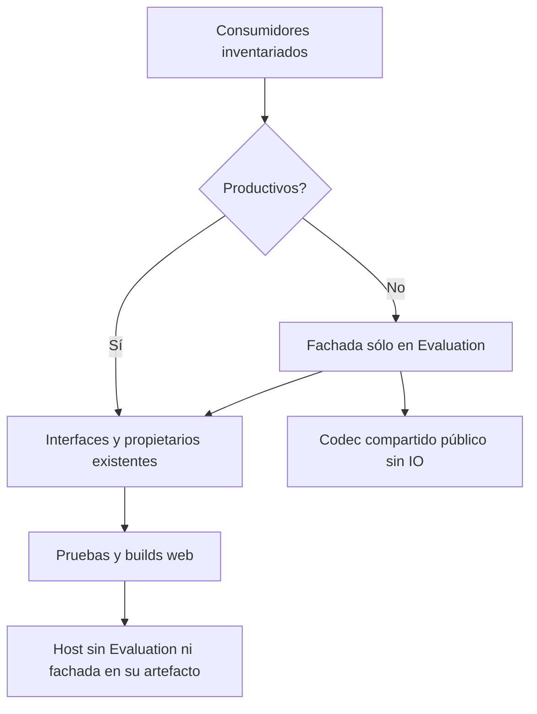

# Retirada de la fachada del runtime productivo

## Auditoría y contrato

PreparationInference reúne interfaces que ya tienen propietarios independientes.
Inventario actual: Infrastructure contiene sólo su declaración; API sólo su
registro. Ninguna ruta ni módulo productivo la solicita. Los consumidores restantes
son pruebas y herramientas de Evaluation que preservan comparaciones/diagnósticos.
La extracción de algoritmos ya se verificó en incrementos anteriores.

Alternativas: mantener el registro muerto conserva una entrada agregada innecesaria;
eliminar también los consumidores QA destruiría pruebas y evidencia; mover la
compatibilidad a Evaluation permite retirar el tipo del artefacto productivo sin
duplicar sus algoritmos. Se elige esa tercera opción. No se promueve el agente
experimental ni se cambia de algoritmo semántico.

El cuerpo de la fachada se conserva como compatibilidad QA. Domain/Application/API/
Infrastructure no referencian Evaluation. Los consumidores productivos siguen
usando sus interfaces existentes; no se crea otro servicio, contenedor o registro.
El codec puro AgentStagePacket pasa a ser público para que el adaptador QA delegue
al mismo algoritmo de serialización/metadata, sin copiarlo ni añadir friend assemblies.
Sus entradas CLR provienen de composición confiable; no concede herramientas,
permisos, acceso a datos ni autorización al modelo.

Invariantes: instrucciones, schemas, flags, presupuestos, cancelación, errores y
propiedad prestada/contenida conservados. Ningún efecto, aprobación o configuración
nuevos. El adaptador QA no se incorpora como fallback al host. Los hashes de los
evaluadores deben distinguir Infrastructure de la nueva ubicación del adaptador.



```text
archivar fuentes originales e inventario de consumidores
reproducir presencia del tipo/registro productivo con pruebas de retirada
trasladar fachada a Evaluation sin cambiar sus algoritmos/delegaciones
retirar registro API sin tocar los alias por capacidad
abrir sólo el codec compartido requerido por el adaptador QA
migrar referencias de hashes y guardas al propietario real
compilar y probar consumidores afectados; ejecutar host normal/desactivado/sustituido
verificar ausencia de Evaluation y del tipo antiguo en artefactos productivos
conservar todos los fallos y pruebas históricas; no inferir comprensión Qwen
```

Compatibilidad: cambio **intencional del API .NET**, no del HTTP. El tipo con
namespace histórico deja de existir en QuickPrompt.Infrastructure y sólo queda
en QuickPrompt.Evaluation para QA; no se reenvía desde producción hacia Evaluation.
Integraciones .NET externas que instanciaran la fachada deben migrar a los puertos
independientes. Los consumidores encontrados en este repo recompilan con Evaluation,
que ya referenciaban. MAUI excluido; sin migración de BD, instalaciones o despliegue.

Rollback conjunto desde before.json: fuente, registro, visibilidad del codec y
referencias de evidencia/guardas. No borrar evidencias.

## Resultado ejecutado

IMPLEMENTADO. Dos pruebas de retirada fallan antes y pasan después: el tipo deja
de estar en Infrastructure y la fábrica no lo registra. Las dependencias de las
cuatro capas productivas no apuntan a Evaluation. El cuerpo del adaptador QA es
idéntico byte por byte al archivado; el codec sólo cambia su visibilidad.

- 457/457 pruebas backend dirigidas en 46 clases PASS, cero omitidas. Incluyen
  consumidores de compatibilidad, proveedores independientes y la regresión de
  conexión semántica anterior. No se eliminó ninguna prueba histórica.
- API, Blazor y evaluador compilan sin advertencias/errores. DLL comunes idénticas
  a las probadas. Artefactos API/Blazor sin QuickPrompt.Evaluation.dll ni dependencia
  Evaluation en sus archivos deps.json; no se transportó la fachada como fallback.
- Quince controles reales Edge/HTTP PASS: host normal/desactivado/sustituido, CRUD,
  revisiones, cancelar/eliminar y error visible. La biblioteca vacía tras eliminar
  el único registro QA se inspeccionó en probe-crud-complete.png.
- Cuatro archivos de contratos/capacidades exportados por el CLI real antes/después
  idénticos. Siete comprobaciones metadata PASS; contrato público de 75 operaciones
  idéntico. Veintisiete controles estáticos PASS.
- Los evaluadores que atribuían hashes al agregado ahora identifican al intérprete,
  generador o revisor real. Semantic/Recovery incluyen además el ensamblado de
  compatibilidad; Agentic distingue ambos hashes.

La primera guarda estática todavía exigía el argumento valueExtractor del registro
retirado; fallo conservado y comprobación migrada a factories/puertos productivos
vigentes. El nuevo fixture de retirada compone también el módulo visible antes de
comprobar su puerto UI. No cambian criterios de éxito o rechazo.

[Evidencia y provenance](../evidence/legacy-inference-retirement-20261020/verification.json).
Los cambios de hashes de los evaluadores se compilaron e inspeccionaron; no se
ejecutaron nuevas campañas Qwen. Este incremento prueba retirada/compatibilidad
controlada, no fidelidad general ni latencia. Sin nueva suite unitaria frontend al
no cambiar presentación; sin instalación ni acceso a bases personales. Los procesos
propios se cerraron y los servicios personales no se reiniciaron.

La matriz canónica sigue con 34 cerrados/54 abiertos; versión abierta y meta activa.
