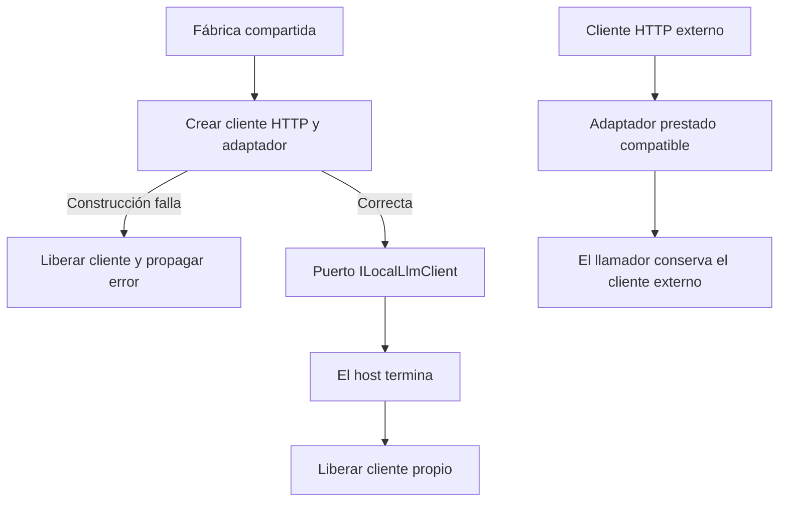

# Propiedad del cliente local de inferencia

## Auditoría y contrato

API y Blazor construyen OllamaClient con HttpClient anidado, pero no registran ese
recurso ni tienen disposición del adaptador. OllamaClient recibe clientes externos
en pruebas/evaluadores y no debe apropiárselos. La frontera ausente es propiedad y
cierre, no el algoritmo de inferencia. No se atribuye a esto la latencia de Qwen.

Se compararon registrar un HttpClient global, añadir un wrapper de delegación y
extender el adaptador existente con una fábrica de recursos propios. La primera
opción mezcla clientes de distintos propósitos; la segunda repite la interfaz sin
necesidad. Se elige OllamaClient.CreateOwned e IDisposable en el propietario
existente. Los dos hosts reutilizan la fábrica, con sus opciones actuales.

Entradas: endpoint loopback, timeout, contexto, muestreo y política existentes.
Salida: OllamaClient bajo ILocalLlmClient. La fábrica crea un handler sin proxy ni
redirección y timeout HTTP infinito; conserva validación de endpoint/opciones en
el constructor. Si construcción falla, libera el cliente creado y propaga el error.
El cierre dispone recursos propios; el constructor público actual de HttpClient
prestado conserva ese recurso con el llamador. Sin nuevos paquetes o framework.

Invariantes: peticiones, schemas, modelos, presupuestos, errores de inferencia,
privacidad, autorización y reglas de negocio intactos; liberar recursos no ejecuta
ni reintenta tareas. El contenedor del host captura/disponde la implementación
creada por su factory, aunque su puerto no herede IDisposable. Los consumidores de
puertos prestados no adquieren propiedad. La fachada compatible ya posee su HTTP
de edición y conserva ese ciclo de vida.



```text
crear_propietario(opciones):
  http = crear cliente con política de transporte actual
  intentar construir adaptador con opciones y propiedad de http
  ante error: disponer http y propagar
  devolver adaptador bajo puerto actual
disponer_adaptador:
  disponer http únicamente si este adaptador lo creó
```

Compatibilidad: constructor anterior conserva firma y propiedad externa; fábrica
y IDisposable son aditivos, sin cambiar HTTP ni configuración. API conserva contexto
de agente/muestreo; Blazor conserva contexto y perfil anteriores. Reversión conjunta
de adaptador y dos registros desde before.json, conservando evidencia. Sin migración
de datos. Alcance sólo web, MAUI fuera de aceptación.

Validación prevista: reproducir cierre de registro productivo antes/después;
verificar cliente prestado, idempotencia, cancelación y solicitudes HTTP reales;
comparar métodos de inferencia; comprobar consumidores afectados en backend/web,
builds y ensamblados. No confundir ciclo de vida con precisión del agente.

## Resultado observado

La prueba del registro real API falló antes de modificar producto: tras disponer
el contenedor, una sonda cancelada del HttpClient devolvía TaskCanceledException,
no ObjectDisposedException. El recurso seguía activo. El mismo método pasa tras
la corrección. Se conservan TRX/log del fallo; no se afirma una DLL baseline congelada.

OllamaClient.CreateOwned e IDisposable están implementados y ambos hosts web usan
la fábrica. Los métodos de inferencia/instrucciones y el constructor prestado son
idénticos a los originales archivados. No hay cambios de protocolo ni modelo.

Pasan 152 pruebas backend de 17 clases y 44 compartidas de cuatro clases, cero
fallidas/omitidas. Seis casos de ciclo de vida incluyen registro real API, HTTP
loopback para disponibilidad/streaming con contextos 8192/12288, cliente prestado
utilizable después de disponer el adaptador, cierre repetido, cancelación de una
petición activa y propagación de errores de construcción. La limpieza interna
durante fallo de construcción está inspeccionada en código, no instrumentada.
Las tandas previas de 1 y 14 son subconjuntos y no se suman.

Una primera tanda ampliada no compiló por inferencia de tipo en un params del
fixture sintético; se corrigió usando LocalModelCapability explícito, sin cambiar
producto ni expectativas. Log conservado y cero pruebas ejecutadas en esa invocación.

API/Blazor compilan sin errores ni advertencias; Domain/Application/Infrastructure
son idénticas entre ambos hosts y ambos proyectos de pruebas. Evaluation compila
con backend. Veintitrés controles estáticos pasan; un guard de fuente nativa
histórico no acredita MAUI. OpenAPI y matriz canónica idénticos.

[Validación](../evidence/local-client-lifecycle-20261020/verification.json),
[proveniencia](../evidence/local-client-lifecycle-20261020/compiled-provenance.json),
[selección](../evidence/local-client-lifecycle-20261020/test-selection.json),
[incidentes](../evidence/local-client-lifecycle-20261020/incidents.json),
[comparación](../evidence/local-client-lifecycle-20261020/algorithm-preservation.json).

Estado: PASS controlado del ciclo de vida. Sin nueva UI, modelo real o aceptación
de latencia; no se reiniciaron los servicios personales. El cierre observado es
del contenedor de servicios y de la fábrica, no una sesión real de cierre Blazor.
La versión sigue NO_CERRADA, 34/54; fiabilidad semántica y auditoría/refactorización
web restantes abiertas. MAUI fuera del alcance actual.
