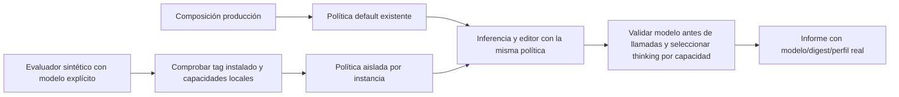

# Comparación local completada — candidato descartado

El modelo configurado sigue siendo `qwen3:8b`. El usuario autorizó descargar y comparar únicamente el candidato descrito, con datos sintéticos locales. Se revalidó el SHA-256 del manifiesto antes de iniciar la descarga. No se cambió la configuración activa. Al terminar, se retiró únicamente el candidato temporal descartado para conservar un modelo generativo, según la preferencia del usuario. Qwen3 8B y Nomic siguen instalados.

Se evaluó **un único candidato temporal**, `qwen3.5:9b-q4_K_M`, contra el modelo activo. El manifiesto público contiene 6.550.825.373 bytes de capas (~6,55 GB decimales, incluido proyector); SHA-256 `56671c2ab9385f9cfcb404638e32cd62d88e3501d44822208363c010179a3c90`. La consulta inicial sólo obtuvo metadatos; la descarga se hizo tras la autorización. [Ficha oficial](https://ollama.com/library/qwen3.5:9b-q4_K_M) y manifiesto local en `docs/evidence/closure-20261020/qwen35-candidate-metadata.json`. No se extrapolan al 9B las métricas de otros tamaños de la familia.

Contrato de evaluación:

- Sólo casos sintéticos locales; sin nube, biblioteca privada ni acciones en la instancia personal.
- Capturar versión de Ollama, digest, contexto, memoria disponible, tiempo frío/caliente y errores. Detener la comparación si el runtime es incompatible o los recursos no permiten una ejecución estable; no cerrar aplicaciones ajenas.
- Primero revisar los seis controles contrastados de fidelidad y los dieciséis de desarrollo en la misma entrada de aplicación. Conservar cada fallo. No generar variantes por frase, añadir votos, relajar oráculos o seleccionar sólo resultados favorables.
- Sólo si supera esos gates, ejecutar validación independiente y generación real. Mantener intacto el holdout hasta congelar un candidato. El éxito de un crítico no sustituye creación, adaptación, completar/copiar, aprobación y persistencia en UI.
- Medir calidad antes de comparar latencia con condiciones equivalentes. Los umbrales de la matriz se mantienen.
- No cambiar el modelo activo ni desinstalar `qwen3:8b` durante la comparación. Al terminar, presentar resultados para conservar un solo modelo generativo; Nomic cumple otra función. No acumular alternativas para el mismo propósito.

La autorización específica requerida por `VERSION_COMPLETION_GOAL.md:70` ya se recibió. No se promete que el candidato mejore calidad, velocidad o uso de memoria. El candidato no superó los gates y no se incorporó al producto; su retirada temporal ya se ejecutó y quedó registrada.

## Sustitución explícita en el evaluador

Auditoría: el evaluador, los validadores y varios puntos de selección de reasoning están fijados a tags concretos. Sustituir globalmente `OllamaClient.Models`, renombrar el modelo en un proxy o habilitar el candidato en la configuración de producción falsearía el aislamiento de la comparación. Se extenderá el propietario de modelos con una política inmutable por instancia: nombres admitidos y capacidad de thinking. El default conserva exactamente Qwen3 8B y la compatibilidad heredada existente; el evaluador recibe sólo el modelo instalado elegido y sus capacidades declaradas por `/api/show`. Ningún endpoint acepta una política del usuario ni se agregan descargas automáticas.

La política compartida se pasa del coordinador de inferencia a su editor local; los métodos usan la misma autoridad y capacidad. El API de producción seguirá construyendo el default. Se preserva el perfil experimental de sampling Qwen3, que no se aplica silenciosamente a otra familia. Este cambio habilita la comparación de los dieciséis casos en la misma entrada de aplicación sin modificar frases, corpus, autoridad de dominio o umbrales.



```text
producción: construir política default sin admitir el candidato
evaluación: elegir tag explícito instalado; obtener capacidades y digest; construir política privada
al inferir o editar: exigir que el modelo pertenezca a esa política; aplicar thinking sólo si está admitido
al listar: intersectar tags instalados con los admitidos de la instancia
no compartir mutaciones de política entre procesos/instancias; no ampliar permisos de guardado
guardar modelo, digest, capacidades y hashes reales junto a todos los resultados
```

Gate de integración: pruebas de aislamiento entre instancias, rechazo antes de red y compatibilidad del default; regresiones legacy/backend; luego campaña de aplicación. No se promociona el modelo por pasar esos controles de transporte.

## Límite observado y contraste de representación

El candidato nuevo terminó el control nativo con 2/6 juicios válidos correctos y cuatro inconcluyentes; no supera el gate y no se promociona. Entre los argumentos conservados vuelve a aparecer la confusión entre escribir un documento imperativo y ejecutar ese documento. La clasificación queda INCONCLUSIVE cuando la cita o forma no es válida, incluso si parece acertar parte del defecto.

Planificación de aplicación con el mismo corpus congelado: 12/16 aciertos, intención 0,75, planes válidos 1,00, destino 0,9375; tres planes con efectos extra y un efecto planificado no autorizado. Es evaluación de planes, sin ejecución de esos efectos. La memoria disponible observada llegó a 512.176.128 bytes en el muestreo; no se interpreta su tiempo como una comparación estable de rapidez. El candidato no justifica cambiar el modelo de NOVA. Se descargó sólo ese candidato y se descargó de RAM su runner temporal antes de volver a evaluar Qwen3 8B. En ese punto aún no se había desinstalado el candidato; su retirada posterior se describe a continuación.

La referencia Qwen3 8B en el **mismo binario** dio 13/16, incluyendo un timeout; cero planes con efectos extra/no autorizados. Corpus, umbrales y hashes de runtime coinciden (`model-comparison-summary.json`). Ambos fallan la aceptación; el 14/16 previo se conserva como evidencia histórica, no se sustituye la tanda nueva por el mejor resultado. Tras registrar la comparación se retiró sólo el tag/digest temporal evaluado; `model-comparison-cleanup.json` verifica Qwen3 8B y Nomic conservados. No se ejecutaron validación independiente/holdout ni promoción de un candidato fallido.

Tras completar la comparación de planificación, se permite un único contraste QA de la representación del mismo control: mantener sistema, funciones, parámetros, datos y oráculos, pero presentar la petición como turno de usuario y el artefacto propuesto como turno de asistente antes de solicitar la revisión. Esto contrasta una causa de protocolo (documento en un campo JSON frente a documento producido en una conversación), sin extraer/recortar autoridad ni clasificar palabras. No se modifica el crítico del producto. Sólo 6/6 permite ejecutar el conjunto independiente; si falla, se conserva y no se ajusta esta variante por caso. El holdout no se usa.

Ese contraste de representación sigue NOT RUN: se prioriza el defecto de propiedad/composición reproducido y documentado en `SEMANTIC_CAPABILITY_OWNERSHIP.md`. No se confunde un plan de ensayo con evidencia.
