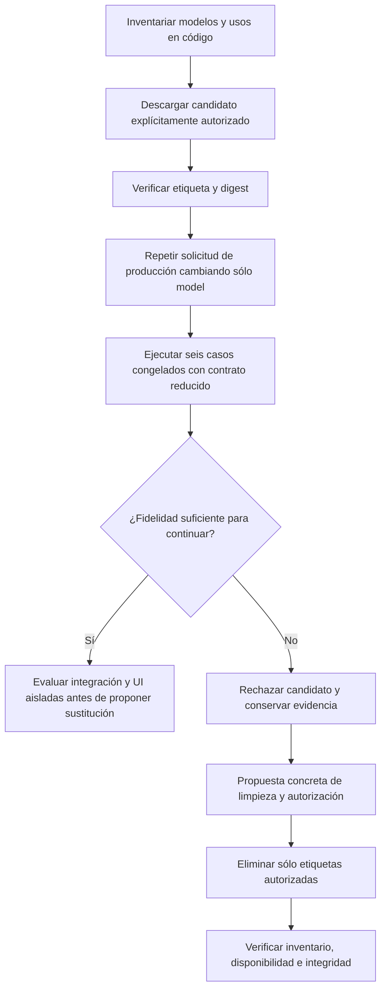

# Inventario y comparación de modelos locales

Fecha: 2026-10-19, America/La_Paz. Estado: inventario, comparación autorizada y limpieza **EJECUTADOS**. La fidelidad de creación de NOVA sigue **NO ACEPTADA**.

## Inventario y uso real

Ollama tenía tres modelos antes de la descarga autorizada y cuatro al terminarla. No equivalían a cuatro modelos cargados simultáneamente: instalación consume disco; residencia depende de las solicitudes a Ollama.

| Modelo | Tamaño reportado por Ollama | Uso observado | Estado final |
| --- | ---: | --- | --- |
| `qwen3:8b` | 5,225 GB | Modelo predeterminado del agente, editor y ejecución local de QuickPrompt | Conservado |
| `qwen2.5:7b-instruct` | 4,683 GB | Alternativa de generación para el mismo propósito; comparaciones previas con fallos | Eliminado con autorización |
| `qwen3:4b-instruct-2507-q4_K_M` | 2,497 GB | Candidato temporal autorizado para comparar creación | Evaluado y eliminado con autorización |
| `nomic-embed-text-v2-moe:latest` | 0,958 GB | Embeddings, función distinta; ninguna referencia ni consumo de embeddings encontrado en el código de QuickPrompt inspeccionado | Conservado; uso por otras aplicaciones desconocido |

Suma de tamaños reportados antes de limpiar: **13,363 GB**. Después: **6,183 GB**. Los modelos retirados sumaban **7,180 GB**. Estas sumas no miden bytes físicos únicos ni espacio efectivamente liberado: Ollama puede compartir blobs entre etiquetas. No se inspeccionó ni modificó configuración privada de otras aplicaciones.

QuickPrompt conserva el mismo modelo predeterminado. `/api/v1/ai/local/models` devuelve únicamente `qwen3:8b`; `/health` responde `status=ok`, `schemaVersion=2`. Nomic no se presenta como modelo generativo soportado. No se modificaron fuentes de producto, listas de modelos permitidos, esquemas, dependencias ni configuración global de Ollama para esta comparación.

## Método y contratos de comparación

Se aplicaron `adaptive-ai-systems` y `algorithmic-engineering`. La comparación utilizó solicitudes sintéticas conservadas y expectativas previas, sin ajustarlas a la salida del candidato.



```text
leer etiquetas, tamaños, digest y referencias reales de la aplicación
descargar sólo la etiqueta autorizada; no cambiar el modelo del producto
reproducir un request sintético archivado cambiando únicamente model
evaluar los seis casos de desarrollo congelados con el mismo contrato reducido
comprobar restricciones, placeholders, tarea futura y ausencia de órdenes de sesión
si el candidato incumple fidelidad: rechazar; no promover ni cambiar expectativas
tras autorización de limpieza:
    borrar únicamente las dos etiquetas aprobadas
    verificar que el modelo actual y el modelo de otra función siguen instalados
    verificar modelos disponibles para QuickPrompt e integridad del servicio
```

El candidato tenía digest `0edcdef34593eac1aa2be9c7d06c432dcf81945adca5eca2f27662c18f168ba0`, Q4_K_M. Se usó Ollama local, sin nube. El replay conserva el JSON real del generador, incluidos esquema, instrucciones y parámetros; cambió sólo el nombre real del modelo. No se falsificaron etiquetas ni se eludió la lista permitida del producto mediante un alias.

## Resultados observados

| Evaluación | Resultado |
| --- | --- |
| Descarga y digest del candidato | PASS; instalación verificada antes de inferir |
| Replay de la solicitud real de creación de reuniones | FAIL de fidelidad: devuelve `No resumas una reunión ahora.` en el cuerpo; además contiene dos rangos con inicio mayor que fin y referencias de autoría incompatibles |
| Contrato reducido: reuniones | FAIL: mezcla el resumen futuro con `No realices el resumen ahora` y menciones a QuickPrompt |
| Contrato reducido: factura en inglés | FAIL: tras describir la tarea indica no realizar ninguna de esas acciones y esperar al humano en esta sesión |
| Contrato reducido: SQL | FAIL: conserva correctamente la prohibición futura de ejecutar SQL, pero convierte la revisión/guardado de esta autoría en una aprobación del resultado futuro |
| Contrato reducido: enseñanza | FAIL: incorpora `Deja el contenido como borrador` y prohíbe explicar el ejercicio en esta conversación |
| Contrato reducido: publicaciones | FAIL: pierde `<producto>`, incluye `No publiques nada en esta sesión`, añade supuestos y termina con una instrucción incompleta |
| Contrato reducido: código | FAIL: deriva condiciones de `sin revisarlo ahora ni guardar todavía` y añade la prohibición no solicitada de ejecutar/modificar código |
| Integración completa y UI con el candidato | NOT_TESTED: no superó el control previo de fidelidad; no se modificó el producto para admitirlo |
| Eliminación de las dos etiquetas autorizadas | PASS: ambas ausentes de `/api/tags` tras `ollama rm` |
| Modelo actual y Nomic preservados | PASS: nombres y digest iguales al inventario anterior |
| QuickPrompt tras limpiar | PASS: modelo disponible `qwen3:8b`, integridad correcta |
| Inferencia mínima tras limpiar | Respuesta disponible; **FAIL de coincidencia literal**: se pidió `LISTO` y Qwen3 8B devolvió `LISTO.`. Se conserva el fallo, sin relajar la expectativa ni repetir para obtener PASS |

Son seis casos de desarrollo ya conocidos, **no un holdout ni una estimación de exactitud general**. El replay tardó 12,2 segundos; los casos reducidos entre 1,4 y 3,4 segundos. No son tiempos del flujo completo ni una comparación controlada de rendimiento con Qwen3 8B. La mayor rapidez de una salida incorrecta no satisface el objetivo.

El fallo del replay se observó en la primera salida del generador; no se ejecutó todo el pipeline de reparación y revisión con el candidato. Los resultados reducidos son diagnósticos, no propuestas publicadas ni versiones guardadas. No se incorporó ningún experimento al producto.

## Decisión y límite pendiente

Se mantiene **un solo modelo generativo instalado para NOVA: Qwen3 8B**, preservando los recorridos ya comprobados. Esto no declara resuelta su fidelidad de creación. La comparación muestra que acumular modelos más pequeños no corrige por sí solo la separación entre tarea futura y controles de la sesión.

Nomic pertenece a otra categoría. No hay prueba de que QuickPrompt lo use ni de que sea innecesario para todo el equipo; no se eliminó sin conocer ese uso y sin autorización. Para futuras comparaciones, cualquier candidato adicional debe tener un objetivo, casos congelados y una decisión de conservar o retirar; la instalación de alternativas no forma parte de la configuración final para el mismo propósito.

Inventario antes/después, solicitudes y resultados: [evidencia local](../evidence/model-selection-20261019/after-cleanup.json). [Replay de producción](../evidence/model-selection-20261019/production-replay.json). [Seis casos reducidos](../evidence/model-selection-20261019/frozen-writer.json). [Comprobación literal del modelo conservado](../evidence/model-selection-20261019/retained-model-check.json).
