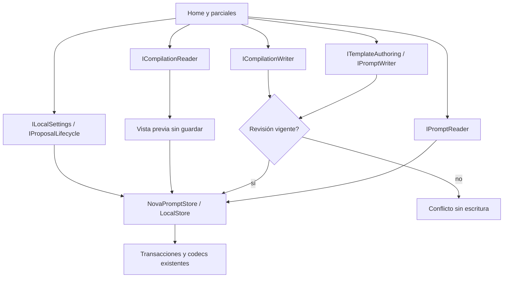

# Consumidores anteriores: CRUD, compilación, ajustes y propuestas

2026-10-20. Incremento IMPLEMENTADO y VERIFICADO. No cierra el objetivo global,
la interpretación del agente ni la versión.

## Auditoría, decisión y propietario

Home y sus parciales accedían al almacén concreto para consultas, guardar/borrar,
compilar, historial, preferencias y propuestas. El propietario transaccional ya
era LocalStore. NovaPromptStore ya ofrecía IPromptReader/IPromptWriter; reutilizar
esos contratos conserva consultas y revisiones sin inventar otro repositorio.

Se compararon acceso concreto, puertos por capacidad y otro servicio/repository
que repitiera las transacciones. Se eligen puertos pequeños implementados por el
propietario existente. No se añade una clase que reenvíe cada método ni un contrato
genérico que borre la diferencia entre lectura y comandos. LocalPromptLibrary
publica los alias y el host registra sus lifetimes. No hay nuevos paquetes.

## Workflow y algoritmo



```text
construir una biblioteca local; registrar alias del mismo propietario por capacidad
leer plantillas/versiones/conteo mediante IPromptReader
guardar borrador/favorito/versión por ITemplateAuthoring: validar y transaccionar
al confirmar borrar: pasar ID y revisión observada al writer existente
previsualizar por ICompilationReader: conservar perfil/ajustes, no escribir historial
al compilar explícitamente: pasar revisión observada y composición al writer
  si cambió: rechazar sin uso/historial; si coincide: guardar según comportamiento anterior
mantener propuestas pendientes, staging y aceptación acoplada en su transacción
guardar preferencias mediante su validador existente; no cambiar consentimiento
no reintentar, guardar automáticamente ni conceder herramientas al modelo
```

## Contratos y límites

| Puerto | Capacidad | Invariantes / errores |
|---|---|---|
| IPromptReader / NovaPromptStore | Find/Search/Versions/ActiveCount | Consultas sin escritor; conteo optimizado en SQLite y fallback compatible para otros lectores |
| IPromptWriter | Borrado con ID y revisión | UI mantiene confirmación explícita; conflicto o ausencia no puede borrar otra revisión |
| ITemplateAuthoring | Save con motivo y propuesta opcional | SaveInside mantiene revisión, versiones y aceptación de propuesta en una transacción |
| ICompilationReader | Preview/History/Executions | Lectura; conserva composición existente; no registra uso |
| ICompilationWriter | Compile/FavoriteFinal/SaveExecution/ClearHistory | Compilar sí conserva historial/uso, privacidad opt-in y revisión; resultados parciales no se guardan |
| ILocalSettings | Settings/SaveSettings | Validador y persistencia existentes; no reemplaza las preferencias de NOVA |
| IProposalLifecycle | SaveProposal/DraftProposal/StageDraftImprovement/Reject | Staging no persiste plantilla; aceptación con ID permanece acoplada a SaveInside |

LocalWorkspace.cs declara los puertos en Application. LocalWorkspacePorts.cs los
implementa en el mismo propietario transaccional mediante declaración parcial.
No hay estado duplicado ni otra conexión a SQLite. Las listas devueltas son las
materializaciones existentes; no son estado mutable compartido con la base.

Los métodos son operaciones locales síncronas y conservan transacciones indivisibles;
no se añade cancelación entre escrituras. La inferencia y sus tokens/lifecycle no
cambian. Estos puertos no se registran como herramientas de reflexión del modelo.

## Implementación y compatibilidad

Los consumidores Home.razor.cs, Home.razor, Home.Assist, Home.Organization,
Home.Simplicity y Home.Sharing usan los puertos para las capacidades migradas.
Program registra los alias de LocalPromptLibrary. La consulta de versiones ahora
recibe un array: el contador Razor usa Length. Safe incluye MissingPromptException
para el writer compartido.

Cambios deliberados de comportamiento: borrar y compilar en la interfaz anterior
ahora pasan la revisión observada a las protecciones ya existentes; una edición
concurrente provoca conflicto antes de modificar datos. La compilación anterior
sigue guardando historial, mientras React mantiene su preview sin escritura. No
se fusionan esos dos casos bajo un CRUD genérico.

La inyección concreta restante no se oculta: grupos/perfiles/combinaciones,
PrepareAssist/ApplyAssist, transferencias/bridge y diagnóstico técnico todavía
usan capacidades por migrar. No se afirma que todo Home esté desacoplado.

## Evidencia ejecutada

[verification.json](../evidence/local-workspace-20261020/verification.json):

- **155/155** pruebas de la aplicación compartida, sin omitidas. Cuatro nuevas
  pruebas de puertos/SQLite real cubren aliases, revisiones, preview, composición,
  opt-in de valores, propuestas, staging, antirreplay, historial y ajustes.
- **23/23** pruebas backend de LibraryIntegration, ArchivePort, ProviderPort y
  CollectionPort; sin omitidas. No se repite toda la matriz del agente.
- API y Blazor compilan, cero errores/advertencias; DLL compartidas idénticas.
- **9 comprobaciones en Edge visible** con dos hosts propios y una base sintética:
  crear, preview sin escritura, compilar una vez, actualizar/versionar, cancelar
  eliminación, compilación/borrado obsoletos, borrar vigente conservando historial,
  persistencia de tema tras recargar circuito. API aporta lectura de evidencia y
  una modificación concurrente deliberada. Cero pageerror y solicitudes externas.
- **7 controles estáticos** pasan, incluido que Home no vuelva a usar Store para
  las capacidades ya migradas. Esta puerta no afirma aislamiento de las restantes.

Se conservaron un error de compilación inicial por Count/Length y dos incidencias
del harness: selector de summary que incluía un submenú y menú de opciones aún
abierto tras cancelar. Se acotó el selector y se cerró el menú por su control real;
no se usaron clicks forzados, CSS para ocultarlo ni cambios de permisos/expectativas.

Frontend React y semántica Qwen: **NO EJECUTADOS en este incremento**, por no cambiar
sus consumidores ni decisiones. La falta de prueba semántica no se convierte en PASS.

## Rollout, reversión y pendiente real

Sin migraciones ni cambios de modelo/HTTP. El miembro nuevo ActiveCount tiene un
default de interfaz para lectores existentes y una implementación optimizada en
el adaptador SQLite. Para revertir, retirar únicamente estos alias/consumidores y
puertos; conservar el trabajo previo y los datos. No procede un reset global.

Quedan organización, transferencias/bridge, workflow de Quick Assist y separación
de su puerto de inferencia, además de la sustitución semántica no cualificada.
La matriz canónica sigue 34 cerrados / 54 abiertos. El goal permanece activo.
