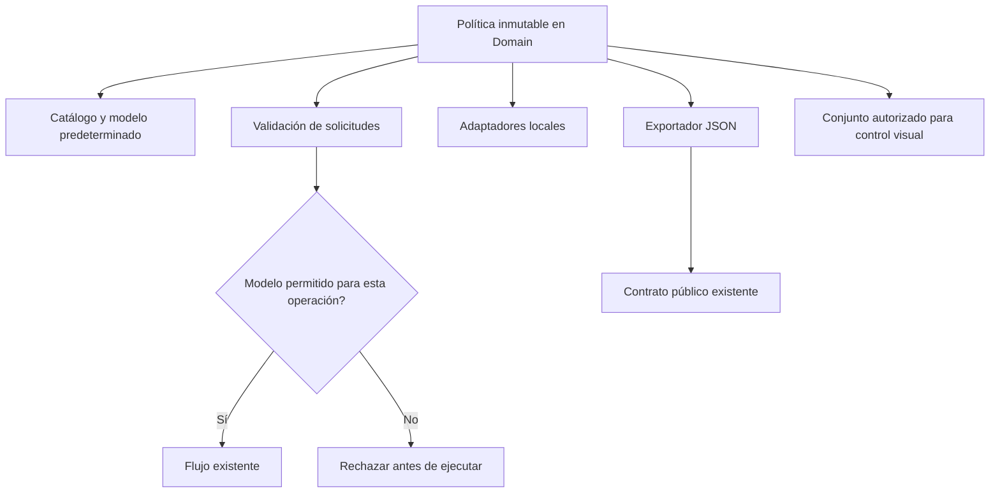

# Política compartida de modelos

## Auditoría y contrato

LocalModelPolicy contiene la admisión del proveedor, pero vive en Infrastructure.
Application y API repiten listas de nombres y la restricción de control visual;
telemetría mantiene otra lista para anonimizar nombres. Los defaults C# también
repiten el modelo principal. Son reglas del producto, no transporte HTTP ni
interpretación de peticiones. El exportador depende de infraestructura para leerlas.

Se comparó duplicar una interfaz/lista en Application, importar Infrastructure y
mover el propietario puro hacia Domain. Las dos primeras duplican política o
invierten dependencias. Se elige mover la clase y descriptor conservando namespace
público y añadir reenvío de tipos desde Infrastructure. El nombre histórico del
namespace no determina el ensamblado propietario; Application sigue sin referencia
de proyecto a Infrastructure. Es política inmutable, no otro servicio/registro global.

Modelo predeterminado C# como constante única. Catálogo y reglas consultan al mismo
propietario; control visual usa un conjunto explícito cualificado de identidades
pertenecientes al catálogo. WithAgentControl devuelve otra política inmutable,
sin ampliar Production ni aceptar identidades externas. Production conserva ambos
nombres admitidos y sólo el principal para BROWSER/SAME_TAB. No instala modelos,
cambia el modelo activo ni cualifica modelos nuevos.

Entradas: descriptores y cualificación suministrados por composición C# confiable.
Salidas: identidad/default, Allows, Require y AllowsAgentControl. Sin IO, estado de
usuario, inferencia, similitud o parsing de frases. Rechazos siguen en los mismos
consumidores, con sus mensajes y antes de efectos. Restricciones del proveedor
QwenThinkingSampling permanecen en su perfil específico: no son admisión general.
Los defaults UI existentes son preferencias del cliente, no listas de autorización.



```text
construir catálogo con los descriptores actuales y validaciones existentes
cualificar únicamente un subconjunto explícito de sus identidades
consumidores consultan admisión general o cualificación visual según su operación
defaults de DTO/callers C# referencian el mismo propietario
telemetría sólo conserva nombres de Production; el resto sigue como other
exportador lee política/atributos sin cargar adaptadores
rechazo no crea ejecuciones ni cambia permisos/estado
```

Compatibilidad: nombres públicos, constructor/descriptor, datos serializados y
modelos/default/contexto actuales conservados; reenvío de tipos al nuevo ensamblado.
Exportador referencia Application/Domain, sin capa de proveedor. HTTP/SQLite/UI y
permisos de aprobación sin cambios. No introducir dependencias o configuración.
Reversión conjunta desde before.json y retirada de la nueva ubicación/forwarders,
conservando evidencias; sin migración de datos. Alcance web; MAUI excluido.

Aceptación prevista: metadata idéntica antes/después, pruebas de catálogo inmutable,
defaults, cualificación/negativos y reenvío; consumidores afectados y metadata pública
con sus controles; HTTP real de admisión/defaults sin inferencia. Builds y hashes de
ensamblados, matrices por frontera. No es cualificación semántica ni latencia Qwen.

Estado: IMPLEMENTADO; aceptación controlada PASS. Versión y meta siguen abiertas.

## Resultado ejecutado

- 550 pruebas backend en 40 clases y 112 compartidas en 13 clases PASS, cero
  omitidas. Selección por consumidores directos; 17 casos nuevos comprueban
  propietario, defaults, subconjunto inmutable y admisión antes de persistir.
- Cuatro controles HTTP reales sobre SQLite sintética PASS: observación/default,
  control visual no cualificado, preparación y ejecución inválidas. No se lanzó
  inferencia. El proceso propio fue cerrado; servicios personales intactos.
- Siete controles del exportador real PASS, con sustitución, entradas inválidas y
  fallo antes de escritura. Metadata y contrato público de 75 operaciones idénticos.
  Exportador depende únicamente de Application/Domain, cero paquetes transitivos.
- API/Blazor compilan sin advertencias/errores; Domain/Application/Infrastructure
  coinciden por SHA256 entre ambos builds y ambos proyectos de pruebas. Evaluation
  compila con backend. Veinticinco controles estáticos PASS.
- Un consumidor compilado contra los ensamblados antiguos funciona con los nuevos
  sin recompilar: ambos tipos se resuelven ahora desde Domain mediante forwarders.
  Esta prueba sólo cubre constructor, consulta y resolución de esos dos tipos.

La primera ejecución de metadata falló por exigir la dependencia antigua de
Infrastructure, después de generar el contrato idéntico. Se conserva el test previo;
ahora exige Application/Domain y comprueba también las dependencias transitivas.
Dos advertencias MSB3277 pertenecen al pequeño consumidor binario construido contra
DLL antiguas, no a los builds productivos. Incidentes y evidencia se conservan en
[verification.json](../evidence/model-policy-ownership-20261020/verification.json).

No modifica instrucciones ni algoritmos de inferencia. No se repitieron campañas
frontend/Qwen ajenas a esta frontera. No demuestra precisión semántica, latencia ni
cierre general: 34 requisitos cerrados y 54 abiertos permanecen sin cambiar.
