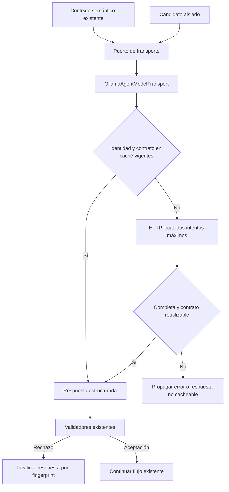

# Sustitución independiente del transporte de inferencia

Estado inicial: DI publica IAgentModelTransport como alias de PreparationInference.
El candidato aislado necesita por ello la clase semántica anterior sólo para HTTP,
modelo, caché y observación. Una interfaz sin composición independiente no permite
retirar esa implementación. No hay evidencia de que este acoplamiento cause por sí
solo los errores de comprensión conservados.

## Contrato de cambio

- **Propietario:** OllamaAgentModelTransport absorbe HTTP y la caché existentes.
  PreparationInference conserva interpretación, contexto y validadores de significado.
- **Puerto:** IAgentModelTransport conserva sus métodos. IValidatedAgentModelTransport
  extiende ese puerto exclusivamente con invalidación de una respuesta rechazada;
  consumidores que no gestionan caché no adquieren ese requisito.
- **Composición:** fábrica API registra un transporte y alias a sus dos puertos.
  PreparationInference recibe el puerto de invalidación; el candidato sólo el puerto
  básico. Instancias construidas directamente conservan un transporte propio.
- **Invariantes:** loopback HTTP, proxy/redirect desactivados, modelo permitido,
  paquete sin cambios semánticos, cancelación, máximo dos intentos transitorios,
  telemetría por consulta, respuesta completa, digest vigente y límites/TTL de caché.
  La invalidación sigue ejecutándose desde los validadores propietarios.
- **Estado:** un único caché por instancia de transporte. No escribe DB/UI ni aprueba
  efectos. El consumidor no cierra un transporte prestado; DI cierra el suyo.
- **Alternativas:** añadir más métodos a PreparationInference mantiene acoplamiento;
  duplicar un cliente para el candidato duplica seguridad/reintentos. Extraer el
  adaptador existente y compartirlo es la mínima frontera sustituible.
- **Compatibilidad:** nombres de interfaces anteriores y HTTP permanecen. La adición
  de un parámetro opcional al constructor C# exige recompilar consumidores binarios;
  todos los proyectos del repo se reconstruyen. No cambia SQLite/config/modelos.
  No se promueve el candidato semántico rechazado.
- **Retirada:** mover InferenceReuse.cs al parcial del nuevo propietario, conservando
  fuente previa/hash. No conservar dos cachés ni dos políticas de transporte activas.
- **Verificación:** contratos existentes de reintento/cancelación/caché y payload;
  sustitución del transporte sin red desde el intérprete; llamada directa sin
  intérprete anterior; build API/evaluador y regresión backend por frontera común.
  No repetir corpus real ni matriz frontend para este cambio sin comportamiento UI.



```text
componer un adaptador de modelo y compartir sus puertos
antes de consultar: validar modelo y cancelación
identificar caché por paquete completo y digest instalado
si hay respuesta vigente: devolver copia estructurada
si no: enviar paquete con política HTTP existente y presupuesto finito
rechazar respuesta incompleta o cancelada; no cachearla
si sigue vigente el digest y el esquema es reutilizable: recordar sin thinking
devolver respuesta; validar su significado en el propietario existente
si ese propietario rechaza: invalidar la respuesta en el mismo transporte
al cerrar: liberar sólo recursos creados por el propietario
```

La validación semántica real y la aceptación de versión siguen siendo puertas
separadas. Los resultados ejecutados se anexarán sin modificar expectativas.

## Resultado ejecutado

- 46 controles dirigidos PASS; después, backend completo **794/794**, cero omitidos.
  Tres pruebas nuevas cubren el préstamo del puerto, caché compartida/cierre del
  primer consumidor y resolución desde la fábrica real sin intérprete anterior.
- API y Blazor compilan con cero warnings/errores; sus tres DLL compartidas son
  idénticas. Evaluation recompiló durante la ejecución de backend, sin campaña LLM.
- Once controles estáticos PASS. La secuencia HTTP y el algoritmo de caché coinciden
  exactamente con originales tras normalizar sólo finales de línea y cambiar el
  propietario/visibilidad previstos. Fuentes permanecieron estables durante pruebas.
- El primer control de trazabilidad señaló el path antiguo del caché en la matriz;
  se actualizó su propietario sin cambiar estados ni criterios. El control vuelve
  a pasar. Las matrices no ejecutan workflows por validar sus manifiestos.

Evidencia: [verification.json](../evidence/model-transport-20261020/verification.json),
[fuentes](../evidence/model-transport-20261020/sources.json) y
[algoritmos preservados](../evidence/model-transport-20261020/algorithm-preservation.json).
La fuente previa está inventariada en before.json. No se eliminan informes históricos
que mencionan InferenceReuse.cs; el path actual pertenece al nuevo propietario.

Los evaluadores ReflectedContent/Recovery y sus pruebas HTTP usan el adaptador
independiente. PreparationInference conserva su implementación pública anterior de
IAgentModelTransport como puente delegado de compatibilidad; DI ya no resuelve el
puerto hacia esa clase y el candidato no necesita construirla. No queda un segundo
caché/algoritmo HTTP en ella. Se añadió referencia **de pruebas** al proyecto API para
invocar la composición real por reflexión sobre su tipo interno explícito; no hay
nuevos paquetes o descubrimiento de código arbitrario en producción.

No se repitió UI ni se usó Qwen real: el incremento no cambia acciones/pantallas ni
intenta cualificar otro juicio semántico. Las 159 pruebas frontend y recorridos UI
del incremento anterior conservan su alcance histórico, sin contarlos como nuevos.
El núcleo semántico activo y los fallos del candidato siguen conservados. La puerta
canónica permanece NO_CERRADA, 34 cerrados /54 abiertos. El objetivo global sigue activo.
