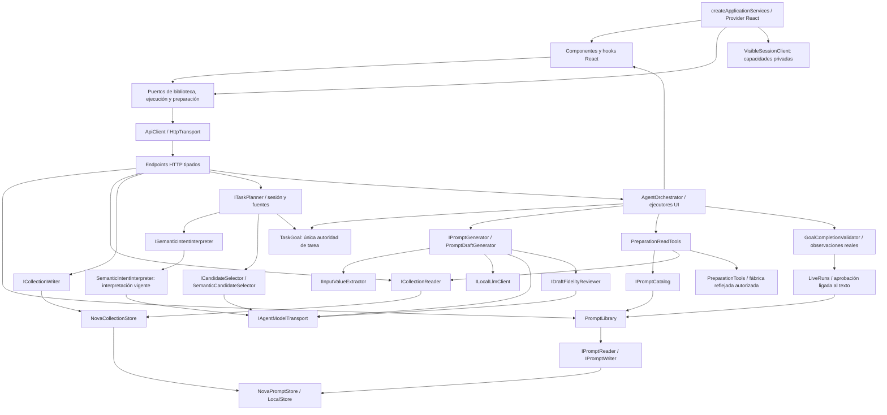

# Mapa modular de QuickPrompt

2026-10-20. Inventario y contrato de la refactorización solicitada. No es una declaración de cierre ni de migración terminada.

Alcance vigente por decisión del usuario: **sólo versión web**. MAUI queda fuera
de esta meta; las notas anteriores sobre sus herramientas pendientes son históricas.
[Decisión y efectos](WEB_SCOPE_DECISION_20261020.md).

## Fábrica y bloques

Las fábricas de ApplicationModules separan biblioteca, agente y ejecución visible. LocalPromptLibrary comparte la construcción de biblioteca/colecciones/archivos entre API y Blazor; cada host registra los alias de sus puertos. La fábrica es el punto de composición: conecta implementaciones con interfaces y valida sus dependencias. Reflection descubre métodos de proveedores explícitamente permitidos y genera contratos desde tipos C#; no descubre código arbitrario ni concede permisos. SOLID no exige una jerarquía de clases para cada pantalla o frase. React usa componentes/hooks; C# usa servicios, puertos y composición. Herencia sólo donde exista variación real y sustitución verificable.

El diagrama representa la composición productiva actual. ReflectedSemanticAgent
permanece aislado en Evaluation/Experiments, sin conexión de sustitución al runtime;
no está promovido. La interpretación anterior sigue como deuda abierta mientras
no se pueda retirar con evidencia suficiente.

| Bloque y contrato | Responsabilidad única | No le pertenece | Estado observado |
|---|---|---|---|
| React, hooks y AgentUiSurface | Presentación, interacción, snapshot y aplicación de comandos tipados | Persistencia, interpretación por frase, aprobación automática | Existente; no se reescriben componentes funcionales por estilo |
| ApplicationServices / ServiceContext | Componer puertos sobre ApiClient y entregarlos a los consumidores de esta aplicación | Datos de dominio, aprobación ni lógica de pantallas | Entrada estable y 18 consumidores conectados; sustitución al montar verificada |
| VisibleSessionClient | Registro de capacidades por instancia e inicio/recuperación con identidad existente | Permisos, ejecución DOM o memoria de tarea | Factory sobre LiveClient prestado; exports compatibles delegan a un solo algoritmo |
| AgentProposalSession / AgentUiProvider | Propietario del vínculo entre editor y escritor activo por montaje, con release ligado al registro | HTTP, estado de dominio, lifecycle del driver ni autoridad DOM | Registro global retirado; App compone contexto, editor manual opcional y SameTabAgent standalone con sesión local |
| AgentUiDriver / AgentUiCommandHost | Primitivas DOM, guardas comunes, cursor, cancelación y observación | Despacho por frases, persistencia ni aprobación de dominio | Fábrica de registro tipado sustituible; primitivas y finalización conservadas |
| AgentUiCommandRegistry / createAgentUiCommands | Despacho de IDs de protocolo, acciones y estado técnico por driver | Intención natural, permisos del backend o emisión de recibos | 21 IDs, descriptores inmutables y captura síncrona de borrado; cadena anterior retirada |
| PromptDeletionController / usePromptDeletion | Revisión, habilitación y decisión de borrado UI, identidad privada y ciclo de vida por conexión | Transacción, permisos del dominio, navegación global o interpretación natural | App compone host estrecho; puertos existentes, vista desprendida y callbacks desacoplados del lifecycle |
| EditorDraftSession / createEditorDraftSession | Snapshots privados de borradores entre visitas, afinidad ID/revisión y copias de defaults | Formulario actual, valores, undo/redo, SQLite o interpretación | Clase privada por montaje; ocho accesos a Map retirados de App y regla única para ambas entradas |
| EditorContextPreparer / createEditorContextPreparer | Snapshot de contexto, inspección delegada y JSON de valores propios por variables reales | Elegir pantalla/origen, parser, autorización, persistencia o interpretación | Clase privada sobre dos puertos prestados; dos algoritmos de App unificados y cancelación explícita opcional |
| ApiClient / HttpTransport | Conexión, cabeceras de protocolo, cancelación, validación de respuestas | CRUD de negocio o decisiones del agente | Fábrica implementada; sustituidas tres conexiones directas duplicadas |
| Puertos de biblioteca y createLibraryServices | Contratos tipados de prompts, plantillas, colecciones y archivos; esquemas HTTP fuera de componentes | Reglas de negocio, aprobación ni estado React | Consumidores CRUD, editor, versiones, compartir y grupos migrados; useLibrary admite sustitución y cancela la lectura anterior |
| LiveClient / PreparationClient | Adaptadores tipados de contexto, acciones/recibos, revisión, aprobación y borradores; JSON/SSE sin consumir el stream | Memoria de tarea, selección semántica ni ejecución DOM | Fábricas integradas en App, SameTabAgent, NovaLive, PreparationCanvas y PreparedUse; capacidades y cancelación explícitas |
| Endpoints | Adaptación HTTP, límites y seguridad del origen local | Redacción, reglas SQLite ni selección semántica | Existente; consumidores inventariados |
| IPromptCatalog / ICollectionReader / ICollectionWriter | Consulta de prompts/versiones y lectura/escritura de colecciones separadas por consumidor | El lector reflejado no recibe escritor ni LocalStore completo | Implementados; pruebas de sustitución sin escritor/SQLite y CRUD UI sobre transacciones reales |
| PromptLibrary / reader / writer | Reglas CRUD y revisiones | HTTP, React ni texto natural | Separación existente y conservada |
| IEditorDraftPreparation / EditorDraftPreparation | Caso de uso explícito del editor: validar, evaluar, registrar y observar usando dueños existentes | Modelos, parsing alternativo, guardar prompts, aprobación o transporte HTTP | Lógica inline retirada del endpoint; interfaz y factory DI, 109 pruebas y equivalencia HTTP verificadas |
| IPreparedDraftCompletion / PreparedDraftCompletion | Compilar valores, recuperar resultado disponible, reservar y registrar checkpoint/sesión/eventos | Persistencia de prompts, autoría, permiso de guardar o transporte | Extraído del HTTP; recibo sin contenido devuelve conflicto sin reejecutar |
| IPreparedDraftSaving / PreparedDraftSaving | Confirmación explícita, guardado delegado y auditoría | Control visual, modelos o compilación | Dos puertos existentes; factory verificada sin LiveRuns y recibos/revisiones del almacén conservados |
| EditorTools / EditorCompilation | Herramientas estructurales y vista previa pura con validación común | Memoria de tarea, persistencia o interpretación natural | Parser de dominio conservado; compilación retirada del host HTTP sin cambiar JSON |
| NovaPromptStore / LocalStore | Transacciones, snapshots, concurrencia y persistencia | Interpretar peticiones o controlar pantallas | Diez servicios trasladados a Infrastructure/Local; retirada inclusión comodín desde el frontend anterior |
| AgentSessions / TaskConversationContext | Estado conversacional y restauración de referencias | Redactar y conceder permisos | Existente; retirada caché paralela de conversaciones del candidato |
| TaskSourceResolver | Lecturas vigentes, identidad y alcance | Cambiar los resultados pedidos | Existente; conserva verificaciones de versión |
| ICandidateSelector / SemanticCandidateSelector | Comprobar pertenencia de cada candidato real mediante transporte compartido | Recuperación, ranking, identidad definitiva, revisión, permisos o efectos | Independiente del intérprete; puente compatible único y autoridad por puntuación retirada |
| ReflectedSemanticAgent | Adaptar inferencia a herramientas tipadas y una tarea fija | Escribir registros o aprobar efectos | Candidato refactorizado; pruebas reales todavía pendientes/fallidas |
| Interfaces semánticas / SemanticIntentInterpreter | Interpretación, contexto, referencias y contenido tipados sobre transporte/selección prestados | Generar borradores, edición, extracción de valores, persistencia o autorización | Fábrica independiente; mismos algoritmos acotados, sin mejora de precisión presumida |
| PreparationInference (sólo Evaluation/Compatibility) | Reproducir consumidores QA históricos delegando a propietarios independientes | Runtime productivo, datos y autorización | Retirada de Infrastructure y del registro API; cambio .NET documentado, cuerpo QA idéntico |
| TaskGoal | Petición completa, requisitos, límites y comprobación ligada al cuerpo | Interacción HTTP o inferencia | Conserva encargo literal completo sin resumen de contenido; modo interno WORK_ORDER y evaluación vinculada a cláusulas; no cambia JSON HTTP |
| IPromptGenerator / PromptDraftGenerator | Generación/adaptación de contenido, delegando extracción y revisión a sus puertos | Interpretación general, persistencia, aprobación o ejecución | Fábrica independiente; puente y schemas públicos compatibles; parcial antiguo retirado |
| IDraftFidelityReviewer / DraftFidelityReviewer | Revisión semántica existente y reparación acotada ligada a propuesta exacta | Generación, interpretación general, persistencia o aprobación | Propietario independiente y sustituible; fallos de precisión del modelo siguen abiertos |
| IInputValueExtractor / PromptInputValueExtractor / resolver | Proponer valores para nombres reales y comprobar evidencia literal en dominio | Autoría ni autorización de ejecución | Proveedor independiente sobre transporte, puerto explícito en orquestador y puente compatible compartido |
| IInputScopeInterpreter / PromptInputScopeInterpreter / SemanticContext | Delimitar material de campos sobre fuente/revisión recibidas; compartir proyecciones de contexto | Elegir intención, recuperar registros o conceder efectos | Proveedor independiente; planificador/resolvedor reciben puerto explícito; parcial antiguo retirado |
| PreparationTools / fábrica reflejada | Descubrimiento autorizado, deserialización y permiso de capacidades | Elegir intención por similitud o escanear ensamblados arbitrarios | Existente, reutilizada y probada |
| Orquestador / dispatcher / verificador | Ejecutar dependencias y comprobar efectos observados | Reinterpretar autoría o falsificar recibos | Existente; no se añaden otros árbitros |
| LiveRuns | Aprobación, hash, caducidad y commit | Conceder autorización por respuesta del modelo | Existente y preservado |

## Retirada de lógica y archivos

Retirar requiere inventario de consumidores y sustitución probada: cambiar composición, demostrar la nueva ruta, eliminar referencias, borrar implementación huérfana y ejecutar la matriz afectada. No se borran evidencias ni se suprimen pruebas para declarar PASS. No se decide por el nombre de una carpeta o por la presencia de un `if` de validación.

| Familia | Decisión / condición |
|---|---|
| Algoritmo semántico vigente | Ya reside en SemanticIntentInterpreter sin generación/editor; su sustitución de comportamiento exige cualificar otro algoritmo, todavía pendiente; no hay fallback añadido |
| Prototipo reflejado anterior | Retirado de infraestructura productiva; candidato y fallos aislados en Evaluation/Experiments |
| Caché de conversaciones del candidato | Retirada; estado vive en sesión/TaskGoal |
| Valores en InstructionDraft | Retirados; interfaz de contenido deja de ofrecer funciones del extractor |
| Conexiones HTTP repetidas en componentes | Retiradas; un cliente común sirve JSON y streaming |
| Importación de clientes globales en features / App / useLibrary | Retirada de consumidores productivos; contexto de servicios y factory compartida; exports anteriores conservan delegación compatible |
| RankedCandidateCompatibility | Retirado del código activo; selección explícita/publicada o error de capacidad ausente, nunca identidad por score |
| InputScopeInference.cs | Parcial retirado; proveedor de alcance independiente, métodos de contexto compartidos y puente compatible único |
| DraftFidelity.cs | Parcial retirado; revisión en propietario independiente bajo IDraftFidelityReviewer, una sola invocación de generación |
| PreparationInference.Authoring.cs | Parcial retirado; autoría y generación en PromptDraftGenerator, sin implementación duplicada en el intérprete |
| SemanticInference, InstructionUseInference, TaskGoalInference, TaskResultInference, TaskGoalAdvice, SourceReferenceInference | Seis archivos retirados/archivados; parciales cohesivos de SemanticIntentInterpreter, fachada anterior sin algoritmos |
| Rutas y esquemas CRUD repetidos en componentes | Retirados de sus consumidores; createLibraryServices compone tres puertos tipados sobre ApiClient |
| Código compartido enlazado desde src/QuickPrompt.Web | Retirada inclusión de archivos; servicios trasladados a su propietario y consumidores conectados por referencia de proyecto |
| NovaAssist y vista NovaCore | Retirados tras comprobar cero consumidores productivos; tipo NovaState trasladado al módulo de preparación y fuentes exactas conservadas |
| Aplicaciones anteriores, extensión y adaptadores | No declarados huérfanos: resolver dependencias y criterios de paridad antes de borrar |

## Pruebas por frontera

- Frontend: sustitución de transporte, cabeceras/capacidades, cancelación, esquema/error y streaming intacto; luego recorrido real.
- Backend/CRUD: validación de negocio, revisión obsoleta, transacciones y confirmación; las pruebas existentes siguen exigidas.
- Agente: contratos de herramientas y aislamiento, más fidelidad con modelo local y efectos reales en UI. Un PASS de transporte o CRUD no acredita interpretación.

No hay migración de base, paquete, modelo, nube ni despliegue añadido. No se interrumpen los servicios personales en ejecución. Los 88 criterios conservan su estado hasta aportar evidencia correspondiente.

## Sustitución y ciclo de vida comprobados

`createApiClient(transport)` admite un transporte alternativo y mantiene cancelación,
cabeceras y validación. `createLibraryServices(client)` compone los puertos HTTP;
`useLibrary` consume sólo `list`, invalida la respuesta del propietario anterior y
aborta su petición al cambiar el puerto. La UI no adquiere autoridad para aprobar
ni persistir fuera de las reglas del backend.

`AddPromptLibraryModule`, `AddNovaAgentModule` y `AddVisibleExecutionModule` son
fábricas de composición, no nuevos propietarios de dominio. Sus singleton y sus
alias conservan las instancias y políticas anteriores. Los diez servicios locales
se movieron sin cambiar sus bytes; `src/QuickPrompt.Web` ahora referencia su
ensamblado propietario en lugar de que Infrastructure compile fuentes del frontend.

No se convierte React a clases ni se introduce herencia sin comportamiento
sustituible. El patrón pedido se aplica a responsabilidades y dependencias; quitar
validaciones de permisos, revisiones o errores rompería sus invariantes.

`Check-ModuleBoundaries.cjs` amplía los controles de dependencia/importación por
incremento, con alcance estático explícito y evidencia versionada. Las primeras
cinco comprobaciones son históricas. Las pruebas de ejecución se registran aparte:
la exclusión de Evaluation del grafo productivo no demuestra fidelidad del modelo.

`createLiveClient` compone la conexión de ejecución: inicio/observación, consulta,
control, propuestas, aprobación/commit, contexto, polling, progreso y recibos. El
SSE despierta la lectura autenticada; no proporciona autoridad para ejecutar una
acción. `SameTabAgent` conserva secuencias, replay de recibos sin repetir DOM y
pausas. `createPreparationClient` conserva identidad de operación y devuelve los
streams intactos al verificador existente. `UiObservation` y `LiveUiAction`
pertenecen ahora al protocolo; el driver DOM los consume y reexporta sus tipos.

La retirada de `NovaAssist` elimina únicamente una vista sin consumidores; no
retira `NovaAssistant` del backend: la preparación manual del editor todavía usa
su endpoint de propuestas. `NovaCore` sólo conservaba consumidores de su tipo,
que ahora vive en preparación. No se borran endpoints públicos por similitud de
nombre ni se declara huérfana toda la aplicación anterior.

La suite frontend descubría únicamente `.test.tsx`; ahora incluye también
`.test.ts`. Los 147 controles anteriores a la retirada pasan; la tanda final
contiene 146 porque se retiró un montaje exclusivo de la vista huérfana, después
de demostrar su PASS. No se quitó una prueba fallida para obtener verde.

## Incremento de puertos de consulta y rutas — 2026-10-20

`PreparationReadTools` ahora depende de `IPromptCatalog` e `ICollectionReader`.
`PromptLibrary` reúne la existencia/lectura de versiones en un solo método;
`NovaCollectionStore` adapta reader/writer a las transacciones actuales. Los alias
singleton viven en ApplicationModules. Las rutas de biblioteca se trasladaron a
LibraryEndpoints y las de interpretación a NovaEndpoints; Program compone y
configura el host. Archivo/compartir permanecían pendientes en este checkpoint;
el incremento siguiente los migra sin declarar completada la refactorización global.

784 controles backend y cuatro recorridos de colecciones pasan. Los siete controles
del agente con órdenes tipadas pasan con el mismo API/web por hashes. No se repite
el frontend unitario al no cambiar sus fuentes. Ver
[contratos y evidencia](COLLECTION_PORTS_20261020.md).

El experimento de contexto descrito por responsabilidad queda rechazado y aislado
en Evaluation: una instrucción aceptable en el caso dirigido y dos fallos conservados.
El compositor no cualificado no se mantiene en producción. La recuperación del
candidato conserva sólo contenido final/llamadas; no reenvía campos privados del
proveedor. Esa prueba de protocolo no acredita comprensión libre.

## Incremento de archivo y compartir — 2026-10-20

LocalPromptLibrary construye una sola biblioteca local por host/ruta y publica los
adaptadores compartidos por sus alias. ILibraryArchiveReader/Writer, IPromptSharing
e ILegacyArchiveConverter conectan ambas interfaces con codecs/transacciones
existentes. LibraryEndpoints ya no importa Infrastructure ni recibe LocalStore.
LibraryTools/LearningCenter usan LibraryArchiveClient; Home.Sharing y la lectura de
archivos Blazor usan los mismos puertos. Se retiró la restauración directa que
eludía snapshot y respaldo previo; no se borran las capacidades aún consumidas.

789 pruebas backend, 151 compartidas, 151 frontend y 14 comprobaciones en Edge
visible pasan. Las DLL compartidas de API y Blazor son idénticas. La conversión
limita bytes durante la lectura, propaga cancelación y limpia su temporal. Ver
[contrato y límites](ARCHIVE_PORTS_20261020.md). La interpretación libre y la
migración de los restantes consumidores anteriores siguen pendientes.

## Incremento de proveedores, preferencias y conexiones finales React

ProviderClient y PreferenceClient concentran catálogo/modelos, preparación de
transferencia, conexión de ejecución y preferencias. PreparedUse obtiene destinos
reales en lugar de duplicar URLs. IPromptTransfer pertenece a Application y se
construye en LocalPromptLibrary; ReviewExecution reutiliza valores/preview de
PromptLibrary. Confirm extiende el propietario de preferencias, sin otorgar al
modelo otro camino de escritura.

TemplateClient.categories y PreparationClient.propose absorben las dos últimas
llamadas de componentes. No hay request/openApiResponse en App/features/hooks;
Zod, cabeceras de run y cancelación permanecen en los clientes. Seis controles
estáticos, 791 pruebas backend, 159 frontend y nueve comprobaciones UI reales pasan.
La prueba local de transporte/copia con Qwen conserva un fallo de respuesta literal;
no prueba fiabilidad del planificador. Ver
[contrato/evidencia](PROVIDER_PORTS_20261020.md). La frontera siguiente son los
consumidores anteriores aún concretos y la sustitución semántica no cualificada.

## Incremento de consumidores anteriores: núcleo de Home

Home y sus parciales usan IPromptReader/IPromptWriter y los contratos de
LocalWorkspace para autoría, lectura/escritura de compilados, ajustes y propuestas.
Los implementa el propietario transaccional actual, con aliases publicados por
LocalPromptLibrary y registrados en el host. No se añade otro repositorio ni una
capa de forwarding por método. Compile conserva el historial de la aplicación
anterior y Preview permanece sin efectos; ambos no se fusionan con React.

Borrado y compilación pasan la revisión observada; la UI muestra conflicto ante
un cambio concurrente. 155 pruebas compartidas, 23 de fronteras backend y nueve
checks reales de navegador/SQLite pasan. Siete controles estáticos protegen el
incremento. Ver [contrato y evidencia](LOCAL_WORKSPACE_PORTS_20261020.md).

Persisten usos concretos para grupos/perfiles/combinaciones, workflow de Quick
Assist, transferencias/bridge/panel y diagnóstico. El host MAUI conserva fuentes
propias (App ya muestra DI e interfaces); su conformidad global todavía requiere
inventario, no borrado automático por antigüedad. La sustitución semántica sigue
sin cualificar. No se presenta este incremento como refactorización completa.

## Incremento de organización y retirada de borrados antiguos

GroupLibrary, GroupMembershipPicker, InstructionLibrary y los consumidores Home
usan ICollectionReader/Writer y los puertos de OrganizationLibrary. La clase parcial
propietaria conserva las transacciones, perfiles/versiones y composición. No se
crea otro catálogo ni otra política de relaciones. El selector identifica entidad
por tipo e ID. La fábrica publica los aliases compartidos.

Se retiraron DeleteGroup(Guid) y DeleteInstruction(Guid), sin consumidores
productivos después de la migración. Cinco llamadas de pruebas usan ahora comandos
confirmados/revisados. La retirada se comprueba por reflexión y conserva copias
con hash. Es una migración deliberada de la API C# local; HTTP/DB no cambian.

160 compartidas, 23 backend del bloque, 13 comprobaciones headed y ocho controles
estáticos pasan. API/Blazor comparten las mismas DLL. Ver
[contrato/evidencia](ORGANIZATION_PORTS_20261020.md). Quedan Quick Assist/puerto de
inferencia, transferencias/bridge/panel/diagnóstico, acoplamientos técnicos heredados
y revisión MAUI, además de la sustitución semántica no cualificada. La inyección
concreta de Home aún no se declara retirada por completo.

## Incremento runtime: UI sin almacén concreto y contratos de infraestructura invertidos

Home/ProviderActionMenu reciben workflow, auditoría, diagnóstico y panel mediante
puertos. No quedan referencias LocalStore/Store en componentes ni PanelSession.
El panel JS delega su proyección/compilación en PromptPanel; las copias de edición
usan WorkspaceSnapshots y el lector publica el límite de archivo. Los contratos
ILocalLlmClient e IWebPromptTransfer pertenecen a Application, preservando nombres
anteriores con TypeForwardedTo. Implementaciones permanecen en sus adaptadores.

791 backend, 166 compartidas, seis checks de Edge y nueve comprobaciones estáticas
pasan. Qwen resolvió una petición sintética de favorito, sin efecto hasta aprobación;
no es aceptación de comprensión general. Ver
[RUNTIME_PORTS_20261020.md](RUNTIME_PORTS_20261020.md). Panel DTO/constructor tienen
migración C# explícita; el protocolo JS conserva nombres y shape.

La estructura MAUI se leyó con lista permitida, sin imprimir propiedades privadas:
targets .NET 9, exclusiones src/backend/apps, SDK8 y cero workloads locales. README
lo identifica como histórico. No se ejecutó ni se declara validado MAUI. Restan su
conformidad, sustitución semántica no cualificada y auditoría del objetivo completo.

## Incremento MAUI: ciclo de base de datos

App y SettingViewModel consumen IDatabaseInitialization e IDatabaseRestore; la
composición resuelve ambos al DatabaseServiceManager existente. Se retiraron el
campo y constructor sin uso de BaseViewModel. Cinco comparaciones exactas contra
originales y diez controles estáticos pasan. Los cuerpos del coordinador,
confirmación y errores permanecen; no se afirma ejecución nativa.

Contrato: [NATIVE_LIFECYCLE_PORTS_20261020.md](NATIVE_LIFECYCLE_PORTS_20261020.md).
Build/UI MAUI NOT RUN por SDK/workloads ausentes; instalación propuesta en
[NATIVE_VALIDATION_SETUP_PROPOSAL.md](NATIVE_VALIDATION_SETUP_PROPOSAL.md).
Esto no declara toda la aplicación MAUI conforme ni cierra la sustitución semántica.

## Incremento de transporte independiente del intérprete

La fábrica ya resuelve IAgentModelTransport e IValidatedAgentModelTransport hacia
un mismo OllamaAgentModelTransport. HTTP y caché migraron a ese propietario; el
intérprete conserva el contexto y sus validadores, e invalida respuestas rechazadas
mediante el puerto. Los evaluadores aislados ya no construyen el intérprete anterior
para comunicarse con el modelo. El puente público anterior sólo delega compatibilidad.

46 controles dirigidos y 794 backend pasan; una prueba de la composición real
resuelve transporte con el intérprete deliberadamente indisponible. API/Blazor
compilan sin warnings y comparten DLL idénticas. Once controles estáticos pasan;
algoritmos HTTP/caché preservados. Ver
[MODEL_TRANSPORT_PORTS_20261020.md](MODEL_TRANSPORT_PORTS_20261020.md).
No hay nueva campaña semántica, promoción del candidato ni cierre de versión.

## Contraste aislado de recursos demostrativos

Después del incremento de transporte se probó una única variante de ejemplos
tipados sobre el candidato aislado. Dos encargos tuvieron contenido aceptable,
pero el del título literal conservó control de sesión y el revisor exigió metadatos
en el cuerpo con evidencia inventada. El recurso no está cualificado y se retiró de
compilación activa junto a su selector y pruebas; fuentes/binarios se conservaron.
Ver [contrato, ejecución y retirada](AUTHORING_RESOURCES_EXPERIMENT_20261020.md).
Los 31 checks archivados eran de contexto/protocolo, no éxito semántico. No hay
promoción ni otra variante de redacción/ejemplos de esta hipótesis.

## Incremento de errores técnicos fuera de la interfaz

Los seis consumidores Blazor dejan de conocer SqliteException. La UI recibe el
puerto IStorageFailureClassifier; el módulo de biblioteca construye un adaptador
SQLite puro, y el host registra su instancia. Los filtros, mensajes y rutas de
éxito se conservan por comparación exacta y pruebas reales; sin proxies por método,
reinterpretación semántica, reintentos ni nuevas excepciones públicas.

168 compartidas, seis checks Edge con abortos reales del motor y doce controles
estáticos PASS. API/Blazor compilan sin warnings y comparten DLL idénticas. Ver
[STORAGE_FAILURE_BOUNDARY_20261020.md](STORAGE_FAILURE_BOUNDARY_20261020.md).
Esta dependencia técnica de presentación deja de estar pendiente; se conservan
los límites de cobertura y los pendientes de MAUI, semántica y auditoría global.

## Incremento de fábrica del host y ausencia de módulos

QuickPromptHost conserva el arranque/seguridad/endpoints originales; Program delega.
Un callback de servicios exclusivamente de código confiable permite composiciones
alternativas sin copiar el servidor ni referenciar Evaluation desde producción.
Evaluation referencia Api para iniciar fixtures nuevos con puertos ausentes o un
intérprete sintético. No se activa ningún candidato semántico rechazado.

La prueba descubrió un arranque fantasma: POST 503 y recibo 404 se publicaban como
identidad incierta. startVisible ahora libera esa identidad y conserva el error
original; la pérdida real de respuesta sigue conservando recuperación sin duplicar
POST. 794 backend, 164 frontend, 15 HTTP/UI y trece checks estáticos PASS. Ver
[HOST_COMPOSITION_20261020.md](HOST_COMPOSITION_20261020.md).

Ese checkpoint dejó pendiente NovaInference; el incremento siguiente lo resuelve.
Falta cualificar la sustitución semántica y validar conformidad MAUI. El host
sustituible y CRUD aislado no prueban comprensión ni cierre global.

## Adaptador compartido y metadatos derivados

NovaInference consume ISemanticIntentInterpreter e ILocalLlmClient registrados;
ya no crea HttpClient ni intérpretes por llamada. La fábrica conserva su propietario
y el adaptador sólo proyecta el protocolo anterior. Treinta pruebas dirigidas y
builds API/Blazor PASS. [Contrato y migración](NOVA_INFERENCE_PORT_20261020.md).

ContractExport deriva modelos/capacidades y enums JSON desde sus dueños C#.
La herramienta Node valida el JSON antes de generar OpenAPI; no referencia Api ni
Evaluation y no consulta modelos. Siete comprobaciones finales y quince límites
estáticos PASS; documento de 75 operaciones idéntico. Se conserva un fallo inicial
que reveló un consumidor adicional. [Contrato](CONTRACT_METADATA_SOURCE_20261020.md).

Son sustitución y propiedad comprobadas; no cualifican comprensión del agente,
conformidad global ni MAUI. La versión permanece en 34 cerrados y 54 abiertos.

## Selección UI independiente del intérprete

UiDecisionModel posee la selección de una sola acción a partir del estado real y
del catálogo elegible; recibe IAgentModelTransport prestado. La fábrica visible ya
no lo resuelve como PreparationInference. El método antiguo delega al mismo dueño
para conservar consumidores, sin duplicar instrucciones o algoritmo. La política
local posee el tamaño de contexto compartido y el alias anterior conserva su valor.
[Contrato, algoritmo y límites](UI_DECISION_MODULE_20261020.md).

174 dirigidas compiladas PASS; 16 controles estáticos y builds API/Blazor PASS con
DLL idénticas a las probadas. Se corrigió un fixture anterior que no compilaba:
el TRX archivado de 30 no acreditaba su fuente; la cohorte se revalida dentro de las
174 con procedencia nueva. No es evidencia de precisión semántica ni cierre global.

## Pertenencia de candidatos independiente y sin autoridad de ranking

SemanticCandidateSelector recibe sólo IAgentModelTransport; no construye intérprete,
editor o biblioteca. AgentResponseContent comparte el mismo parsing/validación de
respuestas con el intérprete. TaskSourceResolver conserva identidad y ambigüedad.
La fábrica publica el selector independiente y el método antiguo sólo delega.

Se retira RankedCandidateCompatibility del constructor compatible del orquestador.
Se usa capacidad explícita/publicada; su ausencia no permite elegir por puntuación.
CAPABILITY_UNAVAILABLE conserva el error distinguible; una identidad explícita sigue
funcionando. [Contrato y migración](CANDIDATE_SELECTION_MODULE_20261020.md).

625 dirigidas compiladas, 17 controles estáticos y builds API/Blazor PASS; binarios
compartidos idénticos a los probados. Dos fixtures que dependían del ranking fueron
migrados a resultados de pertenencia explícitos, sin cambiar assertions; fallos
iniciales conservados. No acredita precisión de lenguaje ni conformidad global.

## Extracción de campos conectada por su puerto

PromptInputValueExtractor se compone sobre IAgentModelTransport y lector JSON
existente. La fábrica comparte esa capacidad con el orquestador y con el intérprete
compatible para autoría/alcance. El orquestador no exige que IPromptGenerator también
implemente extracción; el cast anterior sólo queda como adaptación de consumidores
antiguos cuando no inyectan el puerto. No hay algoritmo paralelo.

582 dirigidas compiladas y 18 controles estáticos PASS; API/Blazor sin warnings,
DLL compartidas iguales a las probadas. Se prueba completar/compilar con generador
sin extractor y rechazo de datos inventados con el puerto explícito. Instrucciones
y método conservados. [Contrato/migración](INPUT_EXTRACTION_MODULE_20261020.md).
Alcance semántico principal y conformidad global siguen pendientes, sin promoción
del candidato rechazado ni nueva aceptación de modelo/UI por estos contratos.

## Alcance de entradas y proyección del contexto

PromptInputScopeInterpreter depende de IInputValueExtractor y política; planificador
y resolvedor reciben IInputScopeInterpreter explícito. Las proyecciones puras viven
en SemanticContext y las llamadas antiguas delegan; no cambian propiedades JSON.
El parcial InputScopeInference.cs se retira con archivo original conservado.
[Contrato y evidencia](INPUT_SCOPE_MODULE_20261020.md).

662 dirigidas compiladas y 19 controles estáticos PASS; API/Blazor sin advertencias
y DLL compartidas idénticas a las probadas. Se verifica delimitación con intérprete
sin esa capacidad y conflicto de revisión durante extracción. Se conserva anomalía
temporal de una prueba; repetición aislada 1.27 s, causa no confirmada, sin aceptación
de latencia. Sigue pendiente la cualificación semántica principal. MAUI fuera de
alcance por decisión del usuario; no impide la meta web ni adquiere estado PASS.

## Revisión de fidelidad sustituible

DraftFidelityReviewer recibe transporte validado/política/opciones; generación lo
consume mediante IDraftFidelityReviewer y diagnóstico por llamada. El bloque anterior
se retira de PreparationInference, que conserva una delegación privada compatible.
AgentStagePacket comparte codificación/metadatos con el intérprete; identidad de
consumer/version del perfil opcional sigue al nuevo propietario.

666 compiladas y 20 controles estáticos PASS; API/Blazor sin advertencias y DLL
compartidas iguales a las probadas. Revisión/reglas/presupuesto conservados, sin
otro árbitro ni llamada. Se conserva un intento de comparación/invocación fallido,
previo a la tanda final. [Contrato y límites](FIDELITY_REVIEW_MODULE_20261020.md).
La fiabilidad semántica principal sigue sin cualificar; el estado de autoría no
mejora por esta extracción. Meta web activa y criterios canónicos intactos.

## Incremento de generación independiente — 2026-10-20

IPromptGenerator se compone como PromptDraftGenerator sobre transporte validado,
editor, extractor y revisor prestados. PreparationInference conserva delegación y
schemas públicos como alias; su parcial Authoring se retira con archivo exacto.
El puerto conserva el método anterior y admite diagnóstico por llamada mediante
sobrecarga predeterminada; no exige modificar implementaciones existentes.
[Contrato y migración](DRAFT_GENERATION_MODULE_20261020.md).

676 pruebas dirigidas compiladas de 55 clases y 21 controles estáticos PASS.
Diez casos nuevos prueban fábrica con intérprete prohibido, perfiles de metadatos,
identidad/revisión, fallo/cancelación, rechazo, compatibilidad y concurrencia.
API/Blazor sin errores/advertencias y DLL compartidas iguales a las probadas;
Evaluation compila con tests. Cuerpos/instrucciones/schema preservados, una única
revisión y mismo presupuesto. OpenAPI y 88 criterios canónicos sin cambios.

Estos resultados controlados no acreditan precisión Qwen ni nuevos recorridos UI.
Autoría conserva FAIL; interpretación principal y auditoría web siguen pendientes.
Meta ACTIVA, versión NO_CERRADA con 34 cerradas/54 abiertas. MAUI fuera de alcance.

## Interpretación independiente — 2026-10-20

SemanticIntentInterpreter recibe transporte validado, selección prestada, política
 y conocimiento opcional. La fábrica comparte IIntentInterpreter,
ISemanticIntentInterpreter e ISemanticContentInterpreter sin construir generación,
edición ni campos. PreparationInference es fachada no parcial; seis archivos
anteriores retirados/archivados, algoritmos e instrucciones preservados al cambiar
propietario. [Contrato y migración](SEMANTIC_INTERPRETER_MODULE_20261020.md).

688 pruebas dirigidas compiladas de 56 clases y 22 controles estáticos PASS.
Seis nuevas de composición y doce recorridos HTTP de autoría por proveedor/fachada
validan límites y compatibilidad; respuestas controladas, no Qwen real. API/Blazor
sin errores/advertencias y DLL compartidas iguales a las probadas; Evaluation
compila con tests. OpenAPI y 88 criterios canónicos sin cambios.

La identidad/version del metadato opcional migra al nuevo propietario; no se
presume mejora lingüística ni se promueve el candidato rechazado. Autoría y
sustitución semántica siguen FAIL. Meta ACTIVA, versión NO_CERRADA con 34/54;
auditoría web y cualificación semántica pendientes. MAUI fuera del alcance actual.

## Ciclo de vida del cliente local — 2026-10-20

OllamaClient.CreateOwned centraliza construcción HTTP para API y Blazor y declara
propiedad mediante IDisposable. El constructor anterior conserva HTTP prestado;
no lo libera al disponer el adaptador. No se añade otro wrapper ni HttpClient
global. [Contrato y evidencia](LOCAL_CLIENT_LIFECYCLE_20261020.md).

Fallo reproducido en el registro API antes de corregir: su HttpClient seguía vivo
tras cerrar el contenedor. La misma prueba pasa después. 152 backend y 44 pruebas
compartidas dirigidas PASS, cero omitidas; seis casos de ciclo de vida, HTTP real
loopback y perfiles 8192/12288. API/Blazor sin advertencias/errores y DLL compartidas
iguales a ambos proyectos probados; Evaluation compila con backend. Veintitrés
controles estáticos PASS. Fallo inicial y compilación fallida del fixture conservados.

Métodos/instrucciones de inferencia y constructor prestado idénticos. No cambia
precisión del agente ni acepta latencia/UI; servicios personales sin reiniciar.
Estado canónico 34/54 intacto; meta web ACTIVA y versión abierta. MAUI excluido.

## Composición frontend conectada — 2026-10-20

createApplicationServices comparte ApiClient entre puertos y ServiceContext los
entrega a 18 consumidores. VisibleSessionClient posee capacidades por instancia,
con inicio/recuperación existentes y exports compatibles delegados. Sin otro
store de dominio ni nuevo árbitro. [Contrato](FRONTEND_COMPOSITION_20261020.md).

171 frontend y typecheck PASS; siete casos nuevos, 29 archivos, cero omitidas.
Veintidós controles Edge/HTTP PASS: quince de composición y siete workspace,
CRUD/revisiones/cancelación, interfaz persistente/settings/móvil. Cuerpos de
consumidores e inicio/observación preservados por comparación AST. Build web
conserva advertencia >500 kB; evaluador sin advertencias, DLL productivas iguales.
Veinticuatro controles estáticos PASS. Fallos de binding/fixture y perfil QA
conservados; expectativas no rebajadas. No nueva comprensión Qwen ni latencia.

Hot-swap activo y múltiples apps DOM en una ventana no cualificados; composición
estable por montaje. Servicios personales no reiniciados. Autoría/semántica y
resto de auditoría web pendientes; meta ACTIVA, versión 34/54 abierta. MAUI excluido.

## Política compartida de modelos — 2026-10-20

LocalModelPolicy pertenece a Domain; Application/API, telemetría, defaults y
exportador consultan al mismo propietario inmutable. Namespace público conservado
y tipos reenviados desde Infrastructure; exportador sin dependencia de proveedor.
Sin otro registro, modelo instalado, configuración ni permiso nuevo.
[Contrato y evidencia](MODEL_POLICY_OWNERSHIP_20261020.md).

550 backend y 112 compartidas PASS, cero omitidas; 17 casos nuevos. Cuatro controles
HTTP reales de admisión y siete del exportador PASS, contrato público idéntico.
API/Blazor sin advertencias/errores, DLL compartidas iguales a ambos proyectos
probados. Consumidor binario antiguo funciona sin recompilar; su fixture conserva
dos advertencias MSB3277. Veinticinco controles estáticos PASS. Fallo de expectativa
antigua del exportador conservado y migrado al nuevo límite.

No acepta comprensión Qwen ni latencia; matriz canónica 34/54 intacta, versión
abierta y meta ACTIVA. MAUI excluido; servicios personales sin reiniciar.

## Capacidades semánticas conectadas por puerto — 2026-10-20

La fábrica registra explicación, referencia, revisión de cláusulas y selección
contextual como alias del intérprete existente. AgentOrchestrator recibe explicación;
NovaTaskPlanner transmite los otros puertos al resolvedor. Se elimina exigir esas
capacidades al generador o proveedor UI/selector básico. Compatibilidad al construir;
sin nuevos propietarios, algoritmos, schema o permisos.
[Contrato y evidencia](SEMANTIC_CAPABILITY_WIRING_20261020.md).

Fallo reproducido: cuatro alias ausentes; mismo binario de 17 tests falla con cores
anteriores y pasa con los corregidos. Tanda final 388 backend/19 clases PASS, cero
omitidas y 19 casos nuevos, incluyendo propietario real/transporte controlado.
Quince controles Edge/HTTP de host normal/desactivado/sustituido PASS; perfil QA
migrado y error visible revisado. API/Blazor/evaluador sin advertencias ni errores;
DLL compartidas idénticas a las probadas. Veintiséis controles estáticos PASS.

Pruebas de conexión y efectos con respuestas controladas: no cualifican Qwen ni
latencia. Fallos originales y compilación inicial del fixture conservados. Matriz
canónica 34/54 intacta; versión abierta y meta ACTIVA, MAUI excluido.

## Fachada histórica retirada del runtime — 2026-10-20

PreparationInference ya no se compila en Infrastructure ni se registra en API. Sus
consumidores restantes son QA; archivo idéntico trasladado a Evaluation/Compatibility.
AgentStagePacket es un codec público puro compartido, sin duplicación ni friend
assemblies. Hashes QA apuntan a los propietarios reales y separan compatibilidad.
Cambio intencional del API .NET antiguo; puertos productivos y HTTP conservados.
[Contrato, migración y evidencia](LEGACY_INFERENCE_RETIREMENT_20261020.md).

457 backend en 46 clases PASS, cero omitidas; dos pruebas de retirada fallan antes
y pasan después. Quince controles Edge/HTTP de host normal/desactivado/sustituido
PASS. API/Blazor/evaluador sin advertencias/errores y DLL comunes iguales a las
probadas; artefactos productivos sin DLL/dependencia Evaluation. Cuatro contratos
exportados y OpenAPI idénticos; siete controles de metadata y 27 estáticos PASS.
Fallo inicial y guarda de inyección antigua conservados.

No cambia el algoritmo semántico ni cualifica Qwen/latencia. Versión y meta siguen
abiertas; matriz 34/54 intacta. MAUI excluido, servicios personales sin reiniciar.

## Perfil técnico por composición — 2026-10-20

ApplicationModules captura NovaAgentSettings una vez, con PreparationOptions existente.
Las factories diferidas dejan de retener IConfiguration; worker/node se capturan en
su módulo. Mutaciones posteriores requieren nueva composición, sin alterar las
preferencias funcionales del usuario. Cuatro regresiones reproducidas y corregidas;
84 pruebas de factories y 15 controles Edge/HTTP PASS.
[Contrato y límites](RUNTIME_SETTINGS_SNAPSHOT_20261020.md). Meta/versión abiertas.

## Propuestas UI con sesión propia — 2026-10-20

Registro global del driver retirado. App compone AgentProposalSession con un
proveedor estable y release por identidad; editor y ejecutor comparten ese puerto.
180 frontend y 22 controles Edge/HTTP PASS, nueve casos nuevos; cuerpos de driver
y vista preservados. [Contrato y límites](UI_PROPOSAL_SESSION_20261020.md).
No se afirma aislamiento completo de DOM/window ni comprensión Qwen. Meta activa.

## Registro tipado de comandos UI — 2026-10-20

La cadena del driver se retiró a createAgentUiCommands sobre AgentUiCommandHost.
Guardas y finalización permanecen en el driver; políticas técnicas declaradas por
comando y defaults restrictivos. 189 frontend, 15 controles de host y smoke de
escritura normal/rápida en Edge PASS. [Contrato y límites](UI_COMMAND_REGISTRY_20261020.md).
No acepta comprensión ni latencia del agente; meta activa y versión abierta.

## Presentación web sin consumidores retirada — 2026-10-20

CommandDialog/SemanticPlan y contrato commands.ts retirados tras grafo de imports
y búsqueda de consumidores; proposalSchema queda en PreparationClient. Los 51
módulos TypeScript web restantes son alcanzables. 189 frontend y siete recorridos
Edge PASS; endpoints públicos conservados. [Contrato y límites](WEB_RETIRED_PRESENTATION_20261020.md).
Sin cambio semántico ni cierre canónico; MAUI excluido.

## Propietario de borrado UI — 2026-10-20

usePromptDeletion concentra el flujo manual/agente antes mezclado en App. Dos
fallos originales de sustitución/pending corregidos y contrato privado de aprobación
verificado. 192 frontend, nueve dirigidas y siete controles Edge PASS; 31 estáticos.
[Contrato y límites](PROMPT_DELETION_OWNER_20261020.md). Sin cambio semántico,
backend reutilizado y versión abierta.

## Sesión de borradores del editor — 2026-10-20

Interfaz/fábrica/clase privada sustituyen la Map expuesta al shell y su comprobación
de revisión duplicada. Fallo original reproducido en componente y Edge real;
197 frontend, cinco comprobaciones headed y 32 estáticas PASS. [Contrato y límites](EDITOR_DRAFT_SESSION_20261020.md).
Sin cambio del modelo ni cierre canónico; estado actual/contexto aún bajo App.

## Preparación común de contexto del editor — 2026-10-20

Dos algoritmos de App se sustituyen por un preparador sobre snapshot tipado y
puertos existentes. Ocho escenas de payload idénticas, 209 frontend y cuatro
recorridos Edge en ambos builds PASS; 33 guardas. [Contrato y límites](EDITOR_CONTEXT_PREPARATION_20261020.md).
No cambia el lifecycle global de App ni la interpretación Qwen; meta activa.

## Preparación explícita del editor en aplicación — 2026-10-20

HTTP adapta DTO y delega a IEditorDraftPreparation; EditorTools compila sin efectos.
No se construye evaluador en el endpoint ni se actualizan sesiones desde su cuerpo.
109 pruebas backend, 21 casos HTTP por build y 19 controles Edge de integración
PASS; tres builds sin advertencias y metadata reflejada idéntica. [Contrato y límites](EDITOR_PREPARATION_CASE_20261020.md).
Sin cambio de interpretación ni cierre canónico; meta activa.

## Ciclo de vida de borradores preparados — 2026-10-20

Completar/guardar se componen por interfaces separadas sobre dueños existentes.
Fallo real 200 vacío tras descarte corregido a 409 sin repetir efectos. 164 pruebas
backend, siete comprobaciones HTTP, dos UI con planificación controlada y 15 de
host PASS; 35 guardas. [Contrato y límites](PREPARED_DRAFT_LIFECYCLE_20261020.md).
No cierra interpretación/latencia del agente; meta activa.
