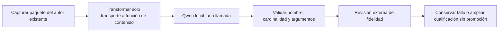

# Protocolo nativo de contenido: comprobación acotada

2026-10-20. Hipótesis sin incorporar al producto. La redacción JSON vigente puede confundirse con otra solicitud de crear un prompt. Se comprueba si el canal nativo de herramientas de Qwen representa mejor la entrega de un artefacto de contenido. No se cambia el significado de las instrucciones ni se añaden demostraciones por caso.

La [documentación oficial de Ollama](https://docs.ollama.com/capabilities/tool-calling) describe `tools` y respuestas `message.tool_calls`. No demuestra fidelidad de autoría; esa capacidad debe calificarse con el modelo instalado.

**Propietario y límite:** el evaluador captura el paquete construido por `GenerateAuthoredDefinition` real mediante un servidor loopback controlado. Luego transforma sólo su transporte de salida: el mismo esquema pasa a parámetros de una única función de entrega. Los argumentos siguen siendo título, descripción y cuerpo; no se publican, guardan ni ejecutan herramientas. Es un ensayo del adaptador, no del flujo completo. No cambia la configuración de la aplicación.

**Invariantes:** misma petición original, mismo sistema y opciones generados por el propietario; sólo se añade la instrucción de entregar mediante la función. Exactamente una llamada de función con el nombre fijado y argumentos del esquema; ninguna ausencia o función extra cuenta como éxito. Una llamada por caso, 90 segundos, mismo Qwen local y contexto. Se conserva contenido/estadísticas, nunca razonamiento privado. Los argumentos se validan con `ContractSchema.Validate`; su validez no acredita fidelidad. Extracción de valores, revisor, UI y persistencia quedan fuera de este primer contraste.

**Alternativas:** otra redacción del prompt repite experimentos rechazados; cambiar modelo no está en el alcance actual; incorporar herramientas al producto sin contraste expande el riesgo. Se prueba el cambio de protocolo sólo en QA, con cuatro encargos sintéticos ya conservados, sin abrir validación/holdout. Sólo si pasan una revisión externa del contenido procede comprobar integración y el revisor. No añadir un árbitro.



```text
leer cuatro encargos sintéticos y verificar identidad del modelo
por encargo:
    capturar paquete del propietario actual mediante respuesta controlada sin entradas
    sustituir format por tools; conservar sistema, petición y opciones
    exigir una llamada de entrega al nombre fijo, sin ejecutar esa función
    validar argumentos con el esquema original
    conservar cuerpo, transporte y estadísticas; marcar pendiente de revisión externa
si cualquier cuerpo incumple el encargo: rechazar el protocolo sin integrar
```

## Resultado y decisión

[Campaña](../evidence/closure-20261020/native-content-wire-development.json) y [revisión independiente atribuida a Codex](../evidence/closure-20261020/native-content-protocol-review.json). Los cuatro casos terminan con una llamada de función y argumentos válidos. No se ejecutó ninguna de esas funciones.

Reunión y resumen repiten «crea/prepara un prompt» en el cuerpo; resumen además conserva la orden de no resumir ahora. El encargo de mensaje preserva aprobación futura, pero añade la prohibición de enviar en esta conversación. Por esos fallos retenidos el protocolo queda **RECHAZADO**, sin integrarlo ni ejecutar un recorrido UI/revisor posterior. El cuerpo SQL expresa las tres condiciones futuras comprobadas; esa observación acotada no acredita fidelidad general ni compensa los anteriores.

El autor actual no aprende destinatarios por devolver argumentos de herramienta en vez de JSON. Tiempos de componente 3,2–15,6 segundos, sin latencia completa o p95 aceptados. No se retocan instrucciones, ejemplos o semillas para repetir este protocolo. Modelo/configuración de la aplicación intactos, sin validación/holdout.
