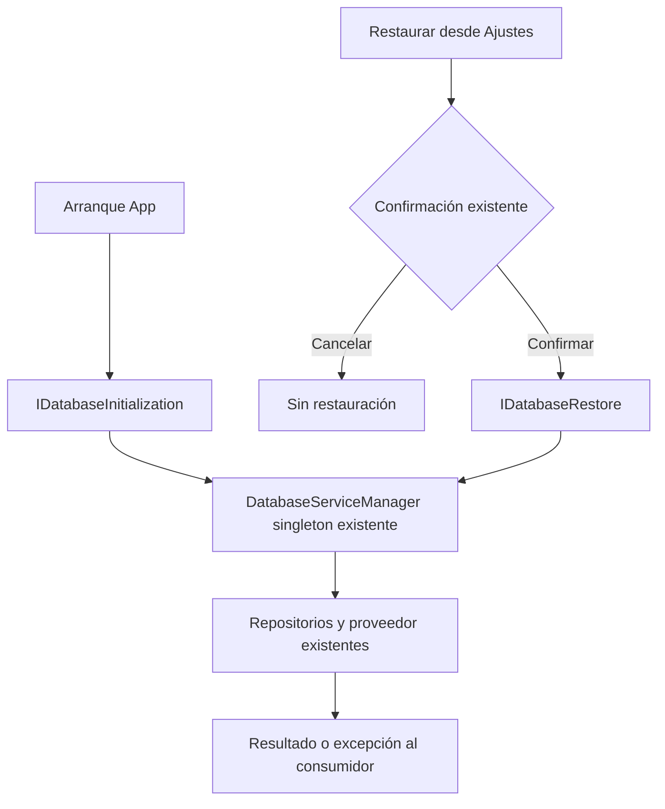

# Ciclo de base de datos del host MAUI

Estado: IMPLEMENTADO; verificación estática ejecutable, build y UI nativos pendientes.
El producto web mantiene su validación independiente. Este incremento no cierra la versión.

## Capacidad, propietarios y alternativas

App sólo consume inicialización; SettingViewModel sólo consume restauración. Ambos
dependían de DatabaseServiceManager. Este coordinador ya es propietario de las
llamadas a los repositorios y DatabaseConnectionProvider; se conserva ese propietario.

Se eligieron dos interfaces pequeñas en ApplicationLayer/Common/Interfaces y
aliases DI al mismo singleton. Extender consumidores concretos mantendría su
acoplamiento; otro servicio/coordinador duplicaría una responsabilidad existente.
No se añade herencia ni reflexión: no hay descubrimiento dinámico que lo requiera.



```text
al componer el host:
    registrar el coordinador singleton existente
    resolver inicialización y restauración hacia ese mismo singleton
al iniciar App:
    invocar InitializeAsync mediante su interfaz; conservar manejo de errores
al restaurar desde Ajustes:
    si se cancela la confirmación: terminar sin invocar restauración
    invocar RestoreAsync; conservar loading, error y finally existentes
```

## Contratos e invariantes

- IDatabaseInitialization.InitializeAsync devuelve Task; no expone restauración.
- IDatabaseRestore.RestoreAsync devuelve Task; no expone arranque ni repositorios.
- No se crea estado nuevo, conexión adicional, política de autorización o reintento.
- Los cuerpos del coordinador no cambian. El proveedor conserva el cierre y la
  restauración; errores se propagan como antes. Estas interfaces no prometen
  cancelación que sus implementaciones anteriores no soportaban.
- App y Ajustes conservan sus llamadas, confirmación y tratamiento de errores.
- La raíz de composición conoce la implementación; los consumidores reciben puertos.

## Compatibilidad y retirada

Cambian los parámetros C# de los constructores App y SettingViewModel; el host
resuelve las interfaces. DatabaseServiceManager conserva métodos públicos.
Se retira el constructor protegido BaseViewModel(DatabaseServiceManager) y su
campo sin lecturas ni llamadas en el inventario .cs de producto y pruebas. No hay
protocolo HTTP/JS ni cambios de SQLite. Los originales están inventariados en
`docs/evidence/native-conformance-20261020/before.json`; no incluyen configuración
de firma ni el proyecto privado. Revertir sólo este incremento exige restaurar
esos cinco archivos, retirar el contrato nuevo y los dos aliases DI juntos.

## Verificación y límites

`node scripts/Check-ModuleBoundaries.cjs` incluye ahora el control estático de
consumidores y aliases de ciclo nativo. La comparación contra los originales
comprueba cuerpos preservados; su informe se guarda en
`docs/evidence/native-conformance-20261020/verification.json`.
La comparación final tras retirar un espacio de la firma cambiada está en
`docs/evidence/native-conformance-20261020/verification-final.json`.

No confundir este control con compilación: el entorno dispone de SDK 8.0.425,
cero workloads, y MAUI declara targets .NET 9. Build, arranque y restauración
reales MAUI: NOT RUN. No se cambió el target para simular compatibilidad ni se
instalaron herramientas. No corresponde repetir corpus Qwen o matrices web sin
cambios para acreditar este incremento nativo.
