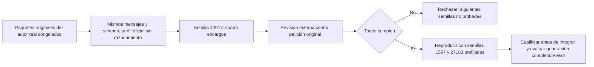

# Redacción: contrato de muestreo del adaptador

2026-10-20. Diagnóstico aislado, sin promoción. La decisión 19/19 del contrato conjunto rechazado medía operación de autoría, no fidelidad del contenido. No se incorpora aquel contrato.

La ruta `GenerateAuthoredDefinition` fija `think=false, temperature=0`; `QwenThinkingSampling` sólo adapta llamadas con razonamiento y por tanto no cambia esa ruta. La [ficha oficial de Qwen3-8B](https://huggingface.co/Qwen/Qwen3-8B#best-practices) recomienda temperatura 0,7, top_p 0,8, top_k 20 y min_p 0 para el modo sin razonamiento. Esa recomendación no prueba mejora en QuickPrompt.

## Contrato e hipótesis

Se comprueba una política de decodificación del adaptador existente, sin otra redacción del sistema ni ejemplos. Se reutilizan los cuatro paquetes **originalRequest** capturados del autor real en `native-content-wire-development.json`, no las peticiones transformadas a herramientas. Sus mensajes, schema, contexto y presupuesto quedan intactos; sólo cambian esos parámetros y la semilla fijada. La llamada sigue entregando JSON, sin herramientas ni efectos. El modelo/digest permanece Qwen3:8b local. No se descargan modelos ni dependencias.

El dueño de semántica/autoría sigue siendo PreparationInference. Una política compartida sólo se justificaría si las llamadas reales demuestran fidelidad y compatibilidad. Nueva abstracción de contenido o nuevo proveedor no se justifican antes de esta comprobación de la política concreta. Los resultados no alteran límites, aprobación o postcondiciones.



```text
congelar paquetes y tres semillas: 42017, 1507, 27183
verificar hash del ensamblado que construyó los paquetes y digest del modelo
para la primera semilla:
    para cada paquete original:
        conservar mensajes/format/contexto/presupuesto; aplicar perfil oficial y semilla
        llamar una vez, con límite de 90 segundos, sin reparación o selección del mejor resultado
        validar argumentos con el contrato cerrado de tres campos y conservar salida
si falla fidelidad: no incorporar y no ejecutar otras semillas para buscar verde
si todos cumplen: repetir las semillas restantes como comprobación de estabilidad, no búsqueda
```

Los oráculos existentes no cambian. Las expectativas no se envían al modelo. No se abre validation/holdout, no se repite UI o suites generales. Incluso si el redactor califica, el revisor conserva sus dos falsas aceptaciones y debe calificarse por separado antes del cierre. Los tiempos de componente no sustituyen la latencia de tarea completa.
