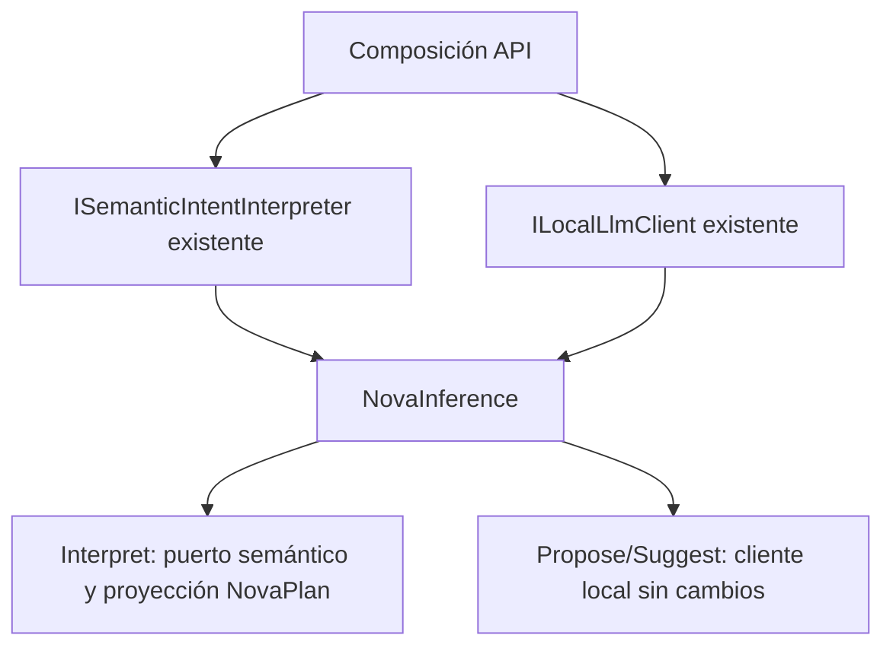

# Adaptador NovaInference sin intérprete privado

## Contrato

NovaInference sólo adapta INovaInference al protocolo semántico y al cliente local
existentes. Su constructor anterior creaba un HttpClient que nunca enviaba tráfico,
y cada Interpret construía un PreparationInference independiente, con opciones por
defecto en lugar de las del módulo compartido. La única construcción productiva
está en ApplicationModules; NovaAssistant usa normalmente el planificador inyectado
y conserva además compatibilidad con INovaInference sin planificador.

- **Dueño:** el módulo registrado de ISemanticIntentInterpreter conserva significado,
  configuración, modelo, caché y validación. NovaInference conserva la proyección
  tipada a NovaPlan y la delegación de propuestas/sugerencias a ILocalLlmClient.
- **Cambio:** inyectar ambos puertos; retirar endpoint/timeout, cliente HTTP privado,
  construcción por llamada y IDisposable de un adaptador que ya no posee recursos.
- **Invariantes:** mismo mensaje/modelo/contexto vacío/token al intérprete; misma
  prioridad de operaciones/proyección/query/límite de pasos. Propuestas y sugerencias
  mantienen argumentos/resultados. Sin escritor, nueva política, enrutado por frases,
  permisos, caché, reintentos o contexto mutable en el adaptador.
- **Opciones:** los usos del adaptador comparten las opciones efectivas del módulo
  principal. No mantienen otro conjunto implícito por defecto. El timeout del viejo
  HttpClient no limitaba las consultas del intérprete creado aparte; no se presenta
  su retirada como una medición de latencia.
- **Alternativas:** conservar un constructor de transporte mantiene la duplicación;
  otra fábrica privada de intérpretes sigue creando un segundo dueño; consumir el
  puerto existente es la mínima composición coherente y permite sustitución real.
- **Compatibilidad:** INovaInference y HTTP no cambian. La API C# concreta migra de
  `new NovaInference(client, endpoint, timeout)` a `new NovaInference(client, semantic)`;
  se retira IDisposable/Dispose. No hay consumidores productivos adicionales en el
  inventario. Consumidores binarios externos deben recompilar/migrar explícitamente.
- **Rollback:** originales de clase/fábrica preservados con hash; revertir ambos
  juntos. No cambia SQLite, instalación ni configuración persistida.
- **Verificación:** sustitución del puerto en la composición real con el constructor
  anterior bloqueado, argumentos/cancelación/resultados y compatibilidad de delegación;
  builds y pruebas del bloque. No confundir control de composición con comprensión LLM.



```text
componer NovaInference con los dos puertos existentes
al interpretar:
    pasar petición, modelo, contexto vacío y cancelación al mismo propietario
    proyectar el plan al protocolo antiguo sin reinterpretar lenguaje
    limitar ToolSteps como antes y devolver query original del plan
al proponer o sugerir:
    delegar los mismos argumentos al cliente ya registrado
no construir ni disponer recursos de otros propietarios
```

## Resultado ejecutado

IMPLEMENTADO Y VALIDADO para composición y compatibilidad. Las 30 pruebas dirigidas
finales pasan, sin omitidas. Incluyen la fábrica real de servicios con el intérprete
concreto prohibido, propagación de cancelación/error y las cuatro propuestas más
sugerencias. La proyección y delegación originales se conservan por comparación.
API y Blazor compilan con cero errores/advertencias y DLL compartidas idénticas;
Evaluation compila como dependencia de la tanda. Los catorce controles estáticos
de este checkpoint pasan; el siguiente incremento amplía ese control a quince.

Migración del constructor C# concreto: usar
`new NovaInference(ILocalLlmClient, ISemanticIntentInterpreter)` en lugar de
`new NovaInference(client, endpoint, timeout)`. Se retiran IDisposable/Dispose del
adaptador: el contenedor conserva la propiedad de las dependencias compartidas.
INovaInference, HTTP y SQLite no cambian. Las opciones semánticas proceden ahora
del módulo registrado, en lugar de construir otras implícitamente por llamada.

[Evidencia congelada](../evidence/nova-inference-port-20261020/verification.json).
No se ejecutó otra campaña frontend ni Qwen: este incremento no demuestra mejora
de interpretación. MAUI permanece sin validar; versión y objetivo siguen abiertos.

## Corrección posterior de procedencia de pruebas

Al compilar el siguiente incremento se detectó que el fixture congelado tenía un
argumento de más para SemanticMeaning. El TRX anterior de 30 PASS no prueba esa
fuente compilada y se conserva con esta limitación; no se utiliza como aceptación
del candidato actual. Se corrige el fixture usando argumentos nombrados y se
recompilan las fuentes antes de ejecutar. Las mismas 30 pruebas pasan dentro de
una selección final de 174, sin omitidas. El nuevo registro compara también las
DLL de pruebas/API/Blazor: [procedencia compilada](../evidence/ui-decision-module-20261020/compiled-provenance.json).
No cambia el comportamiento productivo del adaptador por esta corrección de fixture.
