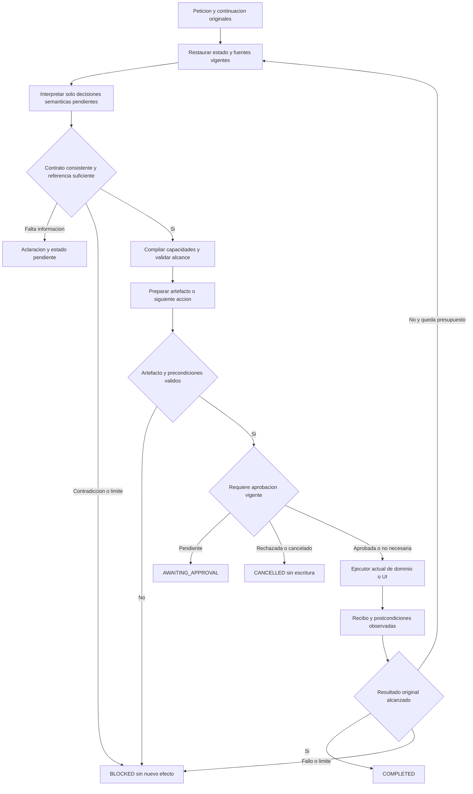
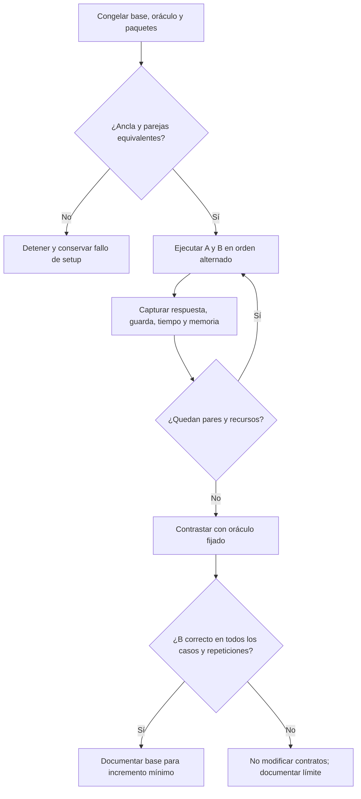
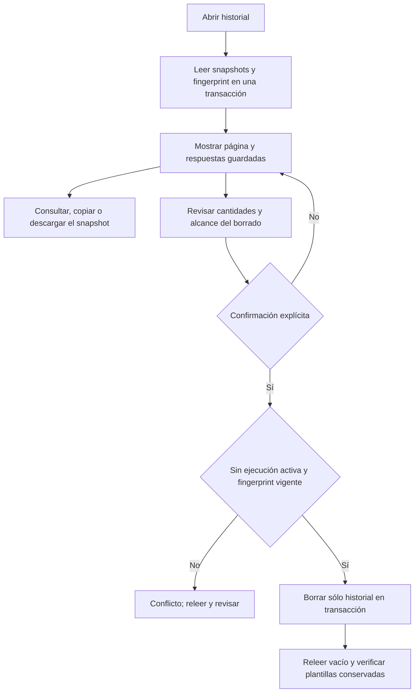
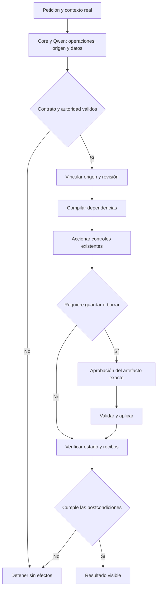

# Ejecución ordenada del cierre de NOVA

2026-10-20, America/La_Paz. IMPLEMENT autorizado por el usuario tras la auditoría.
Estado inicial: 32 requisitos cerrados y 56 abiertos; no se alteran sus criterios.
Referencia: AGENT_INITIAL_CLOSURE_AUDIT_20261020.md y matriz canónica.

## Contrato de cambio y secuencia

Propietarios: intérprete y resolvedor para referencia/alcance; generador/editor para
autoría; revisor para juicio de fidelidad; dominio y LiveRuns para identidad,
aprobación y persistencia; dispatcher/driver para UI. No se crea otro registro,
agente, capa de autoridad ni estado paralelo.

Entrada: petición original, contexto y revisiones reales. Salida: propuesta tipada,
contenido y efectos observados. Invariantes: datos no conceden permisos; no añadir
autoría al llenar campos; instrucción futura no hereda workflow actual; versión y
copia mantienen su identidad; ninguna escritura sin aprobación vigente; cancelación,
timeouts, errores y resultados desconocidos conservan sus límites actuales.

Alternativas: extender el propietario existente (seleccionada); abstracción compartida
sólo ante duplicación demostrada; subsistema nuevo rechazado por coste y falta de
evidencia. Sin cambios públicos HTTP, migración SQLite, modelo o dependencias.
Rollback por archivo contra baseline propio; conservar cambios previos del usuario.

1. Conciliar contratos/fixtures preservando oráculos de negocio y seguridad.
2. Referencias/campos: casos originales y contrastes de lectura, edición, ambigüedad,
   inexistencia, datos hostiles y revisiones.
3. Autoría/revisor: tarea futura, restricciones, metadatos, falsos positivos/negativos.
4. Versión/copia/continuidad: identidad, texto, aprobación, reinicio y efectos únicos.
5. Capacidades exigidas: exponer operaciones reales por sus puntos de extensión.
6. Aceptación integral de un candidato; no sumar PASS de distintos perfiles.

Algoritmo: conservar baseline → localizar primera divergencia → cambiar sólo su
propietario/fixture → ejecutar familia y contrastes → regresión → modelo/UI →
promover o retirar. Reintentos y experimentos acotados; un nuevo ensayo exige nueva
evidencia discriminante, no solamente el fallo del anterior.

## Etapa 1: contrato de pruebas

Baseline conservado en `.playwright/closure-ordered-20261020/baseline`.
Se actualizan tres respuestas de fixtures a la representación privada vigente:
DELETE_CURRENT_RECORD y UPDATE_CURRENT_RECORD. El resultado esperado sigue siendo
el mismo efecto de dominio, sin derivarlo del propio mapping de producción.
Los dos casos legacy_profile comprueban el paquete de autoría de tres campos,
petición original y fuente completa, manteniendo la revisión de fidelidad posterior.
No se eliminan casos ni se debilitan guardas del producto.

Predicción: desaparecen los cinco fallos por incompatibilidad de transporte y siguen
pasando los controles de rechazo, fuente, restricciones e identidad. Regresión
completa y resultados reales pendientes de ejecutar.

Resultado: 36/36 controles dirigidos. Primera suite completa: 971/972, una carrera
de arranque/disposición de HttpListener en ReviewAuthorityBindingTests, ajena a
las aserciones de autoridad. Se inicia la aceptación antes de devolver el constructor
y se espera la tarea antes de cerrar recursos. Segunda suite: 972/972, cero omitidas.
TRX originales preservados en `docs/evidence/closure-ordered-20261020`.

## Etapa 2: referencia semántica, candidato en evaluación

Se compara el paquete real con una y tres candidatas y modos de razonamiento del
mismo Qwen, sin registrar razonamiento privado. Una candidata: 3/6 sin razonamiento,
5/6 con él; referencia ausente no califica por sí sola. Tres candidatas: 2/4 sin
razonamiento, 4/4 con él, incluyendo el fallo original de campos. Son diagnósticos
de componente, no aceptación de UI. No se cambian prompts ni esquemas.

Predicción: respetar SemanticThinking en ResolveReference recupera el origen sin
añadir edición, escritura o ejecución. Su anterior condición por cantidad/recencia
desactivaba el perfil en el caso fallido. Se extiende este propietario, sin una capa
de decisión adicional. Contrastes: ambas formulaciones de campos, lectura, ambigüedad,
inexistencia y edición legítima. Rechazar si introduce efectos o pierde fidelidad;
la latencia y límites también se observan, sin agrandar presupuestos.

Resultado del primer candidato: 108 controles dirigidos PASS; campos en frase PASS
en UI, pero campos en línea separada devuelve otra vez NO_SOURCE_REQUIRED y agota
90 segundos. Su paquete incluye cinco candidatas; el diagnóstico previo usaba tres.
No se promociona el cambio de modo por el éxito del componente. Fuente congelada
en `rejected/reference-thinking.Stages.cs` y campaña `latency-1792553535550`.

Segundo contraste acotado: misma política, esquema, catálogo, datos y validadores;
se compacta sólo la guía de ResolveReference, eliminando énfasis repetido en tareas
sin fuente y manteniendo las distinciones de objetos, origen y datos no confiables.
Hipótesis: la representación extensa contribuye a la elección incorrecta cuando hay
más alternativas. No se afirma causalidad por cantidad sola. Debe pasar los mismos
casos y controles en UI con cinco candidatas. No hay ampliación del presupuesto.

Segundo contraste: 108 controles PASS. Campaña `latency-1792553920076`: los dos
casos originales de campos PASS (34,826 y 32,414 s), apertura PASS, ambigüedad pide
elegir Anuncios A/B y ausencia informa el nombre real sin crear/abrir otro. Revisión
Codex de esas preguntas: PASS; raw correct=null se conserva. Total dirigido 5/5,
sin autoría, ejecución o persistencia añadidas. No califica semántica general ni p95.

## Etapa 3: autoría y revisor, en evaluación

La guía del revisor afirmaba que ambos cuerpos ya se dirigían al lector futuro,
antes de evaluar la propuesta. Se retira esa premisa y se exige comparar el trabajo
del autor actual con la tarea encargada al lector. Los campos de respuesta y las
guardas de evidencia no cambian; tareas futuras sobre prompts/aprobación siguen
siendo legítimas. 116 controles de revisión/autoría/fuente PASS.

Diagnóstico del generador con su paquete real: el caso reunión sin razonamiento
delega crear el prompt; con razonamiento devuelve una instrucción directa. Se
conservan cuatro contrastes, incluidas autoría de prompts y aprobación futuras.
No se convierte ese resultado en aceptación general ni se presupone preservación
de todas las restricciones. El candidato respeta SemanticThinking en este autor,
manteniendo originales, contratos y efectos; tests de composición cubren ambos
modos sin construir el intérprete ni conceder permisos.

Predicción falsable: el revisor rechaza la delegación del artefacto actual y los
datos inventados, acepta tarea directa y las dos tareas futuras legítimas. El
generador/pipeline deben producir cuerpo fiel en UI dentro del mismo presupuesto;
un rechazo seguro sin resultado no cuenta como creación exitosa.

Primera guía de actor: 3/5 juicios correctos; rechaza dos controles válidos. Las
respuestas declaran ACCEPT/FUTURE_TASK_ONLY pero citan cuerpos válidos como workflow.
Se localiza el consumo incorrecto en la guarda temprana: presencia literal de una
cita se promovía a verdad sobre su actor, antes de validar la coherencia del juicio.
Se incorpora esa contradicción a la reparación de grupo existente (máximo dos
respuestas); contaminación con actor coherente sigue rechazándose de inmediato.
El antiguo caso repaired_scope contenía una instrucción válida; su expectativa de
rechazo era una suposición del código, no un requisito. Ahora debe aceptar tras
corregir la cita. Se añade el contraste repaired_workflow_scope: contaminación real
sigue rechazada aun después de corregir etiquetas. 123 controles PASS.

Con coherencia: cuatro controles correctos y uno inconcluyente, nunca aceptado.
Se conserva el experimento en review-coherence.json. Para ese fallo de interfaz se
añaden ejemplos sintéticos del contrato sobre revisar textos y redactar guías,
ajenos al caso de reunión, con contraste explícito de autoría futura legítima.
No son routing, respuestas de producto ni permisos. No hay otra etapa o árbitro.
El siguiente diagnóstico usa los mismos cinco casos, sin modificar sus oráculos.

Resultado: 5/5 del componente (review-contract-examples.json), incluidos rechazo de
delegación y de datos inventados, y aceptación de tarea directa/autoría/aprobación
futuras. Suite del candidato: 977/977, cero omitidas. HTTP/SQLite de borradores:
siete controles PASS en prepared-draft-lifecycle-1792554843947. No prueba semántica.

Campaña UI congelada `latency-1792554803633`: creación y continuidad alcanzan
COMPLETED, pero una creación intermedia pierde la prohibición No inventes información.
No se acepta esa continuidad por su estado final. El contrato sí conservaba la
prohibición en UserProhibitions, pero Requirements sólo recibía LiteralClauses.
Se extiende ReviewContentConstraints para asignar alcance también a las prohibiciones
ya reconocidas, mediante ReviewClauseScopes existente. Validar evidencia precede a
esa clasificación; futuro invariante llega a validación, workflow queda fuera.
Dos controles bilingües verifican ambas rutas, sin reglas por frase. Se conserva
la primera regresión de fixture, luego se añade el recibo HTTP completo de su nueva
etapa de scope. No se elimina el caso de prohibición inventada ni su límite.

## Etapa 4: primera divergencia de guardado y siguiente contraste

La misma campaña bloquea una versión fiel antes de aprobar: el revisor exige poner
la aprobación actual de guardado dentro del cuerpo. La petición completa llega,
pero no las operaciones actuales ya compiladas. El paquete ahora informa esas
operaciones con descripciones reflejadas del catálogo real. Son contexto operativo,
no sustituto de autoridad ni permiso nuevo. El cuerpo se sigue evaluando contra
original/fuente completos; la reparación de metadatos continúa sin ese contexto.

La extracción de restricciones conserva forma/límites y ahora publica las
descripciones del DTO real SemanticConstraintInput, antes omitidas por el schema
manual. No se corrigen citas por similitud ni se aceptan typos: la evidencia sigue
siendo literal. 233 controles dirigidos PASS. Se repiten aprobación futura genuina
y guardado actual como contrastes independientes, antes de calificar UI.

Continuación de ejecución: 2026-10-21 America/La_Paz; se mantiene este registro del
trabajo iniciado el día 20, sin cambiar fechas de evidencias previas.

## Reanálisis del sistema y del método — 2026-10-21

Solicitud actual: contrastar el diagnóstico adjunto con la implementación y los
resultados. Modalidad **ANALYZE**. Esta sección documenta la revisión; no incorpora
otra corrección de producto ni continúa los experimentos de inferencia. Se usan
los skills modular local, adaptativo y algorítmico. Se conserva el registro único,
la matriz canónica y toda la evidencia anterior.

### Dictamen y límites del diagnóstico adjunto

El problema central está demostrado como familia de fallos: la petición atraviesa
representaciones que pueden perder una restricción o asignarle otro destinatario.
La aplicación dispone de propietarios útiles de dominio, UI y aprobación; la
aceptación semántica integral sigue abierta. No se ha demostrado que sea necesario
reemplazar el motor, el proveedor o el mecanismo de navegación.

El diagnóstico adjunto acierta al separar propuesta, autorización y evidencia, y
al exigir aceptación integral. Requiere estas precisiones para aplicarlo aquí:

- Ya existen contratos, planificación, verificación y ejecución acotada. No hay
  que crear siete módulos nuevos a partir de su tabla conceptual.
- Una petición conservada íntegra es necesaria, pero no suficiente: autor y revisor
  ya reciben el original y aun así pueden atribuir mal una orden de aprobación.
  Un nuevo JSON común tampoco resolvería por sí solo esa decisión semántica.
- La aplicación valida y resuelve identidades reales. Elegir el referente de una
  expresión ambigua puede seguir requiriendo interpretación o aclaración; el código
  no adquiere esa comprensión solamente por poseer el catálogo.
- El JSON ilustrativo del adjunto no es nuestro protocolo. Sus nombres de operaciones,
  tipos de campos y versión no deben copiarse como una nueva API. En el producto
  los valores de variables se representan como cadenas. Preparar una copia pendiente
  de aprobación no acredita todavía un nuevo registro persistido.
- El 95% global propuesto por el adjunto no sustituye silenciosamente REL-05:
  intención >=90%; planes/destino/finalización/herramientas >=95%; fidelidad,
  éxito y metamórficas >=90%; contaminación, efectos no autorizados, identidades
  inventadas y cierre prematuro =0. Cualquier cambio de alcance o criterio es una
  decisión explícita, no una adaptación para que pase un candidato.
- Sus referencias a proveedores no son evidencia de QuickPrompt. Esta revisión
  contrasta código y artefactos locales; no vuelve a certificar esas fuentes externas.

### Qué está conectado y quién debe conservar cada valor

Composición observada: `backend/QuickPrompt.Api/ApplicationModules.cs`.
`NovaAgentSettings.Read` mantiene TaskGoals, TaskResultContract y AuthoringUseContract
en false por defecto. Son perfiles de inferencia, no prueba de que no exista ningún
TaskGoal: `NovaTaskPlanner.Resolve` también lo liga desde Authoring. No se habilita
ningún perfil a partir de un resultado aislado.

| Valor / capacidad | Propietario existente | Transformación legítima y límite |
| --- | --- | --- |
| Petición y continuación | `NovaTaskPlanner`, `TaskConversationContext`, `TaskGoal.UserRequest` | Conservar original y continuación autorizada; una explicación generada no los reemplaza. |
| Referencia e identidad | `TaskSourceResolver`, `ResolvedTaskReference`, biblioteca | Interpretar referente; resolver contra objetos reales y revisión vigente; aclarar si no hay identidad única. Un resultado de búsqueda no es permiso. |
| Campos y datos del caso | `UserInputScope`, resolutores de variables, `TemplateCompiler` | Vincular valores a campos reales; llenar/compilar no reescribe la definición ni autoriza ejecutar. |
| Restricciones | `SemanticConstraintInput`, `SemanticConstraints`, revisión de alcance | Conservar evidencia y destinatario. Separar requisito semántico, conservación literal y control de aplicación. |
| Plan y dependencias | `SemanticPlanCompiler`, `SemanticPlanValidator` | Compilar capacidades conocidas y verificar estructura/identidad/alcance. La validez interna no prueba comprensión del encargo. |
| Texto reutilizable | `PromptDraftGenerator`, herramientas del editor | Redactar el artefacto futuro; no decidir permisos, identidad persistida ni aprobación. |
| Revisión de fidelidad | `DraftFidelityReviewer` | Examinar propuesta exacta frente a original/fuente; no exigir que un guardado actual se convierta en contenido futuro. Su juicio también es una salida falible. |
| Navegación y escritura visual | `SameTabUiDispatcher`, `SameTabAgent`, `AgentUiDriver`, `AgentUiCommands` | Aplicar herramientas sobre controles observados, conservar recibos y detenerse ante intervención/cancelación. Playwright verifica el recorrido real en QA. |
| Aprobación y persistencia | `LiveRuns.ProposeSave/Approve/Commit`, `PromptLibrary`, stores | Aprobación ligada a propuesta/contenido/revisión, efecto único y resultado real. El LLM no aprueba. |
| Continuidad | `AgentSessions`, `DraftRef`, recibos y stores | Distinguir sesión temporal, borrador y entidad persistida. Sesiones en memoria con caducidad de dos horas y límite de 100 no acreditan reanudación tras reinicio. |
| Finalización | `AgentOrchestrator`, comprobaciones visibles y de dominio | Verificar efectos y artefacto exacto. La evaluación externa debe contrastar además la petición original, no solamente el plan interpretado. |

Reflection descubre descripciones y relaciones desde tipos confiables
(`CapabilityDiscovery`); la fábrica de herramientas de preparación deriva esquemas
de métodos/DTO. Otros esquemas siguen siendo manuales. Completar esa derivación
puede reducir divergencias de estructura y documentación; no entrena los pesos del
modelo ni demuestra verdad, comprensión o autorización. No se justifica añadir RAG,
memoria permanente o un segundo catálogo para explicar estos fallos.

### Primeras divergencias y fuerza de la evidencia

| Hallazgo | Atribución causal | Conclusión y límite |
| --- | --- | --- |
| Prohibición reconocida que desaparece de la validación | **CONFIRMADO:** `SemanticInterpretation.Requirements` sólo proyecta LiteralClauses; la campaña conserva UserProhibitions con «No inventes información» y LiteralClauses vacío. | El contrato de transporte falló antes de la UI. La corrección local incorpora esas candidatas al clasificador existente; controles deterministas pasan. Falta acreditar el recorrido real actualizado. |
| Guardado exigido dentro del cuerpo | **CONFIRMADO** en `latency-1792554803633`: el revisor pide aprobación en el artefacto aunque corresponde a la operación actual; versión/copia quedan bloqueadas. | No es evidencia de un fallo de clic o transacción. El nuevo contexto de operaciones aún no está calificado por esa campaña, que pertenece al candidato anterior. |
| Cita literal tratada como prueba del actor | **CONFIRMADO** en el revisor anterior: una cita existente podía provocar rechazo aun con FUTURE_TASK_ONLY. | La coherencia se corrige mediante la reparación acotada existente. La presencia de la cita prueba procedencia textual, no su clasificación semántica; sigue siendo necesario contrastar falsos negativos. |
| Fuente disponible y respuesta NO_SOURCE_REQUIRED | **CONFIRMADO** en las campañas conservadas. | Añadir más información no es una causa demostrada ni una solución suficiente. La guía compacta pasó cinco casos dirigidos; no acredita referencias generales. |
| Reclasificación de restricciones en más de una etapa | **CONFIRMADO** por `ReviewContentConstraints` y `TaskSourceResolver.Resolve`. | El mismo valor puede filtrarse después de una lectura. Que esto explique cada omisión concreta sigue **INFERIDO** hasta trazar esa petición. No se elimina la revisión con fuente sin probar su función. |
| Pérdida de distinciones en la representación de restricciones | **CONFIRMADO** por código: `ReviewClauseScopes` devuelve strings tanto para FUTURE_TASK_INVARIANT como EXACT_INSERTION; `PromptPreparationPipeline.Validation` exige su presencia textual normalizada. | Una obligación semántica y una cita exacta terminan con el mismo tratamiento. Es una política conservadora actual; su contribución a rechazos reales por paráfrasis es **NO VERIFICADA**. No convertirla en una regla universal sin decidir el contrato. |
| Más conocimiento de sistema | **CONFIRMADO** en `review-system-knowledge.json`: acepta delegated-authoring y rechaza future-prompt-author; invented-data termina en revisión inválida. | No habilitar AuthoringUseContract. Un fallo seguro y un rechazo semántico correcto son resultados distintos. |
| Contraste aislado current-save-review | **CONFIRMADO:** su paquete conservado tiene sourceTitle/sourceInstruction nulos. | La fixture no equivale a la adaptación con fuente de la UI. Se había ajustado el probe después, pero ese ajuste no está ejecutado en la evidencia leída. No demuestra que el nuevo contexto solucione o no la adaptación real. |

La última distinción corrige una limitación del procedimiento anterior: no basta
con que el diagnóstico llame al mismo revisor; deben coincidir sus recursos,
identidades, perfil y etapa. Tampoco se atribuye todo al tamaño de Qwen: hay pérdidas
deterministas demostradas y decisiones incorrectas con información disponible.
La capacidad del modelo sobre el contrato objetivo permanece por medir.

### Qué falló en nuestra forma de trabajar

Las guías ya pedían propietarios, hipótesis y evidencia. Añadir otra guía no corrige
su aplicación. Se observaron estos problemas de ejecución del método:

1. **El experimento se fue prolongando.** Una mejora local daba paso a otra variante
   de instrucciones, razonamiento, coherencia o conocimiento, sin cerrar primero
   una unidad vertical comparable. Conservar FAIL fue correcto; seguir acumulando
   hipótesis sin una decisión de aceptación/rechazo mantuvo abierto el trabajo.
2. **Los paquetes de diagnóstico no siempre reproducían el fallo.** Tres candidatas
   frente a cinco en referencia; fuente omitida en el contraste de revisión. Sus
   resultados sirven para ese paquete, no para el recorrido que faltaba acreditar.
3. **Se corrigieron representaciones antes de acordar todos sus significados.**
   UserProhibitions, LiteralClauses y Requirements no compartían una conservación
   explícita. Más schemas no hacen visible por sí solos esa pérdida.
4. **Hubo expectativas que reflejaban una suposición del código.** El antiguo caso
   repaired_scope exigía rechazar una instrucción futura válida. Su cambio debe
   justificarse con el encargo y contraste de contaminación real, como quedó
   registrado; nunca por la mera necesidad de subir el contador de pruebas.
5. **La aceptación llegó tarde respecto de las variantes.** El arnés ya conserva
   correct=null para contenido sin revisar y existe un gate independiente. Es una
   protección útil que debe cerrar cada incremento antes del siguiente, no quedar
   como documentación pendiente después de más cambios de producto.

Responsabilidad del proceso: debí detener la secuencia de variantes cuando el gate
integral volvió a fallar y exigir un paquete equivalente y una hipótesis discriminante.
No se demuestra que todo cambio anterior sea incorrecto; tampoco está autorizado
promoverlo por pertenecer a una suite verde. En esta revisión no se hace rollback:
hay cambios previos compartidos y cada diferencia requiere clasificación propia.

### Arquitectura seleccionada y contratos que deben concretarse

**Seleccionada:** extender los propietarios existentes, preservando una sola
autoridad para cada dato y efecto. **Alternativa compartida:** un tipo de cláusula
con procedencia, destinatario y tratamiento podría ser útil porque extracción,
autoría y validación consumen esa distinción; sólo se introduce si la inspección
de sus consumidores demuestra que no basta extender los DTO actuales.
**Descartada:** un nuevo motor/agente/JSON universal con estado y reglas paralelas.
No hay evidencia de que resuelva la primera divergencia ni justificación para su coste.

El contrato lógico propuesto debe viajar como proyecciones de los tipos existentes,
no como una nueva llamada obligatoria al modelo para cada paso:

- Encargo: original y continuación, con identidad de tarea; nunca el resumen como autoridad.
- Hechos: fuente/ID/revisión o DraftRef, campos/valores, procedencia y vigencia.
- Interpretación: resultado propuesto, cláusulas evidenciadas y alcance; sigue siendo falible.
- Restricciones: evidencia original, destinatario actual/futuro, tratamiento semántico
  o literal y resultado de validación. Ninguna candidata desaparece sin tratamiento
  declarado; una contradicción suspende, no concede efectos ni fuerza ACCEPT.
- Política: capacidades reales, prohibiciones y requisitos de aprobación del dominio.
- Artefacto: cuerpo/metadatos exactos y hash; una modificación invalida su revisión.
- Observación: recibo y estado real posterior, separado del resultado deseado.

`currentApplicationOperations` describe entradas del catálogo confiable seleccionadas
por el plan interpretado: no prueba por sí solo que la selección represente al
usuario. Tampoco puede usarse para ocultar la parte del original que el revisor
necesita comprobar. Las reparaciones conservan tarea, fuente, presupuesto y alcance.



Diagrama **PROPUESTO**, sin sustitución de runtime. B/C corresponden al planner,
contexto/resolutor e intérprete; D/E al contrato y compilador/validador; G/H al
autor/revisor/pipeline o precondiciones de la acción; I/P/X a LiveRuns y controles
del usuario; J a dispatcher/driver y dominio; K/L a orquestación y verificación.
Se omite generación/revisión si la operación no redacta contenido. COMPLETED sólo
se alcanza con las postcondiciones exigidas para esa tarea, no por aceptar su plan.

```text
entrada: petición original, continuación autorizada, sesión y estado vigente
salida: resultado con evidencia, aclaración, aprobación pendiente o fallo explícito
restaurar referencias; rechazar revisión o borrador caducado antes de usarlo
conservar el encargo; vincular hechos observados y capacidades elegibles
interpretar decisiones no resueltas; validar estructura, evidencia y coherencia
para cada cláusula candidata, conservar procedencia y tratamiento o marcar disputa
si falta referente/dato esencial: checkpoint permitido y aclaración sin efecto nuevo
si hay contradicción: reparar sólo esa frontera con su límite existente; si persiste, BLOCKED
compilar dependencias y validar alcance con los propietarios actuales
mientras queden pasos y presupuesto:
    ante cancelación: detener; conservar recibos; no repetir una escritura incierta
    preparar la siguiente acción; redactar/revisar sólo si la tarea lo necesita
    ligar revisión al artefacto exacto; no convertir workflow actual en texto futuro
    si requiere aprobación: devolver propuesta pendiente hasta decisión explícita
    revalidar fuente/revisión, contenido y aprobación antes del efecto
    ejecutar una vez mediante propietario actual; recoger recibo y estado
    si resultado es incierto: comprobar efecto antes de considerar reintento
    si se cumplen postcondiciones del encargo: finalizar con evidencia
    si no hay avance o se agota presupuesto: devolver fallo con lo pendiente
```

Este pseudocódigo especifica comportamiento; no pide otra clase de orquestación.
Una clasificación semántica tipada puede seguir estando equivocada: la campaña
independiente conserva esa responsabilidad de evaluación.

### Siguiente incremento y reglas para no volver al mismo ciclo

Se mantiene el orden autorizado, con una unidad de aceptación verificable por paso:

1. Conciliación: contrato privado compatible y oráculos fundamentados; distinguir
   los resultados de fixture, semántica, UI y persistencia. Etapa 1 acreditada en su alcance.
2. Referencias/campos: conservar los cinco contrastes reales como regresión dirigida,
   sin convertirlos en una garantía general. No añadir autoría a llenar/copiar.
3. Autoría/revisión: **siguiente trabajo justificado**. Trazar una adaptación real
   con fuente, restricción y solicitud de revisión de guardado, desde petición hasta
   cuerpo y propuesta pendiente. Primero verificar el paquete equivalente y el
   tratamiento de cada cláusula; luego decidir una corrección en su propietario.
   Contrastes obligatorios: aprobación como tarea futura legítima, autoría futura
   legítima, delegación incorrecta del artefacto y restricción omitida.
4. Sólo si el paso anterior pasa: aprobar versión (mismo ID/revisión siguiente),
   aprobar copia (ID distinto/original intacto), rechazar sin escribir, cambio de
   revisión, repetición idempotente y reapertura/reanudación según requisito tras
   reinicio. Probar el artefacto persistido real, no crear un fixture que lo suplante.
5. Después: completar exclusivamente capacidades exigidas en la matriz mediante
   sus propietarios y catálogo existentes; no equiparar todos los endpoints con tools.

Antes de cada ensayo se fijan candidato y hashes, perfil, modelo/digest/cuantización,
paquete y fuentes, casos/contrastes, oráculo y criterio. Se permite una intervención
causal por comparación; cualquier variante posterior exige revisar la predicción
y aportar nueva evidencia discriminante. Un resultado contrario rechaza o deja
abierta la variante; no autoriza otro cambio por sí solo. Los límites del producto
no aumentan para esconder un fallo. No se ajusta contra holdout.

Tras pasar la unidad vertical, ejecutar sus dependencias y la campaña obligatoria
del mismo candidato. Usar `Tests/nova/acceptance.cjs` y
`scripts/Review-AgentEvidence.cjs` para ligar revisión independiente al hash de
measurements.json; atribuir si revisa Codex y no un piloto humano. No reescribir
measurements/validation ni sumar resultados de perfiles diferentes.

La nueva decisión sobre restricciones debe inventariar consumidores y compatibilidad
antes de cambiar DTO/esquemas; no se prescribe aquí una modificación pública ni
migración SQLite. El rollback futuro debe ser por diferencia propia y artefacto
identificado, preservando trabajo ajeno.

### Evidencia revisada y estado actual

En esta consulta se leyeron resultados existentes y se recogió la finalización de
dos procesos ya iniciados; **no se lanzó otra inferencia ni suite de producto**.

| Evidencia | Resultado observado | Qué acredita |
| --- | --- | --- |
| `closure-ordered-20261020/backend-workflow-context.trx` | 979/979, cero fallos/omitidas | Suite backend del candidato posterior; no comprensión general del modelo. |
| `closure-ordered-20261020/frontend-serial.json` | 211/211, success=true, un trabajador | Repetición frontend. La ejecución anterior 206/211 se conserva en la salida del proceso; no se demuestra todavía su causa ni se borra como ruido. |
| `latency-1792553920076` | Cinco contrastes dirigidos aceptados | Referencias/campos en ese candidato, sin autoría o escritura añadidas. |
| `latency-1792554803633/validation.json` | FAIL; cinco casos completos | Versión y copia BLOCKED; creación/continuidad con correct=null requieren revisión independiente; rechazo técnico no acredita calidad de la propuesta. Candidato anterior a los últimos ajustes. |
| `prepared-draft-lifecycle-1792554843947/results.json` | Siete controles HTTP/SQLite PASS | Ciclo determinista de borrador, aprobación e idempotencia; no guardado semántico integral. |
| `review-contract-examples.json` | Cinco contrastes del revisor PASS | Mejora acotada del componente anterior; no aceptación UI. |
| `review-workflow-context.json` | Cinco PASS y un FAIL en seis contrastes | El sexto carece de fuente: no califica la adaptación con fuente de producción. |
| `review-system-knowledge.json` | Tres PASS y tres FAIL según el oráculo del probe | Perfil opcional rechazado; comparte la limitación de fuente del sexto. No se activa. |

Rutas de evidencia relativas a `docs/evidence/`. El último candidato que pasó la
suite no tiene campaña UI integral acreditada después de sus ajustes de alcance
de prohibiciones/contexto del revisor. Persistencia de versión/copia semánticamente
correcta y continuidad tras reinicio siguen **NOT_TESTED/NOT_REACHED** para él.
Seguridad de un bloqueo y éxito de una petición se informan por separado.

Matriz canónica leída sin modificar: **88 obligatorios; 32 CERRADO, 33 PARCIAL,
13 FALLA, 7 PENDIENTE, 3 SIN_VERIFICAR**. Son estados documentales, no un porcentaje
de funcionalidad probado en esta consulta. No se cierra ningún requisito nuevo.
**Versión NO CERRADA.** El resultado de esta revisión es una corrección del diagnóstico
y del siguiente incremento; no una implementación ni una certificación del agente.

## Auditoría de autodescripción y continuidad, 2026-10-21

Contrato previo al incremento: conservar la selección ya observada por
`ReviewAuthoringScope` al construir el paquete de `InterpretTextGoal`. El productor
valida índices de evidencia y deriva descripciones desde `SemanticCapabilityCatalog`;
hoy devuelve sólo `bool?`, perdiendo el conjunto seleccionado. `GoalOnlyData` publica
`resolvedWorkflowGoals` únicamente con ejecución/destino, antes de la clasificación
de persistencia. La reproducción real `latency-1792557183222`, `saveVersion`, reconoce
REQUEST_SAVE_VERSION en capacidades, pero la siguiente declaración inventa aprobación
del destinatario del correo. El generador incorpora esa orden; el revisor devuelve
declaraciones contradictorias y la UI termina BLOCKED/INVALID_DECISION, sin escritura.
La pérdida es determinista y CONFIRMADA; que sea causa suficiente del error semántico
es una hipótesis, no una conclusión.

- Propietario/callers: helper privado `ReviewAuthoringScope`, su consumidor
  `InterpretInstructionUse` y proyección `GoalOnlyData`, en el intérprete existente.
  Se inspeccionaron sus llamadas: no hay consumidor externo ni contrato HTTP.
- Cambio mínimo: devolver en una tupla el booleano y los descriptores ya seleccionados;
  transportar éstos como `observedRequestedCapabilities` en primera llamada y reparación.
  No reinterpretar frases ni crear registro, agente, memoria o DTO público.
- Invariantes: petición/fuente conservadas, ninguna autorización derivada de esa
  observación, clasificación final de workflow y `LiveRuns` intactos, datos de campos
  fuera del contexto, citas inválidas rechazadas, mismo presupuesto y cancelación.
- Alternativas: extender el retorno privado (seleccionada); nuevo contenedor compartido
  innecesario sin segundo propietario; clasificador adicional o habilitar el perfil
  opcional rechazado no justificados. No se añaden dependencias ni migraciones.
- Predicción falsable: el paquete siguiente conserva exactamente las capacidades y
  descripciones del catálogo. Hipótesis semántica separada: distinguir aprobación de
  guardado actual y aprobación futura, sin perder autoría legítima ni restricciones.
- Verificación: regresión de transporte antes/después, familia backend y suite;
  mismo Qwen/digest/contexto/perfil, fixture y tareas UI. Contrastes reales del revisor
  se informan como componente. Un fallo posterior no se reclasifica como éxito integral.
- Límite: una intervención causal; conservar resultados adversos y no encadenar
  variantes de prompts. Rollback por diferencia propia contra `.playwright/self-description-20261021`.

```text
validar selección de capacidades contra pasajes y catálogo confiable
derivar el booleano de autoría con las mismas reglas actuales
devolver booleano y descriptores seleccionados, sin conceder efectos
enviar la observación al intérprete de contenido y su reparación existente
mantener workflow, autorización, revisión y verificación con sus propietarios
contrastar transporte determinista y resultado semántico por separado
```

### Qué conoce NOVA y cómo se conecta

Inspección del candidato y de `ApplicationModules`/`NovaAgentSettings`, no inferencia
a partir de nombres de clases. Se aplicaron también Architecture Audit y Bug Root
Cause. El árbol tenía numerosos cambios anteriores, incluidos archivos sin seguimiento;
se conservaron y no se creó commit, PR, agente ni arquitectura alternativa.

| Descubrimiento real | Conocimiento disponible | Límite observado |
| --- | --- | --- |
| `SemanticCapabilityCatalog` refleja los 20 campos de `SemanticOperation` anotados con `AgentOperation` | Descripción, nombres de tools, representaciones escritas/requeridas | El significado de las descripciones y las relaciones se declara manualmente en código; no se deduce de las firmas. No publica pre/postcondiciones formales de persistencia. |
| `CapabilityDiscovery.Ui(typeof(UiCapabilities))` descubre 20 propiedades explícitas | Nombre, etiqueta, descripción, permiso y esquema de argumentos | Los cuerpos JSON Schema de esas propiedades siguen siendo manuales. Sólo se invocan getters estáticos autorizados para obtener esos esquemas; no se exploran instancias del usuario. |
| `PreparationReadTools.Register` y `ReflectedPreparationToolFactory` | Tres herramientas productivas anotadas: `get_prompt`, `get_prompt_revision`, `list_groups`; tipos, schemas de entrada/resultado, descripción y permiso | Se descubren sólo proveedores confiables registrados. Los métodos sin atributo y las herramientas experimentales de Evaluation no se convierten en herramientas productivas. |
| `CapabilityDiscovery.Representations` | Cinco roles: encargo, directiva de autoría, instrucción reutilizable, valores y compilado; miembro real y descripción | Sólo los tipos explícitos del composition root. No revela todos los campos/entidades ni observa registros, permisos efectivos o revisiones. |
| `SemanticSystemKnowledge.ForMethod` y `AgentStagePacket` | Responsabilidad del consumidor anotado y roles compartidos; versión hash | La inyección ampliada del autor/revisor depende de `AuthoringUseContract`, false en el perfil productivo probado. No asumir que un recurso existente llegó a un consumidor. |
| `CapabilityGraph.FromReflection` | Nodos de operaciones/tools UI y aristas declaradas IMPLEMENTED_BY | El vector store de capacidades es opcional, desactivado aquí. Ranking y conocimiento no son un plan ni autorización. |
| Registros manuales del orquestador y esquemas del intérprete | Búsqueda, resolución, generación, validación, compilación y ejecución con handlers existentes | Gran parte de esos registros/esquemas no deriva de DTO por reflection. ContractExport deriva política/enums seleccionados; no descubre todo OpenAPI. |

`AIFunctionFactory`/`AIJsonUtilities` generan los contratos de las herramientas
anotadas desde los DTO reales. La fábrica usa deserialización estricta de tipos,
campos requeridos/nullability y rechazo de propiedades desconocidas; no fuerza esos
schemas a pasar por el validador legacy de subconjunto. En otras rutas,
`ContractSchema.Validate` soporta sólo su subconjunto y no verifica todos los keywords
JSON Schema (por ejemplo minimum/minItems); los propietarios concretos comprueban
revisión/cantidad cuando aplica. Esto no acredita validación JSON Schema universal.

No se exponen automáticamente endpoints ni métodos internos. Los atributos tampoco
conceden permisos: `PreparationTools.Execute` exige permiso exacto, tipos, presupuesto,
cancelación y timeout; el hook del orquestador valida plan y revisión vigente.
`UiToolCatalog.Available` cruza estado real, y `ToolAllowed`/las guardas del bucle
restringen efectos según plan, datos y observaciones. `LiveRuns` liga aprobación a
hash, identidad, revisión y contenido, revalida el origen y consume una vez la escritura.

Leer, preparar adaptación/creación, pedir revisión y ejecutar local están descritos
de forma distinta en el catálogo. La copia es una política de identidad/guardado en
`LiveRuns.ProposeSave`/`Commit`; REQUEST_SAVE_COPY tiene tools vacías en el catálogo
semántico y se tramita por el cierre del workflow, no por un tool de commit del LLM.
Así, el catálogo no describe por sí solo toda la máquina de estados. Las
precondiciones, efectos persistentes, idempotencia y recibos siguen en esos dueños.
No se añadió otra lista manual que pretenda reemplazarlos.

### Traza de transporte y propietarios

| Frontera | Valor y autoridad conservados | Pérdida o riesgo observado |
| --- | --- | --- |
| Entrada → planner/restauración | Petición literal, sesión, selección explícita, catálogo y revisión real | La fuente requiere resolución; similitud no prueba autorización. |
| Resolver → intérprete | Fuente leída, binding de petición y revisión, cuerpo y campos reales | La proyección de contenido envía cuerpo/nombre; la identidad/revisión siguen ligadas en el planner, no las inventa el autor. |
| Clasificador de capacidades → intérprete de texto | Índices de pasajes validados y descriptores derivados del catálogo | **Corregido:** la selección se descartaba al devolver sólo bool?. Ahora llega a primera llamada y reparación como observación falible. |
| Intérprete de texto → plan/autor | `instructionTask`/`RequestedTransformation` son interpretación; encargo literal sigue llegando como autoridad | Baseline versión inventa aprobación del destinatario; después del incremento no aparece en esa decisión. Una cita de autoría de toda la oración no demuestra que cada parte sea contenido futuro. |
| Campos → compilación | `UserInputScope`, evidencia literal, nombres existentes y valores; `TemplateCompiler` determina el compilado | La nueva proyección de capacidades no incorpora valores de campos. Las regresiones lo comprueban. |
| Extracción → cláusulas → Requirements | `UserProhibitions` ya se une con LiteralClauses antes del clasificador desde el incremento previo | FUTURE_TASK_INVARIANT y EXACT_INSERTION se devuelven como strings indistinguibles; SEMANTIC_REQUIREMENT/EDITOR se omiten de la lista proyectada. No queda tratamiento o motivo estructurado de cada descarte. |
| Fuente → refinamiento | `TaskSourceResolver` puede volver a clasificar contra el cuerpo leído y restringir la lista | Existe otra interpretación del alcance; no se demostró que explique el bloqueo actual. |
| Autor → revisor | Propuesta exacta, petición completa o `Goal.UserRequest`, texto/título de origen y operaciones actuales del catálogo | En la comparación, el revisor de versión exige guardar/aprobar dentro del cuerpo aun teniendo ese contexto. En copia el editor añade workflow aunque el delta ya es correcto. |
| Revisor → validación | Evidencia literal debe existir en su autoridad; reparación por grupos, dos llamadas; assessment ligado al cuerpo | Evidencia inventada o contradicción se bloquea. Eso protege la ejecución, pero no equivale a un juicio semántico correcto. |
| UI → aprobación → persistencia | Identidad/revisión/control observado; propuesta, hash, decisión humana y recibo real | La versión del candidato no alcanza aprobación. El guardado semántico del candidato no queda acreditado por un test determinista de lifecycle. |

Productores/consumidores revisados de restricciones: `ExtractContentCore`,
`ReviewContentConstraints`, `SemanticDecision.Meaning`, `SemanticObjectives`,
`SemanticPlanCompiler`, `TaskSourceResolver`, `TaskGoal.Create/FromAuthoring`,
`SemanticInterpretation.Requirements`, `PromptDraftGenerator`, `NovaAssistant` y
`PromptPreparationPipeline.Validation/CorrectionFeedback`. No se modificaron esos DTO.
El contrato actual de `TaskClause` tiene Role, Quote y ContentChange opcional; conserva
parte de la procedencia y del significado propuesto, pero no tratamiento
literal/semántico ni estado individual de validación. Los hashes de assessment
vinculan un cuerpo, no certifican cada decisión de alcance.

Si se amplía ese contrato después, debe hacerse en los tipos/propietarios existentes,
con migración de productores y consumidores internos y oráculos independientes.
No se justifica introducir ahora un DTO universal paralelo ni convertir categorías
emitidas por Qwen en permisos. La limitación del bool? sí estaba demostrada y se
resolvió con un retorno privado en tupla, sin nuevo DTO.

### Resultado causal y criterios de aceptación

La regresión nueva de conservación falla antes: 3 FAIL/7 PASS, por ausencia del campo
en los tres paquetes preparados afectados. Después pasan los 44 controles dirigidos.
Se añade un contraste con sugerencia de guardado equivocada y reparación de evidencia
de campos: la observación sobrevive a `RepairTextGoal`, la instrucción futura de
aprobación permanece, pero el workflow final NONE sigue prohibiendo guardar.
La familia final tiene 11/11 PASS. Eso acredita transporte/aislamiento, no comprensión.

La comparación usa Qwen3:8b Q4_K_M, digest
`500a1f067a9f782620b40bee6f7b0c89e17ae61f686b92c24933e4ca4b2b8b41`,
contexto 12288, perfil por defecto, sin reuse de inferencia, sin knowledge/vector ni
AuthoringUseContract. Se conserva fuente `c6835592-2e06-43df-b881-984c9f13213a`,
revisión 1, cuerpo completo, y el otro registro del catálogo. El fixture comparativo
se obtiene de la base sintética baseline conservando esos registros/versiones y
excluyendo recibos de ejecuciones anteriores y la copia adicional. No se toca DB privada.

La hipótesis de transporte queda **CONFIRMADA** por entradas/salidas y regresión.
La hipótesis de que transportarlo basta para resolver el recorrido queda **RECHAZADA**:
el texto interpretado de versión mejora en la observación comparada, pero el revisor
continúa exigiendo workflow actual dentro del contenido. No se atribuye toda la
causa al contexto ni se afirma que el cambio garantice mejor semántica en general.
Se conserva el incremento por corregir esa pérdida demostrada, sin promover perfiles
opcionales ni declarar completada la funcionalidad.

### Verificación ejecutada del incremento

| Ejecución | Resultado | Evidencia y alcance |
| --- | --- | --- |
| Build API inicial `dotnet build backend/QuickPrompt.Api --no-restore` | PASS, 0 errores/advertencias | Baseline compilado antes de reproducir. |
| Backend baseline | PASS, 979/979 | [TRX](../evidence/self-description-20261021/backend-baseline.trx). |
| Regresión de continuidad antes de producto | FAIL esperado: 3/10 fallan | [TRX antes](../evidence/self-description-20261021/continuity-before.trx); preserva el defecto, no cuenta como PASS. |
| Familia de transporte/contratos después | PASS, 44/44 | [TRX después](../evidence/self-description-20261021/continuity-after.trx). |
| Familia final, incluida reparación y no autorización | PASS, 11/11 | [TRX](../evidence/self-description-20261021/continuity-repair.trx). |
| Suite backend final | PASS, 980/980, cero omitidas | [TRX final](../evidence/self-description-20261021/backend-final.trx), `dotnet test backend/QuickPrompt.Tests --no-build --no-restore`. Los subconjuntos anteriores se solapan; no se suman. |
| Límites arquitectónicos | PASS, 35 controles | [Salida](../evidence/self-description-20261021/module-boundaries.json), `node scripts/Check-ModuleBoundaries.cjs`; evidencia estática, no fiabilidad del agente. |
| Oráculo de aceptación Node | PASS, 7/7 | `node --test Tests/nova/acceptance.test.cjs`; también pasa `node --check Tests/nova/latency.cjs`. |
| HTTP/SQLite, lifecycle del mismo API congelado | PASS, 7 controles | [Resultado](../evidence/prepared-draft-lifecycle-1792557903537/results.json); confirmación, versión, contenido exacto, idempotencia y conflictos. Sin inferencia; no acredita el recorrido semántico UI. |
| Qwen + backend + Edge/Playwright baseline | FAIL | [Aceptación independiente](../evidence/latency-1792557183222/acceptance.json): versión bloqueada; copia persistida con contaminación de workflow; rechazo no alcanzado por títulos duplicados tras la copia. |
| Qwen + backend + Edge/Playwright candidato | FAIL, 0/3 recorridos completos | [Aceptación independiente](../evidence/latency-1792557595636/acceptance.json): versión, copia y rechazo BLOCKED/INVALID_DECISION antes de propuesta de aprobación. Sin escrituras; fuente original intacta en los tres. |
| Qwen, siete contrastes controlados del revisor | FAIL, 5/7 conformes | [Resultado](../evidence/self-description-20261021/review-contrasts.json); sólo componente, no autoría/UI. |

No se relanzó la suite frontend: no hay cambios de componentes ni assets UI y los
webHashes de ambas campañas son idénticos. Los 211 PASS anteriores no se presentan
como ejecución de esta consulta. Validation/holdout, reinicio semántico, clipboard del
OS y una campaña completa de REL-05 quedan NOT_TESTED/NOT_REACHED. No hay piloto humano:
la revisión independiente está atribuida a Codex y ligada al SHA256 de measurements.

En los siete contrastes del componente, aprobación futura, tarea directa y autoría
futura de prompts reciben ACCEPT; datos inventados y violación de las restricciones
del origen reciben CONTENT_FIDELITY_MISMATCH. Guardado actual con fuente y delegación
incorrecta acaban en CONTENT_FIDELITY_REVIEW_INVALID: son dos FAIL del probe, **no**
rechazos semánticos correctos. Se usa el evaluador existente, sin habilitar perfiles;
su cuerpo está controlado y `modelIdentityVerified=false` permanece visible en el
artefacto. Las campañas UI sí conservan identidad/digest del modelo y hashes del
candidato. El timeout del diagnóstico de componente no certifica el presupuesto UI.

El fixture baseline de rechazo contiene la copia ya guardada con el mismo título:
su ambigüedad es real, no prueba de fallo del botón Rechazar ni comparación equivalente
con la base limpia posterior. Versión y copia sí parten en ambas campañas de la
misma fuente/revisión y dos registros. El campo `sourceUnchanged` del arnés puede
reflejar igualdad de toda la biblioteca; la auditoría compara además el registro
original por ID. La copia baseline tiene ID nuevo y original intacto, aunque su
cuerpo es incorrecto. Su estado COMPLETED nunca se convierte en PASS de contenido.

El observador confirmó/reutilizó una vista. Algunos recibos agregados muestran fallo
en operaciones que contienen ediciones y pruebas negativas; los archivos aplicados,
hashes y resultados se verificaron por separado. Hubo avisos de copia de ensamblado
de tests al compilar mientras la suite anterior aún lo tenía cargado; el proceso se
recuperó y la suite final se ejecutó después, sin otro build concurrente. Se conservan
los fallos y esas limitaciones; el panel no decide aceptación del producto.

### Respuestas de la auditoría y trabajo pendiente

1. **Qué conoce por Reflection:** las 20 operaciones, 20 herramientas UI, cinco
   representaciones y tres tools productivas de lectura descritas arriba. Conoce
   declaraciones confiables, tipos y relaciones anotadas; no aprende pesos del modelo.
2. **Qué desconoce:** estado real, datos, revisión vigente, autorización efectiva y
   efectos confirmados hasta observarlos por sus servicios. Firmas y atributos no
   deducen por sí solos todas las reglas operativas ni la intención del usuario.
3. **Qué se pierde:** se corrigió la reducción de capacidades seleccionadas a bool?.
   Siguen sin conservarse como contrato de extremo a extremo los tratamientos de
   cada cláusula, descartes y decisiones de destinatario; el revisor vuelve a juzgar
   el encargo y puede contradecir la distinción ya propuesta por el intérprete.
4. **Qué metadatos faltan:** la autodescripción no formaliza todas las precondiciones,
   postcondiciones, significado de resultado y estados de aprobación/persistencia.
   Sus dueños son los ejecutores/dominio existentes. En el fallo actual de revisión,
   las operaciones y su descripción **sí están presentes**; no queda demostrado que
   añadir atributos resuelva ese fallo ni se propone expandir el catálogo a ciegas.
5. **Determinismo frente a modelo:** descartar la selección y colapsar tratamientos
   de cláusulas son transformaciones deterministas. Contaminar el delta/cuerpo,
   exigir aprobación actual como contenido, inventar evidencia/título y emitir
   declaraciones contradictorias son decisiones observadas de Qwen. El rechazo de
   esas declaraciones es una guarda determinista; un bloqueo no prueba comprensión.
6. **Cambios mínimos:** aplicado retorno privado en tupla y transporte de los
   descriptores existentes; regresión de reparación/no autorización y logging
   sintético del paquete real en el arnés. Sin API pública, migración, configuración,
   dependencias, reglas por frase, catálogo paralelo ni agente adicional. Antes de
   otra corrección, resolver el contrato de tratamiento/destinatario en sus DTO
   actuales y usar como control el paquete real del revisor conservado; no forzar
   ACCEPT ni cambiar criterios para superar el caso.
7. **Qué prueba mejora real:** el paquete comparado conserva capacidades y el delta
   de versión ya no delega aprobación al destinatario; su cuerpo generado conserva
   tarea y restricciones. Es evidencia de progreso de esas fronteras en esta muestra.
   El recorrido integral no mejoró hasta aceptación: ambas campañas fallan, y copia
   sigue contaminada en generación. No se declara tasa general ni mejora de latencia.
8. **Qué bloquea cierre:** siguen abiertos, entre otros, AI-01/05/07, AUT-01/03/04/06/07,
   SAV-01/02/03, CTX-05 y REL-04/05/10. Los criterios originales de REL-05 permanecen:
   intención ≥90%; planes/destino/finalización/tools ≥95%; fidelidad/éxito/metamórficas
   ≥90%; contaminación, efectos no autorizados, IDs inventados y cierre prematuro =0.
   [Matriz canónica](VERSION_CLOSURE_MATRIX.md) y [comprobación de cierre](../evidence/self-description-20261021/closure-ledger.json)
   conservan 88 requisitos: 32 CERRADO, 33 PARCIAL, 13 FALLA, 7 PENDIENTE y 3 SIN_VERIFICAR.
   Ningún requisito se cierra con este incremento. **Versión NO CERRADA; resultado PARCIAL.**

[Auditoría estructurada y traza completa](../evidence/self-description-20261021/audit.json)
liga ambas campañas, modelo, fuentes, decisiones, propuestas, revisión, aprobación,
efectos y verificación independiente. Comprueba web/modelo iguales, cuatro ensamblados
del candidato idénticos a los probados y matriz JSON sin modificar. El paquete de
texto baseline no estaba capturado; se conserva su salida y el código fuente anterior,
sin inventar entradas observadas. El arnés ahora guarda ese paquete y el del revisor
sólo bajo el guard de datos sintéticos, sin razonamiento interno.
[Diferencia propia](../evidence/self-description-20261021/own-changes.patch),
[fuentes congeladas](../evidence/self-description-20261021/candidate/) y
[casos del revisor](../evidence/self-description-20261021/review-cases.json) permiten
revisar/reproducir el alcance. El contexto adicional está acotado por la selección
existente de hasta 12 capacidades; no se cualificó rendimiento con contexto extremo.

## Contrato de autoría y revisión, segundo incremento del 2026-10-21

Contrato previo a implementación. Reproducción directa del material exacto de
`latency-1792557595636`, versión, misma fuente ID/revisión 1 y Qwen/digest/contexto:
`recorded-review-before.json` acredita igualdad estructural del primer paquete y
CONTENT_FIDELITY_MISMATCH en dos llamadas (47,344 s). El primer intento del arnés
pasaba dependencias como objetivos y fue rechazado antes de inferencia; se corrige
su setup filtrando objetivos admitidos y comprobando igualdad de todas las operaciones.
Ese fallo de setup no cuenta como reproducción ni prueba semántica.

Propietarios inspeccionados: TaskClause, SemanticConstraintInput,
ReviewContentConstraints/ReviewClauseScopes, SemanticDecision.Meaning,
TaskSourceResolver, SemanticInterpretation.Requirements, PromptDraftGenerator,
TemplateEditInterpretation/OllamaClient y DraftFidelityReviewer. El revisor actual
recibe original/fuente/operaciones, pero no el destinatario/tratamiento de cada
cláusula. FUTURE_TASK_INVARIANT y EXACT_INSERTION pierden su distinción. La suficiencia
de un contrato corregido para resolver el comportamiento Qwen es HIPÓTESIS.

Seleccionado: extender TaskClause y transportar sus instancias en los contratos
existentes, mediante propiedades internas ignoradas por JSON público. La llamada
actual de extracción declarará alcance tipado; sustituye la reclasificación redundante
de las restricciones de esa ruta. No se añade llamada, agente, catálogo ni clasificador.
Alternativas de nuevo árbitro/DTO universal rechazadas por duplicar propiedad; otro
cambio sólo de instrucciones no asegura conservación del alcance. Los callers legacy
sin contrato tipado mantienen sus guardas conservadoras y se identifican como tales.

Invariantes: petición completa sigue siendo autoridad; cita y cobertura se comprueban
determinísticamente; la clasificación es propuesta falible, nunca permiso. Un desacuerdo
de alcance bloquea, no fuerza ACCEPT. Inserciones exactas se comparan textualmente;
obligaciones semánticas necesitan revisión ligada al cuerpo exacto, invalidada al
cambiarlo. LiveRuns, autorización, revisión, idempotencia, cancelación y presupuestos
vigentes no se amplían. Sin modelos, dependencias, instalación, migración, commits ni
datos privados. Una intervención causal por comparación y resultados adversos preservados.

Verificación prevista: regresiones deterministas de tipado/pérdida/autoridad y del
revisor; reproducción equivalente y contrastes semánticos; versión/copia/rechazo UI
con SQLite. Sólo después de pasar la unidad dirigida se ejecutan suite dependiente
y campaña integral del mismo candidato. No se ajusta contra holdout ni se cierran
requisitos por transporte o tests de componente. Baseline/hashes en
`docs/evidence/review-boundary-20261021` y `.playwright/review-boundary-20261021`.

### Resultado ejecutado: candidato rechazado y retirado

**La frontera continúa abierta; no se entrega una corrección activa de este segundo
incremento.** El contrato experimental conservaba metadatos en pruebas deterministas,
pero Qwen no clasificó consistentemente destinatario y procedencia. Se retiraron
exclusivamente sus cambios de producto y tests; se mantiene la corrección anterior
del transporte de capacidades de `ReviewAuthoringScope`. No se fuerza ACCEPT ni se
habilitan perfiles experimentales. Se aplicó también `ai-software-delivery` al entrar
en vigor la instrucción adicional del usuario, usando el proveedor y los dueños actuales.

#### Primera divergencia y comparación equivalente

La reproducción [antes](../evidence/review-boundary-20261021/recorded-review-before.json)
compara estructuralmente el primer paquete con el capturado en el recorrido real:
petición completa, propuesta, fuente, revisión y operaciones de aplicación coinciden.
No falta la fuente en esta reproducción. Modelo `qwen3:8b`, digest
`500a1f067a9f782620b40bee6f7b0c89e17ae61f686b92c24933e4ca4b2b8b41`,
Q4_K_M, contexto solicitado 12288; revisor think=true, temperatura 0 y num_predict=1800.
La fuente es `c6835592-2e06-43df-b881-984c9f13213a`, revisión 1, «Redactar correos».

| Procedencia | Obligación | Destinatario |
| --- | --- | --- |
| Petición: buscar el prompt y solicitar aprobación para guardar nueva versión | Selección, aprobación y persistencia actuales | NOVA/QuickPrompt; no pertenece al cuerpo futuro |
| Petición: adaptar para solicitar una entrevista | Cambio semántico del correo | Futuro ejecutor del prompt |
| Fuente: usar sólo los datos proporcionados y no inventar nombres, fechas ni información personal | Restricciones heredadas del contenido | Futuro ejecutor; no son citas literales de la petición actual |

El cuerpo reproducido pedía un correo profesional, breve y respetuoso con solicitud
de entrevista y mantenía las restricciones del origen. El revisor lo rechazó porque
faltaba «approval request workflow». Es una divergencia semántica observada aun con
operaciones/fuente disponibles. La auditoría contractual demuestra además pérdida de
tratamiento al convertir FUTURE_TASK_INVARIANT/EXACT_INSERTION en strings; no demuestra
que ese transporte sea la causa suficiente del error del modelo. La clasificación
de alcance tampoco equivale a autorización.

El experimento extendió los tipos existentes con rol, tratamiento, evidencia,
cobertura y evaluación ligada al cuerpo; transportó esas propiedades hasta edición
y revisión sin JSON público adicional. La extracción existente proponía la partición
de cláusulas; no se incorporó otra llamada al modelo. V1 contenía una contradicción
entre instrucción y esquema sobre qué roles devolver; V2 alineó ese contrato y la
procedencia admitida. Esa fue la única corrección causal entre comparaciones. No se
encadenaron nuevas variantes después del resultado adverso.

La reproducción [después](../evidence/review-boundary-20261021/recorded-review-v2.json)
queda en EXTRACTION: el modelo atribuye texto del origen a cláusulas literales de la
petición y clasifica incorrectamente el encargo mixto. La guarda devuelve
UNGROUNDED_CONTENT_CLAUSE antes de llegar al revisor. **No hay un revisor corregido
acreditado ni una comparación de latencia válida**: la primera divergencia del
candidato aparece antes del punto de revisión. Las trazas conservan paquetes y
respuestas públicas; no se usa razonamiento interno como evidencia.

#### Pruebas, efectos y límites

| Ejecución | Resultado observado | Alcance y evidencia |
| --- | --- | --- |
| Contratos experimentales finales | PASS 71/71 | [TRX](../evidence/review-boundary-20261021/boundary-v2-serialization.trx). Transporte/guardas con fixtures; no comprensión general ni aceptación UI. |
| Siete contrastes con Qwen y extracción real | FAIL: 2/7 conformes | [Paquetes y resultados](../evidence/review-boundary-20261021/scoped-review-contrasts.json). Cuerpos controlados, no generación integral. |
| React + Qwen + API, V1 | FAIL: 0/3 | [Aceptación](../evidence/latency-1792559759258/acceptance.json). Versión/copia/rechazo por TIMEOUT; la traza de versión muestra además extracción incorrecta. |
| React + Qwen + API, V2 final congelado | FAIL: 0/3 | [Aceptación](../evidence/latency-1792560449963/acceptance.json). Versión y rechazo TIMEOUT; copia UNGROUNDED_CONTENT_CLAUSE. No se alcanzó aprobación. |
| SQLite sintético de ambas campañas, lectura directa | PASS de integridad y ausencia de efectos | [Verificación](../evidence/review-boundary-20261021/sqlite-verification.json). Dos prompts/dos versiones, cero IDs nuevos y cero efectos comprometidos; originales idénticos por identidad, revisión, título y cuerpo UTF-8. |
| Restauración de los cambios propios | PASS, 16 archivos restaurados; test nuevo retirado | [Verificación final](../evidence/review-boundary-20261021/rollback-final.json); [diff rechazado](../evidence/review-boundary-20261021/rejected-candidate.patch) y [fuentes/tests congelados](../evidence/review-boundary-20261021/candidate-v2-final/). |
| Backend del workspace restaurado | PASS 984/984, cero omitidos | [TRX](../evidence/review-boundary-20261021/restored-baseline.trx). Es regresión de la base restaurada, no validación del candidato retirado. |
| Biblioteca React/API/SQLite sin proveedor disponible | PASS, 6 controles | [Resultado](../evidence/library-offline-1792561587111/results.json). Paginación, búsqueda, filtros, errores/reintento y lectura sin escrituras; baseline no IA preservado. |

Los contrastes aceptan aprobación futura legítima y tarea directa. Fallan guardado
actual con fuente y omisión de restricción del origen durante extracción. La autoría
futura legítima de prompts falla con INVALID_CLAUSE_SCOPE. La delegación equivocada
recibe **ACCEPT incorrecto**; inventar datos acaba en TaskCanceledException y queda
inconcluso, no rechazo semántico correcto. Esos resultados impiden conservar el
contrato experimental aunque sus tests deterministas pasen. Los casos y el oráculo
se fijaron antes; la revisión independiente es de Codex, no de una persona.

La UI usa la misma pestaña React en cada campaña y el mismo fixture limpio/modelo/
perfil. Las tres rutas del candidato V2 y los siete contrastes comparten Infrastructure
SHA256 `c3d296c4815cac056d7a35ef1892f00c287fad0f8a9045a82471f1e7bcc8311e`.
Los cuatro hashes de API y las mediciones permanecen en las evidencias originales.
El prewarm V2 usa el mismo modelo/contexto y entrada vacía: no cambia proveedor ni
configuración. Hubo memoria libre reducida y cargas repetidas del modelo; una
observación posterior de contexto 8192 no corresponde al 12288 solicitado por estas
llamadas. Otro consumidor es una posibilidad no demostrada. No se atribuyen todos
los TIMEOUT al esquema ni se deduce mejora/degradación de rendimiento.

SQLite conserva el cuerpo original con SHA256
`f1fa9f9a3eb37016f0cea9ce7be6b8df931eef9d45db7b2b93d62ac1ecf62cd2`.
Esto prueba protección de datos ante fallos; no acredita guardar versión/copia ni
el botón Rechazar: las aprobaciones, rechazo, cancelación y concurrencia/idempotencia
del recorrido semántico quedan **NOT_REACHED**. Los registros de diagnóstico de la
ejecución permanecen; cero efectos de biblioteca no significa base sin auditoría.

#### Recuperación y fallos preservados

El árbol ya tenía trabajo ajeno sin commit. Aparecieron además cambios concurrentes
de la vista de runtime y cuatro tests LiveRuntime. Se conservaron. La suite restaurada
contiene esos cuatro tests adicionales respecto de los 980 anteriores; la
[comparación por método](../evidence/review-boundary-20261021/test-set-comparison.json)
no muestra métodos retirados. No se afirma igualdad binaria de todo el repositorio
con el turno anterior: se verifica igualdad de nuestros 16 archivos contra sus
originales y se aíslan los ensamblados de cada experimento. No se revierte trabajo
concurrente para obtener una comparación artificial.

Se conservan `boundary-dependencies.trx` (59/71, fixtures antiguos incompatibles),
`boundary-candidate-v2.trx` (70/71, casing Role/role en serialización del editor),
y las ejecuciones posteriores de 71/71. Hubo una compilación fallida por variable
`json` duplicada, corregida antes de ejecutar: no produjo TRX. El primer probe V1
terminó sin escribir `recorded-review-after.json`; ese archivo no se fabrica.
La primera comprobación SQLite decodificó el JSON esperado con encoding Windows;
se corrigió explícitamente a UTF-8, sin modificar la base ni su contenido. La
comparación inicial de nombres parametrizados de tests resultó inadecuada por GUIDs
variables/duplicados; se conserva y se sustituye el análisis por conteos de métodos
estables, sin alterar resultados TRX. Los fallos de setup no cuentan como defectos
semánticos ni como éxitos del producto.

El observador Visual Agent Live mantiene resultados atribuidos; sus recibos
agregados de operaciones mixtas no sustituyen hashes, TRX, decisiones y SQLite.
No se repitió la suite frontend: 211/211 sigue siendo evidencia histórica. REL-05,
holdout, reinicio semántico y cierre integral quedan sin ejecutar. No se instalaron
dependencias/modelos ni se cambiaron datos privados, umbrales, APIs o esquemas.
No hubo commits ni publicación.

### Dictamen y siguiente frontera

La hipótesis «preservar el tratamiento tipado basta con este Qwen y perfil» queda
**RECHAZADA para el candidato probado**. El contrato propuesto se archiva como
experimento fallido; no se describe como contrato corregido entregado. La pérdida
contractual y el fallo semántico original siguen pendientes. La siguiente intervención
necesita primero demostrar, en el propietario existente y con la fuente/perfil reales,
una asignación correcta de destinatario y procedencia antes de integrar otra extensión;
es trabajo propuesto, no implementado. Se detiene aquí la cadena de ajustes internos.

La [matriz canónica](VERSION_CLOSURE_MATRIX.md) no se modifica: 88 requisitos,
32 CERRADO, 33 PARCIAL, 13 FALLA, 7 PENDIENTE y 3 SIN_VERIFICAR. Se mantienen los
criterios originales de REL-05 y ningún requisito se cierra por este experimento.
**Resultado PARCIAL de investigación y recuperación; reparación NO ACEPTADA;
versión NO CERRADA.** El [índice estructurado](../evidence/review-boundary-20261021/audit.json)
vincula modelo, comparaciones, trazas, datos y separación de candidatos.

## Semantic Capability Isolation Gate — diagnóstico del 2026-10-21

Contrato fijado antes de inferencia. Se evalúa exclusivamente la capacidad del
`DraftFidelityReviewer` actual para separar la operación de autoría actual de las
instrucciones destinadas al futuro ejecutor. No se cambia producto ni se reintroduce
el contrato retirado. La condición A conserva el paquete de producción; B agrega
únicamente `evaluationScopeLabels` en los datos del usuario. Sistema, esquema,
modelo, sampling y datos originales permanecen iguales. Las etiquetas son manuales,
atribuidas a Codex, sólo de petición/fuente, sin veredicto ni anotación de la propuesta.
Son un oráculo diagnóstico, no permiso ni lógica productiva.

La base conserva los once archivos de producto del experimento retirado y carece
de su test nuevo. Hay dos cambios posteriores al cierre: reparación de entradas en
`SemanticIntentInterpreter.InstructionUse.cs` y adaptación de
`InstructionUseBoundaryTests.cs`; se inspeccionaron y se preservan. La selección y
transmisión de capacidades sigue presente en interpretación y reparación. El revisor
es idéntico al archivado; no se exige igualdad global con los ensamblados anteriores.
[Confirmación de base](../evidence/semantic-capability-gate-20261021/baseline-confirmation.json).

Se fijan once casos: adaptación exacta capturada con aprobación actual, aprobación
futura legítima, tarea directa, autoría futura legítima de prompts, delegación
equivocada, datos inventados, violación del origen, contaminación por workflow actual,
dato suministrado con literal válido, literal invertido y paráfrasis válida de
restricciones heredadas. Dos repeticiones de A y B por caso, orden alternado: 44
revisiones previstas. Las parejas de contenido válido/contaminado reciben las mismas
etiquetas cuando comparten petición/fuente, para no introducir la respuesta esperada.
[Oráculo](../evidence/semantic-capability-gate-20261021/oracle.json),
[protocolo y orden](../evidence/semantic-capability-gate-20261021/protocol.json).

Configuración: Qwen3:8b y digest anterior, Q4_K_M, contexto 12288, think=true,
temperatura 0, num_predict=1800; sin seed adicional ni perfiles habilitados. Se usa el
adaptador nativo actual y su reparación acotada, con caché de inferencia deshabilitada
en el arnés para medir repeticiones reales. No hay prewarm; se conserva la primera
llamada fría y se alterna el orden. Presupuesto de revisión 90 s incluyendo reparación.
Detención ante dos timeouts consecutivos, identidad distinta o RAM libre inferior a
256 MiB antes de una revisión; no se mata ni reconfigura un consumidor externo.

La prueba previa sin modelo verifica 22 parejas con la única diferencia admitida y
cuatro paquetes ancla idénticos al paquete completo archivado, incluido sistema y
esquema. La fuente, identidad/revisión, propuesta y operaciones originales están
congeladas; el paquete productivo del revisor contiene texto/título de fuente, pero
no expone su ID/revisión: éstos permanecen en la entrada tipada y evidencia del arnés.
No se añaden a A fingiendo que ya estaban en el paquete original.
[Preflight sin inferencia](../evidence/semantic-capability-gate-20261021/packet-preflight.json),
[hashes previos a inferencia](../evidence/semantic-capability-gate-20261021/frozen-manifest.json).



```text
assert base y oráculo congelados antes de inferir
para cada revisión programada:
  comprobar identidad del modelo y memoria; aplicar detención predefinida
  construir la entrada del dueño existente con la fuente y propuesta fijadas
  A: transmitir paquete original; B: agregar sólo etiquetas de petición/fuente
  ejecutar revisión y reparación existentes dentro de 90 segundos
  conservar respuesta pública, declaración validada, fallo, métricas y recursos
  timeout/contrato inválido => inconcluso semánticamente, nunca acierto
  aceptación incorrecta => fallo; rechazo válido debe tener evidencia fundada
cerrar y documentar diagnóstico antes de cualquier nuevo experimento
```

El gate favorable exige todas las B correctas en ambas repeticiones, sin aceptación
incorrecta, evidencia inválida ni casos omitidos. Es criterio diagnóstico local,
no cambio de REL-05 ni prueba de fiabilidad universal. Extracción NOT_RUN: B entra
preetiquetada y no acredita al extractor. React, aprobación, SQLite y suite integral
quedan fuera de esta fase; sólo se habilita implementación posterior si el diagnóstico
es favorable. La propiedad de identidad/permisos/efectos permanece en el dominio.

### Cierre de corrida inicial: control de serialización inválido

La primera corrida de este diagnóstico se detuvo al descubrir que el arnés B
reserializaba todo el JSON embebido con escapes Unicode por defecto. Sus valores
eran iguales, pero los caracteres que veía el modelo cambiaban también: la
comprobación estructural previa no era suficiente. **No se atribuyen sus diferencias
a las etiquetas ni se concluye capacidad del modelo desde esta corrida.** Se
conservan `results.json`, `packet-preflight.json`, ensamblados y hashes iniciales.
Se interrumpió sólo el proceso Probe propio identificado por su ruta exacta; el
modelo y otros consumidores siguen sin modificación. Las 19 revisiones terminadas
permanecen registradas. La revisión en curso sin resultado se registra como
interrumpida, no como timeout ni acierto.

[Cierre y demostración de la diferencia](../evidence/semantic-capability-gate-20261021/invalid-serialization-run-closure.json).
Este diagnóstico de setup queda cerrado antes de corregir el montaje. La repetición
controlada conservará exactamente los casos, oráculo, orden, instrucciones, esquema,
presupuesto y ensamblados de producto ya congelados. Únicamente se agregará la
propiedad de etiquetas antes de la última llave del texto JSON original, preservando
cada carácter previo. Se verificará su eliminación inversa por igualdad textual,
además de igualdad estructural. No es otra variante de prompting ni de arquitectura;
no se usarán los resultados vistos para ajustar etiquetas o veredictos.

## Aplicación del skill de entrega — 2026-10-21

Mandato: auditar y completar el sistema agéntico/navegación, conservando los 88
criterios originales. Se aplicaron AI Software Delivery, arquitectura modular local,
ingeniería algorítmica/adaptativa y revisión de release. La versión permanece
**NO_CERRADA**; esta sección es el registro del incremento, no un acta de aceptación.

### Baseline y contrato del incremento

Se conservó el árbol previo y copias de los archivos cambiados en
`.playwright/skill-close-20261021/baseline`. Sin commits, PRs, publicación,
descargas, migración privada ni reinicio de las bibliotecas personales.

- **Defaults:** `InlinePromptEditor` es propietario del formulario y reutiliza
  `useEditorHistory`. `PromptLibrary`/`TemplateCompiler` conservan validación,
  sintaxis, revisión y persistencia. Editar/borrar defaults no cambia el contenido.
  Vacío vuelve a ser obligatorio. No se introduce sintaxis de optionalidad.
  Los controles desaparecen al cambiar el texto hasta que el parser confirme sus
  campos; `metadataLocked` impide editar durante propuestas de NOVA.
- **Datos futuros:** `GenerateAuthoredDefinition` llamaba a extracción siempre que
  el texto generado tenía variables. El caso original de reunión pidió entonces
  el nombre de un prompt que el usuario nunca suministró; no llegó a fidelidad.
  Ahora sólo extrae ante objetivo tipado de llenado, valores UI suministrados o
  asignaciones de campo reconocidas por el parser existente. Una definición puede
  conservar variables futuras vacías. Datos y revisión de contenido siguen separados.
- **QA:** `test:release` limita Vitest a dos workers. Dos fallos de render del primer
  baseline concurrente no se reprodujeron aislados ni con la suite acotada.
  `latency.cjs` respeta el lease exclusivo del diagnóstico .NET antes de usar Qwen.
  Su handle Node no serializa otros harnesses Node; ejecutarlos secuencialmente.
- **Alternativas:** extender esos propietarios, elegido. Otro runtime/registro,
  reglas por frases, relajar fidelidad o añadir permisos, rechazado. Sin migración
  SQLite, nueva dependencia ni cambio del protocolo público.

```text
defaults: confirmar campos del parser → editar snapshot → deshacer/rehacer
          → guardar con revisión → releer y comprobar compilado
autoría: redactar definición → extraer sólo datos del caso realmente aplicables
         → revisar contenido exacto → mostrar borrador o bloquear con evidencia
QA: respetar evaluación activa → congelar build/config → ejecutar UI/modelo
    → comparar tarea original, valores y efectos; COMPLETED no es el oráculo
```

### Resultados y fallos preservados

- Backend final del incremento de datos: **990/990**, cero omitidas.
- Compartido/legacy: **168/168**. Frontend: **222/222**.
- Defaults en Edge/API/SQLite: cinco comprobaciones, incluidas Unicode/saltos,
  deshacer/rehacer, reinicio, retirada del default y conflicto con borrador intacto.
- Superficie del agente: siete comprobaciones reales de apertura en tarjetas/filas,
  llenado, preview exacto, destino sin envío, ausencia de efectos extra y guardado
  manual/reapertura. Datos sintéticos y Qwen caído en los casos que no lo requieren.
- Qwen libre antes del incremento de generación: abrir sin cambios y llenar el dato
  solicitado pasan; creación original falla. La corrección de extracción llega al
  revisor pero **no resuelve la fidelidad de creación**.
- Variante que retiraba la vista de idioma cuando no había idioma explícito:
  58 contratos y 990 backend pasan; UI llega a COMPLETED, pero el cuerpo pide crear
  otro prompt y añade una orden ajena sobre aprobación/guardado. Revisión Codex
  contra petición y texto exactos: **FAIL**. Variante retirada; reviewer restaurado
  byte por byte. No se ajustó el oráculo ni se promovió el estado terminal.
- Probe único de autoría nativa con Qwen: devuelve estructura pero omite la
  prohibición solicitada de inventar información. No se integra al producto.
  El probe cambia transporte y su directiva de entrega; no prueba causalidad de
  transporte por sí sola ni calidad general.
- La primera campaña UI propia coincidió con otro diagnóstico: se detuvo sólo la
  campaña propia. El usuario eligió conservar el diagnóstico previo; terminó sus
  44 revisiones sin intervención. Sus resultados no se mezclan con este candidato.
- Candidato conservado `api-v4`/`web-v2`, cuatro recorridos libres con Qwen:
  **4/4 PASS** en apertura sin cambios, campos exactos, respuesta local `LISTO` y
  preparación Claude sin envío. Evidencia: `latency-1792566586842`. No incluye
  autoría; sus éxitos no compensan los fallos de creación.

Evidencia del incremento: `docs/evidence/skill-close-20261021/`. Conserva TRX,
revisión independiente ligada a hashes, comparación de ensamblados y resumen.
Campañas UI conservadas: `latency-1792565245325` (baseline dirigido),
`latency-1792565680745` (extracción corregida, fidelidad bloqueada) y
`latency-1792565989972` (variante rechazada). El código final restaura el reviewer
original; sus cuatro DLL son idénticas a `api-v2`, no a la variante rechazada `api-v3`.

### Estado de cierre

PAR-02 avanza a parcial por defaults; la optionalidad sigue pendiente. No se cierra
autoría por el número de tests o por el resultado de un modelo revisor. Permanecen
el gate semántico, continuidad/guardado libre integral, paridad de perfiles e historial,
privacidad, accesibilidad/piloto y los permisos/alcances externos de la matriz.
Validation/holdout no se abren ante este fallo de desarrollo. Migración privada,
sitios autenticados y piloto humano conservan sus condiciones originales.

Instancia de revisión: `http://127.0.0.1:5194`, exclusivamente biblioteca sintética
en `.playwright/skill-close-20261021/review-demo/synthetic.sqlite`. Usa el candidato
conservado y cuatro ejemplos; las bibliotecas personales no se reinician ni migran.
Pruebas útiles: abrir Reescribir anuncios sin cambios; completar Proyecto técnico;
ejecutar Resultado breve con Qwen local; preparar Redactar correos para Claude sin
enviarlo. El caso original de creación sigue registrado como fallo de aceptación.

## Segundo incremento del skill de entrega — 2026-10-21

Resultado de versión: **NO_CERRADA, 33 CERRADO / 55 abiertos**. Se cierra PAR-05
por el explorador de resultados guardados y su borrado revisado. AUT-01/02/03/07,
VAR-04, los gates semánticos y el resto de la matriz conservan sus criterios/fallos.
No se sustituyó Qwen, no se migró la biblioteca privada ni se publicaron commits/PRs.

### Auditoría, contrato e implementación conservada

El skill se aplica como entrega verificable sobre los propietarios existentes.
El revisor LLM, un estado COMPLETED y una animación de navegación no demuestran
fidelidad. Una definición futura tampoco solicita por sí sola datos de un caso.
La ruta de autoría sigue teniendo fallos conocidos; no se añade otro runtime.

El historial ya existía en LocalStore, pero carecía de explorador React. Se agrega
un acceso «Historial de resultados» y una vista con snapshots originales, versión,
fecha, respuestas asociadas, paginación, copia y descarga. Cada respuesta mostrada
procede del registro guardado; no se genera de nuevo. Las respuestas nuevas de NOVA
marcadas «SIN GUARDAR» conservan ese comportamiento: esta vista no habilita su
persistencia automática. El historial es una consulta manual; no se añadió una
herramienta semántica de navegación a él ni se afirma cobertura agéntica de esa ruta.

Propiedad: `LocalStore.ResultHistory/ClearResultHistory` lee y modifica los mismos
documentos `compiled`, `execution`, `web-transfer`. Los snapshots y su fingerprint
se leen bajo una misma transacción SQLite. El borrado requiere confirmación y el
fingerprint exacto revisado, y lo compara dentro de la transacción de escritura.
Otro uso/respuesta/transferencia invalida la revisión; una ejecución visible activa
también bloquea el borrado. Se conserva `ClearHistory()` legacy, con el mismo helper
de eliminación. Plantillas, preferencias, borradores, actividad NOVA y respaldos
no se incluyen en este borrado; su alcance se explica en la UI.

HTTP añadido: `GET /api/v1/history?page=N` (10 elementos) y
`POST /api/v1/history/clear` (`confirmed`, `expectedSnapshot`). Conservan loopback,
origen, cabecera del cliente, CSP y límites existentes. El adaptador de conexión
valida el contrato y propaga cancelación. La UI retira destinos de copia obsoletos
al cambiar de página y verifica que la página recibida corresponde a la solicitada.
Alternativa seleccionada: extender LocalStore y la composición de servicios actual;
otro almacén/runtime/registro de permisos sería duplicación sin necesidad probada.
Sin dependencia nueva, migración de DB ni cambio de los documentos persistidos.



```text
leer una página y fingerprint del historial bajo la misma transacción
mostrar snapshots inmutables; cancelar/descartar respuestas de otra página
copiar/descargar sólo el texto elegido, sin inferencia ni nuevo uso
si se solicita borrar:
    mostrar cantidades y alcance; exigir confirmación explícita
    abrir transacción de escritura y revalidar actividad/fingerprint
    conflicto => no borrar; exigir nueva lectura/revisión
    vigente => eliminar historial; confirmar respuesta y releer
corte de conexión => resultado sin confirmar; reconciliar con nueva lectura
```

### Variantes semánticas retiradas

1. **Descripción de prohibiciones:** se amplió la descripción del contrato para
   abarcar restricciones futuras además de efectos de la aplicación. Probe real
   del dueño de extracción con cuatro contrastes. El caso original sigue omitiendo
   «No inventes información» y los casos de workflow/mixto retienen controles de
   esta sesión como cláusulas del cuerpo. Retirado; tres archivos restaurados a
   sus copias previas. El comparador estricto también penalizó al inglés por omitir
   el punto final de una cita: eso no constituye por sí solo un error semántico.
   Adjudicación conservada: 1/4 correcto en significado, no 0/4 semánticos.
2. **Esquema en el mensaje de autoría:** se describieron sus tres campos y se
   incluyó el esquema en el mensaje, siguiendo la recomendación oficial de Ollama.
   Cuatro declaraciones estructuralmente válidas: reunión delega crear el mismo
   prompt; CSV inventa la exclusión de observaciones incompletas; aprobación futura
   conserva el «no guardes este borrador» actual. La tarea futura de escribir tres
   prompts sí es legítima. Variante retirada; autor restaurado byte por byte.
   Este probe `--authoring-wire` usa `includeSystemKnowledge=true`, distinto del
   perfil predeterminado: es evidencia de componente, no aceptación ni atribución
   causal del perfil productivo. No se abrió validation/holdout ni se debilitó el
   revisor. Se conserva el material original y la revisión externa al modelo.

Referencia consultada: [salida estructurada de Ollama](https://docs.ollama.com/capabilities/structured-outputs).
El fabricante recomienda suministrar el esquema también en el prompt; esto no
garantiza corrección de significado. La conservación y revisión de los fallos
forman parte del skill; el skill no certifica capacidad universal del modelo.

### Verificación del candidato conservado

Build API: `.playwright/skill-completion-20261021/api-v2`.
React final: `.playwright/skill-completion-20261021/web-v4`.
Evidencia: `docs/evidence/skill-completion-20261021/summary.json`.

- **994/994 backend**, **168/168 compartido**, **227/227 frontend**, cero omitidas.
- Cuatro controles de historial verifican consentimiento, conflicto con una segunda
  instancia del store, preservación de datos, replay y bloqueo durante ejecución.
- Historial Edge/API/SQLite: **5 recorridos funcionales PASS** en
  `history-1792569053436/results.json`; inferencia deliberadamente ausente.
  La respuesta guardada es un fixture explícito importado por el dueño de archivos,
  no una respuesta Qwen generada durante esta campaña.
- DOM/SQLite/descarga conservan Unicode y saltos exactos; edición/eliminación de
  origen y reinicio no cambian el snapshot. Borrado con cambio concurrente devuelve
  409; conservar no elimina; revisión vigente elimina, persiste vacío tras reinicio
  y preserva plantillas/usos. Origen ajeno y página inválida se rechazan.
- 320/390/768/1280 sin overflow en diálogo/documento, ambos temas, Escape y foco
  restituidos. Se conserva la primera captura del desbordamiento a 320 px y la
  corrección de cabecera/paginación. No se declara WCAG integral ni lector humano.
- Superficie de agente sobre API-v2/web-v4: **7/7 controles tipados PASS**,
  `docs/evidence/ui-surface-20261019/1792569093677`. No es semántica Qwen libre.
- **VAR-04 FAIL**: dos lecturas crudas del portapapeles devuelven CRLF donde el
  original tenía LF. El reporte final es `PARTIAL_NATIVE_CLIPBOARD_MISMATCH`,
  con `historyStatus=PASS`; no se normalizan esas lecturas ni se promueve VAR-04.
  La primera corrida que comparaba directamente y la corrida intermedia con
  normalización quedan preservadas; esta última no se usa para esa aceptación.

Las 88 identidades y condiciones `closeWhen` permanecen idénticas a la copia
previa; `Check-VersionClosure.cjs --write-report` devuelve `NO_CERRADA`, matriz
válida y 55 pendientes. Ése es el estado formal, aunque las suites pasen.

### Instancia visible y límite de ejecución

Se verificó que `5194` estaba en Home, sin edición visible. La revisión automática
rechazó detener/reemplazar su proceso propio y después rechazó arrancar una instancia
permanente aislada en `5195`; sólo indicó `blocked by policy`, sin motivo específico.
No se intentó eludirlo con otro lanzador. **5194 continúa con el build anterior**;
los recorridos del candidato nuevo se ejecutaron en servidores QA efímeros y Edge.
El código del historial se abrió en VS Code. El lanzamiento permanente sigue sin
confirmar, además de los pendientes funcionales de la matriz.

## Auditoría causal del sistema agéntico — 2026-10-21

Petición vigente: analizar cómo está construido NOVA, qué impide completar las
peticiones y cómo aplicar `ai-software-delivery` al cierre. Esta pasada es de
**análisis**: inspección del código, composición, evidencia retenida e instancia
actual. No modifica producto, proveedor/modelo, permisos o criterios; no ejecuta
otra variante de prompting ni vuelve a contar pruebas anteriores como nuevas.
Se combina el skill invocado con arquitectura modular, auditoría de arquitectura
e ingeniería algorítmica/adaptativa.

### Arquitectura real y límites

1. React mantiene biblioteca, editor, formularios y preferencias. `PreparationCanvas`
   elige SAME_TAB (predeterminado) o LIVE; sólo SAME_TAB opera la pestaña emisora.
2. ASP.NET Core compone los propietarios en `ApplicationModules`. `NovaTaskPlanner`
   restaura contexto, resuelve referencias/origen y solicita interpretación a Qwen.
   `TaskSourceResolver` y `AgentSessions` mantienen identidad, revisión y borrador.
3. `SemanticIntentInterpreter` infiere referencia, destino, uso de entradas,
   autoría, workflow y restricciones. El compilador convierte sus decisiones en
   operaciones permitidas; validar estructura/evidencia no prueba significado.
4. `PromptDraftGenerator` y el editor compartido generan/adaptan contenido cuando
   corresponde. `DraftFidelityReviewer` lo revisa; `PromptPreparationPipeline`
   valida/compila. Son varias funciones sobre el mismo Qwen, no agentes autónomos
   independientes trabajando en paralelo.
5. `AgentOrchestrator.Visible` observa la UI en cada iteración, filtra herramientas,
   ejecuta transiciones ya determinadas y consulta al modelo si falta una decisión.
   Hay un ciclo real de observación, no sólo una animación ni un plan ciego.
6. `SameTabUiDispatcher` → `SameTabAgent` → `AgentUiDriver/AgentUiCommands` opera
   controles registrados de React y devuelve recibos. El modelo no controla
   selectores/scripts arbitrarios. LocalStore/servicios actuales conservan autoridad,
   revisiones, aprobaciones y persistencia.

El skill global dirige el trabajo de Codex. El producto no carga ese SKILL.md como
instrucciones de Qwen: en las fuentes de runtime inspeccionadas no aparece tal
integración. `AgentStagePacket` agrega opcionalmente metadatos públicos reflejados
del sistema, que es otra cosa. Reutilizar el skill exige implementar sus contratos
y pruebas en estos propietarios; instalarlo no cambia por sí solo el producto.

### Bloqueos confirmados y alcance de la evidencia

| Prioridad | Bloqueo | Evidencia y consecuencia |
| --- | --- | --- |
| Alta | Preparar para copiar no equivale a copiar | `SemanticOperation.COPY_PROMPT` sólo habilita compilación/preview. `ui_show_compiled_prompt` espera/lee el preview; el registro de comandos no escribe el portapapeles. El contrato actual no puede acreditar el efecto literal de copiar. No se afirma que un nuevo caso libre haya sido ejecutado en esta auditoría. |
| Alta | Mostrar destino no equivale a copiar/abrir/enviar | `ui_open_provider_picker` prohíbe explícitamente navegación externa, copia y envío. Su driver abre/selecciona el proveedor; sólo `ui_execute_local` añade ejecución. Pedir preparar un destino es compatible con esto; pedir copiar y abrir requiere otro efecto autorizado. Enviar sigue separado y sujeto al alcance/política del destino. |
| Alta | La cobertura agéntica no abarca toda la UI | Catálogo reflejado de 20 herramientas, orientado al flujo de prompts. Estado visible: discover/focus/create, campos, preview, respuesta, proveedor y eliminación. No representa historial, preferencias, defaults, categorías o colecciones como controles operables por el agente. La existencia de botones o endpoints manuales no los hace herramientas disponibles. |
| Alta | Se confunden tarea futura, workflow actual y datos | Evidencia retenida de extracción: omisión de prohibición futura y controles actuales clasificados como cuerpo. El autor recibe la petición original, pero eso no asegura que distinga sus roles. Las correcciones de descripción/esquema previas no superaron sus contrastes y fueron retiradas. |
| Alta | El autor puede producir un metaprompt o restricciones ajenas | Caso de reunión: cuerpo pide crear otro prompt, usa un campo vago y añade una orden sobre aprobación/guardado. La revisión externa al modelo calificó contenido FAIL aunque control/UI fueran correctos. Es evidencia histórica de un candidato rechazado, no una aceptación ni un nuevo resultado del candidato actual. |
| Alta | Autorrevisión y cierre técnico no prueban fidelidad | El revisor Qwen ya aceptó un cuerpo incorrecto. Comparar texto del formulario con texto generado verifica transporte, no que el texto resuelva la tarea. La aceptación necesita expectativas externas a esa generación y sus autodeclaraciones. |
| Alta | Contrato ampliado de finalización opcional y perfiles distintos | Predeterminados del código: TaskGoals=false, TaskResultContract=false, AuthoringUseContract=false. Los validadores de Goal se usan cuando ese objeto existe; quedan también comprobaciones legacy explícitas. No es correcto afirmar que no hay validación, pero tampoco que todos los perfiles usan el contrato ampliado. Activar flags rechazados no los cualifica. |
| Alta operativa | La pantalla activa no ejecuta el último candidato | Comprobación actual: proceso propio 19920 usa `skill-close-20261021/api-v4` y `web-v2`; `GET http://127.0.0.1:5194/api/v1/history` devuelve 404. El candidato con historial es `skill-completion-20261021/api-v2` + `web-v4`. El usuario no puede evaluar esos cambios desde el build anterior. La auditoría no intenta reiniciarlo ni eludir los rechazos de lanzamiento previos. |

La cadena semántica contiene decisiones sucesivas que consumen propuestas anteriores.
Eso es un riesgo de propagación y coste, no prueba de que toda separación sea errónea:
hay propietarios útiles que deben conservarse. Como medida histórica concreta, el caso
de creación `latency-1792565680745` termina BLOCKED/INVALID_DECISION tras ocho llamadas
y 124029 ms. No se generaliza esa medida a p95 ni a todas las peticiones. El panel
puede mostrar inferencia prolongada antes de que haya contenido validado que escribir.

Tampoco se atribuye todo a falta de capacidad de Qwen: referencia, campos, ejecución
local y preparación de destino tienen éxitos retenidos. No hay prueba de que otro
modelo o un nuevo framework resuelva automáticamente los fallos de este contrato.
El catálogo vectorial opcional no corrige por sí solo una confusión de actor cuando
la petición/fuente necesarias ya están presentes.

### Qué conservar y orden concreto de reparación

Conservar compilador, propietarios de biblioteca/editor, validación de identidad y
revisión, separación preparar/ejecutar/guardar, aprobación exacta, cancelación y recibos
que evitan repetir efectos. No sustituirlos por DOM/shell arbitrarios, keyword routing,
otro árbitro LLM o un runtime paralelo. Un detalle estructural aislado tampoco prueba
un bypass: por ejemplo, VerifyVisible hace menos comprobaciones para borradores sin
ID, pero éstos ya pasan generación/pipeline y comparación exacta del artefacto; no se
afirma una vulnerabilidad integral sólo por ese retorno temprano.

1. **Definir cobertura y efectos de v1.** Relacionar petición soportada → objetivo →
   herramienta → control → servicio dueño → postcondición. Distinguir preparación de
   copia real y selector de apertura real. Si un efecto no existe, informarlo antes
   de completar; no reinterpretarlo silenciosamente como una preparación.
2. **Primer incremento independiente del autor.** Petición sobre un prompt existente:
   abrir → completar datos literales → copiar. Extender catálogo, puerto UI y dueño
   manual de copia, conservando el contrato legacy de preparar para copiar. Probar
   permiso denegado, clipboard fallido, cancelación, revisión y uso exactamente una
   vez. La igualdad LF/CRLF conserva VAR-04 hasta resolverla; no normalizar el oráculo.
3. **Contrato de tarea coherente por recorrido.** Conservar original, efectos,
   procedencia/destinatario de restricciones, origen/revisión y resultados pendientes.
   Revisar qué inferencias deben reconciliarse o reutilizar decisiones ya fundadas,
   sin otro intérprete global. Cualificar ese cambio en el perfil productivo, no
   encender de golpe los adaptadores experimentales anteriores.
4. **Autoría/fidelidad.** Aislar el primer cambio de significado con paquetes reales
   del perfil correcto. Controles: tarea directa, autoría futura legítima, aprobación
   futura legítima y workflow actual que debe quedar fuera. Predicción y límite de
   variantes antes de cambiar; si falla, preservar/retirar. No dar por imposible el
   modelo ni por eficaz otra redacción sin esa comparación.
5. **Finalización obligatoria según el efecto.** Mostrar formulario, compilar, copiar,
   ejecutar y guardar necesitan evidencias diferentes. Usar validadores existentes y
   completar sus brechas, con contrato común entre SAME_TAB y LIVE donde proceda.
   Las condiciones conocidas no pueden omitirse por seleccionar un perfil opcional.
   Los fixtures/oráculos de contenido se derivan de petición/fuente, nunca del propio
   plan generado. Esto no promete una demostración determinista universal de semántica.
6. **Candidato único visible.** Tras cualificar cada incremento, hacer corresponder
   código/build/config/modelo con la instancia mostrada y sus campañas reales. Luego
   desarrollo → validación → holdout según gates originales. Las suites históricas
   994/227/168 y las siete rutas UI tipadas no se vuelven a presentar como pruebas de
   lenguaje libre ni como resultados ejecutados en esta auditoría.

Este análisis no cambia el estado de los 88 requisitos: **33 CERRADO / 55 abiertos**.
La siguiente implementación justificada es el recorrido de efectos UI faltantes
descrito arriba, con fuente existente, concentrando el incremento en completar
peticiones agénticas y conservar sus criterios originales de aceptación.

## Aplicación de Adaptive Core y copia real — 2026-10-21

Se aplica la propuesta del framework a los propietarios existentes y al SDK real
del repositorio hermano `Adaptive-AI-Core`; no se agrega otro runtime Python al
proceso de NOVA. La guía ejecutable está en
[`agents/nova-core`](../../agents/nova-core/README.md).

**Contrato e implementación.** `COPY_PROMPT` continúa preparando texto.
`COPY_TO_CLIPBOARD` solicita un efecto distinto y exige evidencia de una directiva
del usuario fuera de campos/títulos. La compilación agrega dependencias; los
atributos registran `ui_copy_compiled_prompt` con permiso explícito. El ejecutor
usa `prompt.copy`, espera un recibo nuevo y compara origen/revisión/texto exacto.
`PromptFocus` y `EditorPreparation` siguen siendo los propietarios manuales de la
copia. El primero registra uso con la misma identidad de operación. El estado
invalida recibos al cambiar la revisión o los datos. Cancelar impide anunciar un
resultado tardío; una escritura de clipboard ya iniciada no puede deshacerse.
La aprobación de un guardado posterior conserva únicamente el recibo previamente
verificado del mismo texto, sin repetir el efecto. La preparación sin superficie
visible rechaza una petición de copia real, en lugar de declararla completada.

El puente del SDK es un consumidor opcional con workflow explícito
`read-one-prompt`, dos capacidades opt-in y solo permiso `prompts:read`. Consulta
la API .NET existente; no accede a su SQLite ni concede escrituras. La búsqueda
requiere un fragmento literal y la lectura un ID/revisión observado en esa misión.
Ante coincidencias ambiguas o revisión distinta solicita aclaración.
Configuración explícita: SDK, URL del host, protocolo Ollama, endpoint, modelo y
timeout. Las ejecuciones se guardan en una SQLite privada del SDK.

El SDK extiende **su orquestador existente** con `read_completion`, callback
opcional y puro del anfitrión que devuelve un resultado Pydantic. Se ejecuta tras
persistir una lectura. Con ese contrato un `finish` del modelo no reemplaza la
verificación; el cierre lleva `source=host_postcondition`. Sin callback conserva
el piloto anterior. La alternativa de otro servidor/orquestador o de reescribir
NOVA se descartó porque ambas aplicaciones ya tienen sus propietarios.

```text
NOVA_COPY(plan, visible):
  exigir copia explícita, origen/revisión y compilado actuales
  accionar el control manual de copia una vez
  exigir recibo nuevo con el texto exacto; si falta, fallar
  verificar estado y registrar observación; luego permitir completar

SDK_READ_ONE(goal, config):
  cargar SDK y proveedor configurados, sin instalar ni cambiar modelo
  descubrir solo búsqueda/lectura autorizadas
  Qwen selecciona herramientas; el host valida referencia e identidad/revisión
  guardar cada lectura en el SDK
  al observar el único prompt solicitado, devolver sus campos/texto tipados
  comprobar cancelación/plazo y atribuir el cierre al host
```

| Tramo | Propietario | Comprobación |
| --- | --- | --- |
| Intención/autoridad de copia | intérprete, compilador y validador actuales | directiva, datos excluidos, preparación sin copia, continuación autorizada |
| Descubrimiento | atributos .NET y `Registry` del SDK | 21 operaciones/21 herramientas UI; catálogo antiguo congelado preservado |
| Efecto visible | controles React y `AgentUiDriver` | recibo nuevo, errores, cancelación y cambios de datos |
| Uso/historial | escritor actual y `IResultHistory` | uso por identidad de operación y resultado exacto; sin nuevo estado de negocio |
| SDK → API .NET | `QuickPromptReader` | permiso, búsquedas observadas, revisión y origen HTTP local |
| Finalización SDK | `AgentRuntime.read_completion` y contrato del host | sin inferencia ficticia; no resucita cancelaciones ni borra recibos al fallar |

**Evidencia conservada.** El primer SDK buscó y leyó correctamente, pero falló
en una tercera inferencia que debía anunciar el resultado. Se corrigió la
finalización mediante el punto del host descrito; no se aceptaron lotes nativos
inválidos. El lanzador sobre la demo descubrió además que `page=1` se enviaba a
una API con base cero; la frontera ahora declara páginas desde 1 y traduce a base
cero, con regresión y nueva ejecución real satisfactoria. No es routing por frases.

La petición libre «deja listo para copiar» con una prohibición de copia sigue
**FALLANDO**: omitió objetivos y pidió una aclaración innecesaria. La copia directa
libre con Qwen sí pasó, en una campaña independiente y acotada. Los resultados de
desarrollo no abren el holdout ni prueban fidelidad general.

Los resultados, hashes, comandos y fallos están en
[`docs/evidence/adaptive-apply-20261021/summary.json`](../evidence/adaptive-apply-20261021/summary.json).
La instancia de revisión usa API `api-v3`, web `web-v3`, puerto **5195**, tres
ejemplos sintéticos y Qwen local. `5194` conserva su proceso anterior. Se abrió la
guía en VS Code y se observó la nueva biblioteca en el navegador integrado.

La validación estática detectó que el historial añadido anteriormente dependía
de `LocalStore` desde HTTP. Se corrigió exponiendo `IResultHistory` desde el mismo
propietario, sin cambiar rutas, esquema o reglas de borrado.

**Aceptación acotada, versión global NO CERRADA.** No cambian los 88 criterios ni
sus estados. VAR-04 conserva el fallo histórico LF/CRLF del clipboard nativo
multilínea. La copia/guardado compuestos, autoría general, RAG, SDK .NET empaquetado,
multiusuario y proveedores ajenos a Ollama no quedan certificados por este incremento.

## Core en el intérprete real del agente — 2026-10-21

**Resultado parcial, versión NO CERRADA.** El puente anterior era opcional y no
participaba en las peticiones del panel. Ahora la composición explícita
`QuickPrompt:Agent:Runtime=adaptive-core` sustituye `ISemanticIntentInterpreter`
por `AdaptiveCoreInterpreter`. El planner de esa composición recibe solo sus
puertos necesarios; no activa las antiguas extracciones semánticas previas de
origen, ámbito y cláusulas. No hay fallback silencioso al intérprete nativo.
`native` conserva la composición anterior para comparación y uso manual existente.

La prueba original «Deja este prompt listo para copiar con tema: energía
hidráulica. No copies al portapapeles ni ejecutes su tarea.» pasa con Core/Qwen
en el mismo recorrido API → controles React → observación. Aplica el valor,
prepara el texto, no escribe el clipboard y no registra uso. También pasan copia
inmediata con recibo nuevo/uso único, lectura intacta, datos que contienen órdenes
y ejecución local con salida exactamente `LISTO`. Son **5/7 casos libres de
desarrollo aceptados**, no fiabilidad general, validation ni holdout.

Los dos fallos retenidos son reales: otra formulación declara solo
`FILL_VARIABLES` y omite `COPY_PROMPT`; el generador añade un punto al texto literal
pedido `Responde únicamente LISTO`. Ambos recorridos devuelven `COMPLETED`, pero
**fallan la expectativa externa**. No se cambia el oráculo, no se normaliza el
punto, no se añade routing por frases y no se cierra la versión por ese estado.
En el segundo, Core declaró correctamente la creación; la divergencia está en
el generador existente. La aprobación/guardado/reinicio compuestos bajo la nueva
composición siguen sin cualificación completa.

### Contrato y propietarios

| Frontera | Propietario y contrato |
| --- | --- |
| Petición/recursos → declaración | SDK existente: `Registry`, `AgentRuntime`, `OllamaProvider(single-contract)`, permiso único `nova:interpret`; no acceso a la biblioteca |
| Proveedor | Ollama local, `qwen3:8b`, contexto 12288; respeta `SemanticThinking` del host, salida 6000/2600 tokens con/sin razonamiento; timeout 90 s |
| Citas | El modelo selecciona un índice de pasaje original. El host recupera texto literal y excluye datos/títulos; no acepta citas inventadas como autoridad |
| Origen | El host liga identidad/revisión; puede usar el sujeto actual único para operaciones dependientes de origen. No convierte nueva creación, búsqueda o ambigüedad en selección |
| Valores | Prefijos literales de campos reales; ámbito provisional se vuelve a ligar al origen/revisión leídos. Una lectura/control no dispone del puerto de aplicación de valores |
| Contenido futuro | Generador existente recibe el encargo completo (`WORK_ORDER`); no se añade otro extractor de requisitos futuros a Core |
| Dependencias/efectos | Compilador, dominio y controles actuales; autorización, cancelación, aprobación exacta, recibos de UI y uso idempotente conservan sus propietarios |
| Finalización | Core `completed` acredita la declaración, no la tarea completa. NOVA verifica postcondiciones; las pruebas externas conservan los fallos de comprensión/fidelidad |



```text
INTERPRET_WITH_CORE(request, currentContext, frozenConfiguration):
  rechazar configuración inválida, cancelar antes de iniciar si ya fue cancelado
  enviar encargo original y recursos separados a la capacidad tipada del SDK
  exigir una declaración validada; no aceptar un finish del modelo ni fallback
  ligar pasajes originales, operaciones, sujeto y valores a su autoridad
  si la operación es lectura/control: no aplicar valores propuestos
  compilar dependencias y crear meta con el encargo original completo
  leer origen/revisión vigente y volver a validar los campos reales
  ejecutar controles existentes bajo los permisos y límites actuales
  exigir revisión vinculada al artefacto para guardar/borrar
  verificar estado, texto compilado y recibos nuevos para efectos realizados
  completar solo si las postcondiciones del plan están observadas
  evaluar por separado contra la petición original; conservar divergencias
```

### Experimentos y validación

Los intentos previos se conservan bajo `docs/evidence/core-agent-20261021`.
Las herramientas nativas de la primera variante permitían terminar sin declarar;
la declaración siguiente perdió origen/objetivos. La salida estructurada corrigió
la estructura, pero añadió requisitos de contenido ajenos a las operaciones.
Se retiró ese diseño redundante: Core declara operaciones y el generador conserva
el contenido. Las citas generadas se sustituyeron por referencias a pasajes. Se
restauró la configuración de razonamiento del host. Una regresión de identidad de
instancia del ámbito se corrigió conservando el objeto ya ligado a la misma
revisión. El guard de arquitectura exige ahora, como antes, configuración
inmutable capturada desde `NovaAgentSettings`.

El candidato final es API `api-v8`, web congelada `web-v3`, worker y SDK Python
congelados e iguales al código fuente verificado. Backend **1013/1013**, SDK
**27/27**, puente **7/7** y límites modulares pasan. La campaña final tiene
**8 controles aceptados/2 fallidos**: cinco peticiones libres aceptadas, dos
controles UI tipados y conservación de otro registro/pestaña; los dos fallidos
son las peticiones libres descritas arriba. El consumidor de lectura también
pasó con el modo original de herramientas nativas y Qwen real, sin cambiar la
biblioteca. Esto verifica dos modos del mismo proveedor, no otro proveedor ni un
SDK .NET distribuido.

La instancia visible **http://127.0.0.1:5196/** usa la composición Core, datos
sintéticos y el candidato final. En ella se observó además la preparación de
`Aprende algo nuevo` con sus campos reales `concepto=energía hidráulica` y
`nivel=principiante`, y la vista previa compilada. Las instancias previas se
conservan. VS Code incluye la tarea **NOVA: iniciar con Adaptive Core y Qwen local**
y el lanzador configurable `integrations/adaptive_core/start-nova.ps1`.

Evidencias, hashes, recibos y fallos:
[`core-agent-20261021/summary.json`](../evidence/core-agent-20261021/summary.json).
No cambian los 88 requisitos ni sus estados: **33 cerrados/55 abiertos**.
Se mantienen el fallo histórico multilínea LF/CRLF y los gates de fidelidad,
paridad, rendimiento, validación/holdout y aceptación humana que siguen abiertos.

## Corrección de las dos peticiones originales — 2026-10-21

Prioridad solicitada: verificar primero las dos peticiones; después retirar
lógica obsoleta y reorganizar móvil/web/agentes. Esta corrección no equivale al
cierre de los 88 requisitos. Se conservan los cambios previos del árbol de trabajo.

### Propietarios y primera divergencia observada

- **Preparación:** la evidencia basal de esta consulta ya tenía los campos y
  `compiledReady=true`, con el texto exacto de biomasa y sin copia. La aserción
  exigía además la etiqueta interna `COPY_PROMPT`, omitida por el intérprete.
  El oráculo ahora exige las postcondiciones originales: fuente, valores, texto
  compilado exacto y ausencia de escritura/ejecución. Las intenciones se conservan
  en la evidencia; un `COMPLETED` solo no acredita el resultado.
- **Cuerpo literal:** la autoría antigua volvía a generar el cuerpo y podía añadir
  puntuación, confundir instrucciones de la transacción con contenido o bloquear
  por una partición de palabras. La creación con encargo `WORK_ORDER` reutiliza el
  propietario de autoría de contenido. Este selecciona, cuando corresponde, un ID
  de cuerpo completo citado; el host recupera sus caracteres originales antes de
  extraer variables y revisar fidelidad. Una cita sobre un título/ejemplo no obliga
  a copiarla como cuerpo. La revisión existente sigue activa.
- **Campos:** el SDK publicaba alias correctos en el esquema pero los serializaba
  como nombres internos al invocar/revalidar. `runtime.py` y `capabilities.py`
  conservan los alias también en argumentos, recibos y resultados. No se cambian
  permisos ni reglas de la biblioteca.
- **Autoridad:** los pasajes ofrecidos al modelo excluyen datos de campos conocidos
  mediante `GroundedVariableResolver`. Sus IDs explícitos son enumerados; una cita
  fuera del catálogo no autoriza efectos. Las dimensiones tipadas se derivan de
  los contratos existentes. Rellenar/preservar/ninguna son opciones mutuamente
  excluyentes; ya no hay una lista abierta que pueda contradecirlas con prohibiciones
  inventadas. Copiar, ejecutar, guardar y borrar siguen deshabilitados si no son
  objetivos positivos. No hay routing por palabras ni manejadores por frase.
- **Identidad:** un ID sobrante en una referencia `NAMED` no elige el registro.
  Se ignora ese metadato y se resuelve la consulta literal con el propietario de
  búsqueda y la revisión vigente. Los IDs ajenos en `SELECTED` siguen rechazándose.
- **UI:** un título generado con salto de línea era modificado por el `input`
  HTML antes de escribir el cuerpo. El contrato de autoría exige título no vacío
  de una línea; el cuerpo conserva saltos de línea y Unicode. La prueba de título
  inválido rechaza la propuesta antes de revisión/UI. Esto no cierra el fallo
  independiente de portapapeles nativo LF/CRLF.

### Experimentos conservados y límites

Los resultados de `core-fixes-20261021` retienen los fallos de contratos de
valores, alias, partición del cuerpo, listas planas de efectos y prohibiciones
contradictorias. `outcome-contract` se rechazó y detuvo tras reproducir fallos;
sus casos no ejecutados no se cuentan como aprobados. `input-preservation`
mostró que una bandera adicional todavía podía contradecir el objetivo de
rellenar. El candidato siguiente usa una sola elección para ese control.

El contrato interno es `nova-core-plan-3`: API y worker deben desplegarse juntos.
La composición `native` sigue existiendo para sus consumidores actuales; Core
no la activa como fallback. Se restauró la instancia previa de revisión con su
API y worker congelados compatibles durante las pruebas. No se alteró la base
real ni se detuvieron diagnósticos de otros chats.

La retirada general y los movimientos de raíz aún no se han ejecutado. El
inventario detecta propietarios activos de generación, selección, revisión,
dominio y UI que no se pueden borrar por llamarse antiguos. La app MAUI está en
raíz y apunta a .NET 9; el entorno solo ofrece SDK 8.0.425. Moverla a
`apps/mobile` requiere actualizar proyecto, soluciones, referencias de pruebas,
recursos y herramientas, y comprobar una compilación móvil con el SDK adecuado.
`apps/web`, `backend`, `src/QuickPrompt.Domain`, integración Core, pruebas y
evidencias tienen consumidores distintos. No se ejecuta el antiguo script de
reestructuración contra este árbol ya modificado.

### Resultado ejecutado de esta corrección

La campaña `exclusive-input-final/1792580724879` pasa sus **7 comprobaciones**
en un único candidato: las dos peticiones originales, lectura, datos de campos
con apariencia de órdenes, dos copias tipadas con recibos nuevos y conservación
de otro registro/pestaña. La preparación original también conserva ahora
`COPY_PROMPT` en sus intenciones; no se depende de esta etiqueta para acreditar
el texto visible. El segundo caso termina con cuerpo exactamente
`Responde únicamente LISTO`, en el editor y sin persistirlo.

Backend **1022/1022**, SDK **28/28**, puente **7/7**, worker+SDK con transporte
simulado explícito **3/3**, y límites modulares pasan. Las pruebas del worker
acreditan esquema, alias, referencias y aislamiento, no semántica de Qwen.
`sdk-transfer-final/1792580990232` pasa sus cuatro comprobaciones, incluyendo
lectura real con el modo nativo de herramientas del SDK y el mismo Qwen local.
No se combinan las variantes rechazadas para formar este resultado.

La instancia **http://127.0.0.1:5196/** se sustituyó por API `api-v10`, web
`web-v3` y SDK/worker `frozen-final` compatibles. Se mantiene el conjunto público
sintético previo. El lanzador admite `-Worker` para reproducir esa composición.
El panel se abrió y se comprobó su biblioteca visible. Resumen y hashes en
[`core-fixes-20261021/summary.json`](../evidence/core-fixes-20261021/summary.json).

La matriz sigue siendo válida y **NO_CERRADA: 33 cerrados/55 abiertos**. Los
contrastes de fuente nombrada y cuerpo multilínea tuvieron fallos en variantes
anteriores y no se calificaron de nuevo en el candidato final. No se anuncian
resueltos ni se borra su evidencia. La retirada completa de agentes anteriores
y la reorganización de raíz siguen pendientes; no se declara paridad general.


## Reorganización y retirada acotada — 2026-10-21

Este incremento ejecuta la limpieza que el apartado anterior dejaba pendiente.
No sustituye la matriz de aceptación del producto ni sus fallos registrados.

### Propietarios y movimientos ejecutados

- MAUI, recursos y pruebas históricas pasan a `apps/mobile`, con pruebas separadas
  en `tests/windows` y `tests/portable`. React permanece en `apps/web`.
- El adaptador/puente del SDK existente pasa de `integrations/adaptive_core` a
  `agents/nova-core`. El SDK compartido permanece en `../Adaptive-AI-Core`.
- API/aplicación/infraestructura siguen en `backend`; dominio compartido y Blazor
  compatible permanecen en `src`. No se duplica dominio ni se cambia esquema SQL.
- Se actualizan soluciones, referencias de proyectos, globs del dominio enlazado,
  tareas y depuración de VS Code, lanzadores, rutas de CI y guías actuales.
- Se trasladan ocho archivos del intérprete nativo a
  `backend/QuickPrompt.Infrastructure/Compatibility/NativeAgent`. Conservan su
  namespace/API porque Blazor y el perfil explícito `native` tienen consumidores
  activos. No se finge haber retirado esos consumidores ni acreditado su paridad.
- Se retira `UnderstandingSchema` del intérprete de producción; su consumidor de
  evaluación conserva su esquema en `Evaluation/Compatibility`.
- `PromptAdviceResponder` posee el consejo sin construir el intérprete anterior.
  La composición Core resuelve ambos puertos de interpretación con Core, sin
  fallback. Una prueba impide construir el intérprete nativo y resuelve igualmente
  el orquestador completo y el consejo.
- El script antiguo de reestructuración queda en `scripts/archive` con extensión
  `.ps1.disabled`: se conserva la referencia histórica y se retira su entrada activa.
- Se mantienen ignorados los secretos móviles trasladados y la configuración local
  del agente. La biblioteca privada de raíz, sus contenidos y las bases de otros
  servicios no se leen, mueven ni modifican.

El inventario previo y las huellas comprueban **293 archivos trasladados, cero
faltantes y 286 idénticos**. Los siete editados después del movimiento son proyectos,
solución portátil, pruebas/guía Core y la retirada de esquema obsoleto. No se
revierte el trabajo preexistente del árbol. Los outputs ignorados antiguos no se
borran a ciegas.

### Causa de navegación y contratos de datos

La fuente B se resolvía correctamente, pero el ejecutor intentaba comprobar sus
campos contra la fuente A todavía visible. `UiToolCatalog.InputTargetVisible`
separa la navegación de la vinculación: antes de abrir B no se extraen valores
contra A; al mostrar B se exige de nuevo identidad, revisión y nombres exactos.
La comprobación de herramientas que realizan el efecto sigue siendo estricta.
Pruebas deterministas cubren identidad diferente y revisión obsoleta.

Los nombres de catálogo ofrecidos son datos de búsqueda; el modelo no recibe
permiso para inventar ID/revisión ni saltarse la resolución del repositorio.
Los valores usan referencias a tokens literales de campos conocidos; el host
copia el prefijo UTF-16 original, conservando Unicode. La lectura no obtiene
un puerto para escribir valores.

### Experimentos conservados

`docs/evidence/layout-20261021` conserva campañas separadas y sus candidatos:

- `core-regression`: la selección del origen nombrado falla antes de navegar.
- `source-contract`: Qwen identifica B, pero aparece el fallo de vinculación previa.
- `source-navigation`: **10/10** con navegación B, cuerpo Unicode/multilínea,
  dos peticiones originales, preparación, copia real, ejecución local y aislamiento.
- `approval-contrasts`: lectura pasa; datos parecidos a órdenes no se conservan.
- `value-references`: lectura y valores pasan; creación/guardado propone abrir
  un registro inexistente. Ninguna escritura se ejecuta.
- `source-union`: contrato discriminado añade complejidad y omite creación en la
  prueba real; rechazado aunque pasen sus fixtures de transporte.
- `artifact-contract`: elección conjunta de autoría/origen se rechaza: omite la
  revisión de guardado y falla después la revisión de contenido.
- `artifact-controls`: la misma elección conjunta pasa lectura, pero interpreta
  los datos como creación; rechazada. No se combinan positivos de variantes
  distintas para presentar una aceptación global.

El contrato posterior vuelve a dimensiones/fuentes simples con referencias
literales; la corrección acotada distingue mostrar el borrador creado de abrir
un registro guardado. Los intentos rechazados permanecen congelados. Una
interpretación Core completada acredita su declaración, nunca la misión UI.

### Verificación estructural y flujos sin inferencia

- Guardas de estructura (7), límites modulares y manifiestos: PASS. Sus salidas
  distinguen verificación estática, workflows ejecutados y aceptación de versión.
- React: build y **239/239** pruebas; dominio/Blazor: **168/168**; puente Core:
  **7/7**. Las suites de worker simulan explícitamente el transporte del modelo.
- UI manual con composición Core: **7/7**; UI offline: **4/4**; archivo/importación
  entre API/Blazor: **14/14**, con SQLite sintética, preview, confirmación,
  idempotencia, conservación del origen y exportación sin datos privados.
- La primera ejecución backend tras los cambios encontró supuestos antiguos de
  identidad del responder y enlaces de dominio rotos; se corrigieron. También se
  conserva el fallo de build por DLL bloqueada del smoke propio: se detuvo sólo
  ese proceso antes de reconstruir. Las ejecuciones posteriores pasan.
- Nuevo workflow de CI web configurado para .NET 8/Node 22; no se afirma ejecución
  remota. El flujo MAUI conserva su alcance aparte.
- MAUI devuelve `NETSDK1045` con el SDK 8 instalado. Su build no está acreditado;
  según `WEB_SCOPE_DECISION_20261020.md` no bloquea la aceptación web actual.

No se accede a la biblioteca privada sin la autorización específica de DAT-03.
Las pruebas de importación sintética no sustituyen esa comparación ni el piloto
humano. El resumen actual conserva hashes, resultados y limitaciones en
`docs/evidence/layout-20261021/summary.json`.


### DAT-03: copia e importación privada autorizadas

El usuario autorizó explícitamente la lectura de una copia, respaldo local e
importación en una base nueva. Se ejecutó sin inferencia: proveedor apuntando a
un puerto local sin servicio, navegador restringido al host de comprobación y
cero peticiones externas observadas.

El snapshot SQLite consistente pasa `integrity_check`; el original conserva
su huella antes/después. Se compararon localmente las **22 plantillas y un
historial**: identidad, título, cuerpo, descripción, categoría, favoritos,
valores por defecto, estado y fechas representables; el historial conserva
identidad, vínculo, texto, favorito y fecha de creación. La exportación del
nuevo almacén coincide con el archivo convertido, una segunda importación añade
cero y se conserva la igualdad exacta tras reiniciar el proceso propio. Un
registro importado se reabre por su ID real en Edge, sin inferencia.

La primera selección UI asumía que un título arbitrario estaría en la primera
página; la biblioteca pagina de 12 en 12. Se corrigió el arnés para seleccionar
un ID importado efectivamente visible. No se alteró el producto ni su paginación.
La primera comparación de categoría usaba nombre frente a enum numérico; se
corrigió la representación del comparador antes de importar. Los controles
posteriores comparan los campos completos sin imprimir contenido privado.

Respaldo y recibos detallados quedan sólo en `%LOCALAPPDATA%/QuickPromptNova/`;
la nueva biblioteca es `migrated-library.sqlite`. El original y la biblioteca
normal no se sustituyen. El servidor temporal de comprobación se detuvo.

**Límite observado:** el historial web no representa `FinalPrompt.UpdatedAt`,
y existe una fecha distinta de creación en el origen. La información original
permanece íntegra en el respaldo, pero no se afirma paridad integral de ese
metadato en el modelo web. Por ello DAT-03 pasa de pendiente a **PARCIAL**, no a
CERRADO; se actualiza su observación sin rebajar su condición de cierre. No se
publican textos, títulos, IDs ni huellas de la biblioteca privada.


### Retirada de contratos experimentales del recorrido vigente

El ensayo `source-display` también conserva fallos: revisión de contenido antes
de aprobar guardado, búsqueda infundada en datos de campo y valor que incluye
workflow posterior. Los controles de lectura, origen nombrado y cuerpos literales
no compensan esas regresiones. Se detiene la modificación semántica por esta
hipótesis y se retiran del código activo los contratos 4–8, sus tipos de fuentes,
tokens y alternativas conjuntas. Se vuelve a `nova-core-plan-3`, con el worker
idéntico al congelado anterior, conservando la corrección determinista de UI y
la composición sin el intérprete nativo. Los experimentos siguen disponibles
para diagnóstico, sin fallback ni promoción de sus positivos.

Las pruebas de worker finales pasan **5/5** sobre SDK real y transporte simulado:
alias, citas permitidas, preservación de inputs, origen inválido y creación con
revisión de copia. Son contratos, no aceptación semántica de Qwen. No se cambia
el corpus de evaluación, sus oráculos ni umbrales y no se tunea contra holdout.


### Candidato final de estructura y limitaciones de la entrega

API `api-layout-stable`, worker/SDK `frozen-layout-stable` y web `web-v3` quedan
congelados juntos. Backend **1022/1022**, guardas estructurales **7/7**, límites
modulares, worker **5/5** y puente **7/7** pasan. La reducción desde los conteos
experimentales corresponde a retirar las pruebas de contratos rechazados, no a
borrar fallos del corpus obligatorio. Sus fixtures se conservan con cada variante.

La campaña final `layout-stable` se ejecuta sin cambiar las expectativas y conserva
por separado todos los fallos. La preparación original pasa de nuevo. La creación
literal vuelve a bloquearse por revisión inválida y el origen nombrado propone
una identidad que el host no puede autorizar. Lectura y datos con apariencia de
órdenes pasan. No se declara fiabilidad universal ni se inicia validation/holdout
con este gate funcional fallido.

Para el rechazo de creación se consultó la telemetría del run real: dos respuestas
de revisión de 343 y 374 tokens, con presupuesto 1800 y razonamiento activado.
Esto **no confirma agotamiento del presupuesto**; no se eleva el límite para
ocultar el fallo. El código conserva el rechazo y el original.

Se abrió la carpeta del proyecto en la ventana existente de VS Code. El intento
de sustituir el servicio propio de revisión en `http://127.0.0.1:5196` fue
rechazado por la revisión automática antes de ejecutarse: `blocked by policy`,
sin causa más específica. **La instancia anterior sigue activa**; el artefacto
compilado nuevo no se presenta como cargado en ese puerto. No se intenta evadir
el rechazo creando otro servicio permanente. El servidor temporal de migración
se había detenido tras sus comprobaciones autorizadas.

La reorganización y retirada acotada están ejecutadas. La versión integral
continúa **NO_CERRADA**, con 33 requisitos CERRADO y 55 abiertos; DAT-03 ahora es
PARCIAL por la comprobación privada autorizada y su metadato pendiente. El bloqueo
de servicio y los fallos semánticos se incluyen en el informe, sin acta de cierre
inventada, publicación remota, cambios de modelo o borrado de trabajo ajeno.


Resultado final de `layout-stable/1792586393990`: **8/12 comprobaciones PASS,
4 FAIL**. Fallan creación literal, origen nombrado, copia inmediata libre y
solicitud de aprobación para guardar. La ejecución local, lectura, preparación,
valores como datos, cuerpo Unicode, copias tipadas y aislamiento pasan. Los
COMPLETED intermedios no se contaron como éxito si el oráculo final falló.

Se distinguen las webs congeladas: la comparación semántica usa `web-v3`, cuyo
índice no coincide con el build actual de frontend. Por esa diferencia se repiten
los flujos sin inferencia sobre **web-final + API final**: UI tipada/manual **7/7**
(`ui-surface-20261019/1792586871564`), offline **4/4**
(`runtime-view/offline-1792586871563`) y archivo/importación **14/14**
(`archive-ui-1792586904600`). No se atribuye al frontend actual una aceptación
semántica del build anterior. Las huellas de ambas webs figuran en el resumen.

El criterio de cierre de versión conserva señal negativa aunque pasen estructura,
compilación y pruebas deterministas. No se promueve el candidato fallido ni se
oculta el impedimento de actualización de la instancia abierta.


## Diagnóstico causal y corrección de los cuatro casos — 2026-10-21

### Cómo está construido el recorrido y para qué sirve cada parte

1. React envía la petición original y la identidad de su superficie. `NovaTaskPlanner`
   restaura conversación, selección, borrador y candidatos actuales. La biblioteca
   y el catálogo son datos; no confieren permiso para copiar, ejecutar o guardar.
2. `AdaptiveCoreInterpreter` envía un contrato al worker de `agents/nova-core`.
   El SDK existente registra `declare_task` como lectura. Qwen propone objetivos,
   evidencia literal, referencia y valores. Completar esa declaración no completa
   la misión: el worker no escribe en la biblioteca ni controla el DOM.
3. `AdaptiveCoreInterpreter.Compile` comprueba efectos, citas y datos; transforma
   la declaración en el modelo semántico de la aplicación. `SemanticPlanCompiler`
   añade las dependencias de dominio (resolver, completar, validar y compilar),
   conservando por separado efectos solicitados, prohibidos y aprobaciones.
4. `TaskSourceResolver` lee el registro real y comprueba identidad/revisión.
   `TaskGoal` conserva el encargo completo y las condiciones de terminación.
   Un ID del modelo no es un resultado de lectura ni una aprobación.
5. Para crear, `PromptDraftGenerator` produce título, descripción y cuerpo. Un
   cuerpo terminado expresamente literal se copia por referencia desde los
   caracteres originales; no se pide al modelo reproducirlos fielmente.
   `DraftFidelityReviewer` contrasta el artefacto con el encargo completo y origen.
6. `AgentOrchestrator.RunVisible` y `UiToolCatalog` eligen pasos autorizados sobre
   estado observado. React acciona controles reales mediante su driver. Navegar,
   completar o mostrar no guarda. Guardar suspende para aprobación ligada al
   artefacto exacto; copiar exige un recibo nuevo y ejecución local su propia
   autoridad. El host comprueba las postcondiciones antes de finalizar.

### Primera divergencia observada

| Caso | Entrada/salida que demuestran el defecto | Propietario y consecuencia |
| --- | --- | --- |
| Creación literal | El generador entrega el cuerpo exacto; el revisor declara ACCEPT del cuerpo, pero requestedTitleQuote toma primero el título generado y después el cuerpo literal. | `DraftFidelityReviewer` usa presencia textual como prueba suficiente de título. La reparación puede inventar una restricción de metadatos y el reintento de generación obedece ese diagnóstico erróneo. |
| Fuente nombrada | La declaración devuelve el ID real ofrecido de B y TargetReference.SELECTED, mientras A es la selección. | `AdaptiveCoreInterpreter.Compile` rechaza etiquetas contradictorias antes de que `TaskSourceResolver` pueda consultar B. La fuente existe y fue ofrecida: no es un fallo del botón ni de conectividad. |
| Copia inmediata | Para una orden actual de copiar se observa READY_FOR_CLIPBOARD en la respuesta. | El worker traduce ese alias a COPY_PROMPT. La UI prepara correctamente el plan equivocado y no produce la copia solicitada. No se debe ampliar el permiso desde una preparación. |
| Crear y pedir guardado | Core sí incluye CREATE_DRAFT y REQUEST_SAVE_COPY. El revisor exige meter la aprobación de ESTA sesión en el cuerpo, cita evidencia con un prefijo inventado y luego devuelve un título ausente del original. | Fallo de ámbito/contrato del revisor; no se alcanza aprobación ni escritura. Repetir el clic o modificar la base no corrige esa frontera. |

La captura `baseline-wire-decoded` retiene paquetes y respuestas finales reales,
con el mismo Qwen local y sin razonamiento privado. El primer proxy de diagnóstico
no decodificaba transferencias HTTP fragmentadas de .NET: se corrigió el instrumento
y se conserva esa ejecución separada, sin atribuir sus BROWSER_FAILURE al producto.
La repetición de creación puede llegar a completarse tras cambiar indebidamente
el título; ese COMPLETED no invalida el defecto observado en su trayectoria.

### Correcciones elegidas, contratos e invariantes

**Autoridad de metadatos:** `VerbatimBodyBinding` conserva hash de petición y el
tramo exacto del cuerpo copiado. Antes de usarlo se comprueba petición, límites y
cuerpo completo exactos. `PrepareInput.VerbatimBody` lleva JsonIgnore: HTTP no lo
puede aportar. El generador entrega ese dato al revisor existente. Sólo para
extraer títulos se sustituye ESA ocurrencia por un marcador; el cuerpo y la
petición íntegra siguen presentes en la revisión semántica. Un título idéntico
situado en otra ocurrencia conserva autoridad. No se salta el revisor ni se
acepta un cuerpo distinto, otro encargo o una declaración de rechazo.

**Identidad:** si el modelo entrega SELECTED con un ID distinto, el compilador
sólo normaliza a búsqueda NAMED cuando el ID pertenece a un candidato de catálogo
ofrecido, no obsoleto, y su título aparece literalmente en la directiva fuera de
los datos de campos. El ID se descarta y se realiza la resolución real por título;
una ambigüedad o revisión diferente siguen suspendiendo/rechazando. IDs inventados,
referencias apoyadas sólo en datos y fuentes obsoletas no adquieren acceso.

**Operaciones:** el contrato interno `nova-core-plan-9` ofrece en cada dimensión
los nombres canónicos del catálogo real. COPY_PROMPT y COPY_TO_CLIPBOARD conservan
sus significados distintos; desaparece la traducción adicional de COPY_NOW y
READY_FOR_CLIPBOARD para el modelo. Las descripciones se derivan del catálogo
actual. No hay detección por palabras ni efectos añadidos por una frase particular.
El modelo todavía debe entender la petición; esta corrección necesita evaluación
real y no garantiza por construcción corrección semántica universal.

Se conservan proveedor, modelo, SDK, presupuestos, aprobación, control manual,
revisiones y recibos. No se añade otro runtime, juez o bucle de recuperación.
Se prefiere extender esos propietarios frente a cambiar el framework. La prueba
acotada primero separa la corrección del revisor con el worker anterior; después
comprueba los cuatro casos y contrastes en un candidato congelado del contrato 9.
Si aparece un fallo, se conserva y se traza la primera divergencia antes de otra
intervención; no se rebajan oráculos ni se suman positivos de variantes distintas.

Pseudocódigo implementado:

```text
interpretar objetivos usando nombres reales de operaciones
si la etiqueta SELECTED contradice un ID ofrecido:
    comprobar título literal fuera de datos y snapshot vigente
    pedir resolución de repositorio por nombre, sin reutilizar el ID
validar citas, fuente, permisos y dependencias en los propietarios actuales
si se crea un cuerpo literal:
    copiar la ocurrencia original y ligar hash/tramo
    revisar petición completa y cuerpo exacto
    extraer título sólo de autoridad de metadatos excluyendo ese tramo
    reparar únicamente el grupo inválido dentro del presupuesto existente
si el contenido se valida:
    ejecutar el próximo control autorizado y releer
    ante guardar, esperar aprobación del artefacto/revisión exactos
    finalizar sólo con postcondiciones y recibos verificados
```


### Contraste que acota la corrección de origen

El candidato 9 pasa copia inmediata, creación y guardado con revisión/reinicio,
pero el origen nombrado produce SELECTED sin el ID de B. La normalización del ID
no puede corregir esa salida: sería incorrecto declarar resuelto el caso. Se retira
esa normalización del código activo y se conserva en el snapshot del contrato 9.

El contrato 10 reemplaza los campos independientes de rol/ID por una sola elección
entre referencias ofrecidas con nombres reales. El host conserva el mapeo privado
rol/identidad/consulta; el proveedor sólo recibe nombre, descripción y campos,
sin cuerpos de las instrucciones ni IDs redundantes. Las consultas NAMED siguen
resolviéndose en el repositorio. Los títulos presentes sólo en datos de campo y
los snapshots obsoletos no generan opciones nombradas. No se añade otra llamada
para resolver el origen ni se decide una intención por coincidencia de palabras.
La predicción es verificable: B debe elegirse en la orden nombrada y A conservarse
en la orden de selección actual; copiar/preparar y autoría deben conservarse.

### Aprobación visible y oráculo de UI

La primera prueba que alcanza AWAITING_APPROVAL revela que el arnés buscaba un
botón antiguo, Guardar copia. La UI actual requiere Revisar y guardar copia y luego
Confirmar guardado de esta copia. El arnés se actualiza para recorrer ambos pasos
y comprobar el texto de la propuesta y la base intacta antes de confirmar.
Además se corrige la fricción real: el botón de revisión estaba disponible sólo
dentro de Actividad. `NovaLive` ahora lo muestra en su estado compacto de espera,
con controles de 44 px, separación y wrap, conservando pausa/cancelación y sin
abrir ni aceptar automáticamente el diálogo. Las pruebas de copia y versión
verifican acceso desde actividad contraída y aprobación ligada a hash/revisión.

Frontend completo inicial: 238/239; el fallo aparece al esperar el primer botón
Editar de una prueba de caché del editor, antes de los controles modificados.
Su repetición aislada pasa 5/5 sin modificar producto ni expectativa. Se conserva
la ejecución y se repite la suite para comprobar si fue una condición de carga;
no se elimina la prueba ni se declara de antemano que sea un fallo intermitente.


La campaña 9 conserva además un FAIL de preparación que no acredita una escritura
de NOVA: el arnés esperaba el clipboard/uso iniciales después de ejecutar otra
copia, y se observó contenido ajeno a esa misión. Se corrige el aislamiento del
oráculo: cada caso sin copia establece un sentinel público propio; la comparación
ocurre en el navegador y nunca imprime contenido ajeno. El contador se compara
con su valor al comenzar ese caso. Se añaden los mismos controles sin escritura
a lectura y cuerpos literales. Esto no cambia lo que se exige al producto.

El contraste Unicode del mismo candidato se repitió con captura de la frontera:
el generador selecciona la referencia 0, el host copia el cuerpo original y el
revisor responde ACCEPT/FUTURE_TASK_ONLY, título null, sin defectos. El recorrido
pasa. El fallo anterior no se convierte en PASS retrospectivo ni se atribuye una
causa sin observarla; se conserva para la campaña conjunta del candidato 10.
Se mantiene el revisor actual y no se introduce otro contrato/juez por ese caso.

Se cierra además una frontera nueva de metadatos: un marcador insertado por el
host no pertenece a la petición del usuario y nunca puede convertirse en un
título requerido. La cita debe existir tanto en el original como en su ámbito
de metadatos. Una prueba rechaza expresamente esa promoción.


## Método global de depuración y regresión — 2026-10-21

La nueva solicitud prioriza crear el skill global `ai-system-debugging` antes de continuar los cambios de comportamiento. Se instala en `C:/Users/estju/.codex/skills/ai-system-debugging/SKILL.md` y se conecta desde `ai-software-delivery` y `adaptive-ai-systems`. Reutiliza el arnés y este incidente; no introduce runtime de agentes.

El método fija caso/estado/oráculo y composición activa, audita producto frente a arnés, localiza primera divergencia, exige hipótesis refutable y compara candidato aislado con controles preservados. Se documentan pruebas deterministas, replay, semántica real, RAG, UI/efectos, baseline sin IA y criterios de promoción. Fuentes primarias consultadas: Promptfoo, DeepEval, LangSmith, Phoenix, Ragas, OpenTelemetry y Anthropic; enlaces y decisiones en `references/frameworks-and-sources.md` del skill.

Comparador offline `scripts/compare_runs.py`: verifica manifiestos/plan, casos/checks/repeticiones, evidencias locales con SHA-256 y transiciones por caso. No llama modelos ni herramientas. Resultado FAIL si hay un fallo concluyente; sin señal, reproducción o comparabilidad no produce PASS. Limita lectura de evidencia al árbol del run.

Validación observada: 28/28 pruebas sintéticas, incluidos controles sin IA, regresiones, efectos extra y citas RAG inventadas. Metadatos y enlaces comprobados con standard library. El validador oficial se intentó y no pudo iniciar por ausencia de PyYAML; no se instalaron paquetes. Primer comprobador alternativo falló en una línea vacía de metadatos y se corrigió el lector, manteniendo criterios. Evidencia: `.playwright/ai-system-debugging-20261021/{validation.json,tests.log}`.

No es evidencia nueva de semántica Qwen, del candidato 10 ni de activación/cierre de QuickPrompt. Su campaña real sigue pendiente. Las observaciones históricas de este documento no se convierten en pruebas ejecutadas en esta solicitud.

## Aplicación del skill de depuración al cierre — 2026-10-21

Se conserva el candidato `nova-core-plan-10`: API `api-source-final`, web
`web-canonical`, worker/SDK `frozen-source-final`, identificados por hashes en
`docs/evidence/skill-audit-20261021/candidate-manifest.json`. La instancia 5196
sigue con el candidato anterior; no confundirla con las pruebas del candidato.

Campaña real Edge/API/Qwen: **13/13** en
`docs/evidence/skill-audit-20261021/source-final-e2e/1792592054298/results.json`.
Diez peticiones libres más dos controles explícitos y aislamiento: fuente nombrada,
copia, literal, aprobación/guardado/reinicio, preparar sin copiar, paráfrasis,
lectura, datos como instrucciones, Unicode y ejecución. No acredita autoría general.
Evaluador publicado con los tres ensamblados compartidos idénticos al de la API.
Compartidas 168/168, worker 6/6, puente 7/7 y cuatro controles offline con composición
Core pasan. Límites estáticos/modulares y estructura pasan.

La campaña `development-source-final.json` conserva fallos nuevos. No se rebajan
umbrales ni se ejecuta holdout mientras falle desarrollo. En 01 el modelo devuelve
SEARCH_PROMPT y un candidato correcto, pero omite `query` (campo opcional del
contrato Python). El host rechaza MISSING_SEARCH_QUERY. La evidencia de la búsqueda
ya contiene la orden literal y está ligada a un pasaje del encargo. En 02 el modelo
elige OPEN en lugar del objetivo SEARCH esperado. En 05 propone COPY_TO_CLIPBOARD
ante una petición de concisión: fallo semántico con efecto adicional planificado,
no ejecutado. Esos mecanismos se distinguen: completar una consulta no corrige la
clasificación semántica. Las decisiones están en la SQLite sintética del evaluador;
no se usan datos privados ni razonamiento interno.

### Intervención Q1: consulta literal dentro del objetivo de búsqueda

Propietario: `AdaptiveCoreInterpreter.Compile`. Invariante: sólo SEARCH ya declarado
y con evidencia autorizada puede recibir una consulta por defecto. La consulta
debe ser exactamente el pasaje validado, sin datos de formulario ni truncamiento,
con máximo 200 caracteres. Una consulta explícita se conserva. No se añade SEARCH
a otros objetivos ni se cambia su identidad, revisión o efectos.

Alternativas: extender ese compilador (elegida); otro extractor LLM de consultas
(descartado: ya hay evidencia suficiente); nuevo buscador/normalizador global
(descartado: duplicaría propietario y no resuelve la omisión contractual).
Predicción falsable: el replay de la declaración 01 deja de fallar por consulta
vacía, mantiene objetivo/identidad y rechaza datos/citas inventadas o demasiado
largas. Contraste: conservar consultas explícitas y todo objetivo no SEARCH.
El oráculo de la campaña original permanece intacto.

Pseudocódigo Q1: validar primero citas y autoridad; si el objetivo contiene SEARCH
y la consulta está vacía, usar su evidencia validada sólo si cabe completa en el
contrato; continuar validación/compilación normal. No modificar permisos ni añadir
otra llamada. Registrar red/green dirigido antes de la siguiente campaña congelada.

Resultado Q1: replay dirigido inicialmente 3/3 FAIL. Uno de los fallos muestra
otro defecto determinista: un objetivo de lectura elimina los valores propuestos,
pero luego crea un `UserInputScope` que exige esos mismos valores. Se limita ese
ámbito a objetivos que realmente poseen binding de entradas. Los datos incidentales
de lectura siguen fuera del encargo de acciones y no se aplican. Las expectativas
internas de ámbito vacío cambian a ámbito ausente, manteniendo el oráculo de cero
FILL/clipboard. La prueba de consulta demasiado larga comprueba el código real
MISSING_SEARCH_QUERY en lugar de exigir otro tipo de excepción. Se conservan
`query-before.trx` y `query-after.trx`; final dirigido **105/105** en
`query-after-fixed.trx`.

### Experimento G1: declarar sólo objetivos solicitados

Baseline completo del contrato 10: intención 10/16 (62,5%), planes válidos 15/16,
destino 13/16, seis planes con efectos adicionales y una prohibición violada en
planificación. El evaluador no ejecutó esos efectos. Los 13/13 anteriores no
califican esa generalización. Validation/holdout no se ejecutan ante este FAIL.

Hipótesis G1: la representación obliga a decidir seis dimensiones, incluidas las
que el encargo no solicita, y favorece objetivos adicionales. Causa todavía NO
confirmada. En un worker aislado `goal-list-probe/nova_worker.py`, sustituir sólo
esa declaración por lista de objetivos raíz con operación del catálogo real y
pasaje original. Se conservan proveedor/modelo, fuentes, valores, compilación,
permisos, límites y una llamada de interpretación. Los esquemas se derivan del
mismo catálogo; no hay clasificación por palabras ni ejemplos de los casos.

Predicción: desaparecen COPY/FILL/CREATE sobrantes en 05/06/08/14 sin perder los
objetivos combinados de 11 ni lectura/campos/negaciones/ejecución. Contrastes:
casos antes aprobados en el mismo dataset/oráculo y controles UI conservados.
Presupuesto: un prototipo de representación, campaña development completa y,
sólo si se justifica, contraste UI antes de promoverlo. La corrección Q1 se
califica por replay separado; una mejora de 01 no se atribuye sólo a G1. Los
artefactos del prototipo se conservan separados de producción.

Resultado G1: intención 10/16 y gate FAIL; introduce regresiones de lectura (03),
valores (07) y objetivos combinados (11). Se rechaza; no se cambia el worker de
producción. Su evidencia queda en `development-goal-list-probe.json`.

### R1: candidatos de búsqueda no son selección humana

La declaración de 12 elegía una de dos facturas sin evidencia que distinguiera
ambas. `SourceChoices` la convertía en un ID CANDIDATE ligado; `TaskSourceResolver`
trataba ese ID como referencia ya resuelta y no visitaba su selector de ambigüedad.
Es una primera divergencia de autoridad de identidad comprobada en esos límites,
distinta de la clasificación del objetivo. Se extiende el propietario actual de
opciones de fuente: candidatos no seleccionados se mantienen como NAMED con la
consulta original completa fuera de los datos. El repositorio y selector existentes
resuelven relevancia/ambigüedad. No se añade un juez de planes. Un único resultado
alternativo respecto de un solo antecedente conserva OTHER_CANDIDATE; sujetos
actual/anterior distintos no crean una identidad implícita. Selección y borrador
mantienen sus roles propios, sin duplicarlos como candidatos arbitrarios.

Predicción: la búsqueda genérica de facturas alcanza el selector y pregunta entre
ambas; búsqueda única conserva su destino; «otro» conserva la alternativa real.
Dos tests nuevos fallan antes del cambio por CANDIDATE y duplicación del origen,
y pasan después. Se añade contraste para dos antecedentes diferentes. Falta el
contraste real del candidato final; no se atribuye a esta corrección una mejora de
clasificación de concisión ni se declara cierre del agente.

### S1 y F1: contraste de configuración, sin cambiar producción

El SDK original fija temperature=0 incluso cuando think=true. La guía oficial
de Qwen recomienda 0.6/top_p .95/top_k 20/min_p 0 para thinking y desaconseja
greedy: https://qwen.readthedocs.io/en/stable/getting_started/quickstart.html .
Eso justifica el experimento S1, no confirma una causa. Se usa worker original,
API Q1 y copia aislada del SDK; sin lista G1 ni cambios de modelo. Los criterios
se fijan antes en `sampling-comparison-plan.json` y el helper global compara
resultados reales exportados con hashes. Resultado estricto: 8/16 → 8/16, una
regresión (04), **FAIL**. Perfil rechazado. El SDK compartido queda intacto.

F1 es el último contraste de ese grupo: mismo worker/API iniciales, schema idéntico
en el prompt y validación del runtime, sólo sin la máscara `format` de Ollama.
Seis casos preseleccionados de lectura, concisión, creación, campos, contexto y
objetivos combinados distinguen interacción con salida restringida de capacidad
de interpretación en ese paquete. Un resultado inválido/regresión no se promueve;
no se ajustan prompts contra esos resultados. Faltan resultados al registrar el
experimento. `format-ablation-manifest.json` identifica el aislamiento.

### Resultado final y explicación del bloqueo de cierre

El candidato con Q1, ámbito de entradas condicionado y R1 quedó identificado en
`docs/evidence/skill-audit-20261021/final-candidate-manifest.json`. La campaña
`development-final.json` ejecutó los 16 casos: planes válidos 16/16, intención
14/16 y cinco planes con efectos adicionales. El criterio estricto sigue fallando
en 05, 06, 08, 13 y 14; no equivale a éxito completo de tareas. Concisión propone
copiar, creación añade preparación de copia, el contexto anterior añade FILL,
la petición sin antecedente explica en vez de aclarar y la adaptación en inglés
añade copia. Son efectos planificados en ese evaluador, no escrituras ejecutadas.
Validation y holdout no se ejecutaron ante este FAIL.

La UI del mismo candidato pasó 14/14 comprobaciones acotadas en
`final-source-authority-ui/1792594694846/results.json`; la resolución real de
fuentes pasó 4/4 en `source-authority-diagnostic.json`. Backend 1037/1037.
Estas pruebas no sustituyen la campaña general de interpretación.
F1 terminó 0/6 por contratos fallidos y N1 (modo tools del SDK) 0/4 por errores
de contrato/transporte. Ambos se rechazaron; producción conserva el worker y
SDK originales. Ninguno demuestra una causa única de la interpretación errónea.

El error de enfoque fue dar demasiado peso a pruebas de implementación y a
recorridos seleccionados para estimar cercanía al cierre general. El runtime
Core aporta ejecución y contratos, pero no garantiza la interpretación correcta
del dominio. `TaskGoal.Create` deriva efectos y condiciones del plan;
`GoalCompletionValidator.Validate` comprueba ese objetivo contra estado y recibos.
Es una comprobación real de ejecución, pero no es un oráculo independiente de
que el plan corresponda a la petición original. Validar una cita literal tampoco
demuestra por sí solo que autorice la operación propuesta. La primera divergencia
observada de los cinco casos está en la declaración semántica; sigue sin confirmarse
una causa única en modelo, representación o contexto que resuelva toda la familia.

Tras autorización explícita se actualizó sólo la revisión local 5196. El recibo
privado `.playwright/skill-audit-20261021/review-activation.json` registra respaldo
SQLite íntegro, PID nuevo 30760 y conservación de argumentos salvo rutas de
artefactos congelados. Comprobación posterior: PID activo con API final, worker
congelado y web canónica; `/health` devuelve `ok`. Activación de revisión no es
aceptación de versión. No se ejecutaron peticiones de evaluación contra su base.

El siguiente cambio de comportamiento debe partir de una divergencia trazada,
una hipótesis discriminante y controles preservados sobre el mismo candidato.
No se promete que otra capa de validación, otro prompt o una reescritura cierre
el sistema sin demostrarlo. Este análisis no introduce cambios de producto.

### Depuración de la frontera de interpretación — E1

Solicitud: corregir la raíz del flujo y comprobar mezcla de motores. Las cinco
decisiones públicas y su `host_context` se extrajeron, sólo desde la SQLite
sintética de development-final, a `.playwright/skill-audit-20261021/failure-boundaries.json`.
05 ya devuelve COPY_TO_CLIPBOARD/NONE draft; 06 CREATE_DRAFT + COPY_PROMPT;
08 PROPOSE_ADAPTATION + FILL_VARIABLES; 13 EXPLAIN/NONE control; 14 adaptación
+ COPY_PROMPT. El host no origina esos efectos extra. No se extrajo thinking.

Composición observada: el planner Core recibe AdaptiveCoreInterpreter y no
recibe los resolvers/reviewers opcionales nativos. El compilador y el ejecutor UI
son propietarios de dominio compartidos, no otro motor de interpretación. Aún
se registran servicios SemanticIntentInterpreter para la ruta manual de propuestas;
su retirada debe cubrir esos consumidores y no se atribuye a los cinco fallos.

E1: hipótesis no confirmada de contaminación por empaquetado. El proveedor
single-contract coloca objetivo original, recursos y schema en un mismo JSON
de usuario. Contraste en copia aislada del SDK: separar mensaje literal de usuario
del contexto y elevar únicamente la descripción de capacidad registrada al mensaje
de sistema. Mismo worker 10, formato/schema, API, dataset, Ollama y modelo/digest;
sin nuevos jueces, normalizadores, llamadas ni routing por frases. Alternativas:
extender el proveedor actual (elegido como experimento), añadir otra abstracción
de interpretación (rechazado sin necesidad) o sustituir runtime/modelo (fuera de
este contraste). Capturar sólo paquetes de los fixtures sintéticos permitidos.

Predicción: el contrato sigue válido y elimina las operaciones extra de la familia
fallida; controles ya correctos y objetivos combinados se conservan. Primero los
cinco fallos, después development completo sólo si hay mejora discriminante. Un
candidato con regresión/efecto extra no se promueve. Presupuesto: un contraste de
empaquetado; no revisar mensajes contra cada frase. El worker y SDK de revisión
5196 quedan congelados durante el experimento. Cancelación/timeouts permanecen.

E1 terminó con 1/5 estricto; 08 añadió también PREPARE_LOCAL_EXECUTION. Rechazado,
sin campaña completa ni promoción. `message-boundary-diagnostic.json` conserva
los resultados y `message-boundary-manifest.json` la copia del proveedor.

E2 se justifica por evidencia adicional de N1: el runtime sí recibió tool calls,
pero sus argumentos omitían source/values y supportingPassage en las seis
dimensiones obligatorias. F1 envolvía el resultado en Declaration y además
conservaba errores semánticos; no se normaliza para llamarlo solución.
Contraste E2: operaciones del catálogo como capacidades read de declaración
con argumentos planos, sin el clasificador legacy de seis dimensiones; SDK
original en modo tools. La selección de la capacidad declara el objetivo raíz;
objetivos adicionales conservan su evidencia y validación. Una aclaración nativa
de Core se adapta únicamente a ASK_CLARIFICATION, sin efectos de aplicación.
No se generan textos ni se ejecuta UI dentro del worker. El host sigue teniendo
identidades, permisos, compilación y efectos. Mismo modelo/dataset/API inicial.
Presupuesto: cinco casos fallidos, ampliar a los 16 sólo si hay mejora; no promover
con regresiones ni efectos extra. No cambiar funciones ni ejemplos según resultados.

Primer arranque E2 interrumpido tras identificar un defecto del propio adaptador
experimental: serializaba constraints como objeto vacío y el host requiere arrays
no nulos. Primer caso ArgumentNullException, no puntuación de Qwen. Se detuvieron
sólo el evaluador identificado 42540 y su worker coincidente; revisión intacta.
Se restaura el mismo contrato tipado de constraints del worker original, sin
cambiar objetivos/oráculo. El nuevo intento usa otro archivo de evidencia.

El intento corregido de E2 no se ejecutó: las decisiones retenidas ya muestran
una aclaración que pide texto existente en el host, y otra llamada añade un campo
operation ajeno al schema de la capacidad. E2 queda rechazado como candidato,
no como evidencia de mejora. No se promueve su corrección de serialización.

E3/contexto: el paquete original expone títulos/inputs pero omite todo texto
observado de selección/borrador. La primera decisión E2 pide ese original al
usuario. Falta de datos comprobada; que explique los cinco errores sigue siendo
hipótesis. Se extiende la proyección del adaptador Core existente con snapshots
readOnlyData, ligados a sus claves de sourceChoices y revisión/truncado conocido.
No se exponen IDs duplicados, cuerpos de candidatos no seleccionados ni stale;
un borrador se distingue de su base guardada. El encargo literal y sus citas
siguen siendo la única autoridad. El límite de 64 KB rechaza sin truncar.

Tests de contrato del paquete real: 3/3 FAIL por ausencia de sourceObservations
antes del cambio (`core-context-before.trx`). Predicción E3: la selección y la
propuesta anterior llegan con texto, y el modelo deja de pedir datos disponibles
y declara adaptación en esos contextos; el caso sin antecedente sigue aclarando.
Controles: lectura, creación independiente, fuente ambigua, datos/instrucciones,
negación, objetivos combinados y ausencia de efectos extra. Mismo worker/SDK
originales, sin E1 ni E2. Cinco casos primero; development completo sólo con
mejora y sin regresión. Rechazar/retirar si no se confirma; no sumar otro juez.

E3 terminó **0/5 estricto** y regresó creación con SOURCE_ACCESS_REQUIRES_REFERENCE.
La proyección de texto por sí sola queda rechazada. No demuestra que la ausencia
de texto fuera la causa de las decisiones de copiar/rellenar. El candidato queda
congelado sólo para contraste en `eval-observed-context`; no se activa en 5196.

E4: último contraste de esta familia, combina ese contexto observado con las
capacidades planas E2, sin E1 ni cambios del SDK. Justificación: E2 mostró que el
agente nativo pedía texto ausente y omitía campos del contrato anidado. No se
asume que corregir ambas fronteras baste; deben aprobar los cinco originales y
los once controles en el mismo artefacto. El contrato plano se valida antes con
Core real y transporte simulado: **4/4**, incluyendo operación contradictoria
rechazada, objetivos combinados y aclaración nativa sin efectos. Un único pasaje
literal puede ser enlazado por el host cuando el tool ya declara su operación;
con varios pasajes debe elegirse explícitamente. Un tag operation opcional debe
coincidir con la capacidad invocada; nunca cambia su significado.
Presupuesto: cinco casos y ampliar a development sólo con mejora; no promover
con efecto extra, regresión o pérdida de controles. No añadir otro ajuste si falla.

Durante E4 apareció evidencia discriminante nueva: en 05 el modelo devuelve texto
revisado por agent_finish, anunciado por OllamaProvider, y AgentRuntime lo rechaza
porque el callback read_completion exige un resultado registrado. Es un contrato
de terminación incompatible entre proveedor/runtime/host, no otra clasificación
semántica ni falta de token budget. En 08 elige EXPLAIN, que es un error semántico
distinto. Esta evidencia justifica E5 fuera del presupuesto inicial: un modo
registered-tools del proveedor actual que ofrezca únicamente capacidades registradas
y aclaración, sin agent_finish, y declare el resultado técnico requerido. Se prueba
en copia del SDK/worker, sin cambiar modelos, schemas de las operaciones ni host.
No se infiere que corrija el error 08. Contrastar cinco originales, preservar
default tools/single-contract y sólo promover tras controles completos.

E4 final: 2/5 estricto. E5 final: **4/5**, sin efectos adicionales en los cinco.
05/06/13/14 pasan; 08 pregunta «¿Cuáles son los obstáculos específicos del equipo
que deseas abordar?». Es una confusión entre editar una instrucción reutilizable
y ejecutar su caso futuro. No se promueve todavía. Backend del candidato de
contexto 1040/1040; adaptador Core simulado 5/5; SDK 28/28. Primer arranque de la
suite SDK tenía PYTHONPATH incompleto (3 import errors); corregido el entorno,
se comprobó por __file__ la copia realmente cargada. No se atribuye a producto.

E6: nueva frontera comprobada, sin nuevo motor. SemanticCapabilityCatalog posee
Writes/Requires y SemanticSystemKnowledge define actores/representaciones, pero
CreatePacket descartaba ambos para Core. Se proyectan los contratos existentes
y la responsabilidad real de la etapa, sin ejemplos/frases del dataset. El worker
expone Writes/Requires desde la descripción de cada capacidad; las representaciones
siguen siendo metadatos del host, no permisos ni instrucciones del usuario.
El modo registered-tools conserva un solo catálogo de capacidades (tools) y omite
su copia redundante available_capabilities en el JSON del usuario para no aumentar
el presupuesto de contexto con dos descripciones iguales. Se conservan límites.
Predicción: edición del artefacto no pide hechos del futuro caso; los cinco fallos
y once controles deben pasar. Primero los cinco, después development completo.
Preservar E5 y descartar si hay regresión; no añadir ejemplos ni relajar el oráculo.

E6 final: 4/5, sin efectos extra; 08 registra sólo OPEN_PROMPT hacia PREVIOUS y
omite PROPOSE_ADAPTATION. Sus 25 contratos y 31 comprobaciones de composición
Core/nativa pasan. La selección concreta es decisión del modelo; no se demuestra
que una llamada siguiente hubiera añadido adaptación. Sí está comprobado un
defecto del adaptador por-operación: read_completion finaliza al primer resultado
de una capacidad que sólo declara una operación, sin representar el encargo completo.
El objetivo del host hereda ese resultado parcial y no puede recuperar el cambio.

E7 corrige esa granularidad en el propietario actual: una capacidad registrada
declare_work_order cuyo contrato exige la lista completa de objetivos raíz, no
un primer paso ni seis decisiones independientes. SDK registered-tools E6,
contexto observado, mismos metadatos, modelo y host. El catálogo de operaciones
se mantiene como recurso único (con Writes/Requires) y se elimina la repetición
del schema del encargo en dieciocho herramientas. No hay bucle, juez, keyword
routing ni otra llamada. Es distinto del G1 original: transporte de capacidades
nativas y contratos de actores/contexto presentes; se conserva aquel fracaso.
Predicción: 08 declara adaptación sin FILL ni pedir hechos futuros; los otros
cuatro pasan y los once controles se conservan. Cinco casos primero y después
development entero; ningún criterio se rebaja. Si no cumple, no promover.

E7 final: 4/5 estricto. 06/08/13/14 pasan sin efectos extra. En 05 la decisión
ya es PROPOSE_ADAPTATION con origen correcto, pero supportingPassage se serializa
como {id:0}, no como escalar 0, y falla Pydantic. No se cuenta como PASS.
Replay con SDK real/transporte simulado reproduce exactamente esa incompatibilidad
(6/7 pasan; falla referencia estructurada). Reparación E7/ref: contrato tipado
permite ID escalar o referencia {id:ID}, exclusivamente sobre IDs ofrecidos;
extra fields y referencias inventadas se rechazan. No cambia objetivos, valores,
contenido, citas ni añade llamadas. Nuevo worker/artefacto separado; primero
replay, después los cinco reales y desarrollo completo si pasan.

E7/ref: replay 7/7, real 4/5; el nuevo fallo 08 vuelve a declarar adaptación y
origen correctos, pero la referencia incluye {id:0,text:...} con texto del artefacto
en vez de la orden. El host nunca debe usar esa anotación como autoridad. Se
formaliza la referencia con un campo text opcional de presentación, ignorado;
el único selector es el ID ofrecido y la cita se obtiene del pasaje original del
host. Una anotación no cambia ni añade operaciones, identidades o permisos.
El test anterior de «extra fields» se mantiene con grantOperation desconocido;
text ahora tiene contrato explícito. Nuevo test inyecta texto distinto/instrucciones
y exige el mismo objetivo y cita original, nunca su contenido. No se cambia el
oráculo semántico, los casos ni los umbrales. Se conserva el fallo de extra text.

La referencia ampliada vuelve a omitir adaptación en 08 (OPEN sólo). Se rechaza
su schema como solución: una ampliación sintáctica alteró el paquete de inferencia
y su semántica observada. Se conserva E7 con su schema original; el nuevo codec
compatibiliza exclusivamente la referencia de transporte antes de validarla contra
los IDs ofrecidos. ID escalar canónico en schema; envelope privado conocido
{id,text?} con anotación sin autoridad, campos desconocidos/tipos/IDs inválidos
rechazados. No hay reglas de intención ni sustitución del texto del usuario.
Se exige igualdad exacta de los paquetes modelo E7/candidato mediante fixture
simulado antes de la evaluación real. Este contrato del codec se documenta aunque
el schema de generación permanezca canónico. El oráculo de tareas no se cambia.

E7/codec: **8/8** contratos y paquete modelo exactamente idéntico al E7 del fixture
(SHA canónico a1e139899bab85f4c06c0a4a0a8d9c33772038a0bc44f91688b16fa70fcc9210).
Campaña real de cinco: **5/5**, todos sin efectos extra ni objetivos omitidos,
en `whole-work-order-codec-diagnostic.json`. No se suman intentos anteriores.

Integración como candidato source protocolo 11: sustituye el worker de dimensiones
por declare_work_order completo, retira objectiveDimensions y su dependencia de
SemanticDecision del paquete Core, mantiene compilador/autoridad/ejecutor existentes.
SDK extiende response_mode=registered-tools sin cambiar defaults tools/single-contract.
Wire11 requiere su worker11; instancia5196 sigue congelada con10 durante QA.
9/9 contratos worker pasan antes/después de la migración; paquete modelo fixture
exactamente igual (SHA canónico b1a8f428b165c9d2b8a0e238097f660112b96b14e634eb8dcd19de1dc7434404).
SDK 29/29 y bridge7/7; un intento de discover sin PYTHONPATH falló por imports,
preservado como error de entorno, no regresión de producto. Se ejecuta backend
y se congela API/evaluador/worker/SDK antes de la campaña development completa.

Protocolo11/source congelado: backend **1041/1041**, worker9/9, SDK29/29,
bridge7/7. API/evaluador con tres DLL compartidas idénticas. La campaña completa
`development-core11.json` es **FAIL**, 11/16 estricto, intención12/16, destino11/16,
0 planes con efectos extra. Regresiones:04 pide nombre de equipo para acortar,
07 omite source (argumentos FILL y valores correctos),11 pide datos de receta,
14 pide aclaración y15 declara CANCEL correcto pero añade el prompt como destino.
No se activa ni se ejecutan validation/holdout. Los cinco aislados no se usan para
ocultar este fracaso del conjunto.

Correcciones dirigidas: control de sesión no posee identidad de artefacto (replay
CANCEL/PAUSE/RESUME **3/3 FAIL** antes); fuente omitida se representa como referencia
no resuelta, nunca ID inferido por modelo (worker **9/10**, falla fuente omitida).
El host conserva su política de sujeto único y su selector de ambigüedad. Schema
modelo no cambia por ese codec; fuente explícita inválida sigue rechazada.

Contraste de contexto mínimo: retirar del planificador el texto futuro, los nombres
de campos no suministrados y los caches de valores UI. Conservar roles/revisiones,
encargo original, pasajes positivos fuera de datos, nombres de asignaciones
realmente presentes, catálogo y responsabilidades. Los cuerpos y valores del
dominio siguen disponibles para los propietarios de generación/lectura/ejecución
después de resolver la fuente; no se borran del contexto de sesión. E3 no había
demostrado que enviar cuerpos reparase semántica; este conjunto mostró preguntas
para ejecutar la tarea futura en lugar de editar su definición. Se actualizan los
tests del paquete (eran hipótesis de implementación, no criterio del usuario) para
exigir roles distintos y ausencia de cuerpos, manteniendo los 16 oráculos intactos.
Predicción: desaparecen preguntas de hechos futuros en04/11/14,07 liga sus valores
por el dueño existente y15 controla sesión sin target. Congelar otro artefacto,
ejecutar los16 completos y rechazar cualquier regresión/efecto extra.

Contexto mínimo final: `development-core11-minimal.json` **FAIL**,12/16 estricto,
0 efectos extra,4/07/14/15 ahora pasan;01 aclara en vez de buscar,05 declara la
adaptación correcta en envelope {effect:{...}} rechazado,08 omite transformación
y11 omite preparación para copia. Se conservan ambos conjuntos completos; no
se activa. Replays de control pasan3/3 tras el cambio y worker fuente omitida
pasa10/10. Contratos composición34/34. No prueba calidad universal del contexto.

Se corrige otra duplicación de propiedad en el modo registrado: anunciaba y
admitía agent_clarify genérico, que el worker transformaba en una aclaración de
dominio, además del ASK_CLARIFICATION del contrato. El modo nuevo debe aceptar
exclusivamente resultados registrados, incluidas preguntas tipadas del propio
contrato. Se retiran finish/clarify del catálogo y se rechazan si el modelo los
inventa; defaults tools/single-contract no cambian. Se elimina la subclase Provider
del worker y su conversión de control genérico. La existencia del canal duplicado
está demostrada por código; que explique cada aclaración observada sigue siendo
hipótesis porque aquellas ejecuciones no conservaron el nombre nativo previo a
la conversión. SDK30/30 y worker11/11 pasan. Se admite un único envelope privado
effect para el objetivo observado en05, manteniendo enum/evidencia estrictos y
schema de generación; nunca se añade ni redefine una operación. Congelar otro
worker/SDK; reutilizar los mismos DLL de API/evaluador mínimo y evaluar los16.

Se prueba primero, aislada y sin integrar, una capacidad Core de evaluación del
encargo: carencia demostrada es que GoalCompletionValidator verifica el objetivo
derivado del plan y no detecta una interpretación incompleta antes de los efectos.
Ni perfiles ni contexto han demostrado fiabilidad general; no se promueven por
ganar una muestra. Alternativa elegida: reutilizar Core Registry/AgentRuntime en
una verificación semántica read-only sobre original/contexto y candidato, con una
sola reparación posible y nueva verificación. No otro planner ni framework; no
puede ejecutar ni conceder permisos. Antes de integrarla, calibrar8 contrastes
humanos de planes correctos/incorrectos retenidos, sin enviar las etiquetas.
Un falso ACCEPT o rechazo de un plan válido invalida la calibración. Mismo Qwen;
errores correlacionados siguen siendo posibles, por lo que no sustituye oráculos
de desarrollo, validación, UI y efectos. No se instala nada ni se toca5196.

## Separación Core/anfitrión — 2026-10-21

Contrato/ADR y resultados completos: CORE_HOST_BOUNDARY_20261021.md.
Manifiesto: docs/evidence/skill-audit-20261021/boundary-handoff-manifest.json.

Se retiró de producción el motor nativo C# y su transporte/cache: quedan solamente
en Evaluation/Compatibility/NativeAgent como controles históricos. Se retiraron
bridge.py/run.py/config/test_bridge y el modo experimental registered-tools. El
worker Python de QuickPrompt solo inicia el host genérico adaptive-inference/1.
La API solo registra Adaptive Core. El negocio, esquemas, identidades, permisos,
aprobaciones, ejecución y recibos siguen con los dueños .NET. El SDK usa Pydantic
AI para inferencia/reparación estructural, con modelo Qwen existente y límites
explícitos. No se crea otra base ni sesión de negocio en Python.

La migración expuso dos defectos de contrato corregidos con pruebas: evidencia
null admitida para operaciones ordinarias; y unión de selección UI sin type=object,
rechazada por StructuredDict antes de inferir (reproducción: requests=0, test C#
rojo conservado). No se atribuyeron estos defectos al modelo.

Candidato final: backend 1058/1058, SDK 42/42, stdio 4/4, compartidas/Blazor 168/168
PASS. Límites de módulos PASS estático. UI real 8/9 FAIL global: copia explícita,
copia libre, lectura, ejecución local, segundo dominio y actividad visible pasan;
preparar para copiar agrega adaptación no solicitada y carece de COPY_PROMPT,
aunque termina COMPLETED. Desarrollo real congelado: 11/16 estrictos, FAIL;
fallos 02/03/11/13/15 conservados. Validation/holdout no ejecutados por gate fallido.
En ese candidato histórico boundary-handoff, el plan alimenta sus propias condiciones de finalización. No se instala un
juez semántico: la calibración previa falló. La versión sigue abierta.

La instancia 5196/PID30760 permanece en el build histórico protocolo10. Los
servidores de prueba 5243 fueron cerrados por el arnés y no se alteró la base de
revisión. Migración de configuración e intérprete Python en agents/nova-core/README.md.

## Contrato previo al plan y auditoría del oráculo — 2026-10-21

Se contrastó la auditoría adjunta con fuente, candidatas congeladas y Qwen real.
Detalle causal y ADR incremental en CORE_HOST_BOUNDARY_20261021.md.

TaskIntentContract congela la intención interpretada antes de producir el plan;
su identidad y requisitos se preservan antes/después de resolver fuentes y al
validar recibos. Corregidos dos defectos C#: pérdida de autoridad de contenido al
suspender una adaptación sin origen, y continuación indebida en controles de sesión.
Se detectó y corrigió una regresión propia de normalización NONE→NAMED en búsqueda.
ProviderRegistry ahora es el único propietario de la vinculación de destino local;
Core recibe el enum de IDs válidos, no convierte nombres de modelos en proveedores.

Se rechazó un experimento de representación por resultados nominales: 4/16,
regresiones conservadas y cuatro archivos restaurados. La fuente final conserva
el contrato de operaciones; no se añade otro motor, juez, modelo o framework.

El oráculo E2E anterior dio 9/9 a una corrida que cambiaba una definición al pedir
prepararla. Ese PASS no acredita la tarea. Oráculo reforzado v2 conserva expectativas
previas, prohíbe la autoría extra en preparación y vincula request/scenario/runId.
Su primera repetición detectó UNKNOWN_PROVIDER; se reprodujo el defecto de
vinculación con cuatro casos rojos, luego corregidos mediante el propietario existente.

Último candidato intent-owned-provider: 1080 backend, 168 compartidas, 42 SDK,
4 worker y fitness 35 PASS. Desarrollo estricto **13/16 FAIL** (02/03/11).
UI real con oráculo v2 **8/9 FAIL**: falso COMPLETED de preparación conservado;
ejecución local pasa. Manifiesto y recibos en docs/evidence/skill-audit-20261021/
intent-owned-provider*. Validation/holdout no ejecutados por gate fallido.

La intención inicial sigue pudiendo estar mal interpretada: el contrato inmutable
protege de cambios del plan, no acredita por sí solo comprensión semántica humana.
No se declara cerrada la versión ni se actualiza 5196; su base privada no se leyó.
