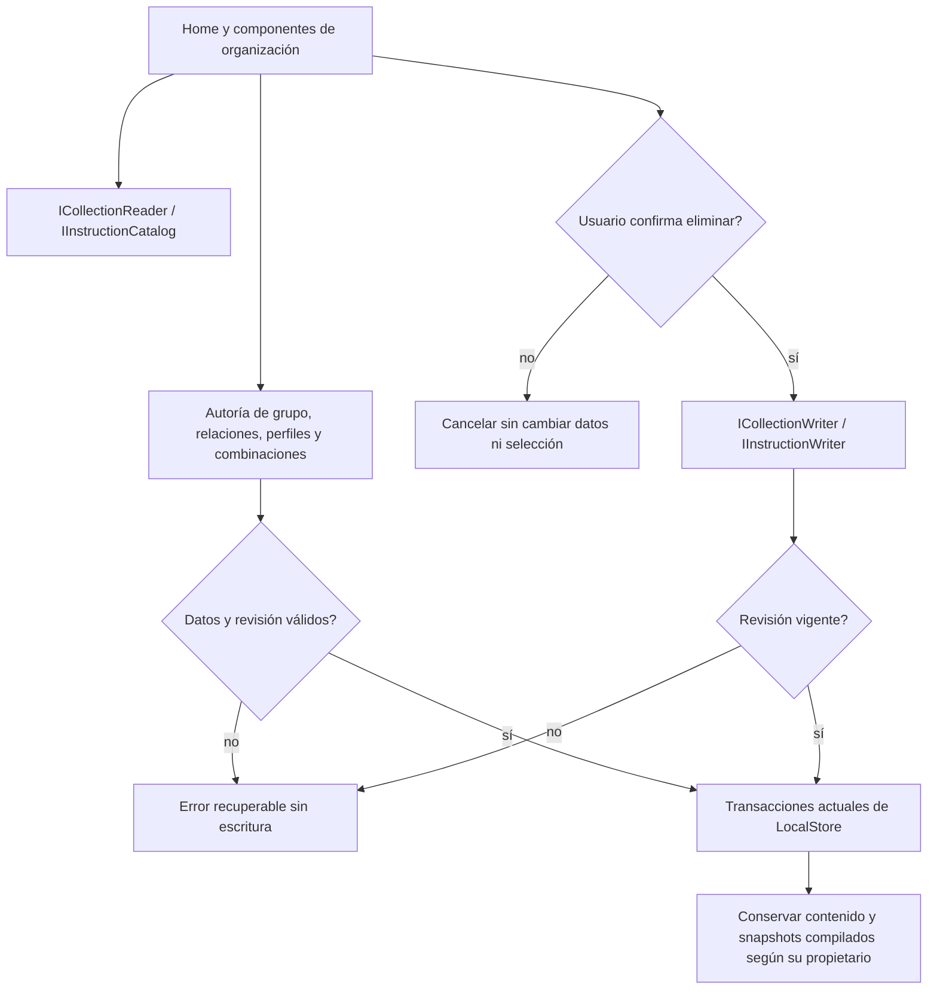

# Organización por capacidades — 2026-10-20

Estado: incremento IMPLEMENTADO y VERIFICADO. Objetivo global y versión abiertos.
No cambia la interpretación semántica de NOVA ni se ejecuta inferencia.

## Auditoría, decisión y propietarios

Home.Organization, el administrador de grupos, el selector de relaciones y la
biblioteca de instrucciones dependían del LocalStore concreto. Las transacciones
y revisiones de grupo/perfil ya existían en OrganizationStore y NovaOrganizationStore.
ICollectionReader/Writer ya ofrecían catálogo y eliminación protegida de grupos.

Se compararon conservar accesos concretos, contratos pequeños sobre los dueños
actuales y otro repositorio/fábrica de reglas. Se eligen contratos por capacidad;
eliminar un grupo reutiliza ICollectionWriter. No se añade un segundo catálogo,
codec, estado ni autoridad de relaciones. LocalPromptLibrary publica los alias
del mismo propietario y Program configura sus lifetimes.

## Workflow y algoritmo



```text
leer catálogos y versiones por sus puertos
guardar grupo/perfil: validar y conservar la revisión en la transacción existente
crear y asignar grupo: una transacción; rollback completo si falla origen o relación
seleccionar relación: identidad compuesta por tipo e ID; no duplicar la entidad
guardar/reutilizar combinación: actualizar selección/ajustes, sin compilar implícitamente
compilar explícitamente: conservar snapshot del perfil y su revisión
eliminar grupo/perfil: exigir confirmación y revisión observada
  si cambió: conflicto sin efectos; si coincide: borrar sólo relaciones del propietario
mantener el historial compilado independiente de la entidad eliminada
sin retries, nuevos permisos del modelo ni reglas por frases del usuario
```

## Contratos, dependencias y lifecycle

| Puerto | Responsabilidad | Invariantes |
|---|---|---|
| ICollectionReader/Writer | Catálogo y borrado protegido de grupos existentes | Revisión/confirmación; eliminar grupo no elimina sus prompts/perfiles |
| IGroupAuthoring | SaveGroup con todos sus metadatos | Nombre único normalizado, límite/revisión y transacción actuales |
| IGroupMemberships | Consultar/asignar relaciones; crear y asignar | Tipo e ID identifican la entidad; validación de todos los IDs y rollback conjunto |
| IInstructionCatalog | Consultas, elección y versiones de perfiles | Lectura materializada, sin escritura ni acceso al modelo |
| IInstructionWriter | Guardar y eliminar perfil confirmado | Revisión, versiones y eliminación de vínculos; historial compilado independiente |
| IPromptCombinations | Guardar, listar, eliminar combinaciones | Referencias válidas; reutilizar no modifica plantilla ni historial |

OrganizationLibrary.cs define los contratos. OrganizationLibraryPorts.cs los
implementa sobre la clase parcial del propietario; SQL/reglas continúan en
Local/OrganizationStore.cs. Los alias singleton de LocalPromptLibrary no crean
otro almacén. Las operaciones locales siguen siendo síncronas y transaccionales;
no se permite cancelar entre escrituras ni se introducen reintentos automáticos.

Los tipos persistidos de relación (`template`/`instruction`) son identificadores
del dominio validados por el propietario, no keywords para interpretar peticiones.
Los nuevos puertos no se registran automáticamente como herramientas reflejadas
del LLM. La autoridad del agente y la confirmación de escritura no se amplían.

## Implementación y retirada real

Home.Organization, Home.Simplicity y Reload usan los puertos. GroupLibrary,
GroupMembershipPicker e InstructionLibrary dejan de inyectar LocalStore. El selector
recarga por `(Kind, EntityId)` y limpia su entrada temporal al cambiar de entidad.
Los conflictos de borrado se muestran como errores recuperables.

Tras inventariar todos los consumidores se retiraron dos firmas C# desprotegidas:

- `LocalStore.DeleteGroup(Guid)`: usar ICollectionWriter.Delete con ConfirmInput.
- `LocalStore.DeleteInstruction(Guid)`: usar IInstructionWriter.DeleteInstruction
  con ConfirmInput y revisión observada.

Es un cambio deliberado de la API C# local, no un cambio silencioso de contrato.
Cinco llamadas de pruebas se migraron conservando sus expectativas; no se quitó
una prueba fallida. Una prueba por reflexión comprueba que las dos firmas antiguas
ya no se descubren. Los métodos/reglas de eliminación protegida quedan en sus
propietarios, sin duplicar SQL. Ver
[inventario y copias](../evidence/organization-ports-20261020/retirement.json).

Rutas HTTP, formatos de archivo y esquema SQLite no cambian. No se descargan
paquetes/modelos ni se modifica el modelo activo. Código previo del usuario fuera
de este bloque permanece intacto.

## Verificación ejecutada

[verification.json](../evidence/organization-ports-20261020/verification.json):

- **160/160 pruebas compartidas**, sin omitidas: cinco nuevas pruebas de alias,
  tipo/ID, atomicidad/rollback, confirmación/revisiones, perfiles/versiones,
  historial y retirada comprobada por reflexión.
- **23/23 pruebas backend de las fronteras afectadas**, sin omitidas. No se repite
  la matriz completa de comprensión ni una suite ajena al cambio.
- API y Blazor compilan, cero errores/advertencias; DLL compartidas idénticas.
- **13 comprobaciones en Edge visible**, dos circuitos reales y SQLite sintético:
  crear/asignar, metadatos de grupo, cancelar y rechazar borrado obsoleto; crear y
  versionar perfil, relaciones de ambos tipos; guardar/reutilizar/borrar combinación;
  composición con revisión del perfil; cancelar, rechazar y confirmar borrado de
  perfil; borrar grupo conservando plantilla e historial. Cero pageerror y
  solicitudes externas. El build final incluye la retirada de firmas antiguas.
- Ocho controles estáticos de fronteras; no acreditan comprensión del agente.

Se conservan las tandas intermedias: una observación prematura tras reutilizar la
combinación, una navegación del harness que buscaba un botón de otra pantalla y
una edición iniciada antes de cargar el perfil en el segundo circuito. La base
sintética mostró revisión 2 intacta en este último caso. Se añadieron esperas por
los valores reales de la edición y se usó el control real de cierre; no se cambió
la regla del producto, el timeout productivo ni el resultado esperado.

React y corpus Qwen: **NO EJECUTADOS**, sin cambios en esos consumidores/decisiones.
Las pruebas de organización no demuestran que el agente elija instrucciones bien.

## Reversión y pendientes

Sin migración de datos. Revertir sólo consumidores/puertos/alias de este incremento;
no resetear trabajo previo ni restaurar una base real para revertir código. Las
copias con hash preservan el código anterior a la retirada. Cualquier consumidor
C# externo de esas dos firmas deberá migrar al comando con confirmación/revisión;
no se promete compatibilidad binaria de una firma retirada.

Restan workflow de Quick Assist/puerto de inferencia, transferencias/bridge/panel,
diagnóstico, conformidad del host MAUI y sustitución semántica no cualificada.
El goal sigue ACTIVO; la matriz canónica permanece 34 cerrados / 54 abiertos.
