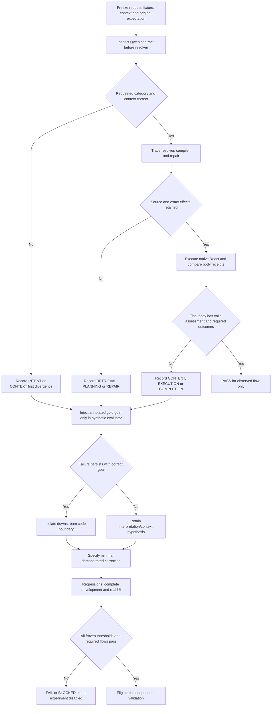

# Phase 5 — causal isolation

Status: **FAIL semantic acceptance; boundary corrections verified**. S04 and both Phase 5 candidates remain rejected and disabled. No new interpreter, lexical request rules, vectors or production oracle. Uses the personal `algorithmic-engineering` skill provided by the user. Skill installation/discovery completed separately before this product work.

## Observations before changes

The eight failed final intent scores are not eight proven errors by Qwen's first intent decision. Cases 02/10 already decode read + actual source correctly; later reference selection rejects copied library text as request evidence. Case 09 additionally has a correct read intent but selects the wrong contextual source. Case 04 has correct edit category with an invalid missing-source role. Cases 08/11/13/14/16 have an incorrect category or missing requested result in the first model contract. Preserve those distinctions; do not tune prompts to final error labels.

Machine-readable first-divergence audit: `docs/evidence/phase5/S04-first-divergence.json`. Initial model contracts are actual frozen Qwen outputs, not new inference. Their comparison against final expectations is diagnostic: some expectations (for example ambiguity) require source resolution, so it is not an independent model-only acceptance score.

| Failure | First demonstrated cause | Component / secondary symptom |
|---|---|---|
| 02 | Initially bound report is demoted before selecting again; isolate the precontrol branch | Planning/grounding; later library-body quote rejection |
| 04 | EDITED_DRAFT + NO_SOURCE_NEEDED despite actual selected source | Context role; decoder permits inconsistent edit then compiler asks |
| 08 | NEW_DRAFT for editing previous proposal | Intent; subsequent repair changes source |
| 09 | Reference selector replaces correct other-result query with report ID | Context/grounding |
| 10 | Reference selector copies stored body as user quote | Retrieval evidence; initial intent correct |
| 11 | DERIVED_DRAFT without requested COPY_READY | Intent before later reference failure |
| 13 | NEW_DRAFT for missing pronoun antecedent | Intent |
| 14 | Separate derived creation instead of edit | Intent |
| 16 | Provider preparation instead of local preparation | Intent |
| Real create | Evaluated proposal changes when RequiredInputs slots are appended | Content; completion correctly rejects unmatched body, question misdiagnoses missing fields |
| Real version review | Scope repair drops SAVE_VERSION_REVIEW | Repair; wrong creation then missing review |

## Isolation workflow



```text
isolate(case):
    freeze original request, actual fixture, context, model options and expectations
    A := actual Qwen interpretation before application source resolution
    retain raw contract and first decoder/compiler divergence separately
    B := construct gold TaskGoal from annotated fixture expectations in evaluator only
    run existing compiler, policy and source resolver with that goal
    retain exact effects, real source/revision, error and call count
    C := execute Qwen and native React using synthetic data
    compare observations with original request, not only repaired model goal
    if C stops before a required stage: mark that stage BLOCKED/NOT_TESTED
    never use B to claim Qwen semantic success
    preserve all earlier failures; do not modify frozen expected outcomes
```

The oracle and gold factory must stay in the evaluation executable; no API, environment switch or runtime tool may accept an oracle goal from a normal user request. B measures planning/source resolution, not generated content or UI. Existing real UI artifacts are C evidence for their exact requests/fixtures; they must not be called paired full-UI evidence for different development requests.

## Nine-call audit

Actual request/response evidence: `docs/evidence/phase5/nine-calls.json`. Total 349.611 s, 340.318 s in model transport. No call has been eliminated.

| Call | Purpose / new information | Decision / duration | Necessity finding |
|---|---|---|---|
| 1 | Interpret original creation | NEW_DRAFT / 25.383 s | New semantics required |
| 2 | Generate first instruction | 241 characters / 11.750 s | Generation required |
| 3 | Review raw instruction without its declared input slots | Rejected / 20.673 s | Code supplied a pre-composition artifact; this does not establish failure of the actual canonical instruction |
| 4 | Regenerate using rejection | 506 characters / 25.644 s | Induced by reviewing that pre-composition artifact; no independent new user goal |
| 5 | Review changed body | Accepted / 27.128 s | New body invalidates previous review |
| 6 | Interpret follow-up with working draft | EDITED_DRAFT / 45.976 s | New user semantics required |
| 7 | Generate adaptation | 697 characters / 100.530 s | Original S04 domain replay rejects seven added source inputs; all original slots remain |
| 8 | Correct with domain feedback | 637 characters / 41.212 s | Corrected edit passes the same source-binding contract; this correction is justified |
| 9 | Review corrected adaptation | Accepted / 42.022 s | Different body; no equivalent deterministic semantic check demonstrated |

## Minimal corrections implemented

1. Canonicalize the proposal with the existing domain placeholder parser before its existing fidelity assessment. Compilation must be idempotent for that body; do not add another model call. Assessment still invalidates when body, constraints or source/working revision change.
2. For a repair of an already parsed scope conflict, retain the original source, outcome, required and forbidden effects, constraints and revision. A subset of old result kinds is not sufficient. If the repair cannot preserve the goal, suspend/ask rather than execute a reduced goal. Invalid, not-yet-bound references are not falsely described as validated authority.
3. A plan whose only active effect is ASK_CLARIFICATION and whose goals are explicitly deferred is suspended. `SemanticPlanning.Resolve` returns it without source retrieval/selection, after checking cancellation. This applies to the typed state, not a particular error message or user phrase. Reference validity is checked again on the resumed user turn.

```text
generate_and_assess(input):
    proposal := existing_generator(input)
    canonical := existing_domain_canonicalization(proposal)
    existing_fidelity_review(canonical.exact_body)
    prepared := existing_compiler(canonical)
    require assessed_body_hash == prepared_body_hash before native completion

scope_repair(original_validated_goal, repaired):
    if repaired suspends: retain original goal and return clarification
    if outcome, reference, source revision, required/forbidden effects or constraints differ:
        retain original goal and return clarification without tools
    otherwise continue within original effect scope

resolve(plan):
    if outcome == CLARIFICATION and active_effects == [ASK_CLARIFICATION]
       and deferred_goals is nonempty:
        check cancellation
        return original resolution without source reads or model selection
    run existing reference resolver
```

| Node / invariant | Existing component | Executed verification |
|---|---|---|
| Canonical body before review | DeterministicPromptEvaluator, PreparationInference.Generate | RequiredInputs without inline slots; reviewed body equals compiled/native body |
| Body mutation invalidates review | TaskGoal.RecordContentAssessment / HasContentAssessment | Changed body and working/source revision cannot reuse assessment |
| Repair retains all effects | TaskGoalInference scope repair | Removing save/read/result cannot grant a smaller executable goal |
| Safe suspension | SemanticPlanning.Clarify | Original goal retained, no tools/writes, deferred results preserved |
| Suspended goal cannot restart resolution | SemanticPlanning.Resolve | Throwing retriever proves zero reads; selected and library references, read/save removed separately |

Acceptance remains the unchanged development thresholds plus real required UI flows. No semantic enablement from mechanical tests alone. Production oracle, global model changes, dependencies, publishing, commits and personal-data mutation remain excluded.

### Isolated results and implementation

`adaptation-structural-audit.json` executes the original S04 domain assembly against the actual two captured edits. `TemplateSourceBinding.Bind` rejects the first with unknown source inputs; the second passes unchanged. The original source's paraphrased final constraint is not recognized by `TemplateConstraints.Required` (empty array), so it is incorrect to attribute that deterministic rejection to a missing protected clause. Source constraint omission remains an observed semantic difference, not the first demonstrated code rejection.

Two distinctions prevent blaming the model automatically. Call 3 reviewed only raw text; its declared `RequiredInputs` were not included in that body or the review packet. The eventual compiled instruction would be different. Call 8 is necessary under the current fixed-source-input policy; an isolated rejection proves enforcement, not that forbidding all new fields is the correct product policy for every adaptation. Neither observation authorizes removing semantic checks or relaxing source contracts merely to save time.

GOLD_GOAL on all sixteen original requests/SQLite fixtures: **15/16 planning PASS**, case 02 FAIL. This is not Qwen accuracy. With the annotated correct report ID and SEARCH goal, the existing resolver returns ASK_CLARIFICATION/AMBIGUOUS_SOURCE and omits SEARCH. No interpretation call or React execution is involved. The literal rank precontrol is therefore a demonstrated downstream first cause for that request. It remains unchanged in this minimal boundary correction; the source-verification contract also remains unchanged.

Implemented: `DeterministicPromptEvaluator.Canonicalize` reuses the existing RequiredInputs transformation before `PreparationInference.Generate` calls its existing fidelity reviewer. The evaluator uses the same idempotent transformation. No inference added. `TaskGoalInference` now compares the complete original scope/outcome/reference/revision with a scope repair and returns clarification with the original TaskGoal/deferred results when it changes. It cannot turn a reduced repaired result set into a new executable authority.

Three new controlled transport regressions passed. The first full backend run preserved **404 PASS / 1 FAIL**: the earlier scope-conflict test expected reinterpretation of the original prohibition followed by execution. Its new expected behavior is intentional safe suspension under the user's Phase 5 invariant; the test now checks preservation of required/prohibited adaptation and no update tool. This is not a changed semantic dataset or threshold. The failed TRX is retained.

## Complete development comparison

Same frozen sixteen requests, SQLite fixtures, model digest and experimental profile; no production feature enablement. Machine-readable comparison: `docs/evidence/phase5/comparison.json`.

| Snapshot | Intent | Target | Valid plan | Metamorphic groups | LLM calls | Elapsed p50 / p95 |
|---|---:|---:|---:|---:|---:|---:|
| S01 | 14/16 | 14/16 | 15/16 | 2/2 | 21 | 28.241 / 68.783 s |
| S03 | 12/16 | 13/16 | 15/16 | 1/2 | 24 | 20.651 / 68.552 s |
| S04 | 8/16 | 8/16 | 11/16 | 0/2 | 23 | 23.171 / 57.822 s |
| P5a boundary corrections | 8/16 | 8/16 | 11/16 | 0/2 | 23 | 21.183 / 54.429 s |
| P5b suspension frontier | 8/16 | 8/16 | 11/16 | 0/2 | 23 | 21.706 / 54.954 s |

P5 **FAIL**: the two demonstrated boundary corrections do not recover interpretation or target resolution. No independent validation or holdout evaluation is authorized by the failed development gate. Elapsed percentiles include unsuccessful requests; they are not time-to-correct-result or evidence of a repeatable speed improvement. P5 has two extra-effect cases among eleven compiled plans and eight missing-effect cases among sixteen contracts; no browser execution occurs in this semantic evaluation.

MODEL_ONLY observed-stage evidence is retained across all five snapshots in `model-stage-audit.json` (80 rows). These are actual Qwen outputs before source resolution in the tool-free recovery evaluator, not an independent fresh model-only invocation. Frozen final-plan annotations cannot independently grade every intermediate decision: an initial read may correctly need the resolver to establish ambiguity. GOLD_GOAL is paired on the same sixteen requests/fixtures and has **15/16 planning passes on both S04 and P5**, with zero model calls; case 02 still fails. Neither mode establishes content fidelity or React completion. Full React coverage paired to all sixteen development requests is **NOT_TESTED**; the separately recorded UI campaign has its own exact requests and fixtures.

Executed regressions: **405/405 backend**, **150/150 legacy**, **90/90 React**. API and evaluation builds succeeded. The three new boundary transport tests are included in the backend total. Source comparison with the frozen S04 manifest shows exactly three changed production files: `Preparation.cs`, `PreparationInference.cs` and `TaskGoalInference.cs`; frontend source and production defaults are unchanged.

Those are the preserved **P5a** results. The paired replay then exposed continuation of a suspended named-reference plan into source selection. The replay correctly refused an unrecorded selection response; P5a ended FAILED/BROWSER_FAILURE with no tools. This is retained in `latency-1792350662251`. **P5b** adds the typed suspension frontier above in `SemanticPlanning.cs`, the fourth production file. It does not relax the replay. Five boundary tests and **407/407 backend** pass; API/evaluation builds have zero warnings/errors. The earlier overlapping test build briefly retried copying a test DLL held by its own targeted testhost; both test executions completed, and the isolated final builds are clean.

The same three boundary tests were extended after freezing the production candidate: constraint changes, source revision 7→8 and a different draft ID also invalidate the prior content assessment (**3/3 PASS**, `checks/P5-integrity-expanded.trx`). This is recorded as a test-only extension in the manifest. No frozen production binary changed. This deterministic build/check overlapped part of the UI campaign, another reason not to infer a speed improvement from single-run timings.

### New UI divergences retained during the campaign

The P5 unsaved-adaptation turn selects the correct WORKING_DRAFT but marks the sentence “termine con responsables y fechas de seguimiento. Conserva la regla de no inventar información.” as `exactText`. The user requested a change, not literal insertion of that whole editing instruction. This is a new **INTENT/constraint** divergence before generation. The actual domain assembly rejects the first edit for two new input names; the second passes source binding but does not contain the model-imposed literal. The final run is BLOCKED/INVALID_DECISION with the previous native draft intact. Public errors collapse ValidationException to that code, so the exact final throw site is not exposed; the contract, binder failure and missing-literal condition are independently recorded in `P5-unsavedAdapt-structural-audit.json`, not guessed from the error label.

The nonexistent-source request initially has the correct SOURCE_READ category and query. Its selector returns NO_IDENTIFIABLE_REFERENCE, but `SemanticPlanning.Resolve` still uses lexical `recallAmbiguous` to assign scores to unrelated recalled records and offer them as choices. This is a demonstrated **PLANNING** fallback problem, not proof that Qwen's initial read intention was wrong. The ambiguity request separately has a wrong initial question about “Redactar correos” while actual Anuncios A/B records are visible. These failures remain open; safety of a blocked action does not establish relevance or functional success.

The real save-copy run reaches approval, commits with HTTP 200 and stores the **exact reviewed/approved/native body**, new ID `0d7f008b-cc65-4aed-81a1-8e086ba11f3b`, revision 1. A separate read-only SQLite audit verifies that all stored values of both original records remain identical and the saved body equals canonical generation. **Mechanical approval/persistence PASS** (`P5-saveCopy-integrity-audit.json`). **Content FAIL**: generation appends “Conserva el original y solicita la aprobación para guardar una copia separada.” to the reusable instruction, and its Qwen fidelity review incorrectly accepts that application workflow. The raw probe also over-requires `compiledReady` for saving a reusable prompt with empty variables; its raw `correct=false` is therefore not sufficient evidence of a persistence defect. Original evidence is retained and the independent content finding still rejects this flow.

The real version-rejection request cannot reach rejection: its first contract contains DERIVED_DRAFT but omits SAVE_VERSION_REVIEW. Its later fidelity reviewer asks the authored instruction to contain the missing approval workflow, which is another content/workflow error. The first cause is **INTENT**, not a repair regression; no approval or persistence occurred. The separate recorded-reply experiment is needed to exercise the original S04 repair failure with identical model replies. The pause/resume flow similarly omits COPY_READY in its first contract; touching the input does not pause, explicit pause is observed, fields remain stable and resume clears the pause, but later generation blocks. Control mechanics pass while the requested end-to-end result fails.

## Real UI campaign and paired mechanical replay

P5a completed all twelve scheduled scenarios using real Qwen, one React page per scenario and no external requests. Raw probes have four flow passes; manual review rejects one of those creations for an added prohibition of participants/location/follow-up. Annotated scope: **3 PASS / 7 FAIL / 2 BLOCKED**, `P5a-e2e-audited.json`. This is a manual artifact review, not independent blind evaluation or a score comparable to the different S04 ten-case scope. Rejection was blocked before approval. The third-turn chain completed creation and adaptation but its harness could not find the composer after the dock collapsed; no third request or approval occurred. This is **HARNESS / NOT_TESTED**, not a Qwen failure. The corrected harness opens the existing visible NOVA button before a follow-up; the failed locator and original data remain preserved.

Paired replay (`paired-replay-audit.json`) uses identical recorded material fields and original owned fixtures on original S04 versus P5b, with **zero real model calls**. Uncaptured descriptive metadata is reconstructed, so these are not byte-identical complete HTTP replies and are never a model-quality or latency benchmark.

| Recorded failure | Original S04 | P5b | Isolated result |
|---|---|---|---|
| Creation reviews a different body from the native form | BLOCKED, three replay responses | COMPLETED, three replay responses, native fields exact | Canonical artifact boundary PASS |
| Repair removes save/read and creates an unsaved instruction | Four replay responses, executes open-create/prepare-creation | Two replay responses, ASK_CLARIFICATION, zero tools | Suspended original goal boundary PASS |

Both preserve their libraries. Repair replay does **not** pass the user's requested save/rejection outcome; it proves prevention of the reduced unauthorized execution. None of the original nine continuity calls has been removed. The unnecessary continuation after a suspended goal is stopped without adding an inference stage. Full paired React coverage for all sixteen development cases remains NOT_TESTED.

### Final P5b real-Qwen verification

The complete sixteen-case rerun on the frozen P5b API/evaluation assemblies again fails: **8/16 intent, 8/16 target, 11/16 valid plans, 0/2 metamorphic groups, 23 calls**. GOLD_GOAL remains **15/16** with zero calls; case 02 still fails. The model digest, profile, source/runtime/dataset hashes and unchanged synthetic library are checked in `final-integrity.json`. Production defaults remain false. Independent validation and holdout are not executed.

With the corrected dock opener, the final source-free continuity scenario has **no harness errors**, but fails during adaptation: **307.231 s / 10 real model calls / 304.134 s transport**. Creation takes five calls and completes mechanically; it adds the same unrequested ban on participants/location/follow-up. The next turn correctly selects WORKING_DRAFT, but also marks the whole editing instruction as literal text. Its fidelity reviewer then rejects follow-up dates because the generated source prohibits them. The first divergence is **CONTENT/authority** in creation/review; the later reviewer promotes a model-added prohibition above the new user directive. This is not a failure of the corrected dock opener or the suspension frontier.

`P5b-continuity-audited.json` retains this chain. No third save request, approval or persistence occurs; those stages are **NOT_TESTED / blocked by adaptation**. The session, native fields and original library are preserved. The UI run uses one React page and makes no external requests. This final build has focused real continuity and paired replay evidence; the twelve-case real campaign belongs to frozen P5a, not P5b. Public live views do not expose internal DraftId/revision, so full real-chain identity verification remains NOT_TESTED beyond the controlled context/assessment tests. OS clipboard integration remains NOT_TESTED.

Final checks: **407 backend + 150 legacy + 90 React = 647 PASS**. This count validates executed regressions, not natural-language correctness. The final API/evaluation builds have zero warnings/errors. Dataset/threshold/validation/holdout hashes are unchanged; no dependency, public HTTP contract, database schema or deployment configuration changed.

## Decision and remaining blockers

**FAIL — do not enable or promote the semantic candidate.** Canonical review and repair/suspension authority boundaries pass their isolated tests and paired browser replay. They do not recover general interpretation. No repeatable speed improvement is established; failed elapsed times cannot be treated as correct-result latency. About 99% of the final failed continuity time is model transport, and none of the original nine calls has been removed.

Remaining demonstrated failure classes are first-contract intent/reference/constraint mistakes; literal retrieval-rank authority overriding semantic source decisions; copied source text being used as user evidence; missing requested effects; and generation/review adding workflow or constraints that were not authorized by the user. Correcting these needs their own isolated contracts and unchanged-corpus verification, not phrase exceptions or another interpreter. Rejection with real Qwen, the full three-turn approved save chain and complete paired A/B/C React coverage are not passed by this delivery. Historical failures, blocked stages and the initial test/harness failures remain available in their original evidence files.
