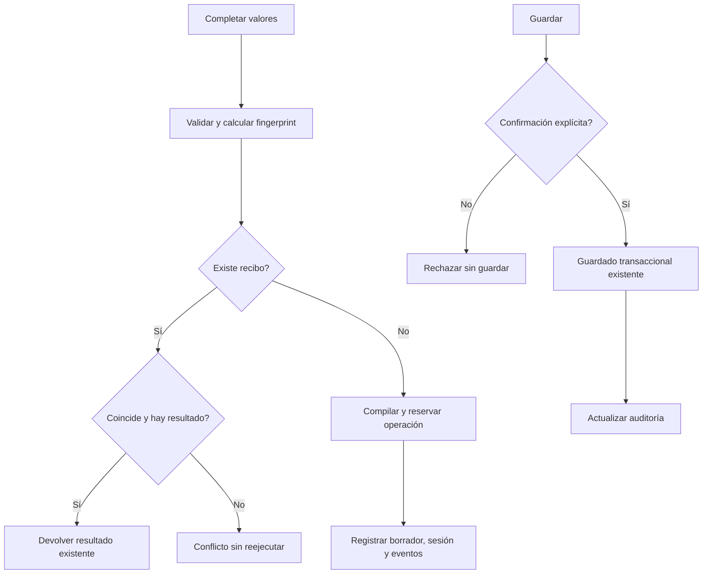

# Ciclo de vida de borradores preparados

## Auditoría, raíz y contrato

PreparationEndpoints contiene el flujo de completar valores y de confirmar guardado.
IPreparedDraftStore ya posee contenido/recibos/guardado transaccional; AgentSessions
posee transición de memoria; IAgentRunStore conserva checkpoints; LiveRuns publica
observaciones. Listar, leer y descartar ya delegan al almacén y se conservan así.

Fallo reproducido con HTTP/SQLite real: completar, guardar, descartar resultado y
repetir la misma operación encuentra fingerprint retenido, pero Get retorna null.
La aserción null-forgiving oculta esa ausencia y HTTP devuelve 200 vacío. Se debe
mantener el recibo (no repetir efectos) y responder 409 cuando ya no hay resultado.
Es una regla de disponibilidad de artefactos, independiente de frases/modelos/categorías.

Se extraen dos capacidades estables: IPreparedDraftCompletion/PreparedDraftCompletion
(completar+checkpoint+sesión+eventos) e IPreparedDraftSaving/PreparedDraftSaving
(confirmar guardado+auditoría de checkpoint). El guardado sólo requiere almacén y
runs; no se le añade dependencia del control visual. Ambas se registran en la
factory DI existente y conservan todos los propietarios de datos. DTO HTTP público
CompletePreparedInput permanece en API, adaptado a CompleteDraftRequest de aplicación;
SavePreparedInput existente se reutiliza. Sin tablas, parser, permisos o modelos nuevos.

Alternativas: ampliar AgentOrchestrator acopla operaciones deterministas a modelos;
un servicio único con todos los puertos impone LiveRuns al guardado; wrappers de
lectura/descarte no aportan reglas. Dos interfaces estrechas separan las dependencias
reales sin dispatcher, framework, herencia artificial ni manejadores por texto.

Invariantes: valores literales válidos, orden ordinal del fingerprint idéntico,
idempotencia sin reejecución, mismatch siempre conflicto. Recibo con contenido
recupera el mismo resultado; recibo sin contenido rechaza, no reconstruye ni produce
éxito vacío. Compilar no guarda el prompt ni aprueba su guardado. Guardar requiere
Confirmed y conserva transacción/revisión/deduplicación del almacén. Mismas etiquetas
y eventos; no se modifica la política actual de contexto Source/Values o semántica.

Orden de completar preservado: leer/validar/recuperar recibo, compilar, reservar run,
guardar preparación, observar sesión y publicar eventos. Sin transacción ficticia
entre propietarios, ni rollback/cancelación/retry añadidos. Si falla tras reserva,
no se borra la reserva para repetir efectos sin evidencia. Guardar conserva el orden
Save antes de auditoría; un fallo posterior no revierte el commit ya efectuado.

Compatibilidad: mismas rutas, DTOs y respuestas válidas. Cambio intencional único:
replay de resultado descartado devuelve 409 en lugar de 200 vacío, conforme al contrato
que exige PreparedDraft válido en éxito. Mensaje de recuperación legible, sin exponer
IDs internos. Descartar mantiene el recibo y no toca un prompt ya guardado.

Aceptación: baseline relevante; caso real antes/después con mismo harness; contratos de
completar/guardar, efectos y fallos, sustitución/ausencia de LiveRuns para guardar;
HTTP/SQLite y comprobaciones UI/hosts con candidato congelado. Build API/evaluador/
Blazor web, DLL comunes y metadata reflejada; sin campaña Qwen ni suite frontend si
sus fuentes no cambian. Version/matriz canónica no se cierran automáticamente. MAUI
excluido. Rollback conjunto desde before.json y archivos nuevos, conservando el fallo.

## Workflow y algoritmo



```text
completar: leer y validar datos; calcular la misma huella ordinal
si hay recibo: rechazar mismatch o contenido ausente, devolver sólo resultado existente
si no hay recibo: compilar, reservar, registrar y observar como antes
guardar: exigir Confirmed, delegar transacción al almacén y actualizar auditoría
no recrear artefactos olvidados, no repetir efectos ni añadir autoría/inferencia
```

## Resultado ejecutado

IMPLEMENTADO. Dos capacidades con dependencias segregadas retiran la lógica de
completar/guardar del HTTP. Lectura/listado/descarte siguen en su almacén existente.
Guardado no requiere LiveRuns/modelo; completar conserva sus propietarios/eventos.

- Fallo original conservado: tras guardar y descartar, replay devuelve **200 vacío**.
  El mismo harness HTTP ahora pasa **7 comprobaciones**; devuelve **409** y no
  reejecuta ni recrea contenido. Guardado ya confirmado sigue recuperándose por
  su recibo; no se borra el prompt persistido al descartar un borrador.
- Baseline **150/150**; **14/14** casos nuevos; final **164/164**, cinco clases,
  cero omitidas. Orden ordinal de valores, replay sin efectos, fallos tras reserva,
  confirmación, versiones, auditoría y ausencia de Live para guardar cubiertos.
- **2 controles headed de UI** pasan con stream de preparación sintético claramente
  identificado: campos visibles -> valores API -> vista previa exacta -> guardado
  real. Completar/guardar y SQLite no están simulados. El fixture inicial esperaba
  campos tras READY, contra el diseño existente; fallo conservado y comprobaciones
  ajustadas al momento visible sin cambiar producto ni fidelidad de valores.
- **15 controles de host** normal/desactivado/sustituido PASS. API/evaluador/Blazor
  web compilan con **0 errores/advertencias**; DLL comunes iguales a las probadas.
  Cuatro schemas/capacidades reflejados idénticos; **35** guardas estáticas PASS.
- Tokens de lógica extraída preservados salvo la única corrección declarada; DTO
  público, otras rutas y fingerprint no cambian. OpenAPI/matriz conservan hashes.
  Frontend congelado sin cambios reutilizado; no se repite su suite ni build.

No es prueba de planificación Qwen ni latencia. No añade transacciones entre
propietarios, rollback o reintentos. Se conserva la política anterior de contexto.
MAUI excluido, servicios personales sin reiniciar; puertos propios cerrados.
Versión NO_CERRADA (**34 cerrados/54 abiertos**) y meta general activa.

[Verificación y provenance](../evidence/prepared-draft-lifecycle-20261020/verification.json).
