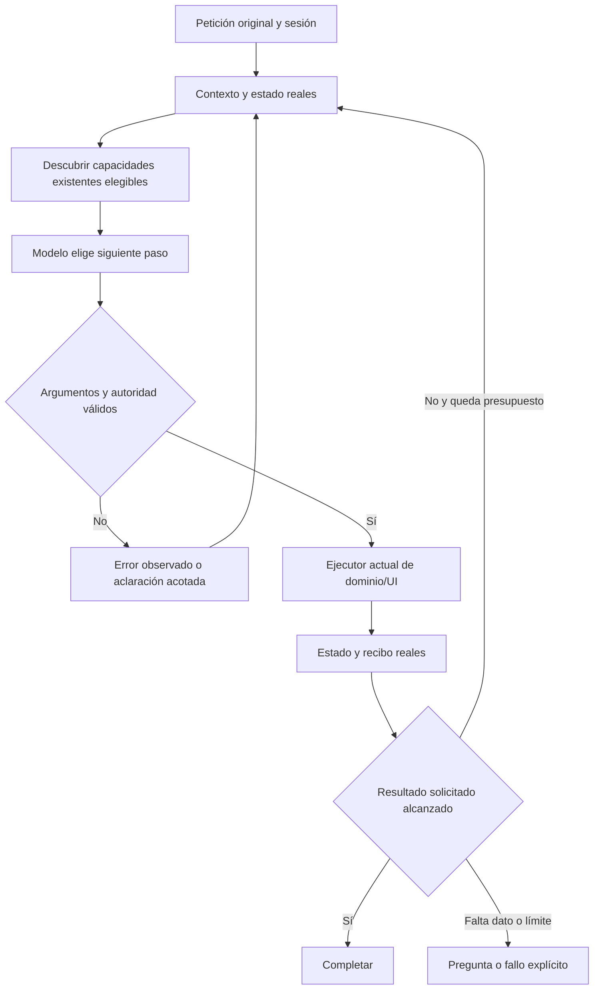

# NOVA: arquitectura de agente guiada por el sistema real

2026-10-20. Revisión solicitada tras rechazar la duplicación de capacidades de planificación. Diseño corregido; sustitución productiva pendiente. Atribución: Codex. Las prácticas documentadas de proveedores no acreditan nuestro modelo local.

Incremento posterior: [recursos del bucle UI](UI_AGENT_RESOURCES.md) ya conecta guía reflejada, controles actuales, catálogo elegible, memoria de tarea y efectos comprobados a `PreparationInference.Decide`. 101 controles dirigidos y un recorrido de acción rápida con Qwen/UI real pasan; la petición libre retenida falla antes, en la decisión de autoría que confunde completar/copiar con modificar contenido. No equivale a sustituir el intérprete inicial ni cualificar semántica general; criterios de cierre intactos.

## Hallazgo

No se necesitan capacidades por frase, sinónimo o caso de prueba. Una capacidad corresponde a una operación real de la aplicación y puede participar en miles de peticiones diferentes. Una nueva forma de pedir la misma operación debe resolverse con el mismo código. Una nueva operación de negocio sí requiere una implementación autorizada; un agente no puede inventar funcionalidad que la aplicación no ofrece.

El primer sustituto volvió a pedir al modelo un formulario interno amplio, `prepare_task`. En cuatro casos retenidos hizo lecturas correctas pero terminó con prosa o produjo restricciones sin evidencia. El protocolo de corrección acotado volvió a fallar en esos mismos cuatro casos. Añadir luego dieciocho métodos de planificación que duplican acciones existentes tampoco era una sustitución adecuada: se archivó y retiró ese archivo antes de conectarlo a la API.

No se atribuye el resultado sólo al modelo: la frontera de preparación artificial y el cierre del protocolo fallan juntos. Qwen sí completó antes dos lecturas reales con herramientas pequeñas. Tampoco se concluye que cambiar nombres o usar reflection solucionará semántica. Los controles simulados del prototipo pasan, mientras su comprobación real falla; el candidato no está cualificado.

## Cómo trabajan los agentes de producción revisados

1. **Un bucle compartido.** El modelo recibe objetivo, estado pertinente y herramientas; propone el siguiente paso; la aplicación valida/ejecuta; el resultado real vuelve a la conversación. Se termina ante postcondiciones, una pregunta o límites. No se programa una trayectoria para cada petición. [Building effective agents](https://www.anthropic.com/engineering/building-effective-agents).
2. **Herramientas con significado y límites.** Nombres, descripciones y parámetros deben explicar propósito, precondiciones, efectos y resultados. La calidad del interfaz afecta al rendimiento; una capa adicional de herramientas que refleje operaciones ya presentes puede añadir confusión. [Writing tools for agents](https://www.anthropic.com/engineering/writing-tools-for-agents).
3. **Contexto administrado.** Instrucciones estables, petición original, datos, fuentes y observaciones conservan papeles y procedencia. El agente consulta recursos según la tarea. Resumir indiscriminadamente no conserva autoridad ni revisión. [Context engineering](https://www.anthropic.com/engineering/effective-context-engineering-for-ai-agents).
4. **Descubrimiento progresivo cuando se necesita.** Los catálogos grandes pueden cargarse bajo demanda; no hace falta enviar todas las herramientas a cada llamada. Este patrón recupera definiciones, no decide permisos ni interpreta la petición mediante palabras clave. NOVA no necesita instalar un servicio de búsqueda nuevo para empezar con su catálogo existente. [Advanced tool use](https://www.anthropic.com/engineering/advanced-tool-use).
5. **Protocolo comprobado con el proveedor real.** Ollama documenta conservar mensaje del asistente, llamadas y resultados durante el bucle. Su compatibilidad con otras APIs es parcial; no basta con copiar un campo de otro proveedor y asumir que se impone una llamada. [Tool calling](https://docs.ollama.com/capabilities/tool-calling), [compatibilidad y campos marcados como soportados/no soportados](https://github.com/ollama/ollama/blob/main/docs/api/openai-compatibility.mdx).

Son patrones aplicables. Las funciones de productos concretos, su entrenamiento y las capacidades de sus modelos no se transfieren automáticamente a Qwen.

## Cómo se le enseña a NOVA

El modelo base ya tiene capacidades adquiridas durante su entrenamiento. Reflection no cambia sus pesos. La documentación aportada durante una tarea es contexto de ejecución, no aprendizaje permanente. Entrenar o cambiar modelo es una decisión distinta que no se ha realizado en esta revisión.

El contexto operativo debe reunir:

| Recurso | Contenido | Propietario |
|---|---|---|
| Guía del sistema | Qué es un prompt, diferencia entre definición/datos/texto compilado, qué puede preparar NOVA y cómo se confirma un efecto | Documentación de dominio versionada |
| Petición | Texto original y continuación autorizada, sin sustituirlos por un resumen generado | Sesión/TaskGoal |
| Estado actual | Pantalla, borrador, fuente/ID/revisión, campos y acciones disponibles | UI y servicios actuales |
| Catálogo | Operaciones reales, argumentos derivados de tipos, descripciones, autoridad y precondiciones | Registro existente; reflection y SDK |
| Observaciones | Qué se leyó, qué cambió, valores reales escritos, errores y recibos | Ejecutores de dominio/UI |
| Memoria de tarea | Referencias vigentes, preguntas y pasos pendientes con procedencia y caducidad | AgentSessions / TaskConversationContext |

Las definiciones pueden documentar llamadas representativas y sus resultados para explicar un interfaz ambiguo. No se convierten en un diccionario de frases, reglas de intención o respuestas predefinidas. Desarrollo, validación y holdout siguen separados.

## Diseño que se aplicará

**Extender los propietarios existentes y componer su catálogo real.** El registro reflejado se conserva; no se construye un registro paralelo con un método por intención. La UI ya publica herramientas y controles elegibles; el dominio ya tiene servicios y validadores. El agente recibe esas capacidades según el estado, junto con la guía de objetos y la petición original. La procedencia del dato y la autorización siguen siendo controles deterministas.

Un agente de UI también puede trabajar con un conjunto pequeño de primitivas sobre controles observados: inspeccionar, asignar un valor a un campo y activar una acción disponible. Los identificadores del control/acción provienen de la pantalla real. Esto no autoriza selectores arbitrarios, SQL, shell ni saltarse servicios de negocio. La elección entre capacidades de negocio y primitivas UI debe respetar el ejecutor actual y medirse; no se incorpora otro controlador de navegador en esta revisión.



```text
restaurar petición y referencias vigentes de la sesión
obtener estado y catálogo de los propietarios actuales
mientras queden pasos, tiempo y llamadas:
    aportar guía estable, petición original, recursos pertinentes y observaciones
    pedir siguiente paso usando el protocolo soportado por el modelo/proveedor
    validar llamada contra capacidad real, argumentos, revisión y autoridad
    ejecutar en el propietario existente; incorporar resultado real
    verificar avance y postcondiciones del resultado pedido
    terminar, pedir aclaración o continuar según evidencia
no inferir acciones de prosa ni contar una propuesta como un efecto
```

## Alternativas descartadas y fronteras

- Diccionario de frases/keywords/regex: descartado para interpretar intención.
- Un `prepare_task` amplio seguido de reintentos de prosa: candidato real no cualificado; no promocionado.
- Métodos adicionales de planificación para cada acción ya implementada: duplican conocimiento/propiedad; archivo retirado.
- Una herramienta universal con acceso arbitrario a base de datos o navegador: no preserva autoridad ni límites.
- Nuevos frameworks, múltiples agentes, modelos o vector DB: no se incorporan sin necesidad y evidencia.

Se comparó extender el módulo actual, añadir una estrategia de interpretación y crear otro subsistema. Se mantiene la extensión del registro/contexto y los ejecutores actuales. Los contratos de ejecución siguen existiendo: ahora deben derivarse del sistema y validar sus límites; eliminarlos no enseñaría al modelo ni protegería los datos.

## Condiciones antes de sustituir la composición

| Comprobación | Evidencia exigida |
|---|---|
| Registro | Nueva operación de dominio registrada por su punto de extensión; sin modificar decisiones del agente ni duplicar reglas |
| Interpretación | Peticiones retenidas y paráfrasis conservan tarea, objeto, alcance y referencias; no hay acciones añadidas u omitidas |
| Datos/autoridad | Datos de campos y fuentes no otorgan ejecutar, guardar o borrar; revisión obsoleta impide efecto |
| Autoría | No mezcla órdenes actuales con instrucción futura; conserva restricciones y título solicitado |
| Ejecución | Valores y controles reales, navegación y recibos; no basta un plan o respuesta del modelo |
| Cierre | Postcondiciones verificadas e independencia de tareas; el modelo no se autoautoriza guardados ni autocertifica todo el flujo |

La capacidad del modelo se mide por separado del protocolo, dominio y UI. Que `/api/show` declare tools no demuestra fiabilidad del agente. Inventario observado: Ollama 0.40.6, Qwen3:8b 8.2B Q4_K_M, capacidades completion/tools/thinking. No se descargó ni cambió el modelo.

Evidencia de este trabajo: [diagnóstico inicial](../evidence/closure-20261020/reflected-core-development-initial.json), [corrección de protocolo fallida](../evidence/closure-20261020/reflected-core-development-protocol.json), [75 controles de límites y consumidores](../evidence/closure-20261020/tests/semantic-core-production-review-boundaries.trx). Los cuatro casos de cada campaña son diagnóstico parcial de desarrollo; no son una campaña de aceptación completa. El control adicional liga los nombres de campo a su fuente, aunque el usuario esté viendo otro ítem, sin conceder autoridad a los datos. No se repitió frontend, backend completo ni holdout. La API sigue enlazando el intérprete anterior; la sustitución queda pendiente, sin cambiar requisitos de cierre.

## Incremento posterior: JSON tipado y alcance de efectos

La evidencia anterior se conserva como historia del candidato rechazado. El incremento [TYPED_AGENT_CONTEXT.md](TYPED_AGENT_CONTEXT.md) extiende el propietario inicial existente con guía/contexto/respuesta JSON tipados, esquemas derivados de C# y atributos `Writes`/`Requires`. No activa el prototipo de núcleo alternativo ni añade ejecutores o un árbitro.

El candidato final acredita 194 controles dirigidos, tres regresiones de planificación con Qwen y las dos peticiones libres originales de completar/copiar en UI: todas PASS en ese alcance. La fuente, revisión, plantilla, valores literales, preview y copia capturada en el navegador coinciden; la edición legítima se conserva. Resultados, hashes y experimentos rechazados: [INSTRUCTION_USE_GROUNDING.md](INSTRUCTION_USE_GROUNDING.md). No se acredita fiabilidad semántica general, creación/fidelidad, holdout, portapapeles nativo ni latencia global; la versión sigue abierta.
