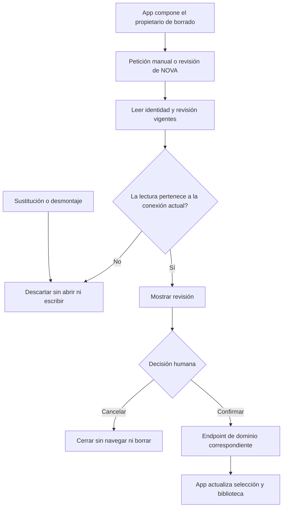

# Propietario de revisión y borrado en la UI

## Auditoría y contrato

App posee actualmente selección/navegación/editor, pero también estados, listeners,
identidad de revisión, habilitación, confirmación y rechazo del borrado. Los puertos
PromptLibraryClient y LiveClient ya existen: el backend conserva revisión, aprobación
y transacción. No se crea otro dueño de datos ni una autorización en el frontend.

Observación: los listeners de revisión se registran con dependencias vacías y capturan
los servicios iniciales. La composición soporta sustitución de servicios (useLibrary
ya incluye identidad del puerto); revisar después de sustituir puede leer otra
conexión. Un pending anterior tampoco se invalida al sustituirla. Se reproducirá antes
de corregir. No se afirma aislamiento de varias App sobre el mismo window.

Se elige extraer la capacidad existente a usePromptDeletion, en features/prompts.
Contrato PromptDeletionHost: bloqueo compartido, error, precondición de tarea activa
y notificación de borrado confirmado; PromptDeletionController: target/review/ready y
open/confirm/cancel. El hook posee únicamente el flujo UI, estados y ciclo de vida.
App compone el hook y conserva selección, navegación, versión y toast. Endpoints y
DTOs existentes permanecen iguales. Sin dependencias, DB, modelos o permisos nuevos.

Alternativas: dejar el bloque en App mantiene dos responsabilidades y dificulta
sustituirlo; un framework de workflows/clase por acción añade piezas sin variación;
un hook cohesivo con interfaces estrechas usa la arquitectura React actual. No se
introduce herencia ni reflexión artificial en componentes React. La reflexión del
backend sigue siendo responsable de sus capacidades reales.

Invariantes: no DELETE desde una revisión de NOVA; la decisión humana envía el id,
hash y revisión verificados; sólo se habilita la revisión correspondiente. Cancelar
cierra sin navegar ni borrar. Abort del agente cierra sin persistir. Revisión previa
no puede reaparecer al cambiar conexión/unmount; manual/agent comparten un propietario.
La UI no declara éxito antes de que termine el endpoint. No se reintenta mutación
incierta. El bloqueo compartido sigue impidiendo otras acciones durante guardado.

Cancelación/error: invalidar lecturas pendientes al cerrar/sustituir/desmontar;
conservar timeout de lectura y errores existentes. Mutaciones ya enviadas no se
replayean. La retirada del módulo elimina sus listeners y no afecta otros flujos.
Compatibilidad HTTP/BD/atributos de UI conservada; rollback conjunto desde before.json.

Aceptación: reproducir sustitución y pending viejo, mismas pruebas después; cohorte
existente de borrado/driver y suite frontend; typecheck/build; recorridos reales sobre
build congelado y DB sintética. No matriz backend/Qwen sin cambio de algoritmo.
Matriz canónica conserva criterios, estados y hashes; este incremento no cierra agente.

## Workflow y algoritmo



```text
componer usePromptDeletion sobre lector/borrado y get/decisión del run existentes
suscribir eventos; guardar contador de lecturas de esta conexión
leer propuesta; comprobar contador antes de pedir el origen
comprobar identidad/revisión/título antes de mostrar; mostrar sin efecto persistente
habilitar sólo la revisión con run/destino/revisión correspondientes
cancelar: invalidar lecturas y cerrar; rechazar propuesta si procede, sin navegación
confirmar: aplicar guardas y esperar endpoint correspondiente sin retry automático
tras éxito de la misma sesión: cerrar y notificar a App para refrescar biblioteca
sustituir/desmontar: invalidar contador y retirar listeners
cambiar callbacks de presentación: actualizar receptor después del commit React,
  conservando revisión y listeners de la conexión
```

La vista pública de revisión es una copia con sólo runId; id/hash de aprobación y
revisión del dominio quedan privados. La mutación de esa copia no modifica la
identidad que se envía al endpoint. Callbacks dinámicos de notificación no son
identidades de conexión: el puente con ref se actualiza por useLayoutEffect y no
reinicia la revisión. Los puertos sí determinan el ciclo de vida del listener.
Las lecturas obsoletas se invalidan, no se afirma abortar su HTTP; conservan timeout.
La sustitución de todos los estados de App o aislamiento múltiple window queda fuera
de la evidencia de este módulo: las pruebas cubren este propietario y su integración.

## Resultado ejecutado

IMPLEMENTADO. App delega estados, listeners, lectura de revisión, habilitación y
confirmar/cancelar a un único propietario de UI. Su host sólo coordina bloqueo,
errores, disponibilidad y resultado confirmado. API/datos/autorización no cambian.

- Reproducción original: **6 PASS /2 FAIL**. Ambos fallos de conexión corregidos:
  la revisión consulta el puerto vigente y descarta respuestas de una conexión
  retirada antes de pedir su origen. Cohorte inicial corregida **8/8 PASS**.
- Contrato aislado descubre un reinicio por identidad del notifier en el módulo
  intermedio; se separó de la conexión. El mismo caso prueba vista desprendida y
  envío de la identidad privada original: **9/9 dirigidas PASS**. No se oculta el fallo.
- Final **192/192** frontend, 32 archivos, cero omitidas. TypeScript y Vite PASS;
  warning retenido >500 kB (578,85 kB /178,59 kB gzip). Primer error de tipos de
  fixture y ejecuciones intermedias conservados.
- Siete controles headed Edge del build final con SQLite sintético PASS: cancelar
  no abre detalle, confirmar elimina, editar/versionar/duplicar, favoritos/vistas,
  navegación y panel/settings/móvil. Cero errores browser. Captura de cancelación
  inspeccionada; listener propio 5194 cerrado al terminar.
- Comparación léxica conserva todo App salvo los ocho statements extraídos,
  composición del hook, import y lectura de review sin ref. **52/52** fuentes
  TypeScript alcanzables; **31** controles estáticos PASS. Backend congelado
  reutilizado por hashes; no se repite build/matriz C# o Qwen.

La evidencia es de workflow UI e integración de puertos, no comprensión general
del modelo. No valida sustitución de todos los estados de App, varias App en el
mismo window ni latencia. Matriz/OpenAPI mantienen hashes; **34 cerrados/54 abiertos**,
versión NO_CERRADA y meta activa. MAUI excluido por alcance autorizado.

[Evidencia detallada](../evidence/prompt-deletion-owner-20261020/verification.json).
