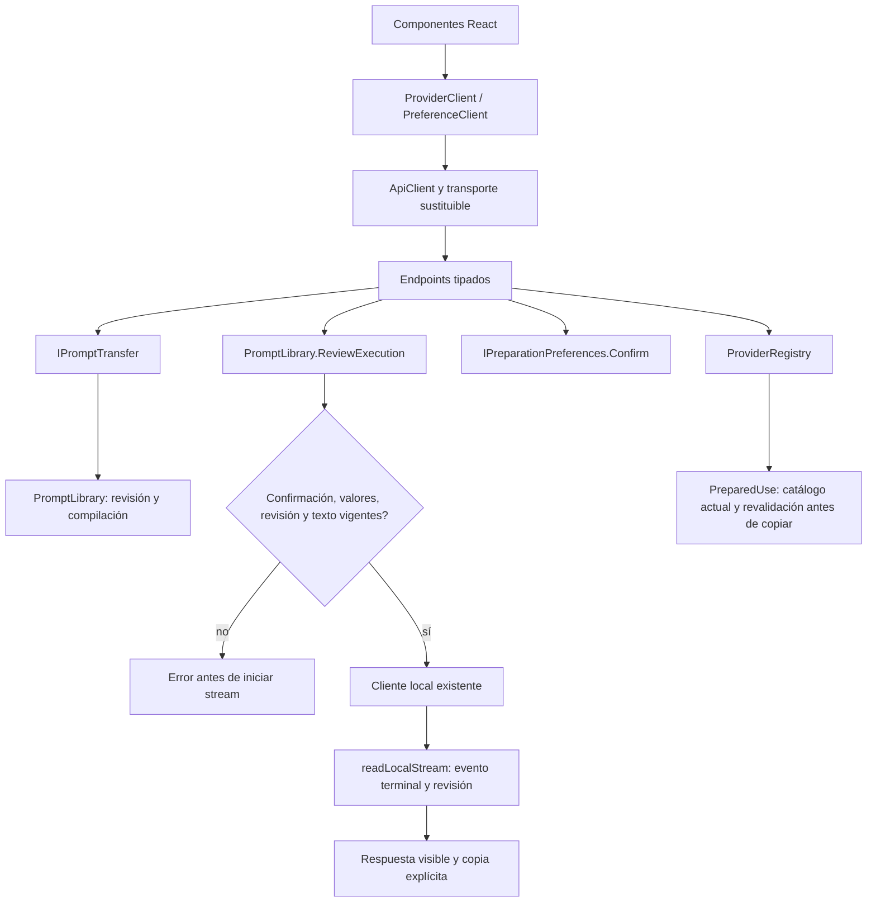

# Conexión de proveedores, preferencias y ejecución — 2026-10-20

Estado: incremento modular implementado y verificado. El objetivo global y la
versión continúan abiertos. No cambia la interpretación semántica productiva.

## Auditoría, propietario y alternativa

ProviderPicker, QuickActions, PreparedUse y NovaPreferences mantenían conexiones
HTTP/esquemas dentro de componentes. PreparedUse duplicaba las URLs del catálogo
C#. LibraryEndpoints decidía confirmación/destino/compilación y NovaEndpoints
validaba valores/texto antes de ejecutar. Las reglas ya tenían propietarios:
ProviderRegistry, PromptLibrary e IPreparationPreferences/PreparationPreferenceStore.

Se comparó conservar llamadas directas, pequeños puertos sobre ApiClient, y un
framework genérico de proveedores/plugins. Se eligen puertos por capacidad y
extensión de los propietarios actuales: no otro catálogo, verificador ni árbitro.
LocalPromptLibrary construye también IPromptTransfer. No requiere dependencias
nuevas, reflexión arbitraria ni una jerarquía artificial de herencia. Reflection
sigue limitada a las herramientas autorizadas del agente, no concede permisos.

## Workflow y pseudocódigo



```text
descubrir catálogo/modelos mediante ProviderClient con señal de cancelación
preparar transferencia con ID, revisión, valores, proveedor y confirmación explícita
  validar permiso de copia/apertura en ProviderRegistry; compilar sin guardar uso
  reservar ventana sólo en gesto del usuario; comprobar destino actualizado
  copiar antes de navegar; registrar uso con texto/revisión exactos una sola vez
ejecutar con texto esperado y confirmación explícitos
  PromptLibrary valida valores, preview/revisión y texto antes del stream HTTP
  transmitir respuesta sin consumirla en el cliente de conexión
  conservar lector SSE existente y su cancelación; sólo terminal válido habilita copia
preferencias: obtener; editar localmente; Confirm valida y persiste; Forget elimina
borrador: obtener destinos del catálogo; revalidar URL y disponibilidad al copiar
sin retries automáticos, navegación desde servicios ni permisos concedidos por texto
```

## Contratos y lifecycle

| Bloque | Entradas/salidas | Frontera e invariantes |
|---|---|---|
| ProviderClient/createProviderClient | AbortSignal, ID/revisión/valores/destino/modelo/confirmación/texto → catálogo, transferencia o Response | Zod valida catálogo; el stream queda intacto; no clipboard, ventanas ni estado React |
| PreferenceClient/createPreferenceClient | Opciones nulas o explícitas, confirmación y señal → preferencias validadas | No inferir confirmación ni persistir al editar; DELETE sólo preferencias |
| IPromptTransfer/PromptTransfer | TransferInput → PreparedTransfer | Registro existente de destinos, confirmación, compilación/revisión; sin inferencia, navegación ni guardado |
| PromptLibrary.ReviewExecution | ExecuteInput → CompiledPrompt | Reutiliza ValidateValues y preview del reader; revisiones/texto exactos; sin escritura ni llamada al modelo |
| IPreparationPreferences.Confirm | PreferenceApproval → preferencias persistidas | Confirmación y reglas de opciones en el propietario; Save existente queda para consumidores internos confiables |
| ProviderPicker/PreparedUse | Gesto y snapshot UI | Ventana/clipboard en interacción; PreparedUse deja de mantener URLs duplicadas; reconsulta catálogo antes de copiar |

Cancelación, timeout de inferencia, limitador HTTP y verificador SSE existentes
se conservan. No se añade otro executor ni otra copia de las reglas de compilación.
Errores de confirmación/opciones siguen siendo 400; revisión/texto obsoletos 409,
antes de abrir SSE. Validación de valores utiliza ahora el mensaje del propietario
de dominio. Rutas, JSON, cabeceras de correlación y aprobación no cambian.

Las últimas conexiones directas de categorías y propuestas del editor se
trasladaron a TemplateClient.categories y PreparationClient.propose. El schema de
propuesta y el header X-Nova-Live-Run se conservan; la prueba UI de propuesta
observada existente sigue pasando. No quedan llamadas request/openApiResponse en
App, features o hooks; esto es una propiedad comprobada del código actual, no una
afirmación de que todo el frontend o el agente estén terminados.

## Verificación ejecutada y límites de la evidencia

[verification.json](../evidence/provider-ports-20261020/verification.json) reúne
hashes, comandos, fuentes y resultados:

- **791/791 backend**, sin omitidas. Dos nuevos contratos reales de SQLite prueban
  transferencia/revisión sin efectos y confirmación/persistencia de preferencias.
- **159/159 frontend**, incluyendo contratos de transporte, pérdida de contexto,
  copia/apertura, catálogo cambiado/offline, preferencias y propuestas observadas.
- API y host Blazor compilan, cero errores/advertencias; DLL compartidas iguales.
  TypeScript/Vite pasa con la advertencia anterior de tamaño del chunk principal.
- **9 comprobaciones en Edge visible**, backend real y SQLite sintético: preferencias
  explícitas y recuperación, borrado aislado, preview/cierre sin uso, copia/apertura
  confirmada, rechazos previos al stream, ejecución Qwen y borrador/editor con catálogo.
- Destinos externos interceptados antes de navegar: sólo se probó preparar/copiar,
  no se contactó ChatGPT ni se validó una integración externa. Cero pageerror.
- Qwen3:8b instalado produjo una respuesta terminal visible y copiable; uso registrado
  una sola vez. El control estricto de la palabra solicitada resulta **false** y se
  conserva separado: transporte y copia correctos no prueban fidelidad semántica.
- Seis controles de fronteras estáticas pasan; tres manifiestos válidos no ejecutan
  flujos. Los corpus de comprensión del agente no se repitieron para este cambio.

Fallos conservados: un fixture incompleto de catálogo, un intento del harness de
leer por CDP el cuerpo SSE consumido/cancelado por el lector y un click durante la
salida animada del detalle. Se corrigieron contrato sintético/observación/espera,
sin cambiar readLocalStream, aumentar timeouts del producto ni rebajar permisos.
El caso de respuesta literal no se reclasifica como PASS de comprensión.

## Compatibilidad, reversión y trabajo restante

No cambia base de datos, modelo activo ni catálogo de destinos productivo. Para
revertir, restaurar sólo estos consumidores/puertos y registros; no resetear el
trabajo previo ni borrar archivos todavía usados. Nueva implementación del puerto
de preferencias debe implementar Confirm, además de Get/Save/Forget.

Permanecen abiertos los consumidores anteriores de CRUD, compilación, propuestas,
ejecución y settings, y la sustitución semántica rechazada. El objetivo sigue activo;
la matriz canónica conserva 34 requisitos cerrados y 54 abiertos.
