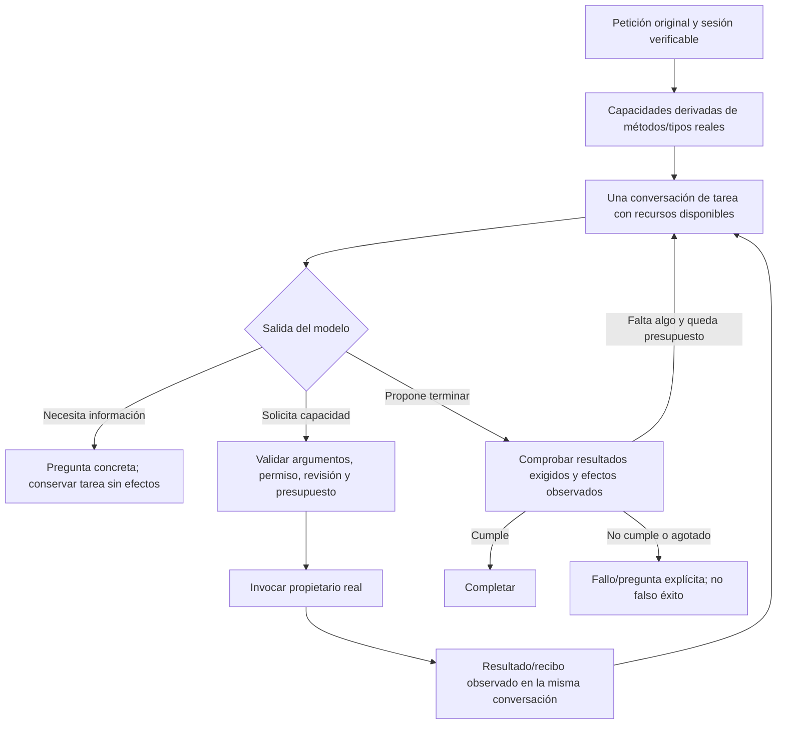

# Sustitución del núcleo semántico por capacidades reflejadas

Actualización 2026-10-20: el prototipo de conversación/`prepare_task` no calificó en cuatro casos retenidos, tampoco tras recuperación acotada. La composición API sigue intacta. Se archivó y retiró un archivo posterior que duplicaba operaciones de planificación. La decisión vigente está en [arquitectura de producción](PRODUCTION_AGENT_ARCHITECTURE.md): reutilizar catálogo y ejecutores, contexto operativo y observaciones reales; no multiplicar capacidades por frase ni mantener propietarios paralelos. Las herramientas de lectura del incremento anterior siguen integradas.

2026-10-20. Solicitado explícitamente: retirar lógica semántica legacy, contratos escritos a mano y redacciones/reclasificaciones sucesivas. No sustituir reglas de datos, revisión, aprobación o seguridad por decisiones probabilísticas.

## Diagnóstico observado

`NovaTaskPlanner` llama al intérprete y después refina fuente/contexto. `PreparationInference` puede activar tres caminos mediante TaskGoals/AuthoringUseContract y vuelve a clasificar destino, uso, autoría, workflow, identidad, restricciones y fidelidad. Las etapas reciben proyecciones distintas de una petición y los resultados no son una observación compartida de una misma conversación. El autor acierta CREATE en casos donde el redactor aún copia «crea un prompt» dentro del artefacto. Generar JSON correcto, herramientas válidas o descripciones comunes de objetos no corrigió esa sustitución de destinatario. El último recurso inyectado también produjo revisiones inválidas y no califica.

Los esquemas se componen con diccionarios `ContractSchema.Object`, nombres de campos y listas de enums en múltiples ubicaciones. `PreparationToolAttribute` descubre métodos, pero todavía remite a `SchemaProperty` escrita manualmente; reflection no genera hoy ese contrato. Ésa es una duplicación concreta entre método/tipos reales y esquema anunciado al modelo.

No se afirma que una biblioteca nueva entienda por sí sola las peticiones. Su propósito es eliminar esa duplicación y permitir un flujo que observe recursos/herramientas/resultados con una conversación de tarea estable, en vez de encadenar clasificadores y redactores sin memoria de sus decisiones.

## Arquitectura elegida

Extender registro y servicios actuales con un adaptador de funciones reflejadas; sustituir el intérprete legacy, sin un segundo árbitro. Generar parámetros/resultados desde métodos y tipos C# con `AIFunctionFactory` de Microsoft. Mantener el adaptador HTTP local de Ollama y el orquestador de UI/servicios de dominio. No incorporar Azure, nube, modelos nuevos ni un framework de planificación.

Cada capacidad se liga a un método real y define descripción, argumentos, resultado, permisos, precondiciones y recibo. El modelo puede inspeccionar recursos, leer fuentes, proponer y pedir aclaración. El registro valida y ejecuta; nunca despacha nombres/types/reflection elegidos libremente por el modelo. Un plan/acción propuesta no equivale a aprobación.

| Propietario | Se conserva | Se retira/sustituye |
|---|---|---|
| Sesión/contexto | AgentSessions, TaskConversationContext; petición, fuentes y revisiones reales | Proyecciones incompatibles y resúmenes convertidos en autoridad |
| Herramientas | PreparationTools, permisos, presupuestos, cancelación y servicios | SchemaProperty manual en capacidades migradas; esquemas del modelo escritos en diccionarios |
| Interpretación | Interfaz consumida por aplicación y entradas públicas compatibles | Clasificadores semánticos legacy, flags de selección y reparaciones compensatorias |
| Contenido | Propuestas de dominio, compilador, invariantes del origen | Redactor/fidelidad como consultas separadas que reinterpretan el mismo encargo |
| UI/efectos | Dispatcher de la misma pestaña, aprobación ligada al texto, control de revisión y recibos | Ningún cambio cosmético ni acceso privilegiado nuevo |
| Calidad | Matriz del agente, casos y fallos originales | Declarar éxito por JSON válido, autoveredicto o tests simulados |

## Flujo



```text
restaurar petición original, sesión, referencias y aprobaciones vigentes
construir funciones desde una lista fija de proveedores C# autorizados
generar esquemas mediante biblioteca mantenida; no un exportador propio
ofrecer sólo capacidades elegibles para el estado y la autoridad actuales
mientras queden pasos y tiempo:
    consultar modelo local con conversación de tarea y recursos/resultados observados
    si pregunta: suspender con original y contexto conservados
    si solicita función: validar dominio y ejecutar una sola operación idempotente
    incorporar recibo real; no reescribir petición con el resultado
    si termina: exigir las postcondiciones reales del objetivo
conservar límites, errores y cancelación; nunca repetir hasta conseguir una tanda favorable
```

## Eliminación y sustitución verificable

1. Congelar estado y traza anterior en evidencia sintética; inventariar consumidores de cada archivo legacy.
2. Sustituir generación de esquemas en una capacidad existente y comprobar descripciones, argumentos, resultados y barreras reales.
3. Conectar conversación/herramientas al propietario de interpretación y contenido; depurar creación, campos/copiar y continuación con Qwen/UI reales.
4. Cambiar la composición de la API al sustituto y eliminar las ramas/archivos legacy alcanzados. No dejar un selector que silenciosamente regrese al flujo anterior. Eliminar mediante referencias verificadas, sin borrar servicios compartidos o la aplicación funcional.
5. Mantener los criterios originales. La matriz del agente decide la cualificación; backend/frontend sólo cuando sus contratos sean afectados. Validación/holdout después del desarrollo cualificado. No hay promoción por autoevaluación del modelo.

## Dependencias autorizadas e incremento instalado

El usuario autorizó explícitamente ambas dependencias y sus transitivas oficiales el 2026-10-20. Instaladas y fijadas en Infrastructure: `Microsoft.Extensions.AI.Abstractions` **10.11.0** y `System.Text.Json` **10.0.13**. Restauración ejecutada correctamente. No se instaló el paquete completo Microsoft.Extensions.AI, proveedor de nube ni modelo.

`ReflectedPreparationToolFactory` genera el esquema completo del DTO con `AIJsonUtilities.CreateJsonSchema` y el resultado/invocación del método con `AIFunctionFactory`. Se eliminaron `SchemaProperty`, el cierre genérico propio y los tres esquemas manuales de `PreparationReadTools`. El atributo conserva sólo identidad, descripción y permiso. Los tipos Microsoft.Extensions.AI permanecen dentro de Infrastructure.

Se conserva el formato plano existente: `{id, revision}`, no `{args:{id,revision}}`. La primera campaña con Qwen seleccionó correctamente las dos herramientas pero omitió el envoltorio anunciado por la fábrica; falló antes de ejecutar. Se preservó ese fallo. La corrección genera el esquema **completo** desde el DTO mediante el SDK, sin recortar subesquemas, aceptar formatos alternativos ni escribir un exportador propio. La campaña posterior ejecutó ambas lecturas reales y respondió con sus títulos correctos.

El modelo no elige tipos CLR ni permisos concedidos. `PreparationTools.CallJson` y `Call<T,R>` comparten autorización, hook de dominio, presupuesto atómico, timeout, cancelación y observación. La deserialización estricta rechaza miembros desconocidos/duplicados, nombres con casing incorrecto, ausencia de parámetros obligatorios, nulabilidad y números enviados como texto. Las reglas de negocio siguen en los métodos originales. El validador limitado `ContractSchema` no procesa los esquemas del SDK.

**Estado parcial:** este incremento sustituye la frontera de herramientas de lectura. Todavía no sustituye la composición semántica, los redactores ni las ramas legacy de `PreparationInference`. La conversación acotada del evaluador verifica transporte/lecturas con Qwen, no constituye otro runtime productivo ni acredita creación, campos/copiar, aprobación o UI del agente nuevo. Los pasos 3–5 siguen pendientes; la versión permanece abierta.

Validación y fallos conservados: [acta del incremento](../evidence/closure-20261020/reflected-tools-increment/review.md). La instalación autorizada no equivale a fiabilidad semántica.

Fuentes comprobadas: [AIFunctionFactory](https://learn.microsoft.com/en-us/dotnet/api/microsoft.extensions.ai.aifunctionfactory), [paquete, versión, licencia y dependencias](https://www.nuget.org/packages/Microsoft.Extensions.AI.Abstractions/10.11.0). La documentación y su compatibilidad no equivalen a una prueba ejecutada de NOVA.
