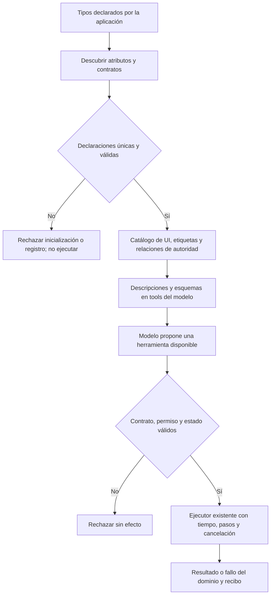

# NOVA — capacidades declarativas con atributos y Reflection

2026-10-19. Implementación acotada del catálogo y registro; **no es cierre de fiabilidad semántica**.

El usuario solicita sustituir las decisiones dispersas por operaciones que el propio sistema describa al agente. El catálogo de UI mantenía descripciones/esquemas en una lista y etiquetas en otro `switch`; la relación entre operaciones semánticas y herramientas vivía en otro diccionario. La inscripción de lecturas duplicaba nombres, contratos y enlaces a métodos. Estas declaraciones ya pueden descubrirse mediante atributos sin interpretar palabras del usuario.

Reflection descubre metadatos y enlaza implementaciones. No interpreta por sí mismo una petición, no entrena el modelo ni demuestra fidelidad del contenido generado. Cambiar un `if` por una tabla tampoco corrige un juicio semántico incorrecto. Se mantienen las comprobaciones de permisos, aprobación, identidad, revisión, datos, cancelación y límites. No se expone reflexión arbitraria al LLM.

## Flujo y algoritmo implementados



```text
inicializar catálogos desde tipos conocidos por la aplicación
leer sólo miembros declarados y anotados; no explorar ensamblados externos
validar nombres únicos, accesibilidad, firmas, permisos y esquema de argumentos
rechazar declaraciones inválidas antes de registrar parcialmente el proveedor
conservar descriptores de UI y relaciones semánticas durante el proceso
al registrar un proveedor de lectura, enlazar Task<R>(T, CancellationToken)
crear delegados tipados; no buscar ni invocar nombres recibidos del modelo
publicar sólo herramientas disponibles mediante el transporte existente
validar propuesta contra plan, dominio y estado con los controles existentes
ejecutar el delegado registrado dentro del presupuesto y cancelación existentes
propagar el error original del dominio; registrar la observación real
```

## Contratos y límites

| Responsabilidad | Implementación | Invariante / evidencia |
| --- | --- | --- |
| Descripción, etiqueta y esquema UI | `UiCapabilities`, `UiCapabilityAttribute`, `CapabilityDiscovery.Ui` | 20 declaraciones; sólo propiedades públicas estáticas anotadas que devuelven un esquema objeto |
| Operación y herramientas asociadas | `AgentOperationAttribute`, `SemanticCapabilityCatalog`, `SemanticPlanValidator.Tools` | Los 20 miembros del enum requieren metadatos; no se agrega autoridad por parecido de texto |
| Catálogo consumido por Qwen | `UiToolCatalog.All` → `PreparationInference.Decide` | Mismo nombre, descripción y esquema en el paquete `tools`; etiquetas derivadas de la misma declaración |
| Invocación de lectura | `PreparationToolAttribute`, `PreparationToolDiscovery`, `RegisterAttributed` | Sólo métodos declarados y anotados en el proveedor suministrado por código; firma tipada y cancelación obligatorias |
| Herramientas reales | `PreparationReadTools.GetPrompt`, `GetRevision`, `ListGroups` | Lectura SQLite vigente; sin permisos de escritura |
| Ejecutor y autoridad | `PreparationTools.Call`, validadores de plan/UI existentes | Permisos, argumentos, revisión, aprobación, timeout, pasos y cancelación no se delegan al LLM |
| Inicialización API | `Program.cs` | Materializar y validar catálogos antes de servir peticiones |

No se cambian contratos HTTP, esquemas de SQLite, modelos, perfiles de inferencia ni dependencias. Las firmas y JSON de herramientas existentes se conservan. Los catálogos UI/semántico se descubren una vez; los delegados de lectura se enlazan al registrar el proveedor de cada preparación, nunca buscando métodos durante una llamada del modelo.

Añadir una lectura exige implementar el método tipado, declarar su atributo y esquema; no añadir un caso por nombre al ejecutor. Una nueva capacidad de UI necesita además su implementación real en el navegador: anotar una descripción no crea el comportamiento. Registrar una operación tampoco concede aprobación para ejecutarla.

## Validación ejecutada

- Snapshot **anterior a modificar producto**: contratos, etiquetas y mapa completo. El recurso congelado `backend/QuickPrompt.Tests/Fixtures/capabilities-v1.json` se compara estructuralmente con el catálogo reflejado. Coincidencia exacta de nombres, orden, descripciones, esquemas, permisos y timeouts.
- Backend inicial tras migrar: **522/522 PASS**. Suite final con 11 controles adicionales: **533/533 PASS**, cero omitidas, [TRX](../evidence/reflection-capabilities-20261019/tests/backend-verified.trx).
- Se prueba descubrimiento de un método nuevo sin añadir un `switch`, exclusión de métodos sin atributo, rechazo atómico de duplicados/firmas inválidas/métodos privados, permisos, tipos, longitud, cancelación, errores sin envoltorio y lectura real de SQLite vigente/revisión anterior sin cambios al listar grupos.
- API final: build sin advertencias ni errores, salida aislada `.playwright/reflection-capabilities-20261019/api-v1`. El servicio previo en 5190 no se sustituye.
- Se conserva `backend-final.trx`: 532/533 por una comparación de identidad de colecciones del arnés, corregida a comparación estructural sin cambiar comportamiento ni expectativas del dominio. Dos errores previos de compilación del test referían una propiedad inexistente del snapshot; se corrigió a `TemplateVersion.Snapshot.Template`.

Los recorridos reales y hashes se registran en el [manifiesto de esta intervención](../evidence/reflection-capabilities-20261019/validation.json). Las pruebas deterministas no acreditan comprensión general de Qwen, creación/copia fiel ni rendimiento p95.

UI real con Qwen3 8B, Edge visible, fixture sintético y el frontend anterior sin modificar:

| Build / petición existente | Resultado | Observación |
| --- | --- | --- |
| Reflection, `readOnly` | PASS, COMPLETED | Abre Reescribir anuncios, identidad/contenido correctos y origen intacto; 82993 ms, 13 llamadas |
| Reflection, `variables` | FAIL, BLOCKED / INVALID_DECISION | La interpretación del destino se rechaza antes de actuar; no completa campos ni escribe. 3735 ms, 4 llamadas |
| Control anterior a Reflection, misma `variables` | FAIL, BLOCKED / INVALID_DECISION | Mismo mensaje «El destino solicitado no admite esa operación; no se ejecutaron efectos.» 3661 ms, 4 llamadas |

Evidencia nueva: `docs/evidence/latency-1792430399002/`; control con API previa: `docs/evidence/latency-1792430539173/`. Capturas inspeccionadas. La comparación conserva mensaje, fixture, web y modelo; no es holdout ni prueba estadística de latencia. Confirma que este fallo también está presente antes de la migración; no demuestra que toda petición posible conserve comportamiento. No se reintenta con otra frase ni se baja el criterio. Los procesos y navegador de prueba se cerraron; 5190 permanece sin cambios.

## Pendiente explícito

No se borraron todas las condiciones del proyecto. Se sustituyeron las declaraciones duplicadas y el registro manual de estas lecturas; siguen existiendo adaptadores y transiciones tipadas en `SemanticDecision`, `SemanticPlanCompiler`, los orquestadores y el navegador. Esas reglas describen dependencias y efectos reales y requieren una migración con equivalencia ejecutada antes de retirarlas. Los validadores permanecen obligatorios incluso con atributos.

Los fallos documentados de autoría, selección de autoridad del revisor y distinción entre workflow actual e instrucción futura permanecen abiertos. Las descripciones que recibe el modelo son exactamente las anteriores; por tanto esta migración no se presenta como mejora demostrada de comprensión ni rapidez. Matriz: **21 cerrados / 67 abiertos**; versión **NO CERRADA**.
