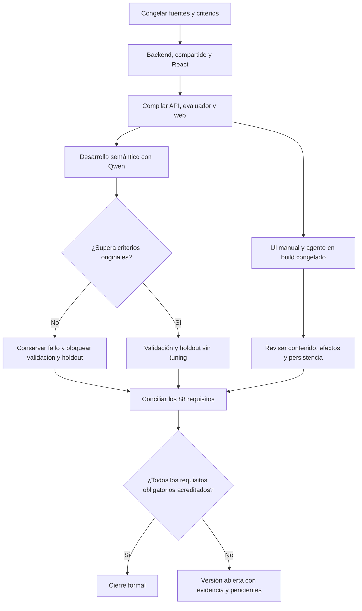

# Validación del candidato inicial — 2026-10-20

Estado final: **NO CERRADA — 30 requisitos cerrados, 58 abiertos**. Esta campaña comprueba el candidato posterior a `instruction-scope-3`; no convierte resultados históricos en aceptación actual.

## Candidato y autoridad

- Fuente canónica: `VERSION_CLOSURE_MATRIX.json`, 88 requisitos, inicialmente 29 cerrados y 59 abiertos.
- Baseline de criterios: `docs/evidence/release-validation-20261020-a1/baseline.json`.
- Congelación y builds: `.playwright/release-validation-20261020-a1/verification.json`.
- Modelo existente Qwen3:8b, sin descargas ni cambio de configuración productiva.
- Datos exclusivamente sintéticos; los servicios 5190/5191 y la biblioteca personal no se modifican.
- No se cambia código de producto para esta campaña. Si aparece un defecto, se conserva su primera divergencia antes de decidir un incremento de corrección.

## Procedimiento



```text
guardar criterios y hashes antes de ejecutar
ejecutar suites completas una vez para el candidato final
compilar artefactos y comprobar identidad de ensamblados compartidos
evaluar desarrollo con el planificador de aplicación y perfil productivo
si desarrollo falla: conservar resultados; no abrir ni ajustar holdout
ejecutar recorridos UI aislados con el mismo build y datos sintéticos
comparar petición, campos, efectos reales y texto guardado independientemente
para cada requisito: mantener o cambiar estado sólo con evidencia suficiente
si existe un obligatorio fallido, pendiente o no verificado: no cerrar
```

Los checks de manifiestos no ejecutan recorridos. Un JSON válido, un proceso con código cero o `COMPLETED` no acreditan por sí mismos fidelidad. La captura de copia dentro del navegador no prueba el portapapeles nativo. Las condiciones del perfil QA se declaran y no se confunden con los defaults productivos.

## Resultados

Evidencia reproducible de la campaña: [resumen](../evidence/release-validation-20261020-a1/campaign-summary.json), [disposición de los 88 criterios](../evidence/release-validation-20261020-a1/requirement-disposition.json) y [verificación del candidato](../evidence/release-validation-20261020-a1/verification.json).

| Categoría | Resultado ejecutado |
|---|---|
| Backend | 730/730, sin omitidas |
| Compartido/legacy | 151/151, sin omitidas |
| React | 136/136, sin omitidas |
| Builds | API/evaluador/TypeScript/Vite correctos; ensamblados compartidos iguales; aviso de chunk Vite conservado |
| Guías de aceptación | Seis pruebas del clasificador de evidencia correctas; manifiestos válidos, sin confundirlos con recorridos |
| Desarrollo semántico real | 14/16; intención y destino 87,5 %, equivalencia metamórfica 50 %; gate FAIL |
| UI agente con Qwen y adjudicación independiente | 21/21 ejecutados: 11 PASS, 10 FAIL; contenido revisado por Codex, no piloto humano |
| Borrado libre y negativos | Seis casos completos: 5 PASS, pregunta explicativa FAIL; primer arnés detenido tras tercer caso también conservado |
| Guardado y reinicio | Versión aprobada pasa; biblioteca/texto/revisión exactos al reiniciar, aprobación antigua rechazada sin escribir |
| Validación/holdout | NOT_TESTED: desarrollo no superó sus umbrales; no se inspeccionaron ni ajustaron |
| Biblioteca manual | Siete grupos correctos en UI real |
| Versiones/compartir/editor | 21 comprobaciones correctas, incluidas concurrencia, copia demorada, descarga, transformación de variables y reinicio |
| Superficie UI tipada | Siete comprobaciones correctas; no prueba comprensión libre de Qwen |
| Responsive/temas | Ocho grupos correctos; no sustituye lector de pantalla ni aceptación humana completa |
| Dependencias | Inventario instalado y licencias declaradas; npm producción y consulta NuGet sin avisos retornados; revisión completa del paquete pendiente |

## Primeras divergencias conservadas

1. **Resolución de origen.** Desarrollo 05 y 14 seleccionan `NAMED_LIBRARY_SOURCE` cuando la petición remite al contexto actual. La primera extracción devuelve «versión más concisa» como búsqueda; la segunda no aporta una referencia válida. No llegan a `instruction-scope-3`. En UI, abrir explícitamente «Reescribir anuncios» ofrece una elección entre tres elementos en vez de abrir el ID indicado. Propietarios: resolución de referencias y `NovaTaskPlanner`/`TaskSourceResolver`.
2. **Identidad de borrador temporal en UI.** Crear termina, pero adaptar/recuperar el borrador sin guardar termina `BLOCKED/INVALID_DECISION`: «La acción no corresponde al prompt visible». `UiToolCatalog.Validate` admite el ID nulo de una restauración mediante `semantic.Goal.WorkingTarget`, mientras el perfil productivo mantiene `TaskGoals=false`. El bucle conserva `WorkingDraft`, pero esa evidencia no forma parte del límite de validación correspondiente. No se trata de una petición incomprensible ni de un fallo del campo al escribir.
3. **Autoría y controles actuales.** Al pedir una copia, una propuesta pide a un futuro asistente adaptar el prompt y solicitar aprobación antes de guardar. El revisor devuelve `ACCEPT` junto con citas de workflow actual; el control posterior lo bloquea sin persistir. Se conserva la propuesta rechazada. Un caso aislado de creación correcto no cierra esta familia.
4. **Recuperación de transporte.** Los escenarios originales `fault` y `persistentFault` devuelven `MODEL_UNAVAILABLE` tras una llamada. El caso transitorio no se recupera y el persistente no alcanza los intentos acotados previstos por el arnés. No se cambió su expectativa para aceptar el fallo rápido.
5. **Pregunta explicativa y evidencia del contrato.** La misma pregunta sobre qué ocurriría al borrar falla en ambas campañas de borrado: `INVALID_DECISION`, declaración de capacidades no ligada a la petición autorizada. La validación estricta impide una operación no sustentada, pero la pregunta queda sin resolver. No se capturó la declaración exacta de capacidades de este caso: no se atribuye el fallo específicamente a índice, duplicado u otro predicado sin observarlo. Negación, texto destructivo dentro de un campo y destino no elegido sí pasan; ningún borrado no autorizado observado.

En la adaptación extensa, el texto real de UI contiene **«Deja el borrador sin guardar»** como instrucción futura. La propuesta del modelo, la observación y el SHA256 coinciden; la revisión independiente la rechaza aunque los controles técnicos pasen. El fallo está en el contenido, no en una captura o una suposición del evaluador. La versión aprobada de correo para entrevista sí conserva la tarea y todas las prohibiciones, actualiza el mismo ID de revisión 1 a 2 y sobrevive al reinicio. Su resumen semántico etiqueta copia mientras el efecto comprobado es versión: se conserva esa discrepancia sin inventar una copia persistida.

La tanda UI es una secuencia declarada sobre una biblioteca sintética: cada caso registra su fuente y revisión iniciales. El guardado de versión cambia esa fuente para los siguientes casos. Los tiempos no se comparan como baseline ni como mejora; las comprobaciones siguientes se interpretan contra su snapshot real. No se atribuye a un recorrido bloqueado una aprobación/rechazo o guardado que nunca alcanzó.

## Corrección del arnés manual

La primera ejecución de `workspace.cjs` falló buscando por rol un compositor recogido. La captura muestra la biblioteca intacta y el orb accesible. El panel puede recogerse legítimamente al restaurar foco en un control que tapaba. Se corrigió únicamente la lectura del valor persistente mediante el nodo DOM, manteniendo las aserciones originales de no DELETE, no navegación, vista y dato exacto. La repetición pasó. Fallo anterior: `docs/evidence/workspace-1792487126519/failure.txt`; ejecución cualificada: `docs/evidence/workspace-1792487187688/validation.json`. No hubo modificación de producto para obtener el resultado.

`save-restart.cjs` puede seleccionar un único escenario de una tanda completa y consumir la adjudicación independiente ligada al hash exacto de mediciones. No permite superar controles UI fallidos y mantiene la igualdad de la biblioteca completa y el rechazo de replay. Se ejecutó realmente con la versión aprobada. `agent-deletion.cjs` conserva cada fallo negativo y continúa los restantes; las peticiones y aserciones originales no cambian. La segunda campaña vuelve a fallar en la misma pregunta, y ahora acredita los tres negativos que el primer arnés no alcanzó.

Las decisiones que requieren autorización específica o aceptación humana no se consideran aprobadas por silencio. Los requisitos de defaults/opcionalidad, perfiles e historial React siguen documentados como pendientes de implementación; la migración privada, el alcance MV3 y el piloto humano conservan sus condiciones originales. Una campaña de tests no los convierte en capacidades entregadas.

## Decisión de cierre

Sólo se cierra un requisito adicional: **REL-06**, identidad reproducible del candidato, sus perfiles, artefactos, modelo y fixtures. No significa que el candidato haya pasado funcionalmente. La [matriz canónica](VERSION_CLOSURE_MATRIX.md) conserva los 88 criterios originales: 30 CERRADO, 33 PARCIAL, 13 FALLA, 7 PENDIENTE y 5 SIN_VERIFICAR. Los cuatro parciales que ahora tienen reproducción negativa pasan a FALLA; no se presentan como defectos nuevos ni se borran éxitos anteriores.

No procede publicar ni cerrar la versión. El siguiente trabajo debe concentrarse en los propietarios de las primeras divergencias anteriores y repetir sus bloques afectados antes de otra campaña integral. No se abren nuevos modelos, frameworks, rutas por frases o árbitros para intentar obtener una cifra favorable.

## Diagnóstico posterior solicitado

Se añadieron puntos DEBUG optativos y un perfil F5 sobre base sintética; véase
[diagnóstico y evidencias](AGENT_DEBUGGING.md). El build instrumentado tiene su
propio manifiesto y 37 comprobaciones enfocadas; no sustituye el candidato de la
campaña integral anterior. Se reprodujeron los dos errores de referencia, los
seis casos de eliminación y dos casos UI de continuidad/transporte. La pregunta
de eliminación ya tiene causa observada: `EXPLAIN` duplicado con dos índices de
evidencia válidos, no un índice inventado. Las trazas también prueban la pérdida
de la identidad temporal en la frontera de validación y la ausencia de
recuperación tras 503. No se cambió la decisión semántica ni se cerró un requisito:
continúan 30 CERRADO y 58 abiertos.
