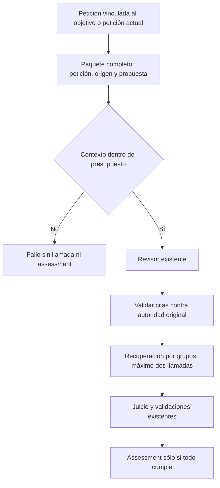

# Autoridad completa del encargo en el revisor

2026-10-20. Implementado tras registrar el diseño y reproducir los fallos. Alcance: contrato de autoridad de `ReviewDraftFidelity`; no declara comprensión semántica recuperada.

## Auditoría y decisión

La ruta previa conserva `GeneratedArtifact.BodyRequestClauses`, elegido por el generador. Ese subconjunto sustituye `TaskGoal.UserRequest` dentro del revisor, tanto para la inferencia como para validar citas. Una restricción real omitida en ese subconjunto queda fuera del contexto y su cita puede rechazarse como inventada. El candidato de autoría v4 no rellena esa propiedad, pero la ruta previa sigue activa; un invariante de autoridad no debe depender del selector del generador.

Se revisó el experimento de 2026-10-19: el paquete completo con `generationRequirements`, el cambio de roles conversacionales y las listas de cobertura no calificaron. No se incorporan esas representaciones ni se cambia el prompt para mejorar ejemplos. Esta corrección elimina la posibilidad de sustitución del contrato privado y deja el revisor semántico en su estado no cualificado. Un transporte correcto no resuelve por sí solo sus dos falsos ACCEPT conservados.

- **Propietario:** `PreparationInference`, con `TaskGoal` como propietario del encargo ligado. Generador produce sólo propuesta y título literal opcional. Datos, fuente, workflow, aprobación y assessment conservan sus propietarios.
- **Entrada/salida:** petición del objetivo, o `PrepareInput.TaskRequest` si no hay objetivo; borrador y origen existentes. Se elimina el argumento privado de subconjunto y la propiedad del resultado interno que permitía transportarlo. Los adaptadores de QA por reflection se actualizan, sin cambios HTTP/SQLite/configuración.
- **Invariantes:** una cita real no pierde procedencia por la interpretación del generador; una cita inventada no adquiere autoridad; el presupuesto mide el contexto completo sin truncar; una continuación conserva su objetivo; máximo dos llamadas; cancelación existente; ningún fallo registra assessment ni autoriza efectos.
- **Dependencias:** se extiende el propietario concreto. Extraer una nueva política o servicio no añade variación real; un árbitro adicional duplicaría autoridad y latencia. No se añaden módulos o dependencias.
- **Compatibilidad:** la ruta de autoría v4 ya enviaba la petición completa. El cambio alcanza la ruta anterior y sus adaptadores internos de QA. Rollback mediante fuentes archivadas; no modificar evidencias previas. Los contrastes semánticos seguirán decidiendo la cualificación, no las pruebas de transporte.



```text
petición := objetivo.UserRequest, si existe; de otro modo entrada.TaskRequest
construir paquete con petición completa, origen y propuesta
rechazar contexto fuera de presupuesto sin truncarlo
ejecutar el revisor existente con su esquema y límite actuales
validar evidencia contra petición original y origen; nunca contra selección del generador
reparar sólo declaraciones inválidas con el presupuesto existente
registrar assessment sólo tras un juicio válido de aceptación
```

## Comprobación prevista

Regresión controlada antes/después de omisión real, continuación, cita inventada y contexto excesivo. Verificar los consumidores del contrato privado y las diez regresiones de recuperación del incremento anterior. Las inferencias reales deben conservar corpus/modelo/perfil y no repetir la ruta v4 inalterada para buscar un resultado favorable. No corresponde ejecutar CRUD/UI o suites generales de frontend/backend por esta modificación.

## Resultado ejecutado

Las cuatro regresiones fallan antes de modificar producto: la condición real se trata como cita inválida, la continuación usa el subconjunto, una condición inventada por el generador adquiere procedencia y un contexto excesivo evita el límite. Tras eliminar el argumento privado y `GeneratedArtifact.BodyRequestClauses`, pasan esas cuatro y los 78 controles directos previos: **82 PASS, cero fallos/omitidas**. Los adaptadores de evaluación por reflection ahora usan cinco argumentos y ya no pasan `ReviewRequirements` del fixture como autoridad.

API y evaluador compilan sin advertencias/errores. Se verifican tres ensamblados compartidos idénticos con el proyecto de pruebas y se archivan nueve fuentes. [Acta, regresiones y snapshots](../evidence/closure-20261020/review-authority-binding/review.json).

La ruta v4 ya enviaba la petición completa: su paquete semántico no cambia por esta corrección. Sus resultados reales anteriores siguen fallidos e históricos, no se recalifican con estos nuevos binarios ni se repiten buscando otra respuesta. El contraste nuevo del protocolo nativo de contenido sí usa Qwen real y se rechaza por conservar autoría/órdenes de sesión. La corrección de procedencia no se confunde con fidelidad semántica.
