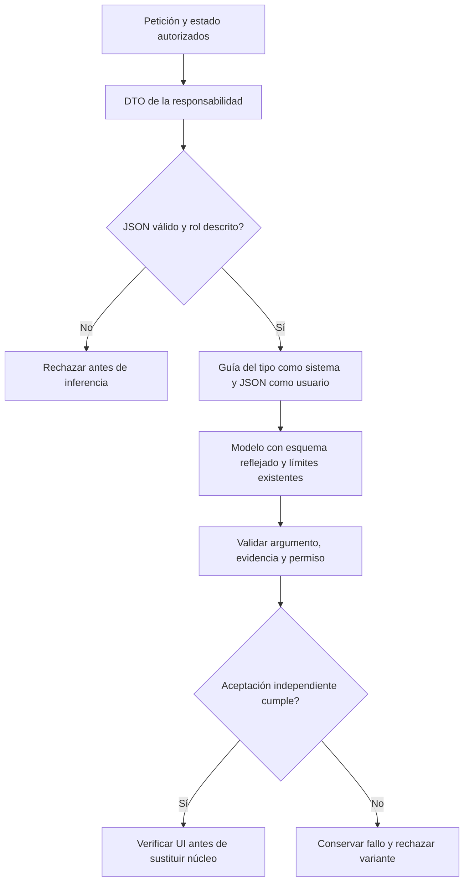

# Contexto por responsabilidad — 2026-10-20

Estado: EXPERIMENTO RECHAZADO. Permanece en Evaluation/Experiments; no activado en producción.

## Causa y contrato de cambio

La evaluación `content-owner-v2-preparation.json` conserva la primera divergencia:
el redactor copia instrucciones del protocolo y la revisión mezcla metadatos con
el cuerpo. La petición original ya llegaba completa, por lo que repetir otra
variante del brief de contenido no aborda esa causa. Autoría/revisión todavía
compartían una guía con planificación y recibían instrucciones internas dentro
del mismo documento JSON de datos.

Hipótesis falsable nueva: contexto de rol mezclado y guía duplicada favorecen esa
transferencia. Se separan las guías del sistema de los documentos de datos y se
reduce el contexto a la responsabilidad presente. No se cambia modelo, presupuesto,
esquema de salida, autorrevisión, criterio ni petición para atribuir éxito.

Propietarios: `ValidatedAgentJson` conserva validación/esquema; el compositor
`RoleScopedContext` queda aislado en Evaluation tras el rechazo. El módulo
de contenido declara `InstructionAuthoringContext` y `InstructionReviewContext`.
Su `DescriptionAttribute` confiable describe el rol y su JSON contiene recursos,
petición y estado. El usuario no puede seleccionar un tipo CLR ni cambiar la guía.
`ReflectedSemanticAgent` conserva transporte, registro de herramientas y límites;
`TaskGoal`/sesiones/fuentes/ejecutores siguen poseyendo estado y autoridad.

Alternativas: (A) otra ampliación de la guía común ya acumula responsabilidades;
(B) extender el serializador validado con contexto descrito desde tipos existentes
es el cambio seleccionado; (C) otro agente/revisor duplicaría autoridad y llamadas.
No hay nueva biblioteca, router por frases, vector-clasificador ni escritura.

## Workflow y pseudocódigo



```text
seleccionar DTO de contexto desde código confiable de la capacidad
obtener su DescriptionAttribute; rechazar rol ausente o demasiado grande
serializar y deserializar con validación estricta; generar esquema del mismo tipo
colocar guía únicamente en system y documento únicamente en user
consultar mediante la interfaz actual, manteniendo esquema y presupuestos
validar resultado por el registro y las reglas existentes
evaluar los tres casos originales sin cambiar oráculo ni repetir hasta PASS
si falla, conservar causa/artefacto; como máximo dos variantes de esta hipótesis
si cumple, recorrer la UI afectada y autorización antes de activar sustitución
```

Entradas: petición completa, fuente/borrador reales, efectos actuales ya fijados,
preferencias aprobadas y feedback acotado; la revisión recibe cuerpo/hash/origen y
nombres de campos de metadatos, no sus valores privados. La extracción de valores
no pertenece al redactor. Salida: contexto descrito con JSON validado y hash de
esquema, sin efectos. Guía y documentos no conceden aprobación. Cancelación, fuente
obsoleta, argumentos inválidos y los presupuestos finitos conservan originales.

Los contratos de forma, aislación y permisos se prueban por separado. El evaluador
captura los paquetes reales de entrada sólo sobre fixtures sintéticos, además de
respuestas estructuradas, sin guardar thinking. Un PASS de DTO no acredita que el
LLM distinga destinatarios; la aceptación requiere el resultado real.

La API de Ollama admite roles de mensajes y `format` con JSON Schema; no garantiza
la fidelidad semántica. Consulta de documentación vía Context7:
[Ollama /api/chat](https://docs.ollama.com/api/chat).

## Resultado ejecutado y decisión

El flujo `AgentOrchestrator.Prepare` real, con la corrección existente, ejecutó los
tres encargos originales congelados. La reunión produjo una instrucción directa
aceptable para ese encargo en 65613 ms; no se cualificó su formulario. El mensaje
conservó `<mensaje>`, pero transfirió una prohibición de la sesión actual al cuerpo
y su revisión la aceptó (68579 ms). El título literal siguió mezclando metadatos
con cuerpo, añadió delimitadores al valor y agotó consultas de recuperación
(105895 ms). No se promueve y no se hace una segunda variante sólo de redacción
para perseguir un agregado favorable. No se cambiaron presupuestos ni semillas.

Evidencias en `docs/evidence/role-context-20261020`: `v1-sources.json`,
`v1-preparation.json` y revisión independiente `v1-review.json`. El experimento
queda fuera del grafo productivo. Los 38 controles de puertos/contexto/protocolo y
los 784 de backend pasan; no convierten estos fallos de significado en PASS.

La captura de paquetes identificó otra frontera concreta: la recuperación del
candidato copiaba propiedades privadas de la respuesta del proveedor al siguiente
mensaje. Ahora sólo conserva `role`, `content` y `tool_calls`. Un test con un
proveedor sintético verifica ausencia de esos campos en la petición siguiente y
conservación del contenido final. La guía oficial pide conservar sólo la salida
final en el historial. [Qwen3-8B: buenas prácticas](https://huggingface.co/Qwen/Qwen3-8B#best-practices).
No se atribuye a esa corrección una mejora semántica sin ejecutar otra evaluación.

El grabador de QA se limitó también a esos datos públicos del protocolo. Dos campos
privados presentes en paquetes de recuperación de la captura inicial se retiraron
sin conservar copia sin redacción; `v1-private-field-redaction.json` registra hashes,
ubicaciones y tamaños, sin contenido privado. Resultados, peticiones, schema y
oráculos quedan intactos. La declaración inicial de no capturar thinking era
insuficiente porque la respuesta anterior viajaba dentro de la petición siguiente.

El compositor por roles no cualificado se retiró de Infrastructure y vive en
Evaluation/Experiments. La mejora independiente retenida en `ValidatedAgentJson`
es propagar la misma ValidationException ante valores no nulos inválidos durante
la serialización que durante lectura, antes de consultar al modelo. Sigue sin
haber un contrato conjunto nuevo ni otro árbitro.

El contexto descrito conserva actualmente el presupuesto JSON de 32000 bytes del
helper; no se cualificaron encargos largos, adaptación general, UI, guardado ni
holdout con este candidato. No se afirma equivalencia global por superar tres
entradas pequeñas.
