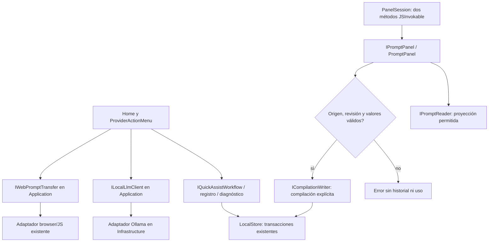

# Quick Assist, transferencia y panel por puertos — 2026-10-20

Estado: incremento IMPLEMENTADO y VERIFICADO. Objetivo global y versión abiertos.
No promociona el candidato semántico rechazado ni acredita fiabilidad general.

## Auditoría y decisión

Home aún recibía LocalStore para Quick Assist, transferencias, diagnóstico y el
panel. ProviderActionMenu escribía directamente el registro. PanelSession mezclaba
interop JS con proyección/compilación. ILocalLlmClient y su error/interpretación
estaban declarados junto a OllamaClient; IWebPromptTransfer junto al adaptador JS.

Se compararon mantener accesos concretos, pequeños contratos reutilizando dueños
existentes y otra capa genérica de repositorios/proxies. Se eligen contratos por
capacidad y traslado de responsabilidades. No se añade otro almacén, workflow,
modelo, framework de reflexión ni política de transferencia.

## Workflow y algoritmo



```text
construir alias de capacidades en LocalPromptLibrary; registrar lifetimes del host
Quick Assist: interpretar con el puerto local existente; enlazar plan a datos reales
  no escribir al preparar; aplicar sólo por la acción de revisión existente
panel: exponer los mismos nombres/argumentos JS; delegar en el caso de uso Application
  listar sólo campos públicos; compilar validando valores y revisión observada
transferencia: mantener gesto/consentimiento y protocolo; registrar sólo metadatos
diagnóstico: consultar integridad por su puerto, sin acceso concreto desde UI
copiar modelos de edición mediante WorkspaceSnapshots, sin depender del codec SQL
mantener cancelación, manejo de resultado incierto y límites existentes
sin retries, cambios de permisos, routing de frases ni nuevos efectos automáticos
```

## Contratos y propietarios

| Contrato | Responsabilidad | Lifecycle / invariantes |
|---|---|---|
| IQuickAssistWorkflow | Preparar/enlazar y aplicar plan tipado existente | Preparar no escribe; validación de referencias/revisiones y transacción al aplicar; aprobación UI existente conservada |
| ITransferActivityReader/Writer | Consultar/guardar auditoría | Metadatos sin contenido; validación, deduplicación y retención existentes |
| ILibraryDiagnostics | CheckIntegrity | Lectura local síncrona; no conoce UI ni modelo |
| IPromptPanel / PromptPanel | Biblioteca pública y compilación del panel | No exporta defaults/historial; revisión y valores válidos; doble comprobación en compilación persistida |
| PanelSession | Adaptación JSInvokable | Nombres, parámetros, errores JS y shape JSON conservados; DotNetObjectReference sigue siendo propiedad del circuito |
| ILocalLlmClient y tipos asociados | Contrato local de modelo | Métodos, argumentos, defaults, cancelación y errores conservados; implementación permanece en Infrastructure |
| IWebPromptTransfer | Contrato browser | Eventos, cancelación, resultados inciertos y permiso existente conservados; JS no se traslada al backend |
| WorkspaceSnapshots | Copias independientes de Template/PromptGroup/InstructionProfile | Algoritmo único; sin mutable defaults compartidos ni dependencia del serializer de persistencia |

WorkspaceRuntimePorts implementa los puertos sobre la clase parcial propietaria.
LocalPromptLibrary construye PromptPanel con lectores y escritor de compilación.
Home ya no inyecta LocalStore; ningún componente o PanelSession contiene acceso al
almacén concreto. Los límites de archivo se obtienen del lector; los modelos, de
LocalModelPolicy. Los errores técnicos heredados se presentan en el host como
antes, sin modificar las reglas ni los mensajes al usuario.

Las operaciones locales son síncronas/transaccionales. La inferencia conserva su
CancellationToken y el adaptador browser conserva Cancel/Dispose existentes. No
se añade cancelación entre escrituras ni autorización basada en respuestas del LLM.
Estos puertos no se exponen automáticamente como herramientas del agente.

## Movimiento y compatibilidad

- LocalInferenceContracts.cs y BrowserTransferContracts.cs pertenecen a Application,
  con dependencias BCL/Domain. Los nombres de namespace anteriores se mantienen
  por compatibilidad; no implican una referencia al ensamblado Infrastructure.
- Los ensamblados anteriores reenvían tipos mediante TypeForwardedTo. La prueba
  verifica Type.GetType con los cuatro nombres de ensamblado originales y comprueba
  que los tipos pertenecen realmente a Application.
- PanelSession pasa de constructor con LocalStore a IPromptPanel. PanelItem,
  PanelCatalog y PanelCompiled pasan al namespace de Application. Es una migración
  C# local explícita; se actualizó su único consumidor de pruebas. El protocolo JS
  y los campos serializados se conservan. No se promete ABI de esos DTO/constructor.
- Los cuerpos del contrato del modelo y browser se conservaron literalmente con
  normalización de fin de línea; implementación del modelo/JS no cambia. Ver
  [registro de traslado](../evidence/runtime-ports-20261020/relocated-contracts.json).
- ILibraryArchiveReader añade MaximumBytes; su implementación actual publica el
  límite existente. Un adaptador externo de ese puerto deberá implementar la propiedad.

## Evidencia ejecutada

[verification.json](../evidence/runtime-ports-20261020/verification.json):

- **791/791 backend**, sin omitidas. Suite completa justificada por el movimiento
  de identidad de tipos usados por toda la inferencia/transporte. No son 791 casos Qwen.
- **166/166 compartidas**, sin omitidas. Seis nuevas pruebas: propiedad/reenvío de
  tipos, sustitución del panel sin SQLite, privacidad, workflow sin efectos al
  preparar, revisión antes de aplicar, auditoría idempotente, copias y ausencia de
  almacén concreto en los consumidores. Las dos pruebas existentes del panel pasan.
- API y Blazor compilan sin errores/advertencias; DLL compartidas idénticas.
- **6 controles en Edge visible** sobre SQLite sintético: panel por postMessage y
  JSInvokable real, compilación con texto/uso/historial, rechazo obsoleto y de campos
  desconocidos, fallback con portapapeles y registro, diagnóstico, Quick Assist real.
- Qwen3:8b instalado propuso **un** paso Favorite para la petición sintética fija.
  No cambió el dato antes de aprobar; después quedó favorito en SQLite. Duración
  observada del plan: **21.722 ms**. No es un benchmark ni prueba de las demás tareas.
- Destino externo bloqueado antes de navegar; no se contactó ChatGPT, no hubo envío
  ni prueba del sitio real. Tampoco se afirma que se haya probado el docking o el
  runtime de una extensión instalada: se probó su puente local JS/interop existente.
- Nueve comprobaciones estáticas pasan. React no cambió ni se volvió a ejecutar su
  suite. No se repitió la matriz semántica moderna ni se cerraron sus fallos.

Se conservó el error de compilación inicial de una colección vacía del fake como
IReadOnlyDictionary; se corrigió sólo el dato de prueba, sin cambiar el contrato.

## MAUI y alcance pendiente

README identifica MAUI como referencia histórica. La estructura XML leída mediante
lista permitida confirma targets .NET 9 y exclusión de src/backend/apps; SDK local
8.0.425 y cero workloads. No se imprimieron propiedades privadas del proyecto,
no se ejecutó un build MAUI, ni se descargaron SDK/workloads. Este dato no sustituye
la revisión de conformidad pendiente del código histórico.

Quedan la revisión MAUI y la sustitución semántica no cualificada, además de la
auditoría final contra el alcance global. La matriz canónica sigue 34/54. El goal
permanece ACTIVO. Para revertir, restaurar sólo puertos/consumidores/forwarders de
este incremento usando las copias; no resetear trabajo previo, datos ni políticas.
