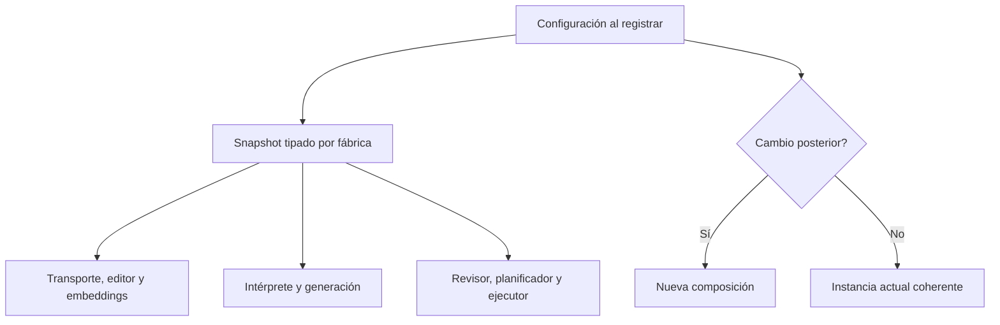

# Configuración coherente de la fábrica NOVA

## Auditoría y contrato

Los registros singleton leen IConfiguration dentro de lambdas diferidas. Algunos
valores se capturan al registrar (sampling, knowledge y budgets), mientras endpoint,
thinking y otros flags se leen al primer uso. IConfiguration es mutable: una recarga
o cambio explícito entre resoluciones puede mezclar perfiles dentro de la instancia.
La auditoría de evaluación distingue los runners antiguos, etiquetados LEGACY, de
los hosts productivos; no permite atribuir una composición a otra.

Propietario: ApplicationModules, frontera que convierte configuración de host en
componentes. Se elige un valor tipado interno NovaAgentSettings capturado una vez,
con PreparationOptions existente para presupuestos. No es un nuevo servicio de
dominio ni registro global. Opciones del worker visible se capturan en su fábrica.
Alternativas: lecturas repetidas conservan la inconsistencia; un monitor/configuración
reactiva requeriría reemplazar todos los módulos y tareas atómicamente. No hay ese
requisito; se conserva la composición estable por vida del contenedor.

Entradas: claves técnicas existentes al registrar módulo. Salidas: mismos puertos,
defaults, validaciones y mensajes, componentes con un perfil consistente. Sin nuevas
claves, dependencias, modelo, base, permisos, API HTTP o instrucciones semánticas.
Endpoint inválido conserva validación del adaptador al usarse; presupuestos inválidos
siguen rechazándose al registrar. Cancelación, retries y disposal pertenecen a los
adaptadores/workflows existentes. Las dependencias siguen prestadas/propias igual.

Invariantes: registro A no cambia al mutar IConfiguration; registro B posterior sí
recibe los nuevos valores. Ningún singleton conserva IConfiguration para decidir
su perfil tardíamente. El cliente local, transporte y embeddings de una instancia
usan el mismo endpoint configurado. Los módulos de inferencia reciben iguales
thinking/metadata, conservando sus decisiones específicas de etapa.
Precondición: configuración estable durante el registro. No se promete lectura
transaccional de un proveedor que cambie concurrentemente mientras se captura.



```text
leer una vez claves existentes y validar presupuestos
capturar opciones en valor inmutable de esta composición
registrar lambdas sólo sobre ese valor y puertos del contenedor
resolver servicios en cualquier orden sin volver a leer IConfiguration
para aplicar otra configuración, construir otra instancia
conservar preferencias de usuario en sus propietarios actuales
probar mutación entre resoluciones, aislamiento entre instancias y HTTP loopback real
```

Cambio operacional explícito: las opciones técnicas singleton se fijan al registrar
el módulo y requieren nueva composición/reinicio para aplicar cambios. No se promete
hot reload parcial. Preferencias UI/biblioteca no cambian de propietario ni ciclo.
Rollback conjunto desde before.json; sin migración de datos. Web-only; MAUI excluido.
Estado: IMPLEMENTADO y verificado dentro de este alcance.

## Evidencia ejecutada

Los cuatro controles nuevos fallan antes y pasan después, sin modificar sus
expectativas. Los dos casos de orden de construcción muestran thinking/metadata
distintos tras mutar IConfiguration. El caso HTTP muestra las tres llamadas del
editor/transporte/embeddings en el endpoint modificado, con cero en el registrado.
El caso de dos composiciones prueba que una instancia nueva puede recibir valores
distintos sin alterar la anterior. No hay configuración estática/global compartida.

- 84/84 pruebas dirigidas en 13 clases PASS, cero omitidas; incluye factories por
  capacidad, ciclo de vida, retirada de fachada y conexión semántica anterior.
- 15 controles Edge/HTTP PASS en host normal/desactivado/sustituido, con CRUD,
  revisiones, cancelación/eliminación y error visible conservados.
- API, Blazor y evaluador compilan sin advertencias/errores. Las DLL comunes
  coinciden con las probadas; Domain/Application/Infrastructure además son idénticas
  al incremento anterior: no cambian algoritmos, prompts ni permisos de dominio.
- 15 defaults, rangos y mensajes de presupuesto conservados por comparación de
  fuentes. 28 controles estáticos PASS. El artefacto OpenAPI y la matriz canónica
  mantienen SHA256; no se regeneró metadata ni se repitió otra suite ajena al cambio.

[Verificación y provenance](../evidence/runtime-settings-snapshot-20261020/verification.json).
No instala modelos, cambia opciones activas ni reinicia los servicios personales;
los hosts propios de prueba se cerraron. Sin nuevas campañas Qwen, cualificación de
fidelidad general o aceptación de latencia. Versión abierta y meta activa, 34/54.
