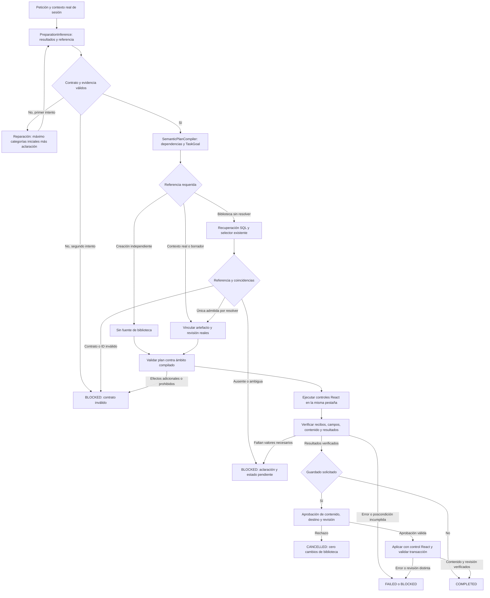

# S04 — Integration and acceptance gate

Estado final: **FAIL**. Se congela la expansión del candidato. S04 queda experimental y desactivado por defecto (`TaskGoals=false`, `TaskResultContract=false`). Esta revisión conserva S01/S03/S04 y sus errores; no cambia corpus, umbrales, modelo ni datos personales. Comparación alternativa, suites y diez recorridos reales terminados, sin modificar el binario S04. Fechas y evidencias corresponden al 18 de octubre de 2026, America/La_Paz.

## 1. Workflow final del código S04

Este diagrama describe las rutas existentes, incluyendo sus límites observados. No acredita que la interpretación semántica sea correcta. No se crea otro orquestador.



Límites importantes: el ámbito compilado procede de una interpretación todavía falible; comprobarlo no demuestra que la petición autorizó cada resultado. El resolver conserva una heurística de ambigüedad por puntuación literal que puede contradecir al selector semántico. La reparación general limita categorías máximas, pero no sella el origen ni exige conservar todas las categorías iniciales. Solo la ruta específica de conflicto de ámbito sella más datos. Por tanto, el workflow requerido por el usuario todavía **no está plenamente satisfecho**.

## 2. Pseudocódigo correspondiente a la implementación

```text
RunVisible(input):
    context = SemanticPlanning.Context(session, explicit_selection)
    interpretation = PreparationInference.Interpret(context, original_request)
        # TaskResultContract experimental: hasta dos intentos
        # valida esquema, rangos y combinaciones; no prueba implicación semántica
        # NEW_DRAFT exige NO_SOURCE_NEEDED
        # DERIVED_DRAFT exige fuente; EDITED_DRAFT aún admite fuente ausente
        # reparación general: categorías originales + CLARIFICATION
        # no hay garantía general de origen inmutable ni de categorías completas
    plan = SemanticPlanCompiler.Compile(interpretation)
    resolution = SemanticPlanning.Resolve(plan, context)
        # referencias contextuales válidas se vinculan sin selección adicional
        # biblioteca no resuelta: recuperar, seleccionar y validar IDs/revisión
        # la puntuación de recuperación aún puede forzar aclaración
        # cita copiada desde datos de biblioteca no autoriza una referencia
    if resolution unresolved: preserve_pending_and_ask()
    if active_working_draft: bind_actual_draft_and_goal()
    for action in existing_visible_execution_budget:
        validate_tool_and_compiled_scope(action)
        execute_same_tab_native_control(action)
        validate_receipt_and_observed_state()
        checkpoint_complete_artifact()
    if required_results_not_observed: BLOCKED_or_FAILED
    if save_requested:
        wait_for_approval_of_exact_content_destination_revision()
        if rejected: CANCELLED_without_library_write
        commit_once_with_fresh_revision_and_hash()
        verify_observed_saved_identity_revision_content()
    COMPLETED_only_after_existing_postcondition_checks()

preparar_creación_actual():
    proposal = GenerateCore(original_request)
    ReviewDraftFidelity(proposal.TemplateText)
    goal.RecordContentAssessment(proposal.TemplateText)
    draft = PromptCompilation(proposal, values)
        # si no hay slots pero RequiredInputs no está vacío, añade slots al cuerpo
    FinalPreparation(draft)  # no exige siempre huella semántica del cuerpo final
    escribir_y_verificar_igualdad_del_formulario(draft)
    GoalCompletionValidator exige HasContentAssessment(draft.TemplateText)
        # cuerpos distintos => no termina; BoundGoal puede preguntar por variables
```

No se presenta la validación de una cita o un ID real como autorización semántica. Tampoco se promete que `COMPLETED` signifique éxito de la petición cuando el objetivo inicial fue interpretado incorrectamente.

## 3. Contratos y archivos

| Contrato / responsabilidad | Archivos existentes del candidato | Límite de autoridad |
|---|---|---|
| TaskGoal, TaskScope, RequestedEffects, WorkingArtifactTarget | `backend/QuickPrompt.Application/TaskGoal.cs` | Cierre de efectos, condiciones y vínculo a contenido; interpretación inicial aún puede ser incorrecta |
| ResultSelection y evidencia por rangos | `backend/QuickPrompt.Infrastructure/TaskResultInference.cs`, `TaskGoalInference.cs` | Propuesta de Qwen validada; no aprobación |
| Referencia fundamentada y revisión | `SourceReferenceInference.cs`, `backend/QuickPrompt.Application/SemanticPlanning.cs` | IDs reales y cita/contexto; no permiso por mera existencia del ID |
| DraftRef / checkpoint | `AgentRuntime.cs`, `AgentOrchestrator.Visible.cs`, `Preparation.cs` | Identidad temporal, revisión y sesión; no identidad persistida ficticia |
| Ejecución y recibos | `UiToolCatalog.cs`, `SameTabUiDispatcher.cs`, `apps/web/src/features/nova/AgentUiDriver.ts` | Observación de controles reales y permisos del run |
| Persistencia | Orquestador/API de aprobación existentes | Hash, destino, revisión fresca, aprobación y uso único |
| Comparación | `backend/QuickPrompt.Evaluation/RecoveryEvaluation.cs`, `Tests/nova/latency.cjs` | Corpus sintético y oráculo independiente; no datos privados |

En esta revisión no se cambia código de producción: solo el probe de pruebas (`notFound`, registro de sesión/pregunta, estado del prerrequisito de continuidad y separación entre bloqueo seguro y pertinencia de la pregunta) y documentación/evidencia. Los demás cambios pertenecen al candidato previamente congelado; no se atribuye a esta revisión todo el árbol de trabajo sucio. `S04-gate-integrity.json` identifica 195 archivos de producción del snapshot sin cambios y todos los hashes congelados del corpus/umbrales intactos.

## 4. Comparación S01 / S03 / S04

| Campaña completa, Qwen real | Intención | Plan válido | Destino | Metamórficas búsqueda/adaptación | Llamadas LLM | p50 / p95 descriptivos |
|---|---:|---:|---:|---:|---:|---:|
| S01 | 14/16 | 15/16 | 14/16 | 2/2 | 21 | 28.241 / 68.783 s |
| S03 | 12/16 | 15/16 | 13/16 | 1/2 | 24 | 20.651 / 68.552 s |
| S04 | 8/16 | 11/16 | 8/16 | 0/2 | 23 | 23.171 / 57.822 s |
| Decoder legacy existente sobre binario S04 | 11/16 | 15/16 | 11/16 | 0/2 | 117 | 24.806 / 52.433 s |

Mismo corpus de desarrollo, umbrales congelados, modelo/digest y opciones; binarios identificados por hash. Las duraciones incluyen fallos y no prueban mejora de velocidad: no hay campaña controlada fría/caliente ni variabilidad establecida. Un rechazo temprano más rápido no es éxito.

Evidencia: `docs/evidence/stabilization-v1/{S01,S03,S04}-development.json`. La precisión de destino usa todos los casos del corpus, incluidos los que esperan ausencia de destino, según el oráculo congelado. Las tasas de efectos adicionales nuevas no se comparan retrospectivamente como si S01/S03 hubieran tenido el mismo oráculo.

La comparación adicional usa `S04-legacy-development.json`, mismo binario y flags experimentales desactivados. Aunque conserva el decoder anterior, **no es una alternativa más simple en coste de inferencia**: descompone referencia, destino, ejecución, texto, valores y workflow en llamadas separadas. Falla búsquedas claras, restricciones de contenido/adaptación, continuidad y contexto de una pregunta sobre cancelar. No se promueve como solución por existir previamente. S01 conserva el contrato TaskGoal anterior, sin el nuevo contrato de resultados ni verificador S04; sigue siendo la alternativa congelada más precisa medida, pero tampoco pasa los umbrales.

## 5. Fallos restantes y causas

| Casos S04 | Primera divergencia observada | Consecuencia |
|---|---|---|
| 02, 10, 11, 14 | El selector cita el cuerpo de la biblioteca en lugar de la petición | Rechazo correcto de evidencia, tarea no realizada; 11/14 ya habían confundido adaptación con creación derivada |
| 04 | EDITED_DRAFT admite NO_SOURCE_NEEDED; el control de fuente solo cubre resultados sin autoría | Aclaración innecesaria pese al prompt seleccionado |
| 08 | NEW_DRAFT con origen contextual incompatible; la reparación conserva categoría errónea y cambia origen | Dos intentos rechazados; no continuidad útil |
| 09 | Nueva selección reemplaza “el otro” por el primer resultado | ID real pero destino incorrecto |
| 13 | Una petición sin antecedente se interpreta como creación | Efectos adicionales planificados; no es una prueba de ejecución de esos efectos |
| 16 | Preparación local interpretada como preparación de proveedor | Falta el resultado local solicitado y aparece otro destino |

Además del corpus: la carga y generación del borrador sin origen siguen dependiendo parcialmente de `Goal.WorkingTarget`; el fallback desactivado de TaskGoals no comparte toda esa autoridad de artefacto. La identidad/revisión estable en pruebas de transporte no demuestra continuidad real hasta superar creación y adaptación en React. No se corrige con rutas por palabras, regex, vectores ni otro orquestador.

El E2E de creación encontró otra frontera rota, independiente del idioma o tema: `ReviewDraftFidelity` aprueba y registra la huella de `PromptProposal.TemplateText` **antes** de `PreparedDraftEvaluator` añadir slots desde `RequiredInputs`. En el run `cbaec454-8c29-45d0-8677-0635bd52412d`, el cuerpo revisado tiene 1.095 caracteres y el escrito 1.255. La reconstrucción exacta de la transformación del evaluador coincide con el cuerpo observado. `GoalCompletionValidator.CONTENT_VALID` exige revisión ligada al cuerpo final y por eso no permite terminar; `BoundGoal` sustituye ese diagnóstico por una pregunta sobre variables vacías. No faltó la escritura nativa: título y contenido coinciden con el borrador preparado y no hubo cambios de biblioteca. Evidencia: `S04-canonical-artifact-failure.json` y `latency-1792325950239/create-1.png`.

La prueba destinada al rechazo confirmó la pérdida de efectos durante una reparación: el primer contrato tenía SOURCE_READ + DERIVED_DRAFT + SAVE_VERSION_REVIEW. La reparación por CONFLICTING_GOAL_SCOPES devolvió únicamente DERIVED_DRAFT. El origen quedó sellado, pero **se perdió la solicitud de guardar una versión** y se ejecutó `ui_prepare_creation` en lugar de la adaptación prevista. El límite superior de capacidades no garantiza conservar las capacidades requeridas ni interpretar bien su categoría inicial. No hubo persistencia, pero tampoco puede afirmarse «cero efectos adicionales ejecutados»: se observó creación donde el fixture pedía adaptación y revisión de la versión del mismo prompt.

La corrección general a evaluar después del gate sería canonicalizar una sola vez antes de evaluar y ligar revisión, recibos y hash al mismo artefacto final; las preguntas deben depender de resultados solicitados y datos realmente necesarios. **No está implementada en esta revisión.** No se añaden excepciones por tema ni se transforma automáticamente todo placeholder vacío en una obligación de rellenarlo. Se conserva el binario fallido para que el diagnóstico siga siendo reproducible.

SourceReferenceInference sustituye el selector en la rama no resuelta; no se llama para toda petición. S04 lo llamó seis veces (casos 02/09/10/11/12/14), 22.647 s acumulados. Cuatro citas inválidas y un destino incorrecto refutan su beneficio actual. Las llamadas se miden por `performance.operations`, no por estimación del tamaño del archivo. El caso 02 entró en esa rama pese a traer un ID inicialmente correcto: el precontrol de ambigüedad léxica invalidó esa vinculación.

## 6. Pruebas E2E y evidencia

Comprobaciones S04 ya finalizadas: backend **402/402**, legacy **150/150**, React **90/90**; builds API/evaluador/web aprobados. Evidencia: `docs/evidence/stabilization-checks/S04-verified-backend.trx`, `S04-legacy.trx`, `S04-final-react.json`. Se conservan intentos fallidos anteriores. Estas pruebas acreditan mecánica y no revierten el FAIL semántico.

Los recorridos se ejecutan con Edge visible, una única pestaña, React real, API S04 congelada, Qwen real y una copia aislada de la base sintética. El probe distingue continuidad no alcanzada por fallo de creación de una continuidad demostrada. DraftRef interno no se expone en LiveView: la UI prueba sesión/contenido, las pruebas de transporte prueban identidad/revisión. No se añadirá una API de diagnóstico al producto para aprobar este gate.

La comparación legacy de los dieciséis casos está completa y rechazada (tabla anterior). Probes metamórficos adicionales: creación **PASS (2/2)**; negaciones **FAIL (1/2)**. El mismo pedido de solo mostrar sin editar/ejecutar falla al copiar una cita de biblioteca; su paráfrasis pasa. Esto no es estabilidad semántica. Evidencia: `S04-metamorphic-probes.json` (congelado antes de ejecutar, hash E617545E1CB95D49DC0A3AA34B5388BB8AEB2704F9A65528EEB10DB165023579) y `S04-metamorphic-results.json`. Son cuatro diagnósticos adicionales de desarrollo, no reemplazan ni alteran el corpus congelado de dieciséis casos. La copia de umbrales tiene exactamente el hash original.

Repetición del gate mecánico: backend **402/402**, legacy **150/150**, React **90/90**. El primer intento React de esta revisión terminó con salida 1 y **cero pruebas descubiertas/ejecutadas** (`S04-gate-react.json`); no contiene una aserción fallida ni diagnóstico suficiente para atribuir una causa. Se conserva. La repetición completa con `--maxWorkers=1`, reporte legible y JSON pasó sin cambiar pruebas ni timeouts: `S04-gate-react-single-worker.json`, 14 archivos / 90 pruebas, 78.03 s. No se atribuye una causa definitiva al intento de cero pruebas solo porque limitar concurrencia permitió completar el siguiente. Nuevos TRX: `S04-gate-backend.trx`, `S04-gate-legacy.trx`.

Primeros recorridos reales (`docs/evidence/latency-1792325950239`): creación aislada **FAIL/BLOCKED**, por la transformación posterior a la evaluación descrita arriba. Crear y adaptar sin guardar **PASS en este recorrido**, misma sesión `2e3aece1-6a49-49dd-a6bb-651ee57379e2`, modo create y sin PromptId persistido en ambos turnos; cuerpo 506 → 637 caracteres, campos nativos coincidentes, biblioteca intacta. Fueron **349.611 s y nueve llamadas** entre ambos turnos: no demuestra rapidez. `S04-unsaved-continuity.json` conserva identidades públicas de sesión/run y las observaciones. Capturas de creación y adaptación inspeccionadas visualmente; no se interpreta que el PASS posterior borre el FAIL de creación aislada.

| Recorrido React / Qwen real | Resultado funcional revisado | Evidencia / límite |
|---|---|---|
| Crear independiente | FAIL (run BLOCKED) | Texto escrito; revisión del cuerpo anterior a añadir variables |
| Crear → adaptar sin guardar | PASS en el recorrido | Misma sesión, cuerpo 506 → 637, sin ID guardado, biblioteca intacta; 349.611 s / 9 llamadas |
| Recuperar tras interrupción | BLOCKED por prerrequisito | Creación se bloqueó; la interrupción/recuperación no se alcanzó |
| Buscar y abrir | PASS | Registro correcto, cuerpo original, sin edición |
| Completar variables y dejar para copiar | PASS | Valor literal, preview y campos reales coincidentes |
| AMBIGUOUS | FAIL funcional; PASS de bloqueo seguro | Pregunta ofrece Proyecto técnico/Redactar correos en vez de los Anuncios A/B visibles |
| NOT_FOUND | FAIL funcional; PASS de bloqueo seguro | Ofrece registros ajenos en vez de reconocer ausencia |
| Cancelar inferencia | PASS | CANCELLED, biblioteca intacta, 515 ms de escenario completo; no mide cancelación durante escritura |
| Adaptar → aprobar copia | BLOCKED antes de aprobación | INVALID_DECISION; no se aprobó ni escribió una copia |
| Adaptar → rechazar versión | FAIL de planificación; rechazo no alcanzado | Reparación pierde SAVE_VERSION_REVIEW y crea borrador; no se llegó a aprobar/rechazar |

Los primeros ocho casos están en `latency-1792325950239`; copia en `latency-1792326585581`; rechazo en `latency-1792326633870`. Cuatro recorridos funcionales PASS, cuatro FAIL revisados y dos BLOCKED por prerrequisito/planificación. Los diez conservaron la biblioteca, sin persistencia aprobada ni no autorizada. **Aprobación y rechazo reales no quedan demostrados** por estos escenarios; los replay históricos siguen siendo únicamente pruebas de UI.

Resumen auditable por caso: `docs/evidence/stabilization-v1/S04-e2e-audited.json`. Los diez usaron una única Page y no hicieron peticiones externas desde el navegador. La prueba de cancelación interrumpió inferencia: no prueba cancelación durante escritura ni recuperación tras interrupción. Tampoco se ha ejecutado un flujo de aprobación de un borrador sin origen. La UI prueba contenido/sesión; la identidad y revisión internas de DraftRef siguen acreditadas por transporte, no por inspección pública de la Page. No se realizaron pruebas de la envoltura MAUI/net9 con el SDK net8 instalado.

Auditoría del oráculo: los resultados originales de AMBIGUOUS/NOT_FOUND decían `correct=true` porque solo comprobaban BLOCKED, ausencia de selección y ausencia de escritura. Al inspeccionar pregunta y captura se refutó ese PASS. Se preservan ambos JSON y se añade `S04-reference-question-audit.json` con veredicto FAIL. El probe corregido separa `controlSafetyPass` de una revisión de pertinencia `NOT_TESTED`, y ya no emite PASS funcional por un rechazo seguro. No añade un juez LLM ni un clasificador por palabras; conserva las fuentes esperadas del fixture para revisión independiente. La corrección del probe es posterior a estas mediciones y no se presenta como una repetición de Qwen.

## 7. Decisión

**FAIL: S04 no supera S01.** Se detiene expansión arquitectónica y se compara el intérprete anterior sin otro mecanismo de inferencia. No se promueve S04 ni se ejecutan validación independiente/holdout mientras desarrollo incumpla los umbrales. La alternativa simple tampoco se acepta por tener menos capas: debe superar las mismas mediciones. Los defectos señalados son diagnóstico; no una lista de arreglos ya implementados.

Gates separados: semántica **FAIL**; continuidad sin guardar **PASS en un recorrido**, recuperación **BLOCKED**; fidelidad/canonicalización **FAIL**; aprobación/rechazo **BLOCKED antes de alcanzar revisión**; mecánica automatizada **PASS tras repetición React**; rendimiento controlado **NOT_TESTED**, con latencia elevada observada. No aceptación global, commits, publicación, instalaciones, nuevos modelos ni cambios en datos privados.
