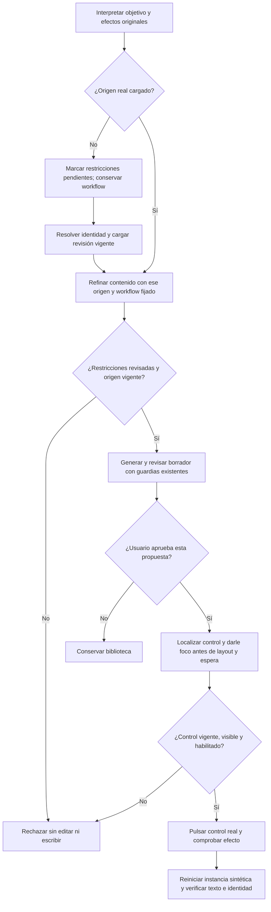

# Recuperación de actualización y guardado — 2026-10-19

Estado: **PARCIAL; SAV-02/SAV-03 permanecen abiertos**. Actualización/rechazo pasan, copia bloqueada por autoría. Continúa el goal original y sus 88 requisitos. Este trabajo atiende errores ya pendientes de edición, navegación y aprobación; no añade requisitos, modelos, dependencias ni perfiles. La fidelidad general de creación sigue abierta y `DraftFidelity.cs` conserva su hash anterior tras rechazar el candidato de contexto compartido.

## Evidencia anterior y primera divergencia

Se mantuvo la petición de desarrollo existente `saveVersion`: buscar el prompt de correos, adaptarlo para solicitar una entrevista y pedir aprobación para guardar una versión del mismo registro. Sólo se usaron copias de SQLite sintéticas y Edge instalado.

| Ejecución | Resultado observado |
| --- | --- |
| `latency-1792427684652` | FAILED / UNGROUNDED_CONTENT_CLAUSE, nueve inferencias; no llegó al editor ni escribió |
| `latency-1792427810187` | El primer cuerpo trasladó la aprobación de guardado a la instrucción futura; la corrección existente lo retiró. El formulario final fue fiel y llegó a aprobación. Después de confirmar falló UI_TARGET_CHANGED, sin escritura |
| `latency-1792428187225` | Sólo foco corregido: volvió a fallar antes del editor por UNGROUNDED_CONTENT_CLAUSE; no demuestra el clic corregido |

La segunda traza conserva el botón visible tras aprobar y el panel cerrado al localizar el control. La captura muestra el foco todavía en el contenido del formulario. `HTMLElement.click()` no realiza el paso de foco de un clic nativo. El layout del dock observa aquel campo externo y oculta su panel antes del clic pendiente. No es una intervención real del usuario ni motivo para desactivar sus guardias.

Las trazas de extracción muestran además `solicitar mi aprobación para guardar...`, paráfrasis de `solicita mi aprobación para guardar...`, dentro de `literalClauses`. Antes de cargar el origen se omitía la revisión de ámbito, pero se exigía grounding literal inmediatamente. La petición se detenía antes de la revisión que puede descartar cláusulas de edición/workflow. No se soluciona admitiendo una cita aproximada ni descartando una condición futura real.

## Algoritmo e invariantes



```text
si el contenido depende de un origen que todavía no se ha leído:
    conservar objetivo y workflow; marcar restricciones pendientes
resolver y leer la revisión real
refinar también candidatos ya identificados si sus restricciones siguen pendientes
releer la revisión después de inferir; rechazar conflicto o revisión aún pendiente
conservar validaciones literales, preservación del origen y evaluación de contenido
al localizar un clic: dar foco al control antes de desplazar y esperar
conservar cancelación, visibilidad, habilitación y aprobación ligada a hash/revisión
pulsar una vez; observar el resultado real
reiniciar sólo el fixture propio; comprobar igualdad, reapertura y rechazo de replay
```

| Frontera | Cambio | Verificación |
| --- | --- | --- |
| `SemanticInference.Interpret` | La extracción dependiente espera al origen; no pierde el workflow ni la solicitud de versión | Transporte con cuerpo presente/ausente, restricción futura conservada y objetivo de guardado intacto |
| `SemanticPlanning.Resolve` | El marcador pendiente exige refinamiento aunque la identidad ya venga de un candidato; relectura fresca y rechazo si sigue pendiente | SQLite real con resolución, revisión obsoleta y refinamiento insuficiente |
| `AgentUiDriver.locate` | Foco al control de clic antes de cursor/progreso/espera; sin cambios al dock ni a sus reglas de descubrir campos | Dos regresiones de versión/copia y suite React completa; falta cualificación UI final |
| Dominio de aprobación | Sin cambios a permisos, hashes, revisiones, endpoints ni escritura | Recorrido real y reinicio pendientes de resultado |

No se cambia `literalClauses` para aceptar paráfrasis: después de cargar el origen, la revisión de ámbito y el grounding existentes continúan siendo obligatorios. La marca pendiente no es permiso para editar o ejecutar. Una fuente no resuelta conserva su pregunta y no genera contenido. No se modifica el revisor de autoría rechazado ni se elimina la corrección acotada existente.

## Pruebas y límites

- React: **103/103 PASS**, [informe](../evidence/approved-control-focus-20261019/react-all.json). Antes de corregir el foco: 13 PASS/2 FAIL en `agent-driver.test.tsx`; ambos fallos mostraron `Contenido aprobado.` como foco cuando el control era `Aplicar versión aprobada`.
- Backend: **522/522 PASS**, cero omitidas, [TRX](../evidence/approved-control-focus-20261019/tests/backend-candidate.trx). Incluye cinco controles nuevos de orden/refinamiento. El transporte válido anterior dio 1 PASS/1 FAIL por extracción prematura: [baseline](../evidence/approved-control-focus-20261019/tests/source-stage-before3.trx).
- Se preservaron intentos del arnés antes de ese baseline: dos esquemas de transporte mal construidos y un fixture de resolución que omitía `RequiresConfirmation`. Se corrigió el fixture, sin retirar la exigencia de confirmación ni alterar los resultados esperados del producto. Esos intentos no se cuentan como prueba de causa de producto.
- API aislada `approved-control-focus-20261019/api-v1`: build sin errores/advertencias. Frontend `web-v1`: TypeScript y Vite compilan; se conservan los avisos existentes de tamaño de chunk y salida externa.
- **PASS dirigido — actualizar/guardar versión:** [Qwen/Edge](../evidence/latency-1792428556555/measurements.json), 143303 ms/19 llamadas; formulario, preview y texto aprobado coinciden. Tras confirmar, mismo ID/revisión 2 y texto exacto. [Reinicio y reapertura](../evidence/latency-1792428556555/restart/results.json): biblioteca completa conservada, aprobación anterior rechazada sin otra escritura y detalle real coincidente. La traza registra foco en el botón nativo; captura inspeccionada.
- **PASS dirigido — rechazar actualización:** [Qwen/Edge](../evidence/latency-1792428950706/measurements.json), 138578 ms/19 llamadas, CANCELLED. [Tras reiniciar](../evidence/latency-1792428950706/restart/results.json) la biblioteca coincide con el estado anterior, sin cambio de cuerpo/revisión; aprobación antigua 409 y sin escritura. No acredita aún intervención manual en cuerpo/destino durante aprobación.
- **FAIL conservado — guardar copia:** [Qwen/Edge](../evidence/latency-1792428725596/measurements.json), 139693 ms/19 llamadas, BLOCKED/INVALID_DECISION. El cuerpo describió adaptar el prompt y solicitar aprobación en vez de producir la instrucción de entrevista; la revisión lo rechazó. No alcanzó confirmación ni guardó. Pertenece al fallo de autoría abierto; no se incorpora su propuesta.
- Los tres recorridos usan las mismas DLLs y web. Ninguno mide p95 ni precisión general. No se ejecutaron holdout, creación completa, toda la campaña semántica ni la suite legacy. Los PASS de transporte no prueban comprensión de Qwen.

El auxiliar de reinicio `Tests/nova/save-restart.cjs` sólo acepta una ejecución correcta con snapshots sintéticos explícitos y hashes del mismo API/web. Verifica biblioteca completa, contenido aprobado, identidad/revisión, replay de la aprobación antigua y detalle real de Edge. No usa inferencia ni suple un recorrido fallido.

Estado de la matriz: **21 cerrados / 67 abiertos**. La instancia previa de 5190, los datos privados y el remoto permanecen fuera de estos cambios. No se solicita ni se ejecuta commit/push.
