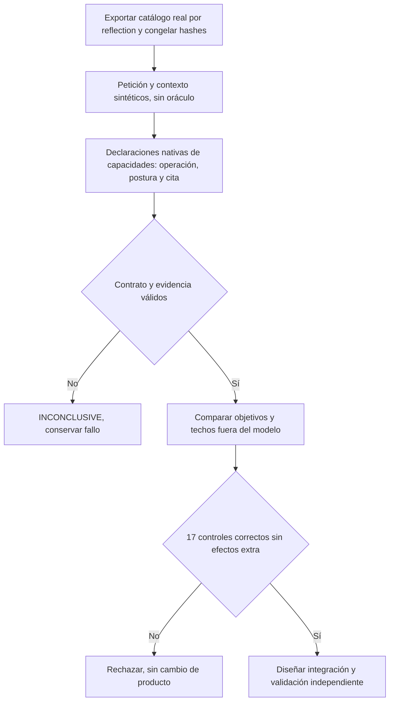
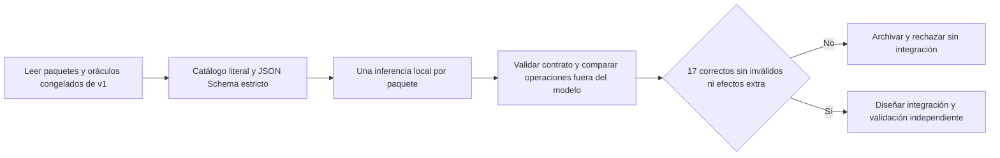
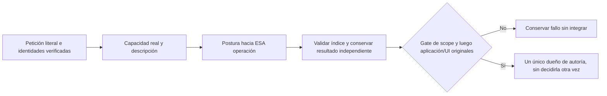

# Operación, objeto y postura — contraste aislado de contrato

Estado: contraste QA **RECHAZADO, no integrado**; no cambia el agente del producto. Continúan abiertos AI/AUT/REL-05. No se utiliza el holdout ni se descarga otro modelo.

## Causa e hipótesis

La cualificación de `SEMANTIC_CAPABILITY_OWNERSHIP.md` conserva dos fallos reales: encontrar una instrucción se convierte en adaptarla; abrir y explicar, con prohibición de modificar, también genera una adaptación. En desarrollo, el primer contrato devuelve `INSTRUCTION_ARTIFACT / REQUESTED`: reconoce el objeto, pero no identifica la operación que se solicita sobre él. Después otra etapa vuelve a decidir autoría. El conocimiento de capacidades existe en `SemanticCapabilityCatalog`, descubierto por atributos/reflection, pero esa relación queda sustituida por categorías abstractas de objeto/postura.

Hipótesis falsable: una declaración nativa por capacidad real, con postura y evidencia de la petición, puede representar la operación sin convertir cualquier referencia a un prompt en permiso para escribirlo. También permite reconocer el cambio solicitado antes de buscar su origen. No se presupone que resuelva extracción de fuentes, fidelidad de generación o ejecución completa.

Alternativas: (A) añadir otra instrucción al clasificador objeto/postura mantiene la ambigüedad y las dos decisiones; (B) contrastar llamadas nativas que usan las capacidades reflejadas existentes no requiere otra arquitectura; (C) sustituir ahora todo el planificador o añadir un revisor aumenta el riesgo/coste sin evidencia. Se elige B **sólo como experimento aislado**. No se incorpora una nueva capa al runtime ni una condición por frase.

## Contrato del contraste

- Propietario del conocimiento: `SemanticCapabilityCatalog` y `SemanticPlanCompiler.Goals` del ensamblado real del candidato, exportados mediante reflection; no se copian descripciones a mano ni se analiza código con regex.
- Entrada del modelo: petición íntegra y contexto sintético real (selección, borrador, candidatos y catálogo). No recibe expectativa, familia del test ni nombres de casos acertados/fallidos.
- Salida: llamadas de declaración, una por capacidad que la petición solicita o prohíbe. Argumentos únicamente `stance` (REQUESTED/PROHIBITED) y `evidence` literal de la petición. Las llamadas **no ejecutan herramientas** ni conceden identidad, revisión o aprobación. Prerrequisitos técnicos pertenecen al compilador, no se solicitan por defecto.
- Validación determinista: función ofrecida, argumentos exactos, evidencia literal no vacía y sin duplicación/contradicción. Ausencia de llamadas, truncamiento, cita inválida o error son INCONCLUSIVE, nunca acierto.
- Presupuesto: Qwen3 8B instalado, 12288 de contexto, temperatura 0, sin thinking, máximo 1200 tokens y 90 segundos por petición; una llamada por caso, cero reparación/votos/reintentos. No es una medición comparable de latencia de usuario.
- Corpus: los dieciséis casos de development existentes, mismos objetivos y techos de efectos del evaluador conservado. Más el fallo UI ya observado de abrir/explicar sin edición (17 controles en total). Los datos del oráculo se guardan sólo en el informe y nunca en el paquete del modelo.
- Gate previo a cualquier integración: 17/17, cero declaraciones solicitadas extra, omisiones, contratos inválidos o contradicciones con prohibiciones congeladas. Este gate sólo permite diseñar la integración y una validación independiente; no cierra aceptación del agente ni fidelidad. Si falla se conserva y no se retoca la variante contra sus filas.
- Aislamiento: proceso/artefactos QA, lease exclusiva de modelo, ningún acceso a SQLite personal, UI personal, nube o persistencia del producto. La cancelación termina la llamada; al salir se libera la lease. No se registra reasoning.



```text
exportar capacidades y objetivos desde el candidato identificado
congelar paquete, corpus, oráculos y configuración antes de inferir
para cada caso, secuencialmente con lease exclusiva:
    ofrecer sólo funciones declarativas de capacidades existentes
    enviar petición y contexto reales; conservar expectativas fuera del paquete
    validar cada llamada, sus argumentos, unicidad y cita literal
    comparar capacidades solicitadas con objetivos/techos congelados
    conservar fallos, tiempos y métricas sin reasoning
si algún control falla: rechazar; no integrar ni ajustar el caso
si todos pasan: todavía exigir validación independiente y recorrido real
```

La comparación con el objeto/postura es causal por representación y conocimiento ofrecido, no un A/B de latencia ni demostración de que el motor nativo sea superior en general. No cambia las reglas del evaluador completo ni admite estas declaraciones como autoridad de ejecución.

## Resultado ejecutado

[Diecisiete controles con Qwen3 8B](../evidence/closure-20261020/native-action-relations-development-v1.json): **6 PASS, 3 FAIL y 8 INCONCLUSIVE**. Las ocho salidas inválidas añadieron un argumento no ofrecido (`object`); no se ignoró ni se amplió el contrato a posteriori para aceptarlo. Hubo además explicación en vez de apertura, copia omitida y explicación en vez de aclarar la falta de origen. El fallo UI conservado tampoco produjo un contrato válido. La variante completa queda rechazada, sin ajustes por fila, reintentos ni integración. La rapidez de estas declaraciones parciales no demuestra mejora de latencia de una tarea correcta. No se consultaron validación independiente ni holdout tras este fallo.

## Contraste de protocolo restringido v2 — antes de ejecutar

La salida nativa de v1 no impuso el esquema de argumentos: ocho respuestas añadieron `object`. El adaptador existente del producto sí dispone de salida restringida mediante `format` JSON Schema. Se contrasta esa frontera de transporte con **los mismos 17 paquetes, descripciones, sistema, modelo, presupuesto y oráculos congelados de v1**. La lista de capacidades pasa a exponerse literalmente como conocimiento en el sistema, porque ya no se transmite mediante `tools`; no se añaden ejemplos ni instrucciones por caso. Esto es un cambio de protocolo completo, no un A/B que aísle sólo la gramática.

Propietario: experimento QA de la relación solicitada; no modifica `PreparationInference`, el planificador, el catálogo ni autorizaciones. Salida JSON: `declarations[]`, cada elemento con operación del catálogo, postura y cita literal, sin campos adicionales. Se validan unicidad, forma, evidencia y el mismo techo de efectos. Una cita válida no demuestra por sí sola la intención. La comparación incluye los tres errores semánticos anteriores, no sólo los ocho contratos inválidos. Mantiene máximo 1200 tokens, temperatura 0, contexto 12288, thinking desactivado, 90 segundos y cero reparaciones/reintentos. Sin llamadas a herramientas, DB, UI o efectos.



```text
congelar hashes de v1 y del script v2 antes de inferir
para cada paquete original, sin familias ni expectativas en el modelo:
    ofrecer las mismas descripciones y exigir declaraciones estructuradas
    validar los mismos argumentos/citas y comparar el mismo oráculo
    conservar cualquier fallo o inconcluyente; no adaptar el siguiente caso
integrar nada hasta cumplir 17/17; el PASS de componente no cierra AI/AUT
```

Resultado v2: [12/17](../evidence/closure-20261020/structured-action-relations-development-v2.json), cuatro FAIL y una cita inválida. El transporte restringido evita argumentos extra, pero no demuestra la intención; revisión→explicación y apertura→explicación permanecen. Rechazado, sin integración ni ajuste de casos. Los casos que requieren aclarar un origen incluyen una decisión de resolución, por lo que este score de declaraciones no se presenta como precisión pura del clasificador ni sustituye la evaluación de aplicación.

## Hipótesis de propietario de operación — contraste antes de implementar

La entrada existente `ReviewAuthoringScope` pregunta por objeto/postura, y luego un segundo clasificador decide autoría. El contrato no identifica la operación cuya solicitud se está verificando. Se contrasta un único algoritmo reutilizable: **para una capacidad explícita, decidir la postura del usuario hacia esa operación**, usando su descripción real del catálogo. Se hacen dos comprobaciones independientes (PROPOSE_ADAPTATION y CREATE_DRAFT); la salida de una no elimina otra. No se pregunta por palabras/verbos, no se genera contenido ni se decide fuente/autoridad. El mismo patrón ya existe para el destino de ejecución, pero esta prueba no cambia ese código ni habilita otro planificador.

Alternativas: modificar ejemplos mantiene la decisión ambigua; otra votación/reparación añade coste y autoridad; un intérprete nuevo para cada frase incumple los límites. Se extiende conceptualmente el propietario de scope actual para recibir la operación que evalúa. Sólo se integrará si prueba la distinción y después supera el gate completo de aplicación/UI con oráculos originales.

Contrato QA: usar los mismos 17 paquetes congelados; presentar sólo identidades de contexto (no cuerpos que describen tareas futuras) y petición íntegra. Cada pregunta recibe una única capacidad y descripción reflejada, nunca objetivos esperados. Respuesta restringida: postura REQUESTED/PROHIBITED/NOT_REQUESTED e índice 0/-1 del pasaje literal; el código liga el texto, sin que el modelo reconstruya citas. Qwen3 8B, contexto 12288, temperatura 0, thinking off, máximo 150 tokens y 90 s; una llamada por capacidad/caso, sin retry/voto. Se preservan ambos resultados y todos los fallos.

Se evalúa **autoría solicitada, antes de resolver fuente**, no el plan final. Para dieciséis casos el objetivo de autoría deriva de sus operaciones anotadas (incluido abrir/explicar sin editar). `Hazlo más claro` queda NOT_GRADED en este componente: el gate final exige aclaración por origen inexistente y no establece una etiqueta independiente de autoría. No se le inventa un PASS ni se cambia su expectativa final ASK_CLARIFICATION. El gate previo a integración exige 16/16 en los casos adjudicados y cero respuestas inválidas en los 17. El corpus completo de aplicación mantiene sus dieciséis oráculos y umbrales originales, incluido ese caso; ninguna declaración de scope autoriza efectos por sí sola.



```text
para cada capacidad de autoría declarada por el catálogo:
    preguntar por la solicitud de esa operación, no por la solicitud de su objeto
    ligar postura a pasaje literal proporcionado por código
    conservar resultado independiente y rechazar contrato inválido
comparar sólo la dimensión anotada; recuperación de fuente se verifica en la aplicación
no integrar hasta pasar scope y después todas las expectativas originales de aplicación/UI
```

Resultado inicial de scope: [11/16 adjudicados](../evidence/closure-20261020/operation-scope-development-v1.json), cero contratos inválidos, un caso de recuperación NOT_GRADED. **Error del arnés identificado:** `requestedOperation.description` se obtuvo de la descripción envuelta de una función QA, que anteponía «Record a user-goal relation only; DO NOT EXECUTE». Eso no es la descripción original del catálogo. No se atribuye sin contraste el fallo a ese prefijo ni se incorpora el contrato.

Corrección de procedencia v2, congelada antes de repetir: exportar de nuevo el catálogo del ensamblado conservado mediante reflection; mantener sistema, esquema, paquetes, objetivos y parámetros exactos del primer scope; reemplazar únicamente los dos descriptores por sus valores originales del catálogo. Se comparan todos los casos otra vez, sin reparaciones ni ejemplos. Ambos reportes/hashes se conservan. Si no pasa el gate, no se integra y no se continúa cambiando redacción por fila. El error también limita la interpretación causal de los experimentos anteriores que envolvían la descripción: sus fallos no se convierten en PASS, y tampoco prueban que los descriptores reales de producto sean insuficientes.

Resultado del contraste con catálogo original: [10/16 adjudicados](../evidence/closure-20261020/operation-scope-catalog-development-v2.json), con un contrato inválido/inconcluso y el caso de recuperación sin adjudicar. No supera el gate. **Rechazado, sin integración y sin nuevas variantes de redacción.** Corregir la procedencia del arnés no recuperó la precisión. Esta prueba no modifica el intérprete ni el catálogo de producción.
