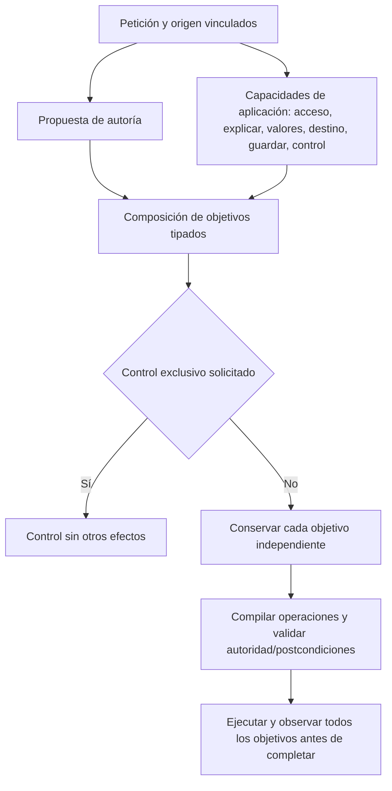

# Propiedad de capacidades semánticas — candidato rechazado

Estado: **RECHAZADO y retirado del recorrido activo**. Se ejecutaron componente, UI y los dieciséis casos de desarrollo. Pasar regresiones deterministas no bastó: el modelo emitió efectos extra. Fuentes/tests del candidato y resultados se conservaron; se mantiene la mejora independiente de editor y la política de modelos por instancia. No se cierra ningún criterio AI/AUT por este incremento.

Observado en la comparación local: el caso de desarrollo 10 obtuvo `VIEW_UNCHANGED` en la etapa de workflow, pero la clasificación de texto produjo `ADVICE_REQUEST`. `SemanticStageComposition.Compose` retorna inmediatamente para `EXPLANATION_WITHOUT_PROPOSAL` y descarta acceso, valores, ejecución, guardado y control ya interpretados. El defecto de composición se puede reproducir sin LLM y afecta combinaciones, no una frase concreta. No se atribuyen a esto los demás fallos de referencia/autoría, ni se alteran expectativas del corpus.

Hay además dos propietarios de una decisión de aplicación: el clasificador de texto elige consejo/explicación y workflow elige navegación. El primero debe describir exclusivamente autoría; una explicación es otra capacidad de uso del sistema. Mantener ambas autoridades y añadir instrucciones por cada negación perpetuaría la contradicción.

Contrato que se implementó para evaluación, después retirado:

- `SemanticTextGoal` conserva únicamente la propuesta de contenido: sin cambio, revisión o nueva instrucción. El resultado legado de consejo se admite mediante adaptación compatible, sin poder borrar otra capacidad.
- Workflow posee acceso, explicación, valores, destino, guardado y control; la explicación es una dimensión independiente para poder abrir y explicar, o modificar y explicar. Se preserva por petición al cargar/refinar un origen, como los demás objetivos de aplicación.
- `SemanticStageComposition` compone los ejes, sin leer palabras de la petición. Un resultado de contenido no suprime otro objetivo. Los controles conservan su exclusividad de dominio y no autorizan efectos.
- `SemanticDecision`/compilador transportan una explicación solicitada como `EXPLAIN`, sin sustituir otro objetivo autorizado. El modelo no concede permisos y los validadores de identidad/revisión/efectos permanecen.
- La nueva marca explícita de explicación de workflow prevalece sobre el resultado legado de texto; ausencia de la marca mantiene compatibilidad con consumidores antiguos. El contrato privado del modelo la exige, por lo que no hay dos propietarios en el recorrido nuevo.

Alternativas: ignorar todas las respuestas de consejo perdería preguntas reales; pedir otro revisor añadiría latencia y otra autoridad; unificar todo en un prompt monolítico repetiría candidatos rechazados. Se extienden los ejes y el compilador existentes, sin nuevo planificador ni rutas por frase.



```text
interpretar contenido sin decidir navegación/explicación
interpretar workflow con explicación explícita e independiente
al componer: conservar dimensiones; un eje no elimina otros
si hay control: aplicar invariantes de exclusividad y no conceder efectos nuevos
compilar EXPLAIN sólo por el propietario de workflow (o adaptación legada explícita)
preservar objetivos iniciales al refinar el origen; no inferir permisos de sus datos
validar combinaciones y exclusiones sin reglas sobre frases o palabras
```

Gate: regresiones deterministas de composición para lectura, campos, preparación, ejecución, guardado y control; contratos de transporte con oráculos de usuario conservados; desarrollo completo con modelo real; después validación independiente y UI. El candidato no se conserva por pasar sólo las pruebas de componente. No se modifica el holdout ni se mezclan resultados de builds diferentes.

Compatibilidad y autorización: existe una prueba anterior que exige que un consejo legado no herede ejecución/guardado. Se conserva esa protección y su aserción. La nueva marca nullable distingue al propietario nuevo de workflow del adaptador legado: sólo una marca explícita permite componer sus ejes; una marca ausente mantiene el resultado de consejo conservador. Los siete controles iniciales se refinan para declarar esa nueva entrada explícita, no para eliminar la aserción de seguridad antigua. El cambio de los fixtures de transporte sólo añade `explain:false` a objetivos ya existentes y elimina el valor privado ADVICE_REQUEST del contrato de autoría; los objetivos/expectativas de usuario se mantienen.

La ejecución visible también debe comprobar la explicación en el recorrido normal, no sólo con el contrato experimental TaskGoal. Una combinación de lectura y explicación usa el responder existente sobre el origen observado; si falta esa capacidad requerida, termina FAILED con EXPLANATION_UNAVAILABLE, sin éxito fingido ni efectos extra. El refinamiento considera terminal el resultado de consejo puro, no cualquier plan que incluya EXPLAIN. No se habilita TaskGoal experimental.

El predicado de consejo puro pertenece al mismo workflow tipado. Sólo ese caso genera una respuesta durante interpretación; una explicación compuesta se responde una vez después de observar sus prerrequisitos reales. Esto elimina la consulta duplicada previa sin omitir verificación, revisar frases ni mantener respuestas anteriores como autoridad.

La declaración de acceso también distingue resultado visible y lectura interna: el texto previo decía “opens or reads”, lo que podía convertir leer una fuente para responder en permiso para navegar. El esquema reutiliza descripciones de SEARCH_PROMPT/OPEN_PROMPT/COPY_PROMPT del catálogo reflejado y exige un resultado de acceso solicitado. Identificar una fuente no concede efectos de UI. Los prerrequisitos siguen a cargo del compilador y del resolver existentes.

Primer control de transporte: 61/80 PASS y 19 fallos por cinco replies JSON literales que todavía omitían el nuevo boolean requerido; se conserva `explanation-ownership-first.trx`. Se migran esos paquetes privados sin cambiar expectativas. El siguiente control dio 83/84 PASS: una aserción esperaba BLOCKED ante capacidad ausente; el contrato operativo implementado es FAILED, conservando error explícito y cero mutaciones. Se corrige esa expectativa de estado, no el comportamiento para ocultar la ausencia.

## Verificación del candidato v2

Regresión backend completa: **636/636 PASS**, cero omitidas (`tests/backend-explanation-owner-final.trx`); legacy **151/151 PASS** (`tests/legacy-model-policy.trx`); React **136/136 PASS** (`tests/react-editor-parity-complete.json`). Son controles de contratos y comportamiento determinista, no precisión del modelo. Los ensamblados compartidos del evaluador/API se identificarán por hashes junto a la campaña real.

Edge real, API y SQLite sintética: [21 recorridos manuales PASS del candidato v2](../evidence/closure-20261020/versions-1792463590976/results.json), sin Ollama ni peticiones externas. Cubren versiones, intercambio, operaciones retardadas e historial del editor; no son 21 peticiones de NOVA.

La [petición libre con Qwen3 8B](../evidence/closure-20261020/versions-1792463747244/results.json) **FALLA**. Se pidió abrir «Guía de hallazgos del laboratorio» y explicar su uso, sin modificar ni ejecutar. Tras 128.080 ms, el run declaró COMPLETED y produjo una explicación, pero también abrió el editor y generó una adaptación no solicitada. La captura `failure.png` muestra el borrador cambiado y el original sin guardar. El timeout posterior del arnés al buscar `prompt-focus` es consecuencia de esa navegación incorrecta, no la causa del defecto. No se interpreta COMPLETED como éxito ni se sustituye por una expectativa permisiva. La comprobación posterior de persistencia de ese arnés quedó sin ejecutar al fallar el control de pantalla.

La composición independiente evita que un eje borre otro, pero no demuestra que sus entradas sean correctas. En la campaña de desarrollo v2, el caso 02 ya conserva una primera divergencia: `ReviewAuthoringScope` devuelve objeto INSTRUCTION_ARTIFACT / postura REQUESTED para una petición de encontrar una instrucción; el clasificador posterior inventa una revisión y la composición la conserva. El contrato objeto/postura no representa explícitamente qué operación se solicita sobre ese objeto. Esto es una hipótesis causal de representación para contrastar, no una solución implementada ni prueba de que todas las equivocaciones compartan causa. Los casos de referencia que toman el cambio deseado como nombre de fuente siguen abiertos por separado. No se añadieron rutas por palabras, reglas por estos títulos, otra revisión en cadena ni excepciones a las prohibiciones.

## Decisión tras la tanda completa

[Desarrollo v2](../evidence/closure-20261020/development-explanation-owner-v2.json): intención **11/16**, destino **14/16**, cuatro planes con efectos extra y **tres planes con efectos prohibidos**; ningún efecto ejecutado en esta campaña de planificación. Los casos 02/09/16 inventaron adaptación; 05/14 conservaron los fallos de fuente. No se ejecutó validation ni holdout sobre un candidato que ya falló. No se atribuye toda variación de Qwen a una línea de código ni se presenta esto como mejora.

Se archivó el candidato en `.playwright/closure-20261020/rejected-explanation-owner-v2-sources`, incluyendo el manifiesto de retirada, y se retiraron sus cambios de contrato/composición/ejecución y sus fixtures específicos. El contrato privado anterior de `SemanticInference.cs` se reconstruyó desde el snapshot conservado, aplicando únicamente la política de modelos por instancia ya probada. Se conservaron las regresiones anteriores, el editor y los controles de modelo. La suite del código conservado pasa **621/621**, cero omitidas (`tests/backend-retained-after-qualification.trx`); el descenso desde 636 corresponde a quince pruebas del experimento archivado, no a eliminar fallos antiguos para obtener PASS. La versión permanece abierta y las dos causas siguen pendientes.
