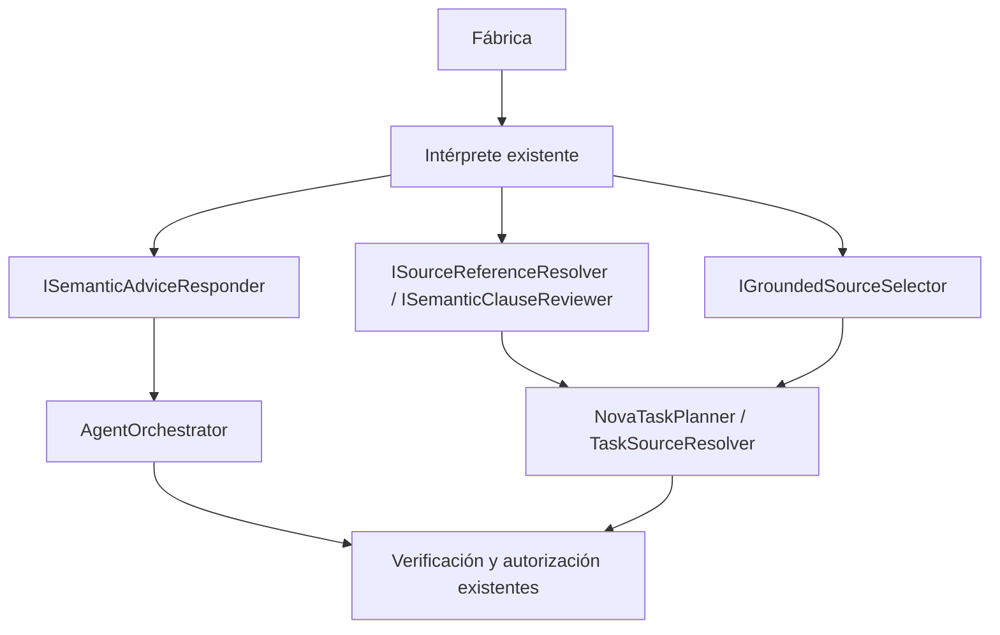

# Conexión explícita de capacidades semánticas

## Auditoría y contrato de cambio

Observado: SemanticIntentInterpreter implementa explicación, selección contextual,
referencias y revisión de cláusulas. La fábrica sólo registra sus tres interfaces
principales. AgentOrchestrator busca explicación por casts del generador/modelo UI;
TaskSourceResolver busca selección contextual por cast de ICandidateSelector.
Los proveedores separados no implementan esas capacidades. Comprobar un método del
intérprete aisladamente no prueba que el workflow llegue a él.

Propietario: el intérprete conserva sus algoritmos; planificador, resolvedor y
ejecutor conservan estado/autorización. No se crea otra implementación ni árbitro.
La alternativa de añadir métodos al generador o selector mezclaría responsabilidades;
volver a usar la fachada conjunta anularía el aislamiento. Se eligen interfaces
existentes, parámetros opcionales finales y alias DI a la instancia existente.

Invariantes: petición/fuente/revisión se conservan; evidencia/IDs y subset de
cláusulas se validan igual; cancelación propagada; sin escritura ni aprobación
por explicar/seleccionar. Sin nuevos reintentos, paquetes o permisos. Composición
explícita prevalece; compatibilidad de proveedores antiguos se resuelve una vez
al construir, nunca seleccionando intención por texto o similitud.

Entradas: interfaces existentes de explicación, referencia, revisión y selección.
Salidas: mismos contratos Task/plan y errores. Dependencias prestadas; el consumidor
no dispone el proveedor. Ausencia opcional conserva el comportamiento compatible;
la fábrica productiva registra todas las capacidades existentes del intérprete.



```text
registrar alias hacia el propietario semántico compartido
inyectar cada interfaz en su consumidor
si no se suministra, resolver compatibilidad del proveedor antiguo al construir
ejecutor pide explicación por su puerto, sin exigirla al generador/UI
resolvedor pide selección/revisión/referencia por sus puertos
conservar validaciones, cancelación y efectos originales
probar fábrica real con proveedores separados y otros proveedores prohibidos
```

Aceptación: reproducir alias ausentes; recorrer explicación manual/visible y
selección contextual con puertos separados; comprobar prioridad, errores,
cancelación, identidades/revisiones y ausencia de generación/efectos. Ejecutar
cohorte backend afectada y builds web con provenance. Modelo real y UI son gates
separados: pruebas controladas no acreditan fidelidad general ni latencia.

Compatibilidad: parámetros finales opcionales conservan fuentes existentes;
requieren recompilar consumidores .NET de estos constructores. Sin cambio JSON,
BD ni configuración. Rollback conjunto desde el archivo before.json; conservar
fallos. Alcance web; MAUI excluido. Estado: IMPLEMENTADO y verificado en su alcance.

## Resultado ejecutado

La fábrica registra los cuatro alias hacia la misma instancia del intérprete.
El ejecutor recibe ISemanticAdviceResponder; el planificador transmite los otros
tres puertos al resolvedor. Los casts de compatibilidad quedan en construcción o
entrada del recorrido visible; los algoritmos internos usan los puertos resueltos.
No se trasladó explicación al generador/UI ni selección contextual al selector
básico. No cambian instrucciones, schemas, revisión final o permisos de aprobación.

- La fábrica original falla sus cuatro comprobaciones de alias ausentes.
- Los mismos **17 tests compilados** fallan contra los cores anteriores y pasan
  contra los corregidos, sin recompilar ni cambiar el workspace para esa comparación.
  Incluyen ambos ejecutores, referencia, selección, revisión, cancelación y errores.
- **388/388 pruebas backend dirigidas** en 19 clases PASS, cero omitidas; 19 casos
  nuevos. Dos casos adicionales recorren ejecutor → intérprete real registrado →
  transporte validado con respuesta controlada, sin generador/fachada/control UI.
- Se rechazan ID ajeno, revisión cambiada y contenido inventado; fallos/cancelación
  de explicación no terminan en éxito ni escriben prompts. Las dependencias reciben
  petición/contexto y token cancelable; ausencia compatible conserva su semántica.
- **15 controles Edge/HTTP** PASS en host normal, módulo desactivado y proveedor
  sustituido; CRUD, revisiones, cancelar/eliminar y error visible conservados. Perfil
  QA actualizado con los cuatro puertos; probe sólo de significado los deja ausentes
  y mantiene traps contra construir el intérprete/fachada/transporte productivos.
- API, Blazor y evaluador compilan sin advertencias/errores; DLL comunes idénticas
  a las probadas. 26 controles estáticos PASS. Contrato público de 75 operaciones
  y matriz canónica idénticos por SHA256.

El primer fixture ampliado no compiló: usaba un método List inexistente y capturaba
un parámetro dos veces. Corregido usando Templates existente y el campo Current;
logs originales conservados. Las primeras cuatro faltas de registro y los 17
fallos de workflow se conservan como regresión reproducible.

[Verificación y provenance](../evidence/semantic-capability-wiring-20261020/verification.json).
[Recorrido Edge](../evidence/module-host-ui-1792537522004/results.json).
La captura disabled-agent-visible-error.png se inspeccionó: error explícito dentro
del panel NOVA y formulario/datos conservados.

Estas pruebas demuestran conexión/efectos de capacidades con respuestas controladas,
no comprensión Qwen ni fidelidad general de autoría. No se repitió una campaña
frontend unitaria ajena al cambio. Sin nuevos modelos, dependencias o datos privados;
servicios personales sin reiniciar. Versión abierta, 34 cerrados/54 abiertos.
