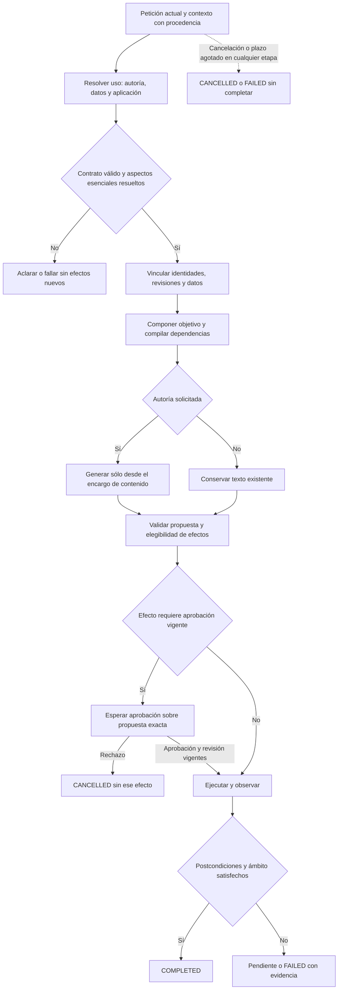

# Composición del contrato semántico de NOVA

Fecha: 2026-10-20, America/La_Paz. Estado: **PROPUESTA, SIN IMPLEMENTACIÓN NI ACEPTACIÓN SEMÁNTICA**.

Esta consulta es de análisis. No cambia producto, configuración, modelo, API, base de datos ni estado de la matriz. El diseño sigue Universal Modular Architecture, Algorithmic Engineering y Adaptive AI Systems. Los nombres de contratos que no existen se indican como propuestos.

## Diagnóstico basado en evidencia

El límite extraído en `InstructionUseInference.cs` permite sustituir una capacidad dentro de `PreparationInference`. Aún contiene decisiones sucesivas de objeto/postura, `ContentRequest`, aplicación de inputs y, después, identidad del artefacto. Separar el archivo no convierte esas decisiones en una interpretación única ni en una garantía de intención correcta.

Hechos observados:

1. El [contraste de contrato v2](../evidence/closure-20261020/instruction-use-contract-v2-verification.json) obtuvo autoría correcta en 19/19 casos adjudicados y cero contratos inválidos, pero añadió llenado no solicitado en cuatro: 15/19 al considerar ambos ejes. No evaluó el plan completo ni la UI. No se incorporó.
2. La [variante de contexto reducido en UI/Qwen](../evidence/latency-1792468519192/measurements.json) obtuvo 0/3 tareas correctas. Dos terminaron `COMPLETED` con adaptación no pedida; creación se bloqueó. Fue retirada. Ocultar el cuerpo no resolvió la interpretación.
3. En el código conservado, `GoalOnlyData` distingue directiva y `workingInstructionData`, pero la separación es conocimiento para un modelo probabilístico. Una cita literal válida tampoco demuestra que el usuario pidiera esa operación sobre ese objeto.
4. `SemanticStageComposition.Compose` todavía retorna inmediatamente para `EXPLANATION_WITHOUT_PROPOSAL`, descartando otros objetivos de workflow. La corrección anterior de composición se retiró porque el candidato completo seguía fallando; no debe recuperarse como solución ya validada.
5. `TaskGoal` ya distingue efectos solicitados, dependencias, prohibiciones y postcondiciones. Su presencia es opcional en `SemanticInterpretation`. El generador usa `Goal.ContentRequest` cuando existe; sin él conserva rutas con `TaskRequest` o `Message`. Por tanto, no hay una frontera de contenido obligatoria y uniforme en todas las rutas semánticas.
6. El [candidato conservado](../evidence/closure-20261020/candidate-instruction-use-retained/verification.json) acredita comprobaciones mecánicas, incluidas 639 pruebas backend. No acredita una campaña semántica final del agente.

Conclusión: hay un problema de contrato entre intención, contenido y efectos, además del error probabilístico de interpretación. El generador puede recibir una orden de sesión que todavía necesita separar; el compositor puede perder objetivos; comprobar el plan ejecutado no descubre por sí mismo que el plan interpretó mal al usuario. No se atribuyen todos los fallos a una sola línea ni se afirma que estos límites eliminen la incertidumbre del modelo.

## Decisión y alternativas

**A. Extender las clasificaciones actuales sin cambiar su contrato.** Es el menor cambio textual, pero mantiene decisiones repetidas y reparaciones compensatorias. No resuelve la propiedad del significado.

**B. Establecer contratos internos por capacidad y componerlos en los propietarios existentes. Elegida como dirección de implementación.** Se mantiene el monolito modular y se sustituye una decisión cada vez. La cantidad de responsabilidades no impone una cantidad de llamadas al LLM, procesos, servicios o interfaces nuevas.

**C. Crear otro planificador, framework, base vectorial o cadena de revisores.** No hay evidencia de que sean necesarios para este defecto. Retrieval ayuda a localizar contexto; reflection describe operaciones reales. Ninguno demuestra que una acción estuviera solicitada. Los revisores adicionales también han fallado y añaden latencia.

La propuesta tiene seis bloques lógicos de ejecución. Todos tienen un propietario existente; no propone seis servicios nuevos.

| Bloque | Propietario existente | Entrada → salida | Límite de responsabilidad |
| --- | --- | --- | --- |
| 1. Contexto y vinculación | `TaskConversationContext`, `AgentSessions`, `TaskSourceResolver`, `UserInputScope` | Petición actual, estado y referencias → contexto con identidad, revisión, procedencia y ámbitos | Distinguir borrador, registro, datos y tarea pendiente; no otorgar operaciones por recuperar un documento |
| 2. Interpretación de uso | `PreparationInference`, incluida `InstructionUseInference` | Directiva y contexto pertinente → decisiones de autoría, aplicación de datos y acciones, con incertidumbre explícita | Un propietario por decisión; ningún generador, árbitro posterior o resumen puede añadir intenciones |
| 3. Vinculación y composición | `GroundedVariableResolver`, `SemanticStageComposition`, `SemanticPlanCompiler`, `TaskGoal` | Decisiones + fuentes/valores vinculados → objetivo de ejecución y plan con dependencias | Validar referencias y valores; conservar ejes; añadir prerrequisitos de dominio sin inventar efectos solicitados |
| 4. Producción de contenido | `PromptPreparationPipeline`, `IPromptGenerator`, `PreparationInference.GenerateCore` | Encargo de contenido y fuente autorizada → propuesta de texto | Crear/adaptar únicamente cuando se solicita; no decidir guardar, ejecutar, llenar o navegar |
| 5. Ejecución autorizada | `AgentOrchestrator.Visible`, catálogo de herramientas, servicios de dominio y `AgentUiDriver` | Plan + estado actual + aprobación aplicable → acciones y recibos | Validar elegibilidad, revisión, permisos e idempotencia antes de efectos; observar el control real |
| 6. Cierre de tarea | `GoalCompletionValidator` y estado de ejecución existente | Objetivo, plan, observaciones y recibos → completo, pendiente, cancelado o fallo | Exigir todos los resultados requeridos y ausencia de efectos sobrantes; no completar por acabar una lista de pasos |

La evaluación de calidad es una puerta externa a estos bloques, propiedad del evaluador existente. No se añade otro crítico de ejecución para que vote sobre la intención.

## Contratos que deben encajar

### Entrada: procedencia y ámbito

Extender el contexto existente, sin otro almacén de sesión. Conservar petición original y referencias a fragmentos; las proyecciones no deben perder su correspondencia con el original. Cada elemento necesita origen, identidad/revisión cuando aplique, ámbito y vigencia.

La directiva actual, la tarea pendiente expresamente vinculada, el cuerpo de un prompt, un valor de campo y una observación son clases distintas de información. Un cuerpo o valor puede ser necesario para comprender el objetivo, pero no puede convertirse en una orden actual de la aplicación. No repetir la hipótesis rechazada de que retirar todos los cuerpos basta para resolverlo.

### Interpretación: tres responsabilidades, sin decisiones duplicadas

Los siguientes son **contratos internos propuestos**, no DTO públicos ni clases que ya existan:

```text
AuthoringUse =
    KeepText
  | Revise(targetReference, contentSpecification)
  | Create(sourceRole, identityIntent, contentSpecification)
  | NeedsClarification(question, unresolvedAspect)

InputUse = NotRequested | Apply(bindingReferences) | Prohibited

ApplicationUse = {
    requestedOperations, prohibitedOperations,
    targetReference, destinationReference, evidenceReferences
}

ContentSpecification = {
    taskForFutureAssistant, contentConstraints,
    artifactMetadata, evidenceReferences
}
```

`AuthoringUse` pertenece a la capacidad de uso de instrucciones. La identidad revisión/artefacto distinto debe formar parte de esa decisión, no de otra inferencia posterior que pueda sustituirla silenciosamente. `InputUse` tiene un único propietario de intención de aplicación; `UserInputScope` y el resolvedor conservan la extracción/vinculación de valores. `ApplicationUse` pertenece a workflow; explicación debe poder coexistir con apertura u otros efectos permitidos.

Cada efecto solicitado o prohibido debe referirse a evidencia de la petición actual o de la única tarea pendiente vinculada. La aplicación comprueba procedencia, pertenencia y coherencia; la interpretación del significado sigue siendo probabilística. No usar un número de confianza declarado por el modelo como autorización. Una ambigüedad esencial produce una pregunta que suspenda efectos, no una operación elegida por similitud.

Para separar autoría y workflow, el contrato debe poder representar **a quién se dirige una instrucción y sobre qué objeto actúa**. Por ejemplo, una restricción sobre lo que hará el futuro asistente pertenece al contenido; una orden de guardar el registro pertenece a la aplicación. No eliminar verbos o negaciones mediante listas o regex. El mismo fragmento puede aportar varias relaciones semánticas; no obligar a partir toda la petición en segmentos mutuamente excluyentes.

No promover directamente el contrato conjunto que acertó autoría y falló inputs. El primer reemplazo debe limitarse a autoría/identidad; aplicación de datos y workflow conservan sus propietarios mientras se valida la composición completa. Esto es una estrategia de aislamiento, no una predicción de éxito de ese reemplazo.

### Objetivo y plan: intención distinta de dependencia

Reutilizar `SemanticObjectives`, `SemanticMeaning`, `SemanticInterpretation` y `TaskGoal`; extenderlos sólo donde no puedan representar estos ejes. No mantener un segundo plan mutable ni otro registro de aprobación.

El compilador recibe decisiones y añade las dependencias requeridas por las capacidades existentes. Por ejemplo, copiar requiere texto compilado; no requiere autoría. `KeepText` no elimina llenar, explicar, copiar o preparar destino. Una explicación no borra abrir. Una revisión tampoco concede llenado, guardado o ejecución. Las combinaciones contradictorias se rechazan o se aclaran según las reglas de dominio existentes.

El objetivo conserva efectos raíz, dependencias, restricciones, origen/revisión, ámbito de valores y postcondiciones. El generador no puede ampliarlo. En la ruta sustituida debe ser obligatorio antes de generar o ejecutar efectos: construirlo después de ejecutar no sirve para detectar divergencias.

`TaskGoal` procede de una interpretación y no es un oráculo independiente de lenguaje natural. Puede proteger contra deriva entre interpretación, plan y ejecución; no puede demostrar que la interpretación inicial era verdadera. Eso se mide con peticiones y oráculos externos, y se reduce aclarando ambigüedades esenciales.

### Encargo de contenido: frontera obligatoria del generador

La creación/adaptación debe consumir `ContentSpecification`, fuente vinculada y restricciones de contenido; nunca recuperar la orden completa como fallback silencioso en la ruta nueva. El título/metadatos se mantienen fuera del cuerpo reutilizable. La intención de guardar/no ejecutar pertenece al objetivo de aplicación cuando su destinatario sea NOVA.

El generador devuelve contenido y metadatos, sin permisos ni operaciones nuevas. Las comprobaciones estructurales se mantienen; la fidelidad semántica se evalúa sin confundirla con un esquema válido. Un encargo insuficiente requiere aclaración antes de generar. Las rutas legacy sólo conservan compatibilidad por adaptación explícita y no cuentan como prueba del contrato nuevo.

### Efectos y cierre

La aprobación sigue ligada a la propuesta/revisión exacta y al propietario actual. Un modelo, un documento, un resultado de búsqueda o un acierto anterior no puede concederla. Se revalida estado al reanudar; datos de una fuente no se aplican a otra ni a otro borrador por coincidencia de nombres.

Antes de `COMPLETED`, el verificador debe comprobar las postcondiciones y los recibos correspondientes a los efectos exigidos, más la ausencia de efectos observables fuera del ámbito. Cuando el contrato no exista, falte un resultado o haya divergencia, la ruta nueva no puede usar el cierre legado como fallback. La detección de efectos extra debe apoyarse en catálogo/recibos/estado, no en volver a preguntar al modelo si terminó bien.

## Algoritmo propuesto



La aprobación se aplica al efecto protegido cuando le corresponde; no exige aprobar lecturas ni llenado de campos. El diagrama resume etapas; no prescribe una llamada adicional al modelo por nodo.

```text
entrada: petición original, sesión, referencias UI, cancelación y presupuesto existente
salida: tarea completada, esperando aclaración/aprobación, cancelada o fallida

restaurar contexto en sus propietarios y verificar procedencia/vigencia
usar LiveCommand validado cuando el usuario eligió una acción explícita
para texto libre, interpretar cada dimensión en su propietario único
validar forma, evidencia y coherencia; sin respuesta válida, detener sin nuevos efectos
si falta una referencia o decisión esencial, preguntar y guardar sólo el estado pendiente
vincular fuente/revisión y valores mediante los propietarios existentes
componer objetivo y plan; añadir únicamente dependencias del dominio
si se requiere autoría, generar desde el encargo de contenido y validar la propuesta
para cada paso elegible dentro del presupuesto:
    comprobar cancelación, revisión vigente y autoridad requerida
    si necesita aprobación, suspender hasta decisión explícita válida
    ejecutar mediante herramienta existente y observar resultado real
    registrar recibo; ante error, aplicar sólo la recuperación acotada permitida
comprobar objetivo, postcondiciones y ausencia de efectos extra
si falta algo, conservar pendiente/fallo; no emitir COMPLETED
```

Errores de esquema y referencias inválidas no autorizan efectos. Conflicto de revisión exige recargar/confirmar el contexto; no reintentar una escritura sobre otra revisión. Cancelación se propaga a inferencia, herramientas y espera de aprobación. No ampliar presupuestos ni encadenar árbitros hasta obtener una respuesta aceptable. Los recibos/logs no deben exponer el paquete privado ni bloquear el camino crítico de ejecución.

## Un recorrido que prueba el encaje

Sobre un prompt real con campos, solicitar completar valores y copiar manteniendo el texto debe producir:

```text
AuthoringUse = KeepText
InputUse = Apply(referencias a valores literales y campos existentes)
ApplicationUse = COPY_PROMPT, sin autoría/guardado/ejecución solicitados

resolver origen y revisión -> llenar -> compilar -> preparar/copiar según contrato UI
-> comprobar campos, preview/texto y recibos correspondientes
```

El cuerpo y la identidad original no cambian; el generador no se invoca. En una petición que sí solicite adaptar además de llenar/copiar, deben conservarse todos los objetivos: no vale suprimir autoría siempre que aparezcan datos. Crear un prompt con una restricción sustantiva para el futuro asistente debe conservar esa restricción, aunque la sesión también prohíba ejecutarlo o pida guardar tras aprobación.

Estos son contratos de capacidades para los fallos existentes, no nuevas rutas por frases. No se afirma que ya pasen con la propuesta.

## Incrementos, compatibilidad y aceptación

1. **Fijar el contrato de sustitución y sus consumidores.** Mapear campos actuales a los tres ejes, las referencias y el encargo. Conservar oráculos, corpus, presupuestos y fallos originales. El catálogo reflejado sigue siendo la fuente de capacidades; no duplicar sus descripciones en otra autoridad.
2. **Sustituir autoría/identidad en una sección vertical.** Usar la frontera actual `InterpretInstructionUse`; hacer que autoría/identidad tengan una sola decisión consumida por compilador y generador. Retirar sus reclasificaciones antiguas sólo de la ruta nueva. Dejar aplicación de datos y workflow en sus propietarios. No integrar el prototipo conjunto rechazado ni ajustar por fila.
3. **Completar composición y encargo obligatorio.** Transportar las decisiones hasta `TaskGoal` y generación, sin pérdida de ejes ni fallback a la petición completa. Verificar determinísticamente combinaciones, aislamiento y postcondiciones; después usar los fallos existentes con Qwen/UI real en ese mismo candidato. Un acierto aislado no autoriza promoción.
4. **Calificar el conjunto antes de validar independientemente.** Repetir los recorridos conocidos de completar/copiar, creación y continuación, abrir/explicar, aprobación/guardado, rechazo/cancelación y cambios de revisión dentro de las campañas existentes. Conservar dimensiones incorrectas aunque otra mejore. Fallo relevante impide la promoción; sin tuning sobre validation/holdout.
5. **Aceptar calidad y rapidez en el candidato final.** Aplicar development → validation → holdout congelados y los controles operativos ya pendientes. Medir latencia de tareas correctas, frío/caliente, llamadas por etapa, recursos y esperas humanas por separado. No presentar rapidez de un fallo como mejora.

Archivos previstos: `InstructionUseInference.cs` y coordinación en `SemanticInference.cs`; contratos/composición/compilador en Application; paso del encargo en `PreparationInference.GenerateCore`/`PromptPreparationPipeline`; cierre en `AgentOrchestrator.Visible`/`TaskGoal`. Los propietarios de fuentes, valores, sesiones, aprobaciones y UI sólo se extienden cuando el contrato lo necesite. Este inventario es una previsión de integración, no archivos modificados en esta consulta.

Compatibilidad: mantener API/UI y SQLite mientras se sustituye el contrato privado. Inventariar fixtures y llamadas antes de cambiarlo; no imponer una interfaz pública nueva sólo por el diagrama. Desactivar el generador debe impedir crear/adaptar y permitir operaciones ajenas que no lo necesiten. Si falta el intérprete requerido, el texto libre falla de forma explícita; las acciones rápidas tipadas mantienen su camino validado cuando sean independientes. Rollback por candidato completo identificado, sin mezclar resultados semánticos ni compartir aprobaciones entre rutas. No activar un fallback silencioso al intérprete antiguo tras rechazos del nuevo.

Pruebas necesarias: contratos deterministas de cada eje y sus combinaciones; sustitución del adaptador sin cambiar invariantes; aislamiento del generador en llenar/copiar; IDs/revisiones/valores ligados; interrupción/reanudación y aprobación exacta; integración real del planificador y UI con Qwen. El criterio final compara peticiones originales y oráculos externos con efectos y contenido observados, no sólo la consistencia interna del plan.

Se mantienen los umbrales existentes: intención ≥90%; planes/destino/finalización/herramientas ≥95%; fidelidad/éxito/metamórficas ≥90%; cero contaminación, efectos no autorizados, IDs inventados aceptados y cierre prematuro. Los objetivos de latencia se fijan tras los tres baselines comparables previstos; no inventar ahora una cifra ni rebajar la matriz.

## Estado de esta consulta

Ejecutado: lectura de código activo, contratos y evidencia conservada; análisis de propietarios y composición. Documento de diseño añadido. No se ejecutaron nuevas inferencias, UI, suites, benchmarks ni gate de cierre. Las cifras anteriores son evidencia histórica consultada, no resultados obtenidos en esta consulta.

La [matriz vigente](VERSION_CLOSURE_MATRIX.md) sigue con 29/88 requisitos cerrados y 59 abiertos; no mide porcentaje de fiabilidad ni esfuerzo restante. Este diseño aborda la frontera semántica que bloquea varias familias del agente. La versión sólo se cierra al satisfacer todos sus requisitos obligatorios con evidencia del candidato final. No se ofrece una garantía de comprensión de cualquier petición libre.
