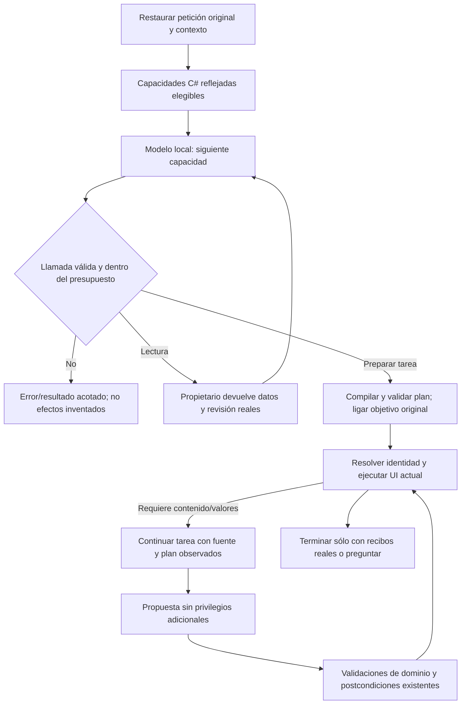

# Sustitución del núcleo semántico

2026-10-20. **CANDIDATO NO CUALIFICADO; NO CONECTADO A LA API.** Los cuatro casos de desarrollo probados fallan antes y después de la corrección acotada de protocolo. Se retiró el archivo posterior que duplicaba capacidades por acción. Dirección vigente: [arquitectura de agente de producción](PRODUCTION_AGENT_ARCHITECTURE.md), reutilizar catálogo/ejecutores reales y contexto, sin otro registro de intenciones. El diseño inferior conserva el historial del prototipo; no describe una sustitución ya aceptada ni la nueva decisión.

## Diagnóstico y decisión

La composición actual entrega interpretación, generación, extracción y selección a PreparationInference. Su interpretación encadena referencia, destino, alcance, autoría, workflow, restricciones y reparaciones; cada consulta vuelve a reconstruir parte de la petición. No hay observaciones de herramientas compartidas entre interpretación y contenido. Los controles estructurales verdes no corrigieron fidelidad.

Se extienden las interfaces existentes con ReflectedSemanticAgent en Infrastructure y el registro PreparationTools. No se introduce framework, otro árbitro, modelo, paquete ni clasificador por palabras. Frente a añadir otra estrategia al árbol legacy o un nuevo workflow paralelo, se elige sustituir las implementaciones registradas. El adaptador local y el ejecutor UI se conservan.

Prácticas consultadas: [contexto selectivo, instrucciones separadas y recursos con procedencia](https://www.anthropic.com/engineering/effective-context-engineering-for-ai-agents), [herramientas con propósito y resultados útiles](https://www.anthropic.com/engineering/writing-tools-for-agents), [conversación de herramientas de Ollama](https://docs.ollama.com/capabilities/tool-calling). Son criterios de diseño; su eficacia en Qwen requiere ejecución propia. No se transforma la petición humana en un resumen autoritativo: se conserva literalmente y se aportan contexto y funciones tipadas.

## Propietarios y contratos

| Capacidad | Propietario |
|---|---|
| Petición original, sesión, borrador, continuación | AgentSessions / TaskConversationContext / TaskGoal |
| Inferencia con observaciones y herramientas generadas | ReflectedSemanticAgent, adaptador HTTP local existente |
| Búsqueda y lectura real | IPromptRetriever / PromptLibrary; los scores nunca conceden identidad |
| Plan, dependencias y autorización | SemanticPlanCompiler / SemanticPlanValidator |
| Esquemas e invocaciones reflejadas | ReflectedPreparationToolFactory / PreparationTools |
| Propuesta, valores y compilación | IPromptGenerator / IInputValueExtractor / canalización de dominio existentes |
| Efectos visibles, aprobación, revisiones y recibos | AgentOrchestrator / dispatcher actual; sin cambios de autoridad |

Entradas: texto humano original, contexto tipado restaurado, modelo local permitido. Resultados: plan compilado o aclaración; después propuesta de instrucción o valores con evidencia literal. Las lecturas observadas son metadatos internos del proceso, ignorados en JSON público, nunca IDs aportados libremente como autoridad. Se revalida la revisión al resolver/ejecutar.

Conversación: una tarea ligada a GoalId conserva mensajes originales y resultados de herramientas; almacén temporal acotado por cantidad/edad, sin persistencia ni historial global. El contenido recibe el plan y la fuente vigente; no puede modificar los efectos ya decididos. Datos de campos y contenido de fuentes no son instrucciones de sistema. Una llamada de herramienta no equivale a guardado ni aprobación.

## Flujo



```text
restaurar contexto y conservar petición literal
crear registro sólo con proveedores autorizados y esquemas SDK
mientras queden llamadas, pasos y tiempo:
    enviar conversación, recursos pertinentes y capacidades elegibles
    conservar respuesta de asistente y tool_calls en la misma tarea
    validar e invocar capacidad mediante ejecutor común
    incorporar resultado/error real, nunca elevar datos a autoridad
    si preparó tarea: compilar, validar y ligar GoalId; devolver plan
resolver fuente/revisión con propietario existente
si requiere contenido o valores: continuar tarea con observaciones actuales
validar propuesta, compilar, aplicar UI y exigir postcondiciones reales
si falta dato esencial: suspender con pregunta; no inventar ni usar fallback legacy
```

## Invariantes y verificación prevista

Sin cambios de API HTTP, SQLite, aprobación ni destinos. El modelo no selecciona tipos CLR, permisos, SQL ni JS. Límites de turnos/pasos/bytes/tiempo y cancelación; errores no producen éxito. El contenido no amplía operaciones. La ausencia de lectura válida no autoriza una identidad; revisión obsoleta cancela el efecto. Los datos no otorgan ejecución o borrado.

Contratos controlados: misma conversación y petición completa; observaciones antes de decisiones; herramientas inválidas, presupuestos, cancelación; IDs ajenos y versiones cambiadas; generación con operación/fuente fijadas; valores exactos; contexto entre tareas aislado. Pruebas reales: desarrollo de interpretación/autoría y completar/copiar con Qwen; UI del mismo build tras calificar desarrollo. Fallos conservados, sin abrir holdout ni alterar criterios.

Retirada: cambiar composición de las interfaces de interpretación/contenido/valores/selección, quitar los selectores semánticos de la composición API. El código histórico de PreparationInference usado por evaluaciones anteriores se conserva identificable para no destruir evidencia; no se ofrece como fallback. Su transporte y decisión UI finita siguen siendo reutilizables. No afirmar que se eliminaron físicamente esos archivos ni que ya se superó la matriz del agente.
