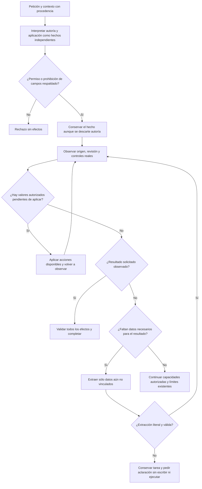

# NOVA — recuperación de aplicación de campos

Fecha local: 2026-10-18. Seguimiento de [la implementación anterior](INITIAL_CLOSURE_IMPLEMENTATION.md). Modo DEBUG → IMPLEMENT. Estado de la versión: **NO CERRADA** por fidelidad de creación.

## Auditoría y causa comprobada

La petición libre no fallaba sólo al escribir en el navegador. Una traza del intérprete mostraba una aplicación de campos correctamente reconocida que se perdía al rechazar una interpretación de autoría. Después se consultaba otro clasificador, que devolvía que no había aplicación solicitada. Además, el esquema permitía representar la aplicación independiente únicamente junto con autoría. Esta dependencia era incorrecta.

Al corregir esa composición apareció el siguiente límite: antes de aplicar el dato ya vinculado a `texto`, el ejecutor intentaba inferir el campo vacío `publico`. El modelo sugería usar el propio nombre del campo como valor; la validación lo rechazaba correctamente. La aplicación quedaba detenida pese a que completar ese otro campo no era parte del resultado solicitado.

| Componente | Estado y función existente |
| --- | --- |
| React, controles reales, dispatcher de la misma pestaña | PRESENT: ejecutan y observan acciones nativas |
| SemanticInference, SemanticPlanning, TaskGoal | PRESENT: objetivos, contexto tipado, restricciones y planificación |
| UiToolCatalog y ejecutor visible | PRESENT: capacidades, precondiciones y postcondiciones |
| AgentSessions y SQLite | PRESENT: tarea pendiente y revisión persistida, con responsabilidades distintas |
| Adaptador Ollama, Qwen local | PRESENT: interpretación y generación |
| Recuperación de candidatos de biblioteca | PRESENT: sin cambios en este arreglo |
| Aprobación, grounding y control de revisión | PRESENT: conservados |
| Nueva memoria duradera, RAG adicional, framework o proveedor en nube | UNNECESSARY para las causas comprobadas |

## Flujo implementado



```text
interpretar hechos con el contexto autorizado
si hay aplicación o prohibición independiente:
    exigir evidencia fuera de los valores de campos,
    o respuesta formada sólo por asignaciones, o tarea pendiente autorizada
    conservar ese hecho aunque la revisión de autoría descarte un cambio de texto

en el bucle acotado existente:
    validar origen y revisión; observar controles
    resolver valores con procedencia
    aplicar primero los valores autorizados pendientes; volver a observar
    para completar sólo campos: exigir al menos un valor autorizado y su igualdad visible
    para consumir el prompt: exigir compilación completa
    extraer datos sólo si aún faltan y no hay una acción ya disponible
    ocultar al extractor material que ya pertenece a otros campos vinculados
    si una sugerencia incumple el contrato de extracción:
        conservar tarea y plan, preguntar, terminar BLOCKED sin efectos
    completar sólo tras verificar todas las postcondiciones
mantener cancelación, aprobación, conflictos y límites existentes
```

## Contratos y cambios

- `SemanticInference`: `inputApplication` admite aplicación independiente sin inventar autoría. Una revisión de autoría no borra un FILL o FORBID respaldado. Datos de campo no constituyen permiso para modificar campos.
- `AgentOrchestrator.Visible`: las acciones listas preceden a la inferencia opcional. No exige completar campos ajenos a un FILL parcial; no acepta como éxito un FILL sin valores autorizados. Una extracción devuelta inválida conserva la tarea y pregunta; no se ocultan errores de transporte, cancelación ni conflictos.
- `PreparationInference` y `GroundedVariableResolver`: material con dueño conocido no vuelve a ofrecerse como candidato para otro campo. Se conserva el material sin vincular y la comprobación contra la petición original.
- No se añadieron clasificadores de intención por palabras clave, regex ni ejemplos particulares. Se reutiliza el contrato existente `nombre: valor` para vinculación literal de datos.
- Sin cambios de API pública, esquema SQLite, modelo predeterminado, configuración global de Ollama, aprobaciones ni dependencias.

## Aceptación ejecutada

| Control | Evidencia y resultado |
| --- | --- |
| Backend completo final | **465 PASS**, cero omitidos; `semantic-input-final.trx` |
| Compilación API final | **PASS**, cero advertencias y errores |
| UI con el build final, después del cambio de recuperación | **PASS**, cuatro familias en [la campaña final](../evidence/field-continuity-20261018/1792378171249/results.json), sin errores de página |
| Composición FILL/FORBID al descartar autoría | Regresión de transporte: español, inglés y prohibición |
| Procedencia de permiso | Regresión: una frase dentro del valor de un campo no autoriza una acción independiente |
| Inferencia con valores ya vinculados | Regresión: el extractor de otro campo no recibe el valor ya asignado |
| Acción disponible y finalización | Regresiones: aplica primero el dato conocido; un formulario previo y una afirmación del modelo no prueban éxito |
| Extracción inválida | Dos regresiones: conserva tarea con y sin ejecución solicitada; no aplica ni ejecuta el valor inventado |
| Petición libre en español, UI con Qwen real | **PASS** en [campaña española](../evidence/field-continuity-20261018/1792376909899/results.json): valor exacto, otro campo vacío, revisión conservada |
| Variante libre en inglés, UI con Qwen real | **PASS** en [campaña inglesa](../evidence/field-continuity-20261018/1792377789726/results.json): misma postcondición; build anterior al último cambio de recuperación de extracción inválida |
| Creación con Qwen, UI real | **FAIL/BLOCKED** en [evidencia de creación](../evidence/authoring-scope-20261018/ui-1792377403438/results.json): sin propuesta ni escritura; el recorrido se detuvo en el primer caso |

Cada campaña de campos comprueba cuatro familias: aplicación parcial por acción rápida; pregunta ante ejecución incompleta; respuesta de datos que conserva y completa ejecución con Qwen; aplicación mediante petición libre. Las familias repetidas no se cuentan como nuevos casos semánticos independientes. Hay comprobaciones de controles, escritorio y móvil. Los hashes del build y del HTML se registran en cada resultado.

En las campañas española e inglesa la petición libre requirió cinco llamadas LLM y unos 22,5 y 24,8 segundos respectivamente; la repetición final tardó 28,3 segundos y también usó cinco llamadas. Esto prueba corrección de esos recorridos, **no** una meta de latencia, p95 o fiabilidad general. React no se modificó durante este arreglo; sus 95 pruebas pertenecen a la validación anterior, no a una ejecución nueva.

Un intento anterior de la suite completa falló por colisión de un puerto efímero de `HttpListener` en el fixture. Se conserva el TRX fallido y la repetición completa exitosa; no se relajó ningún control para resolverlo. El último resultado final es el de [465 pruebas](../evidence/semantic-input-recovery-20261018/semantic-input-final.trx). Los TRX están en [la carpeta de evidencia](../evidence/semantic-input-recovery-20261018).

El build final quedó disponible en `http://127.0.0.1:5190/`, usando la base sintética de la auditoría previa, con tres prompts. La interfaz se abrió de nuevo con Playwright y `/health` devuelve integridad correcta. No se modificó la base de uso real del usuario.

## Creación: límite pendiente

La creación sigue sin aceptación. El escritor y sus revisores locales todavía confunden algunas órdenes de la sesión con reglas de la tarea futura. Las pruebas de componentes no sustituyen la fidelidad del borrador en la interfaz. También se comparó el otro modelo ya instalado mediante el generador existente: hubo rechazos y borradores contaminados que atravesaron la revisión del modelo. No se promovió ese modelo.

Actualización 2026-10-19: la comparación local fue autorizada y ejecutada. El candidato también falló fidelidad; después se retiraron los dos Qwen alternativos con autorización. QuickPrompt conserva Qwen3 8B. Véase [inventario, evaluación y limpieza](LOCAL_MODEL_SELECTION.md).

Los experimentos de extracción, partición, prompts y muestreo rechazados permanecen fuera del producto. No se incorporaron cambios experimentales a autoría ni se debilitaron las puertas de fidelidad. Está solicitada autorización para comparar otro modelo local; no se ha descargado ni cambiado la configuración. Una comparación requiere los mismos casos y contratos, seguida de aceptación independiente en UI antes de promover un candidato. No se atribuye a un modelo nuevo una mejora aún no medida.

## Reproducción

```powershell
dotnet test backend/QuickPrompt.Tests/QuickPrompt.Tests.csproj --no-restore --verbosity quiet
dotnet build backend/QuickPrompt.Api/QuickPrompt.Api.csproj --no-restore -o .playwright/semantic-repair-20261018/api-recovery-final --verbosity quiet
$env:NOVA_TEST_BUILD='.playwright/semantic-repair-20261018/api-recovery-final/QuickPrompt.Api.dll'
node Tests/nova/field-continuity.cjs
```

La evaluación usa datos sintéticos aislados y Edge instalado. No instala navegadores ni modelos. Para repetir la variante inglesa, definir `NOVA_QA_NATURAL_REQUEST` con la petición conservada en la evidencia correspondiente.
