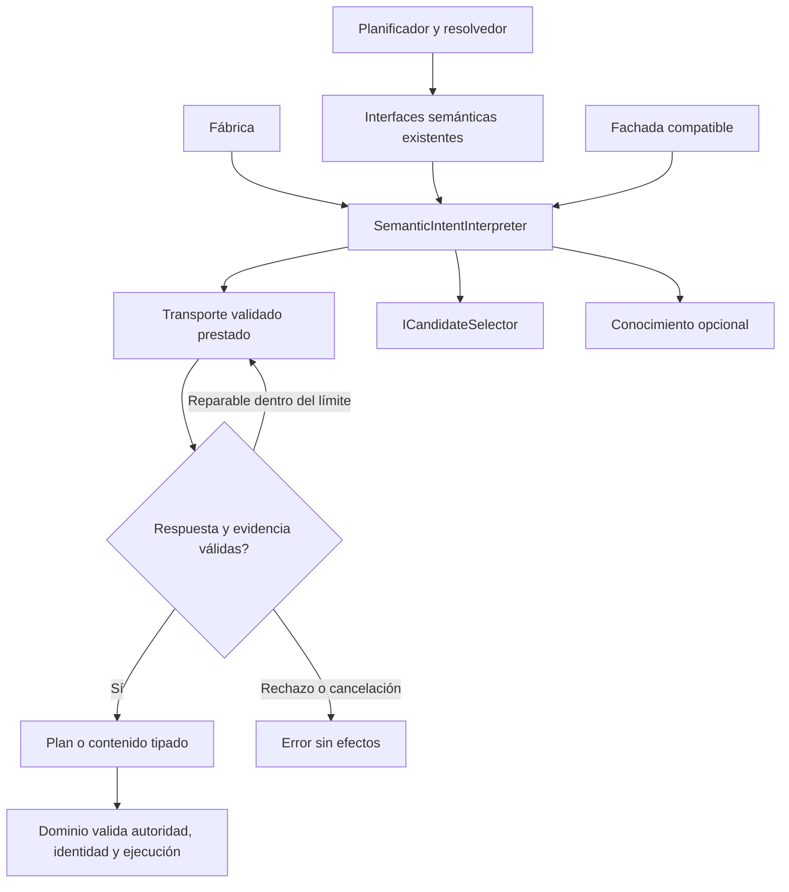

# Interpretación independiente y fachada compatible

## Auditoría y decisión

Tras separar generación, seis parciales de PreparationInference todavía contienen
interpretación, referencias, contenido/restricciones, objetivos y explicación.
Estos algoritmos comparten datos tipados y helpers; no necesitan editor, generador,
extractor de valores, revisión de borradores, UI ni persistencia. La fábrica sigue
resolviendo tres interfaces semánticas al agregado completo.

Se compararon mantener el agregado, añadir un proxy y mover el propietario entero.
Las primeras opciones conservan construcción acoplada. Se elige
SemanticIntentInterpreter sobre los puertos existentes y dependencias prestadas.
No se separan helpers internos arbitrariamente ni se crea otro motor o árbitro.

## Contratos, invariantes y composición

- ISemanticIntentInterpreter, ISemanticContentInterpreter e IIntentInterpreter de
  la fábrica aliasan una misma instancia independiente. Los traits de referencia,
  cláusulas, objetivos y explicación se conservan para sus consumidores actuales.
- Entradas y resultados existentes, contexto vigente, token de cancelación,
  errores, schema, instrucciones, presupuestos, reparaciones y validaciones no
  cambian. TaskGoal, compilador, resolvedor y workflow conservan autoridad/estado.
- Sólo requiere transporte validado e ICandidateSelector; conocimiento y observador
  son opcionales. La fábrica conserva política/opciones actuales. No crea HTTP,
  guarda datos, ejecuta herramientas ni dispone dependencias prestadas.
- PreparationInference se convierte en fachada de compatibilidad; delega métodos,
  schemas públicos y diagnóstico al propietario. Su constructor conserva argumentos
  y añade último proveedor opcional; consumidores recompilan. La fábrica también
  comparte el intérprete con esa fachada, que no es la ruta semántica productiva.
- Los seis archivos anteriores se retiran con originales archivados; los nuevos
  parciales pertenecen al mismo propietario semántico, sin algoritmos duplicados.
- AgentStagePacket conserva codificación; el perfil opcional de metadatos cambia
  consumer/version de DeclareAuthoringUse al nuevo propietario. No se presume
  equivalencia semántica del modelo por validar el paquete ni se promueve otro
  candidato. Los fallos de interpretación existentes permanecen abiertos.



```text
componer un intérprete con transporte, selección, política y opciones actuales
resolver interfaces semánticas hacia esa instancia
para cada llamada, ejecutar el mismo algoritmo acotado de su capacidad
codificar paquete con propietario fijo; no aceptar tipos elegidos por el modelo
validar respuesta y evidencia con los contratos existentes
reparar sólo dentro del presupuesto existente o propagar rechazo/cancelación
devolver plan/contenido; no generar borradores ni efectuar cambios persistentes
```

Verificación prevista: comparación exacta de seis parciales y schemas, fábrica
con fachada/generador/editor/extractor/revisor prohibidos, alias y traits, perfiles,
cancelación/errores y selección prestada; recorridos HTTP directos y compatibles
con mismas expectativas, pruebas de consumidores afectados y builds web/API.
UI sin cambios: no repetir matrices ajenas. Modelo real no se cualifica por estas
pruebas controladas. Mantener matriz canónica y fallos semánticos.

Reversión: restaurar before.json y retirar conjuntamente proveedor/parciales y
pruebas nuevas, conservando evidencias; sin migración de datos o paquetes.
Alcance sólo web; MAUI fuera por decisión del usuario.

## Resultado observado

La fábrica resuelve sus tres puertos hacia SemanticIntentInterpreter y comparte
esa instancia con la fachada compatible. Se retiraron los seis archivos anteriores;
la comparación de fuentes confirma cuerpos/instrucciones idénticos tras cambiar
el propietario. Schema de entendimiento y algoritmo de paquetes preservados.

Pasan 688 pruebas dirigidas compiladas de 56 clases, cero fallidas/omitidas.
Seis casos nuevos verifican la fábrica con fachada/generador/editor/extracción/
alcance/revisor prohibidos, alias/traits, perfiles, selección prestada, cancelación,
disponibilidad y fachada. Los seis escenarios de autoría anteriores se ejecutan
ahora por ambas rutas: doce recorridos HTTP reales sobre loopback con respuestas
controladas y expectativas intactas, incluyendo refinamiento, reparación y
continuación. Las tandas previas de 87 y 40 son subconjuntos y no se suman.

API y Blazor compilan sin errores/advertencias, con DLL compartidas idénticas a las
probadas; Evaluation compila con tests. Veintidós controles estáticos pasan; el guard
nativo histórico sólo analiza fuentes y no acredita MAUI. OpenAPI y matriz canónica
no cambian. Alcance vigente web.

[Comparación de extracción](../evidence/semantic-interpreter-module-20261020/extraction.json),
[selección](../evidence/semantic-interpreter-module-20261020/test-selection.json),
[proveniencia](../evidence/semantic-interpreter-module-20261020/compiled-provenance.json),
[validación](../evidence/semantic-interpreter-module-20261020/verification.json).

Estado: PASS de composición/protocolo controlados. No es un nuevo algoritmo ni
aceptación lingüística de Qwen, UI o latencia. El perfil opcional de metadatos tiene
identidad/version nuevas; su paquete está probado, su precisión no se presume.
Autoría y sustitución semántica siguen FAIL; versión NO_CERRADA, 34/54.
La auditoría/refactorización web restante y cualificación semántica siguen abiertas.
