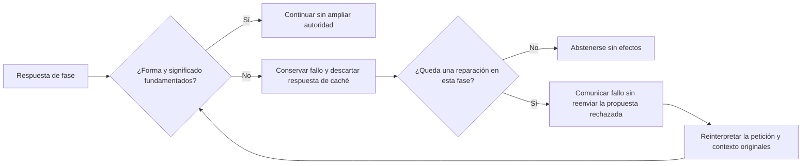
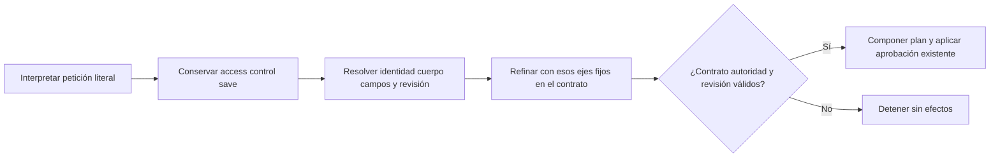

# Reintento semántico — reparación de fase en cualificación

2026-10-19. **Reparación de campos/caché y conservación de workflow implementadas; seis recorridos Qwen/Edge y cuatro controles de ciclo de vida pasan. SAV-04 cerrado funcionalmente; no acredita fidelidad de autoría ni fiabilidad/rapidez generales.** Seguimiento de [SAV-04](AGENT_DELETION_ACCEPTANCE.md).

## Observado

En Qwen3 8B real, `Elimina de mi biblioteca el prompt guardado «QA · Resumen de laboratorio».` llegó al diálogo correcto y Cancelar conservó registro y biblioteca. La siguiente petición de la misma sesión —`Quiero retirar de los prompts guardados «QA · Resumen de laboratorio»; muéstrame la confirmación para eliminarlo.`— terminó en `UNGROUNDED_CASE_APPLICATION`, antes de presentar una eliminación o escribir datos. [Resultado y respuestas estructuradas capturadas](../evidence/agent-deletion-20261019/1792420348832/results.json).

La [captura posterior de ContentRequest](../evidence/agent-deletion-20261019/1792421256681/results.json) identifica `NO_CONTENT_REQUEST` y **`FORBID_FILL`**, con la petición completa como evidencia. La petición pide revisar una eliminación; no prohíbe llenar campos. Además, esa cita abarca el título entre comillas, incompatible con `DirectEvidence`. La primera petición válida devolvió `NOT_REQUESTED`. No fue un caso de `FILL_CASE_FIELDS`. La campaña volvió a dar 1 PASS / 1 FAIL / 4 NOT_TESTED, sin escrituras indebidas.

## Causa reproducida y corrección

En la implementación anterior, `PreparationInference.Interpret` conservaba `rejected` al fallar una validación, pero no lo incorporaba a los mensajes de la siguiente vuelta ni descartaba allí la respuesta. Para este error, el paquete permanecía igual. El adaptador memorizaba JSON válido en forma antes de su validación semántica. La [regresión ejecutada antes de corregir](../evidence/semantic-retry-20261019/tests/baseline.trx) reprodujo tres fallos: una sola llamada real y dos lecturas de caché en lugar de una reparación informada; dos peticiones sucesivas reutilizaban la misma respuesta rechazada. Esto impedía que el modelo corrigiera la declaración, además de su error semántico inicial.

La corrección reutiliza la reparación acotada existente del contrato de texto. Valida su declaración de campos antes de continuar; descarta el JSON rechazado y envía el código de fallo junto con la petición/contexto originales. La propuesta incorrecta queda en diagnóstico, fuera del paquete de la reparación. Comparte un único presupuesto de reparación con la declaración de autoría. No reinicia referencias/destinos, no suprime objetivos ni añade permisos. Si la corrección sigue siendo inválida, descarta la respuesta y se abstiene sin otro intento exterior. La caché no convierte una respuesta rechazada en válida.

Otra regresión mostró que la autoridad de asignaciones aisladas permitía también un `FORBID_FILL` inventado: [3 PASS / 1 FAIL antes de corregir](../evidence/semantic-retry-20261019/tests/binding-baseline.trx). Esa autorización ahora corresponde únicamente al tipo `FILL_CASE_FIELDS`; una prohibición necesita evidencia directiva real. No se clasifican intenciones por palabras ni se introduce una excepción para eliminar.

## Algoritmo y contratos implementados



```text
validar declaración del contrato de texto contra la autoridad original
si falla:
    descartar respuesta rechazada de la caché
    si la reparación compartida está agotada: abstenerse
    fijar en el esquema los objetivos independientes que no fallaron
    reenviar a esa fase petición/contexto originales y fallo validado como datos
    conservar propuesta rechazada en diagnóstico fuera de la petición al modelo
    conservar esquema, autoridad, modelo, límites y máximo de reparaciones
    validar de nuevo; no convertir invalidación en permiso ni suprimir objetivos
    si sigue fallando: descartar respuesta, conservar FAIL y abstenerse
```

`SemanticRetryTransportTests` aporta seis casos: lectura y llenado conservando el objetivo, agotamiento sin contaminación entre peticiones, asignación aislada sin prohibición inventada, propuesta rechazada que no puede conceder autoridad y cancelación sin otro intento. Backend del primer candidato: **492/492 PASS**, cero omitidas, [TRX](../evidence/semantic-retry-20261019/tests/backend-v1.trx). La prueba existente de material de campo mantiene su rechazo esperado; sólo cambia la secuencia del transporte para exigir reparación de fase en vez de reinicio completo. Son respuestas controladas, no precisión de Qwen ni prueba de persistencia.

**Cualificación API-v1:** [Qwen/Edge real](../evidence/agent-deletion-20261019/1792421805300/results.json), **1 PASS / 1 FAIL / 4 NOT_TESTED**. El fallo original se reprodujo y sí llegó a una reparación fresca, pero Qwen copió de nuevo la declaración incorrecta enviada en `previousResponse`: mismo `FORBID_FILL`, misma cita y explicación. No hubo eliminación ni ampliación de permisos. Esto refuta que descartar caché y adjuntar la propuesta como datos sea suficiente. API-v1 compiló sin warnings/errores; frontend conservado web-v2.

**Candidato API-v2:** comunica sólo el incumplimiento y las condiciones del contrato, sin reenviar la propuesta incorrecta como candidato a imitar. La petición, contexto, esquema, modelo y límites siguen iguales. La regresión de contaminación exige ahora también ausencia del contenido rechazado en el paquete de reparación; no sólo ausencia en el campo `request`. Backend completo **492/492 PASS**, cero omitidas, [TRX](../evidence/semantic-retry-20261019/tests/backend-v2.trx); build aislado API-v2 sin warnings/errores. Pendiente de Qwen/UI del mismo candidato. Los casos congelados y holdout no se reescriben para lograr PASS.

**Resultado API-v2:** [Qwen/Edge real](../evidence/agent-deletion-20261019/1792422069868/results.json), **1 PASS / 1 FAIL / 4 NOT_TESTED**. La reparación sí corrigió la declaración de campos a `NOT_REQUESTED`, pero cambió el objetivo independiente a `REVISION_REQUEST`, inventando contenido para la confirmación de borrado. El dominio rechazó la combinación con `DELETE_EFFECT_CONFLICT`, antes de borrar. Esto concreta otra causa del mismo fallo: una reparación de campos estaba autorizada a reinterpretar también autoría. No se presenta el cambio de código de error como cierre.

**Candidato API-v3:** en una reparación de evidencia de campos, el esquema conserva la rama de contenido original y fija `requestType`, `authoringRequestEvidence`, `instructionTask` y `continuesPendingTask`. Sólo la declaración rechazada vuelve a decidirse; las comprobaciones independientes posteriores siguen activas. El validador local rechaza igualmente cualquier respuesta que ignore esos límites. La [regresión previa](../evidence/semantic-retry-20261019/tests/drift-baseline.trx) falla en API-v2 al comprobar que el esquema permitía esa reclasificación. No se añade otra llamada, otro presupuesto ni una ruta por verbos. Backend **493/493 PASS**, cero omitidas, [TRX](../evidence/semantic-retry-20261019/tests/backend-v3.trx); API aislada compilada sin warnings/errores.

**Resultado API-v3:** [Qwen/Edge real](../evidence/agent-deletion-20261019/1792422395011/results.json), **1 PASS / 1 FAIL / 4 NOT_TESTED**. La reparación ya devuelve `NOT_REQUESTED` conservando `NO_CONTENT_REQUEST`, y la segunda interpretación con origen cargado mantiene ausencia de autoría/llenado. Sin embargo, el workflow inicialmente correcto (`access: NONE`, `save: REVIEW_DELETE_EXISTING`) se reinterpreta tras cargar el origen y añade `READY_FOR_CLIPBOARD`, que el usuario no pidió. Termina de nuevo en `DELETE_EFFECT_CONFLICT`, antes de escribir. Por tanto, la reparación concreta progresa, pero **el requisito no está resuelto**. No es otro requisito ni una nueva campaña de descubrimiento: sigue siendo la misma segunda petición congelada que bloquea SAV-04.

Siguiente frontera acotada: `SemanticPlanning.Resolve` vuelve a llamar al intérprete completo después de cargar un origen nombrado. Es necesario conservar el refinamiento de roles de contenido/valores: eliminarlo para pasar esta petición podría ocultar la omisión de llenado ya documentada. La siguiente corrección debe impedir que el material recuperado añada efectos independientes no autorizados, conservando refinamiento, restricciones y objetivos genuinos. Reproducir esa transición con transporte/planificación controlados antes de modificarla; repetir después la misma campaña, sin cambiar frases ni expectativas. No declarar que esta observación explique todos los fallos de autoría/contexto.

No introducir `si contiene eliminar`, listas de verbos, regex de intención ni una excepción que silencie llenado al ver `REQUEST_DELETE`. Tampoco habilitar otro perfil/modelo o repetir los experimentos de fidelidad rechazados sin una hipótesis diferente. La corrección debe atender la frontera general entre interpretación, evidencia, caché, reparación y autorización.

## Conservación de workflow durante la carga de un origen

La regresión de transporte reprodujo la deriva observada: [3 FAIL antes del cambio](../evidence/workflow-refinement-20261019/tests/refinement-baseline.trx). Cubre eliminación con copia añadida, lectura/llenado con copia añadida y copia/llenado con copia omitida. Se añadieron primero los tipos de datos del contrato, todavía sin aplicarlos al adaptador; el decoder seguía admitiendo la deriva y las tres expectativas fallaron.

La corrección conserva una instantánea tipada de `access`, `control` y `save` vinculada a la petición literal. `SemanticPlanning.Resolve` la pasa únicamente al refinamiento del mismo turno tras obtener identidad, cuerpo, campos y revisión reales. `WorkflowContract` fija esos ejes en el esquema del segundo workflow; el validador local rechaza también respuestas que ignoren ese esquema. No se interpreta lenguaje por código ni se fusionan efectos después de que hayan fallado. Contenido, valores, destino, restricciones y autoridad de eliminación siguen sus validaciones existentes; no se elimina la segunda interpretación ni se suprimen campos.

La instantánea es estado de proceso con `JsonIgnore`, no un dato aceptado del modelo, una aprobación, un nuevo endpoint o un cambio de SQLite. No se conserva en el contexto saliente para otro turno. Una petición distinta, un origen sin enlace explícito o marcado obsoleto no pueden reutilizarla. El origen se vuelve a leer tras el refinamiento para rechazar modificaciones concurrentes. No se añade ninguna llamada al modelo ni se amplían presupuestos.



```text
al finalizar una interpretación válida:
    conservar petición literal y ejes de workflow independientes del cuerpo
al cargar un origen nombrado:
    comprobar identidad y revisión reales
    asociar la instantánea únicamente al refinamiento de esa misma petición
    fijar access/control/save en el contrato del modelo
    refinar contenido y campos con el cuerpo y esquema reales
    validar respuesta, autoridad y revisión; si falla, abstenerse
    conservar el plan compuesto; retirar la instantánea del contexto saliente
al recibir una nueva petición del usuario:
    interpretar nuevamente sin reutilizar ese límite de refinamiento
```

| Nodo | Componente | Evidencia |
| --- | --- | --- |
| Instantánea del objetivo | `SemanticInference.Interpret`, `WorkflowGoalSnapshot` | Transporte y anotación del plan |
| Origen y revisión | `SemanticPlanning.Resolve` | SQLite real y regresiones de contexto existentes |
| Refinamiento acotado | `WorkflowContract` | Decoder restringido y respuesta contraria al esquema rechazada |
| Valores conservados | `InterpretInputUse`, composición existente | Copiar/llenar y leer/llenar siguen presentes tras cargar campos |
| Límite temporal | Contexto efímero, `JsonIgnore` | Petición ajena, fuente sin enlace u obsoleta rechazadas antes del modelo |

Backend completo del candidato workflow-refinement API-v1: **501/501 PASS**, cero omitidas, [TRX](../evidence/workflow-refinement-20261019/tests/backend-v1.trx). Incluye ocho controles nuevos, sin cambiar expectativas anteriores. Build API aislado sin warnings/errores; frontend web-v2 sin cambios. Los transportes controlados no acreditan comprensión de Qwen.

**Cualificación de las seis peticiones congeladas: 6/6 PASS** con Qwen3 8B, Edge visible, API-v1 y SQLite sintética. [Resultado](../evidence/agent-deletion-20261019/1792422883612/results.json). Revisar/cancelar conserva biblioteca y registro; la segunda formulación ya confirma y verifica ausencia real del registro correcto, conservando el otro. Pregunta, negación, contenido literal de campo y falta de destino no conceden eliminación. El campo queda con el valor literal exacto y la vista previa refleja ese valor; capturas revisadas visualmente. Los fallos anteriores permanecen enlazados. No se cambiaron frases ni expectativas.

**Protecciones adicionales: 4/4 PASS** en el mismo candidato, iniciando desde detalle. [Resultado](../evidence/agent-deletion-20261019/1792423632740/results.json). Incluye revisión obsoleta, pausa, confirmación vigente, persistencia después de reiniciar y rechazo de la aprobación antigua. Se conserva un timeout de interpretación en un intento desde biblioteca y un fallo de espera de señal del arnés; [alcance y fallos](AGENT_DELETION_ACCEPTANCE.md). No se presenta como campaña de latencia ni precisión global. Esta instantánea limita la deriva del refinamiento, pero no corrige por sí sola una interpretación inicial equivocada ni la fidelidad del contenido generado. AUT, AI-01 y EXE-07/PER siguen abiertos.
