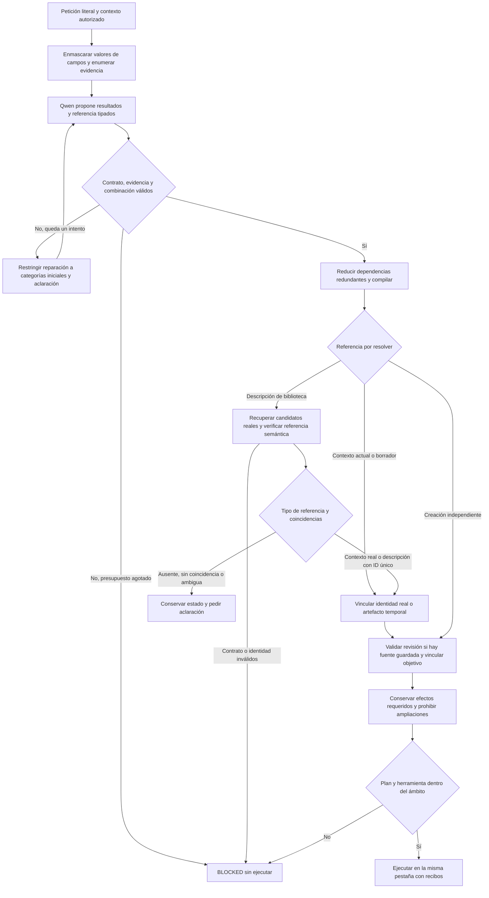
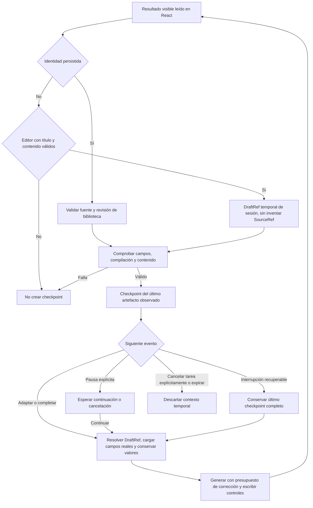
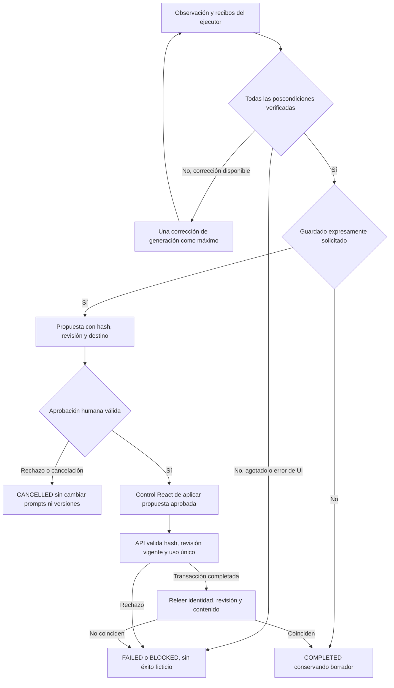

# NOVA: especificación ejecutable de estabilización

Estado: **S04 rechazado tras los 16 casos**, intención 8/16, destinos 8/16, planes válidos 11/16. `TaskGoals=false` y `TaskResultContract=false` por defecto. [Gate de integración y límites observados](S04_INTEGRATION_GATE.md). Los diagramas siguientes documentan el diseño de estabilización; el gate distingue las garantías implementadas de las que la evaluación ha refutado.

## 1. Interpretación, referencia y ámbito

Problema: objetivos añadidos, fuente inventada y reparación que cambia la tarea. Causa: confundir resultados, dependencias, contenido y autoridad. Se reutilizan intérprete, compilador, selección semántica, resolver y validador existentes; no se añade un pipeline ni un router lingüístico.



```text
interpretar(petición, sesión):
    contexto := cargar_contexto_autorizado(sesión)
    evidencia := palabras_de_directiva_sin_valores_literales_de_campos
    contrato := esquema_dependiente_del_contexto_y_evidencia
    repetir como máximo 2 intentos:
        propuesta := Qwen(petición_original, contexto, contrato, error_anterior)
        validar_esquema_y_rangos_reales(propuesta)
        validar_que_NEW_DRAFT_no_tiene_fuente_y_DERIVED_DRAFT_sí
        validar_que_solo_CLARIFICATION_contiene_pregunta
        validar_un_destino_y_un_borrador_de_autoría
        si válida: salir
        si queda intento:
            limitar_categorías_a_las_originales_más_CLARIFICATION
            en conflictos de ámbito, sellar además fuente y datos ya validados
        si no queda intento: devolver BLOCKED
    raíces := reducción_transitiva_de_dependencias_de_dominio(propuesta)
    plan := compilar(raíces, referencia, restricciones)
    si requiere búsqueda:
        candidatos := recuperación_SQL_acotada_de_registros_reales
        selección := selección_semántica_existente_con_tipo_de_referencia
        si no hay referente o hay varios destinos: guardar_pendiente_y_aclarar
        validar_cita_literal_o_rol_contextual_real_e_IDs
    leer_y_validar_revisión_vigente_si_hay_fuente_guardada
    ámbito := cierre_de_efectos_inicial + prohibiciones + requisitos_de_aprobación
    antes_de_cada_herramienta: rechazar_ampliación_o_efecto_prohibido
```

`SOURCE_READ` solicita encontrar/mostrar una instrucción; el código deriva búsqueda según su referencia. `MATCHES_ONLY` prohíbe abrir. `NEW_DRAFT` es independiente; `DERIVED_DRAFT` conserva una base explícita. `COPY_READY`, ejecución, preparación de destino y guardado son resultados distintos, nunca dependencias de crear un borrador. Repetir una capacidad de llenado no duplica su ejecución. Reducir dependencias no oculta capacidades terminales; se conserva el contrato original en evidencia sintética.

La cita prueba procedencia, no significado. Qwen sigue siendo responsable de interpretar el sentido; no se afirma que una validación determinista pruebe implicación semántica. Una lista de candidatos no concede un antecedente a un pronombre. La selección semántica comprueba el tipo de referencia en el paso que ya existía; no decide escrituras ni aprobaciones.

## 2. Borrador temporal y continuidad

Problema: un borrador sin ID guardado se perdía o entraba en una ruta que exigía ID de biblioteca. Causa: registrar conversaciones solo para fuentes persistidas y mezclar identidad de borrador con huella de operación de una propuesta.



```text
registrar_observación(estado, sesión):
    validar_identidad_revisión_campos_y_compilación(estado)
    si editor_sin_ID:
        exigir título, contenido y cambio observado
        artefacto := evaluar_como_creación_temporal_sin_fuente_falsa
        conservar DraftId; incrementar DraftRevision solo si cambia título/contenido
        conservar valores reales de campos
        guardar en AgentSessions, separado del almacén de propuestas por operación
    si hay ID guardado:
        releer revisión, construir contexto de borrador derivado y guardar sesión

adaptar_temporal(referencia, petición):
    cargar checkpoint de esa sesión
    si el editor de ese artefacto contiene texto distinto: bloquear y conservarlo
    si el texto coincide: conservar los valores actuales observados de sus campos
    vincular objetivo al ID, revisión y hash del artefacto real
    si está en biblioteca u otro Focus: abrir un editor temporal sin editar ese registro
    usar generación y revisión existentes con WorkingDraft completo
    permitir como máximo propuesta inicial y una corrección
    escribir título/contenido mediante controles React y verificar igualdad exacta
    registrar checkpoint solo después de validar recibo y contenido observado

interrupción:
    detener nuevas acciones y no confirmar escrituras pendientes
    conservar checkpoint completo de este run, si existe
    de lo contrario recuperar contexto anterior al run
    cancelación explícita de la tarea semántica elimina su contexto
```

Una pulsación en pantalla no pausa. Solo lo hace el control de pausa. Una edición concurrente real se detecta para evitar sobrescribirla y produce intervención manual, conservando el texto observado; no es equivalente a pausar por tocar la pantalla. La interrupción del run conserva el último checkpoint válido; no garantiza recuperación de contenido parcialmente escrito sin recibo. Las sesiones son temporales: TTL de dos horas y depuración al acceder con umbral de cien sesiones; no sobreviven al reinicio del proceso. No se promete persistencia durable del borrador.

Solicitar una copia de un borrador ya existente también consume una referencia: requiere resolver/cargar el artefacto antes de abrir la aprobación, aunque no haya autoría nueva. Crear y guardar una copia en la misma tarea independiente no introduce una fuente de biblioteca artificial.

## 3. Finalización y persistencia



```text
finalizar(objetivo, plan, observación, recibos):
    exigir igualdad del plan con su cierre inicial y ausencia de efectos prohibidos
    verificar identidad/revisión, contenido cambiado si procede, campos y preview
    exigir evaluación de contenido ligada al cuerpo exacto cuando hay autoría
    exigir resultado local/destino/valores solo cuando forman parte del objetivo
    si alguna condición falta: no devolver COMPLETED
    si hay guardado solicitado:
        proponer contenido y destino exactos; esperar aprobación humana
        si rechaza: CANCELLED, cero cambios de prompts/versiones
        si aprueba: comprobar hash, cancelación, revisión fresca e idempotencia
        aplicar por control nativo y verificar contenido/revisión persistidos
    devolver COMPLETED solo tras todas las comprobaciones
```

La revisión semántica local es una señal adicional. No sustituye invariantes de origen, límites de longitud, igualdad de campos/preview, recibos, hash ni aprobación. La composición rechaza restricciones duplicadas y prefijos truncados antes de añadir las cláusulas protegidas. No prueba por sí sola ausencia general de contaminación del contenido.

## Contratos y responsabilidades reales

| Contrato solicitado | Implementación del repositorio | Autoridad/estados |
|---|---|---|
| TaskGoal | `TaskGoal`, `CompletionCondition`, `TaskClause` | Resultado, referencia real, restricciones, información pendiente, poscondiciones |
| TaskScope | Proyección `TaskGoal.Scope` sobre efectos iniciales, prohibidos y aprobación | Código; una respuesta posterior no lo amplía; preguntar no concede efectos |
| DraftRef | Proyección `AgentSession.WorkingDraftReference` del `PreparedDraft` temporal | DraftId, SessionId, DraftRevision, SourceRef opcional y contenido actual |
| Fuente guardada | `PromptDocument`, `GoalTarget` | ID real y revisión fresca; distinto del DraftId |
| Propuesta/aprobación pendiente | `LiveApproval`, `LiveApprovalInput`, control del run | Hash de contenido/destino, revisión, confirmación humana y uso único |
| ExecutionReceipt | `UiActionEnvelope` y recibo del `SameTabUiDispatcher` | RunId/ActionId/secuencia, herramienta, estado observado y verificación |
| Estado de ejecución | `LiveStatus`, `AgentRunState` | Interpretación, herramientas, verificación, pausa, aprobación, terminales |

Las proyecciones nuevas pasan las comprobaciones mecánicas S04. Eso no acredita interpretación ni continuidad real con Qwen: el gate semántico ha fallado. No se duplica el sistema de recibos o aprobación existente. Ningún contrato interno se acepta como autoridad mediante JSON de usuario.

La selección de referencia utiliza un contrato acotado y no tiene un bucle adicional de reparación: un contrato inválido bloquea el run. La interpretación tiene dos intentos como máximo; la generación tiene propuesta inicial y una corrección como máximo. El run visible conserva sus límites existentes de ocho minutos y doce decisiones por defecto. La revisión local, las escrituras nativas y la aprobación siguen sujetos a cancelación entre pasos.

## Validación y estado de evidencia

| Campaña | Evidencia | Estado |
|---|---|---|
| Línea base completa S01 | 16 casos, intención 87.5%, planes 93.75%, destinos 87.5% | FAIL |
| Candidato completo S03 | 16 casos, intención 75%, planes 93.75%, destinos 81.25%, metamorfismo 1/2 | FAIL |
| Mecánica S03 | 392 backend, 150 legacy, 87 React y builds | PASS para mecánica; no acredita comprensión |
| Mecánica S04 | 402 backend, 150 legacy, 90 React y builds aprobados | PASS mecánico |
| S04 semántico completo | 16 casos, intención 50%, planes 68.75%, destinos 50%, metamorfismo 0/2 | FAIL |
| Escenarios reales A–J | Resultados independientes en el gate de integración | No inferir PASS desde unitarias |
| Validación independiente / holdout | Sin ejecutar ni ajustar | NOT_TESTED |
| Comparación de rendimiento | Sin condiciones comparables establecidas | NOT_TESTED |

El evaluador termina los dieciséis casos aunque ya exista un fallo. Conserva contratos, intentos, errores, modelo/configuración y hashes. Los requisitos mínimos del corpus no son por sí solos una lista exhaustiva de permisos: conservar tanto las diferencias de raíces declaradas como los efectos terminales adicionales y los recibos reales. No contar dependencias técnicas como nuevas intenciones ni omitir capacidades terminales añadidas. `GoalCompletionRate`, `ExtraEffectRate`, `MissingEffectRate`, `TargetResolution` y `MetamorphicConsistency` deben indicar su denominador y NOT_TESTED cuando falten recorridos. Ninguna prueba simulada o replay se cuenta como Qwen real.
