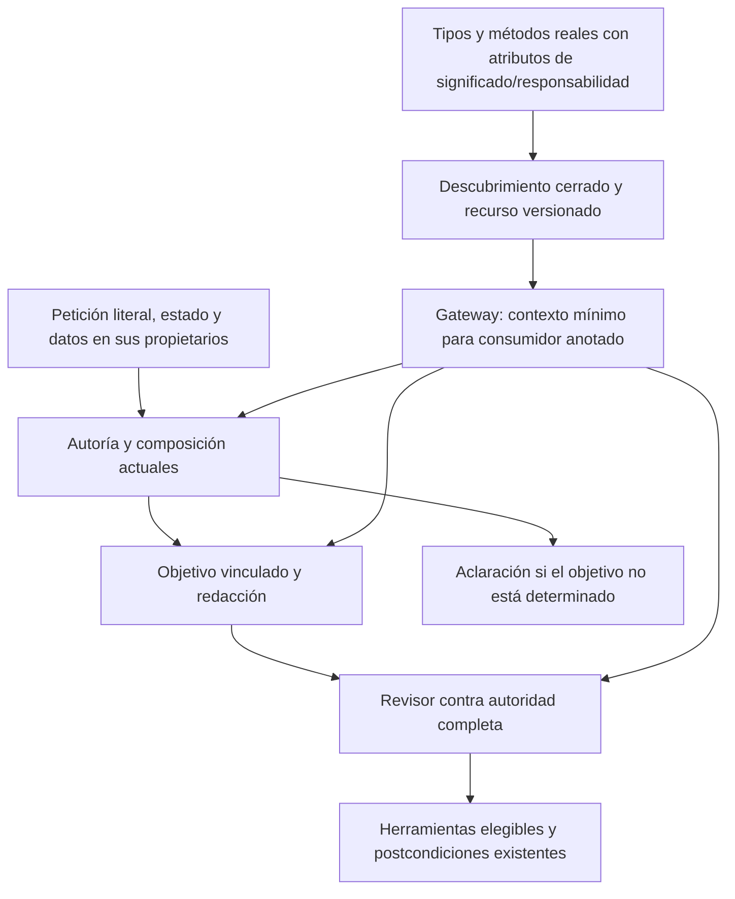

# Flujo semántico: conocimiento obligatorio del sistema

2026-10-20. Experimento implementado y **NO CUALIFICADO**. Los 104 controles de contrato no demostraron fidelidad: el contenido real conservó metainstrucciones en tres encargos y el revisor falló ante los artefactos retenidos. Evidencia: `docs/evidence/closure-20261020/system-knowledge-content-development.json` y `system-knowledge-review-development.json`. No promover este recurso como solución ni repetir semillas hasta obtener verde. La dirección vigente es [sustitución reflejada](REFLECTED_AGENT_REPLACEMENT.md); su primer incremento sólo verifica herramientas de lectura. El diseño histórico inferior se conserva para trazabilidad.

## Auditoría del flujo y primera desconexión

`NovaTaskPlanner` restaura sesión, resuelve el ámbito de datos y la referencia; `PreparationInference.Interpret` consulta destino, uso de inputs, autoría y workflow y los compone. `TaskGoal` vincula petición y efectos. `GenerateCore` crea/adapta; `ReviewDraftFidelity` verifica la propuesta; el orquestador ejecuta herramientas y comprueba recibos/postcondiciones. Datos, referencias, aprobación y ejecución ya tienen propietarios; no deben duplicarse.

El catálogo reflejado describe operaciones y herramientas UI. La recuperación vectorial es opcional y está desactivada por defecto; tampoco contiene el significado común de las representaciones de datos. Autoría recibe nombres de representaciones y una definición, pero el redactor y el revisor mantienen explicaciones independientes. `InstructionAuthoring.ContentInstruction` conserva la directiva literal de esta sesión, no una tarea futura ya normalizada. El generador vuelve a interpretar esa diferencia y los cuerpos observados copian la orden de autoría. El fallo persiste con herramientas nativas y con otros perfiles; un nombre de campo, un formato válido o una decisión CREATE acertada no demuestran comprensión del destinatario.

La corrección de autoridad anterior impide que un subconjunto del generador oculte condiciones al revisor. La recuperación por grupos evita que reparar un título reabra el cuerpo. Ambas conservan valor, pero ninguna enseña qué representan los objetos ni corrige por sí sola un juicio semántico incorrecto.

## Cambio elegido

Extender la capacidad existente de descubrimiento/conocimiento con metadatos sobre **las propiedades reales**, junto a sus declaraciones: petición del objetivo, directiva literal de autoría, definición reutilizable, valores y resultado compilado. Los consumidores declaran su responsabilidad mediante un atributo en su método real. Reflection enlaza únicamente tipos y miembros de confianza; nunca nombres elegidos por el modelo. El gateway existente incorpora ese recurso público y versionado a los consumidores anotados del candidato actual, sin otra inferencia ni consulta vectorial.

No es entrenamiento del modelo ni garantía de fidelidad. Es un contrato común y comprobable de conocimiento sobre la aplicación. El modelo sigue interpretando la petición; el dominio sigue autorizando y ejecutando. Vectores pueden recuperar recursos adicionales, pero las definiciones mínimas del sistema no deben depender del ranking. No se interpreta lenguaje natural mediante keywords/regex ni se otorga autoridad por similitud.

### Propietarios e invariantes

- **Conocimiento:** CapabilityDiscovery/CapabilityKnowledge; descripciones junto a propiedades y consumidores reales, sin segundo registro de reglas. No contiene ejemplos de pruebas, historial, biblioteca privada ni valores de instancias.
- **Consumo:** `PreparationInference.Chat` incorpora metadatos sólo al candidato `authoringUseContract` y a métodos anotados. No se crea otro selector, planificador, revisor o servicio. Estado y permisos no cambian; no hay acceso a getters de datos ni escaneo de ensamblados.
- **Compatibilidad:** mismos DTO, esquemas JSON, datos y workflow. Atributos no cambian serialización. El perfil previo sigue disponible por el selector existente; no se activa el candidato en la instancia personal.
- **Límites:** recurso cacheado por tipo/método de confianza, tamaño máximo fijo; misma cancelación y presupuesto de llamadas. El paquete completo resultante participa en la clave de caché de inferencia y telemetría.
- **Incertidumbre:** recurso y etapas deben reconocer que el encargo puede contener varios destinatarios y que falta de evidencia necesita aclaración. No convertir una declaración de confianza del LLM en autorización. La propagación de aclaraciones se revisará en el propietario ya existente antes de ampliar sus variantes.

### Alternativas

Otra redacción aislada o más demostraciones no resuelven la divergencia entre consumidores. Otra base o un nuevo árbitro duplican dependencias/autoridad. Una capacidad común de metadatos para tres consumidores tiene variación real y se extiende dentro del módulo existente. No corresponde copiar el contrato conjunto rechazado ni reemplazar los propietarios de datos/workflow.



```text
descubrir atributos de propiedades en la lista fija de tipos de la aplicación
validar ids únicos, descripciones y miembros existentes sin leer sus valores
descubrir responsabilidad del método consumidor en el tipo conocido del gateway
si el candidato está habilitado y el método está anotado:
    construir/cachear recurso con significado de objetos, responsabilidad y prohibición de otorgar permisos
    incorporar recurso al sistema antes de calcular caché, medir y enviar
mantener petición, datos, workflow, autoridad y recibos en sus propietarios
validar el comportamiento con contratos y luego el mismo corpus real conservado
si el contexto no demuestra mejora semántica, conservar el fallo sin promocionar
```

## Aceptación

Contratos: nombres reflejados exactos, getters nunca ejecutados, definiciones inválidas rechazadas, versión estable, recursos compartidos entre los tres consumidores, candidato desactivado sin alteración, sin llamadas adicionales ni campos de datos copiados al conocimiento. Después, una campaña acotada del autor/revisor real con los encargos retenidos y revisión independiente, con sources/modelo/binarios congelados. No repetir frontend/CRUD o abrir validation/holdout mientras desarrollo siga fallando. La fidelidad sigue siendo un gate externo, no un autoveredicto del modelo.
