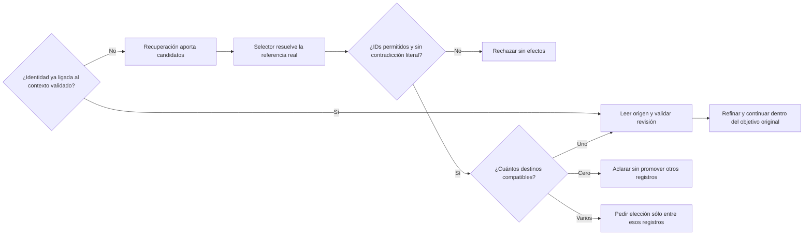

# Recuperación de selección de origen

2026-10-19. Trabajo sobre fallos conservados en [Phase 5](PHASE5_CAUSAL_ISOLATION.md): GOLD_GOAL caso 02 y candidatos ajenos tras una selección sin referente. No es una nueva familia de auditoría ni recuperación de autoría. Versión abierta: 21 cerrados/67 abiertos.

## Causa reproducida

El [baseline actual del corpus anotado](../evidence/source-selection-20261019/gold-baseline.json) vuelve a dar **15/16**, fallando el mismo caso 02 antes de generación/UI. Los objetivos correctos se inyectan sólo en el evaluador sintético; no son una entrada autorizada del producto. La comparación no mide comprensión de Qwen.

`SemanticPlanning.Resolve` utilizaba similitud entre puntuaciones de recuperación para anular un ID de candidato real o sustituir la selección del modelo. Con puntuaciones parecidas, incluso `PromptIds=[]` podía convertirse en varios candidatos con score 3. Esto confundía recuperación con resolución de referencia: la similitud no prueba que el usuario identifique esos registros. Siete contrastes controlados con identidades/revisiones en SQLite real reprodujeron **4 FAIL / 3 PASS** antes de modificar el resolver.

## Contrato y algoritmo



```text
si una elección proviene de la UI y tiene identidad/revisión explícitas:
    conservar su ruta de validación existente
si la identidad ya está ligada a un candidato del contexto validado:
    no reinterpretarla por empates de recuperación ni repetir selección
    conservar rechazo de título contradictorio y aclaración por nombres duplicados
    leer y comprobar la revisión actual
si requiere resolver el origen:
    usar el selector existente y la petición original
para cualquier búsqueda semántica:
    validar cantidad, unicidad e inclusión de IDs en candidatos reales
    rechazar contradicción con un título literal identificado
    si se selecciona un título duplicado: conservar sus identidades para aclarar
    no sustituir elecciones por empates de puntuación ni restaurar filas no elegidas
    si hay cero coincidencias: devolver cero candidatos a UI y memoria de búsqueda
    si hay varias: aclarar sin leer/modificar arbitrariamente una
    si hay una: leer la revisión vigente y aplicar comprobaciones existentes
    respetar cancelación, presupuesto finito, contexto y aprobación
```

Las puntuaciones y normalización siguen disponibles para recuperar/identificar datos, no clasifican intención ni deciden el efecto final. Un ID conocido no equivale a aprobación para escribir. Se reutiliza `SelectSource`/`Select` cuando corresponde resolver una referencia; no se crea otro servicio ni se cambian modelos o perfiles del producto. Las identidades ya ligadas al contexto se leen con revisión vigente, sin otra llamada al modelo. No se retiran las comprobaciones de ID/revisión, títulos duplicados, título explícito contradictorio ni origen de contenido no confirmado en la ruta legacy.

| Frontera | Implementación | Evidencia requerida |
| --- | --- | --- |
| Recuperación frente a selección | `SemanticPlanning.Resolve` | Coincidencia única y ninguna sobre scores empatados |
| Referencia pendiente frente a identidad ligada | Contexto y ruta existente del selector | Petición original e IDs permitidos; enlace ya validado y selección explícita intactos |
| Ambigüedad real | IDs múltiples / títulos normalizados duplicados | Aclaración con registros correctos, sin elegir uno |
| Lectura vigente | `Read` y `PromptLibrary` | Cambio concurrente de revisión rechazado |
| Resultado visible | Resolver y consumidor UI existentes | Candidatos ajenos ausentes, navegación al registro solicitado |

## Verificación en curso

Las siete regresiones nuevas y la tanda dirigida de contexto/comandos pasan **62/62** en la primera variante; backend completo **508/508**, cero omitidas. API/evaluador aislados compilan sin warnings/errores. Los resultados observables esperados de ID, aclaración, candidatos y revisión no cambiaron.

La primera variante intentó reinterpretar también IDs ya ligados al contexto. El corpus anotado cayó a **14/16**, con errores reales del selector añadido: una referencia de búsqueda válida se interpretó como no identificable y otra citó el cuerpo del candidato en vez de la petición. Se conserva [la captura estructurada](../evidence/source-selection-20261019/gold-diagnostic-v1.json), sin reasoning. **Variante API-v1 rechazada.** Esas llamadas adicionales no se promovieron. El evaluador ahora puede conservar sólo las elecciones de fuente de sus propios fixtures sintéticos para distinguir la causa de un rechazo; no registra datos del producto.

El candidato **API-v2** conserva el enlace previamente validado y retira únicamente la decisión por empate de puntuación. Para búsquedas nuevas, respeta los IDs elegidos y no promueve filas ajenas cuando la elección está vacía; los títulos duplicados siguen aclarando. El nuevo test de identidad ligada se ajustó para exigir cero reselecciones, con un selector que lanza si se invoca; no cambian sus ID/resultado/revisión esperados ni los del corpus. Esto corrige el contrato experimental de llamadas redundantes de API-v1, no una expectativa semántica para obtener PASS.

Backend completo API-v2: **508/508 PASS**, cero omitidas. [Corpus anotado API-v2](../evidence/source-selection-20261019/gold-candidate-v2.json): **16/16 PASS de planificación**, cero llamadas al modelo, sin generación/UI y con fixtures intactos. Se corrige el caso 02, manteniendo los otros quince. No es 16/16 de comprensión de Qwen ni autoriza declarar aceptado AI-01. Recorridos Qwen/UI en curso; ningún requisito adicional se cierra sólo por este resultado.

## Coincidencia real frente a candidato más cercano

La [UI API-v2](../evidence/latency-1792424841385/measurements.json) mantuvo el fallo de inexistencia: terminó abriendo Proyecto técnico para la petición de Protocolo de navegación submarina. La ambigüedad sí preguntó por los dos registros de anuncios, pero no se presenta el estado BLOCKED por sí solo como prueba semántica. Se amplió únicamente la observabilidad del arnés sintético para conservar las respuestas de referencia y selección, sin reasoning.

La [captura causal](../evidence/latency-1792425079789/measurements.json) muestra que el extractor conserva correctamente el nombre solicitado. El selector posterior elige Proyecto técnico y explica que es el más cercano, aunque no sea coincidencia exacta. No fue un cambio del nombre por el extractor en esta ejecución. El contrato anterior empezaba emitiendo IDs y no distinguía coincidencia suficiente de mera cercanía; la selección vacía estaba permitida pero el resultado real no la usó.

Se aisló una alternativa con `matchStatus` antes de los IDs: `NO_MATCH` exige lista vacía; `MATCHING_CANDIDATES` exige 1–3 identidades reales. No hay umbral por palabras, comparación de la explicación libre ni reglas para un nombre de ejemplo. El modelo decide equivalencia semántica, el código comprueba pertenencia/unicidad/cantidad y respeta la ausencia. [Desarrollo: 8/8](../evidence/source-selection-20261019/match-probe.json); [validación independiente: 8/8](../evidence/source-selection-20261019/match-validation-probe.json). La validación quedó congelada antes de consultar desarrollo; no es recovery-v1 holdout. Incluye equivalencias ES/EN, títulos existentes, fuentes ausentes y funciones próximas pero no equivalentes.

Tras esas dos tandas, se integró el contrato en el `Select` existente, devolviendo el mismo `SemanticCandidateChoice` público. Mantiene una llamada, contexto 12288, thinking desactivado y presupuesto 500 del selector anterior. No se habilitan perfiles experimentales ni cambia modelo. Rechaza estatus/IDs contradictorios, duplicados o ajenos; la ausencia de candidatos es un hecho determinista y no necesita inferencia. El arnés de transporte tuvo **3 FAIL / 4 PASS** antes de integrar, porque los tres resultados válidos del nuevo contrato aún no eran admitidos por el adaptador anterior.

API-v4 también distingue una búsqueda completada sin coincidencias para mostrar la consulta y pedir corregir/describir la referencia, sin promover otros registros. Backend completo: **515/515 PASS**, cero omitidas. API/evaluador aislados compilan sin warnings/errores. [Planificación anotada API-v4](../evidence/source-selection-20261019/gold-candidate-v4.json): **16/16**, cero inferencias, sin cambios de fixtures. La [primera UI API-v4](../evidence/latency-1792425594259/measurements.json) conserva la biblioteca y genera la pregunta correcta del inexistente; el selector devuelve `NO_MATCH` y `[]`. Falta archivar la comprobación del texto visible en el control de actividad y revalidar eliminación sobre este candidato; no se cierra AI-02/03/07 por pruebas de componente.

**API-v4 no cualificado para promoción:** la [repetición con el control de actividad abierto](../evidence/latency-1792425748928/measurements.json) mostró el aviso correcto del inexistente, visible y sin navegar/modificar. Sin embargo, para anuncios el selector recibió sólo Anuncios A/B y devolvió `NO_MATCH`, alegando que ninguno correspondía de forma única. La pregunta resultante afirmó incorrectamente que no había coincidencia. Control seguro y texto visible no equivalen a relevancia: esa ambigüedad sigue FAIL y no se reetiqueta como éxito por estar BLOCKED. El script mantiene `referenceQuestionReview.status=NOT_TESTED` para revisión independiente.

La primera captura de candidatos completos había pasado los ocho contrastes y su validación, pero no cubría cambios de composición del conjunto. La nueva hipótesis representa explícitamente **cero, una y varias coincidencias**, sin confundir falta de unicidad con ausencia. Prototipo aislado, todavía sin integrar: `NO_MATCH` (0 IDs), `UNIQUE_MATCH` (1) y `AMBIGUOUS_MATCHES` (2–3), en la misma llamada/budget. La separación entre workflow de búsqueda y tarea del documento se hace explícita; no se condiciona por nombres o frases de los casos.

Cada una de las ocho peticiones se prueba con candidatos completos, orden inverso y un conjunto enfocado (sólo los registros que sí corresponden, o un subconjunto irrelevante en los negativos). Las expectativas semánticas no cambian. [Desarrollo de cardinalidad](../evidence/source-selection-20261019/match-cardinality-development.json): **24/24 condiciones PASS de ocho peticiones**, no 24 peticiones independientes. Se conservan las ocho consultas de validación ya congeladas y se repiten con las mismas variaciones; al estar expuestas por la variante previa, se describen como validación reutilizada/regresión, no holdout nuevo. Resultado pendiente, sin promoción ni cierre adicional.

## Candidato API-v5 — selección por cardinalidad

[Validación reutilizada con pools variados](../evidence/source-selection-20261019/match-cardinality-validation.json): **24/24 condiciones PASS**. En total, 16 peticiones y 48 condiciones; no se presentan como 48 consultas independientes. Tras esos controles se integraron los tres estados en el selector existente. Las nueve pruebas de transporte verifican concordancia de estado y cardinalidad, IDs reales, duplicados y rechazos; no cambian las expectativas de identidad/resultado del dominio. Backend final **517/517 PASS**, cero omitidas, [TRX](../evidence/source-selection-20261019/tests/backend-v5.trx). API/evaluador API-v5 compilan sin warnings/errores. [Planificación anotada](../evidence/source-selection-20261019/gold-candidate-v5.json): **16/16**, cero llamadas; no acredita interpretación del corpus por Qwen.

Los dos recorridos Qwen/Edge se repitieron con el control de actividad abierto: [capturas y respuestas](../evidence/latency-1792426322282/measurements.json). La inexistencia muestra el nombre solicitado y no abre otro registro; la ambigüedad pregunta por Anuncios A/B. La pregunta es visible mediante el control existente «Ver última actividad de NOVA». El script conserva sus resultados semánticos como `NOT_TESTED` para revisión; la [inspección separada](../evidence/source-selection-20261019/ui-review-v5.json) documenta la relevancia observada sin alterar los archivos originales ni atribuirla a un piloto humano.

Además, la petición exacta del caso development-02 se ejecutó en UI con Qwen real y el Informe semanal real sembrado en otra biblioteca sintética: **PASS** de ID/texto/revisión conservados. [Resultado](../evidence/latency-1792426506104/measurements.json). El arnés permite un fixture de búsqueda explícitamente sintético, limitado a ese escenario; no inyecta plan/ID esperado al agente. La biblioteca de UI difiere del corpus de cuatro registros: no se llama a esto una campaña UI emparejada de los dieciséis casos.

Revalidación de SAV-04 sobre API-v5 en curso. Se conserva [un fallo del arnés](../evidence/agent-deletion-20261019/1792426585462/results.json): tras confirmar devolvió el estado de revisión todavía pendiente, antes de esperar verificación terminal. La captura ya muestra la eliminación, pero no demuestra por sí sola finalización. La espera ahora distingue revisión y finalización; mantiene estados esperados, máximo 240 s y comprobaciones de ausencia. Los negativos siguen deteniéndose inmediatamente si aparece una revisión indebida. No se cambió producto para corregir esa carrera.

**Revalidación final completada en API-v5/web-v2:** [seis mensajes de eliminación PASS](../evidence/agent-deletion-20261019/1792426762145/results.json) y [cuatro controles de ciclo de vida PASS](../evidence/agent-deletion-20261019/1792427200425/results.json). Se confirmó estado terminal y ausencia real, sin perder cancelación, pregunta/negación/datos, pausa, revisión ni reinicio. Los hashes de DLL e índice web coinciden con las tres comprobaciones UI de selección. [Manifiesto del candidato](../evidence/source-selection-20261019/validation-v5.json).

Resultado: correcciones de selección conservadas y SAV-04 revalidado. **Ningún cierre nuevo: 21 cerrados/67 abiertos.** AI-01/02/03/07, autoría y aceptación global siguen pendientes. No se modifica el servidor 5190 ni se declara una mejora de p95 a partir de estos recorridos dirigidos.

La creación mantiene sus fallos: el [predicado único de autoría](AUTHORING_PREDICATE_DIAGNOSTIC.md) dio 5/6 y se rechazó sin modificar producto. El revisor `DraftFidelity.cs` y los experimentos descartados permanecen sin cambios. La corrección de selección tampoco acredita fidelidad de contenido ni guardado autónomo.
